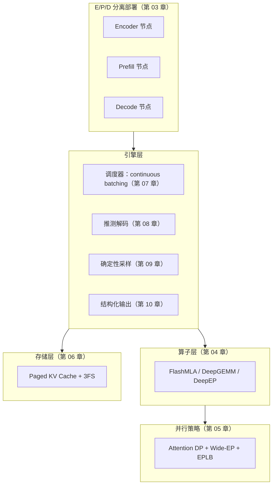

# 01 总览：推理框架是什么

这一章回答三个问题：推理框架到底是个什么东西、它为什么必须存在（为什么不直接用 PyTorch）、DeepInfer 在这类框架里处于什么位置。读完它你应该能理解一件事：**大模型推理系统的全部复杂性，几乎都来自一个物理矛盾——生成每个 token 时，芯片需要的计算量很小，但需要搬运的数据量很大。** 后面所有章节（调度、KV Cache、分页、推测解码）都是在从不同角度缓解这个矛盾。

## 1. 从一次 API 调用说起

你平时用网页版或 App 和大模型对话时，点一下「发送」，回答是一个字一个字蹦出来的。在这个体验背后，服务端发生的事情大致是：

1. 你的问题（一段文字）被**分词**（tokenization）成一串整数编号，称为 token；
2. 服务器上有一块或多块 GPU，显存里驻留着一整个模型的**权重**（几百 GB 量级的数字）；
3. 引擎把你的 token 序列喂给模型做一次前向计算，得到第一个输出 token；
4. 把刚输出的 token 拼回输入末尾，再做一次前向，得到第二个 token；
5. 如此循环，直到模型输出结束符（EOS）或达到长度上限；
6. 期间每生成一个 token，就推送给你的屏幕一次。

这个「一个 token 一个 token 往外蹦」的过程叫**自回归生成**，它是 Transformer 解码器的工作方式。注意第 3~5 步：**每生成一个 token，都要把整个模型完整地算一遍**。671B 参数的模型生成 1000 个 token，就要完整前向 1000 次。推理框架（inference engine）就是管理这个循环的软件系统：它决定什么时候算、算哪些请求、中间结果存在哪、显存不够了怎么办。

「推理」这个词对应的是「训练」：训练是用数据更新权重，推理是用固定权重产生输出。听起来推理是训练的简化版（不用算梯度），但实际上推理系统的工程难度不低反高。原因在下一节。

## 2. 训练和推理，在系统层面差在哪

训练像一场批处理作业：几万亿 token 的数据集，分批喂进去，梯度算出来，权重更新，跑完整个数据集就结束。整个过程中每一步的计算形状几乎不变——矩阵尺寸固定、batch 大小固定、算几个小时很正常。衡量它只有一个指标：**吞吐**（单位时间处理了多少 token）。

推理是一个**长驻服务**：请求随时到达，长短不一（有人问一句话，有人贴一整篇论文），生成到一半随时可能结束，而且要 7×24 小时扛住早晚高峰的流量波动。它的指标是三个：

- **TTFT**（Time To First Token，首 token 延迟）：从请求到达到你看到第一个字的等待时间。它主要由一次 prefill 计算（见下）决定，决定「响应快不快」的体感。
- **TPOT**（Time Per Output Token，每 token 延迟）：之后每个 token 的平均间隔，决定「打字速度」的体感。人眼觉得流畅大约需要每秒 20 token 以上。
- **吞吐**（throughput）：整台服务器每秒总共产出多少 token，决定成本——同样买 8 块 GPU，谁的吞吐高，谁每个 token 的成本就低。

这三者互相冲突（后面会反复看到：很多优化是拿吞吐换延迟，或反过来）。而训练没有这种权衡，它只要吞吐。

还有一个更深的差别：**显存里存的东西不一样**。训练时显存大头是激活值——反向传播需要把前向每一层的中间结果都留着。推理不需要反向，但需要另一样新东西：**KV Cache**。简单说，注意力计算需要「回看」序列中之前所有 token 的中间结果；既然算过的不会再变，就把它们缓存下来，避免每生成一个 token 都重算整个前缀。这个缓存随请求数和序列长度**线性增长**，管理它是推理框架最核心的状态机（第 06 章整章讲它）。

把这些差别列成表：

| 维度 | 训练 | 推理 |
|---|---|---|
| 形态 | 批处理作业，跑完即止 | 长驻服务，流量波动 |
| 指标 | 吞吐 | TTFT、TPOT、吞吐（三者相互牵制） |
| 显存大头 | 激活值（反向需要） | KV Cache（随请求与长度增长） |
| 计算形状 | 固定的大矩阵 | 变长请求、动态组批 |

## 3. decode 为什么「喂不饱」芯片：算一笔账

这是本章的核心。这一节算的账，值得你拿计算器跟着验算一遍——它解释了后面十一章里几乎每一个设计为什么长成那样。

### 3.1 两个基本事实

**事实一：一个 token 的计算量其实很小。**

以 DeepSeek-V3/R1 为例（这两个是同一个基座，DeepInfer 主要服务的模型）：总参数 671B，但由于 MoE（混合专家）结构，每个 token 实际只激活约 37B 参数。前向一个 token 的计算量粗略等于「参数量 × 2」（一次乘法一次加法）：

$$
\text{计算量} \approx 2 \times 37\text{B} = 74 \text{ GFLOPs}
$$

而一块 H800 GPU 的 FP8 算力在 1000 TFLOPS 量级（$10^{15}$ FLOPs/s）。算一下时间：

$$
\frac{74 \times 10^9}{10^{15} \text{ FLOPs/s}} \approx 0.074 \text{ ms}
$$

也就是说，**纯计算只需要不到千分之一秒**。

**事实二：但要搬运的数据量很大。**

GPU 的计算单元本身不存数据，所有权重和缓存都在显存（HBM）里，算之前必须先搬过来。一个 token 的前向要激活 37B 参数，FP8 格式下每个参数 1 字节，就是 **37 GB**；此外还有该请求全部历史的 KV Cache 也要读（注意力要回看所有历史 token）。H800 的显存带宽是 3.35 TB/s。光读权重：

$$
\frac{37 \text{ GB}}{3.35 \text{ TB/s}} \approx 11 \text{ ms}
$$

### 3.2 矛盾出来了

把两个数放在一起：计算需要 0.074 ms，搬数据需要 11 ms。**芯片 99% 以上的时间在等数据从显存搬到计算单元，算力基本在空转。** 这个「计算量 / 搬运量」的比值叫**算术强度**（arithmetic intensity），单位是 FLOPs/byte。decode 阶段每个 token 只产出 1 个位置的计算，算术强度极低，这种负载在体系结构里叫**带宽受限**（memory-bound）；训练的大矩阵乘则是算力受限（compute-bound）。

这就是物理矛盾本身：**模型大到权重就读不完，而每个 token 需要的计算又少到不配这些读取。**

从这个矛盾出发，三大主线优化全部自然推出：

**组批（batching）：让一次读取服务多个 token。** 权重对同一层内所有 token 是共享的——batch 里 64 条请求各生成 1 个 token 时，这 64 个 token 可以拼成一个矩阵一起算，权重却只需读一次。batch=64 时，每个 token 摊到的权重读取成本降到 1/64，等效算力利用率翻 64 倍。所以推理框架一定要做**连续组批**（continuous batching，第 07 章）：每个 decode step 都重新组一次批，请求随到随入、生成完随走随出，尽量把 batch 拼大。这和训练「拼大 batch 提吞吐」形似，但目的相反——训练是让计算饱和，推理是**让带宽饱和**。

**算子优化：让每一次搬运尽量不浪费。** 朴素实现的注意力里，中间结果（比如完整的注意力矩阵）会在显存里写了又读、读了又写，来回搬好几次。FlashMLA 这类算子（第 04 章）通过分块计算和寄存器内融合，把同一份数据的搬运次数压到理论下限——不是让搬运变快，而是**让同样的结果需要搬的次数变少**。

**推测解码：用闲置算力换带宽。** 芯片算力本来就闲着 99%，那不如每步先让一个小的 draft 模型猜后面 4 个 token，再用大模型一次前向**同时验证**这 4 个（一次权重读取摊给 4 个 token，就像 batch=4）。猜对 3 个，这一步就白赚 3 个 token（第 08 章）。

 !!! tip "把这一节刻进脑子"

     每当你后面读到某个设计看不懂时，回到这里问一句：**它在减少搬运量，还是在增加单次搬运的产出？** 答案几乎总是二者之一。

## 4. 为什么不直接用 PyTorch

初学者的自然疑问：PyTorch 能做前向，为什么不包一层 HTTP 服务直接上？答案是能跑，但每一项生产需求都要自己重造。关键的四块：

**第一，迭代级调度。** PyTorch 的世界观是「一个进程算一个任务」，`DataLoader` 按 epoch 批量喂数据。而推理需要**每个 decode step（毫秒级）都重新决定**这一批算哪些请求：新到的要不要插进来？生成完的怎么摘出去？显存不够了抢谁的？这个粒度的调度 PyTorch 完全没有对应抽象。

**第二，KV Cache 生命周期管理。** KV Cache 是推理最大的显存开销，必须分页存储（不然长请求把显存切碎）、前缀共享（同 system prompt 的请求复用同一段缓存）、及时逐出（请求结束立刻回收）。这是一套独立于 PyTorch 的、带引用计数的存储系统（第 06 章）。

**第三，CPU 与 GPU 的流水线。** 调度决策在 CPU 上做，前向在 GPU 上算。如果调度完再算、算完再调度，GPU 每步都空等一段 CPU 时间。必须让两者重叠（CPU 组下一批的同时 GPU 算当前批），这要求引擎同时掌握两边的进度状态（第 07 章的异步引擎）。

**第四，专用算子。** DeepSeek 的 MLA 注意力和 MoE 通信结构特殊，通用 kernel 库（cuBLAS、FlashAttention）的显存布局和性能都不适配，需要 FlashMLA、DeepEP 这样的自研算子（第 04 章）。这些算子直接管理显存分配和线程调度，在 PyTorch 的算子抽象之外。

vLLM、SGLang、DeepInfer 这些框架，本质上都是在 PyTorch（或绕开它）之上补这四块。补的方式各有侧重，这就引出了下一节。

## 5. DeepInfer 在生态中的位置

开源推理框架里最有名的三个：

| | vLLM | SGLang | DeepInfer |
|---|---|---|---|
| 出身 | 伯克利 / 社区 | LMSYS | DeepSeek 自家线上服务 |
| 定位 | 通用引擎，什么模型都跑 | 通用引擎 + 前端 DSL | 为 DeepSeek 系模型量身定制 |
| 算子 | 用 FlashAttention 等现成库 | 现成库 + 部分自研 | FlashMLA / DeepGEMM / DeepEP 全自研 |
| KV 管理 | PagedAttention（显存分页） | RadixAttention（前缀树复用） | 分页 + 3FS 分布式持久化 |
| 部署形态 | 单机为主 | 单机/小集群 | E/P/D 物理分离的大集群 |

前两家是「引擎适配模型」：拿到一个新模型结构，想办法在通用框架里高效跑它。DeepInfer 是反过来——**写引擎的人就是写模型的人**。这带来一个别人复制不了的机制：模型结构和引擎算子在同一場设计里互相成就。MLA（模型侧）把 KV Cache 压缩到传统注意力的几分之一，同时天然适合做成 FlashMLA 算子（引擎侧）的规整分块；MoE 的路由稀疏性（模型侧）催生了 DeepEP 的通信算子（引擎侧）。每一代模型的架构改动，都直接兑现成引擎里对应的新算子。

代价是通用性差：DeepInfer 不以「跑万种模型」为目标，它只为把 DeepSeek 系模型的服务成本压到极限。作为教学项目，这反而是优点——目标单一，每个设计都能讲出明确动机。

!!! note "开源范围"

    DeepInfer 开源了引擎主体与算子库，但 **KV cache 管理与负载均衡组件未随仓发布**。本套文档涉及这两块时，基于公开行为和 vLLM 谱系的通用做法推断，均会标注「推测」。

## 6. 一张地图

全书的结构如下。集群层决定「机器怎么分工」，引擎层决定「每个循环做什么决策」，算子层决定「每次计算怎么省带宽」，存储层决定「状态放哪、活多久」：

每章末尾会链接对应的 **miniflow 教学实现**——一个 Python + NumPy 的迷你引擎，把这些机制在 CPU 上跑起来、测起来。读懂原理和亲手写出行为，是两种牢固程度。

---

| 上一章 | 下一章 |
|---|---|
| — | [02 三大设计目标](02-goals.md) |