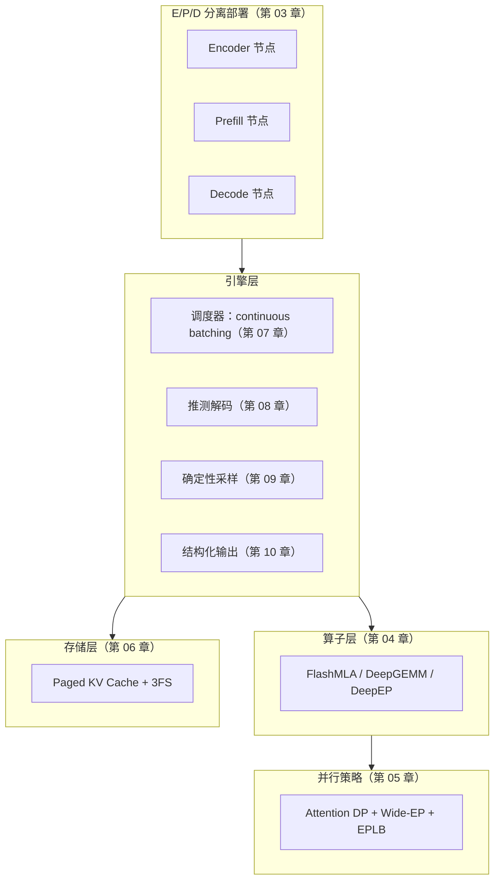

# 01 总览：推理框架是什么

这一章回答三个问题：推理框架到底是个什么东西、它为什么必须存在（为什么不直接用 PyTorch）、DeepInfer 在这类框架里处于什么位置。读完它你应该能理解一件事：**大模型推理系统的全部复杂性，几乎都来自一个物理矛盾——生成每个 token 时，芯片需要的计算量很小，但需要搬运的数据量很大。** 后面所有章节（调度、KV Cache、分页、推测解码）都是在从不同角度缓解这个矛盾。

这一章会算几笔具体的账。强烈建议你拿计算器跟着验算——这些数字不是装饰，它们是全书所有设计的出发点。如果只读一章，就读这章。

读完本章，你应该能不假思索地回答这些问题：

- 一条请求从点发送到看见第一个字，中间经过了哪几段？
- 训练和推理在系统层面的四个本质差异是什么？
- 为什么说 decode 是带宽受限？算术强度 2 FLOPs/byte 这个数怎么来的？
- 组批、算子优化、推测解码分别从哪个方向缓解这个矛盾？
- DeepInfer 和 vLLM/SGLang 的根本差异在哪？

## 1. 从一次 API 调用说起

你平时用网页版或 App 和大模型对话时，点一下「发送」，回答是一个字一个字蹦出来的。这个「打字机效果」不是前端做给你看的动画，而是服务端真实的工作节奏：模型真的是一次算出一个词元，一个一个往外发的。在这个体验背后，服务端发生的事情大致是：

1. 你的问题（一段文字）被**分词**（tokenization）成一串整数编号，称为 token；
2. 服务器上有一块或多块 GPU，显存里驻留着一整个模型的**权重**（几百 GB 量级的数字）；
3. 引擎把你的 token 序列喂给模型做一次前向计算，得到第一个输出 token；
4. 把刚输出的 token 拼回输入末尾，再做一次前向，得到第二个 token；
5. 如此循环，直到模型输出结束符（EOS）或达到长度上限；
6. 期间每生成一个 token，就推送给你的屏幕一次。

这六步里每一步都值得展开。我们先解决两个名词：token 和权重。

### 1.1 token：模型眼中的文字

模型不直接处理文字，它处理整数。分词器（tokenizer）把文本切成一小段一小段，每一段对应词表里的一个编号。切分的单位就是 token。

英文里一个 token 大约是 0.75 个单词：常见词整词一个 token（`the`、`low`），生僻词拆成几段（`tokenization` 可能是 `token` + `ization`）。中文里一个 token 大约是 0.5~0.6 个汉字：常用字一个 token，高频词可能整词一个（`北京`），不常用的字会被拆成字节片段再拼。

切分算法的主流叫 **BPE**（Byte Pair Encoding，字节对编码）：预先在语料上统计出「哪些字符对经常连着出现」，把高频对合并成一个新符号，反复迭代。比如英文 `low`、`lower`、`lowest` 共享前缀 `low`，BPE 学到 `l+o→lo`、`lo+w→low`，于是 `lowest` 会被切成 `low` + `est` 两个 token，而不是五个单字符。

这样「低层拼写规律」（前缀、后缀、常见字）被编码进 token 本身，模型不用从字符学拼写。

一个关键直觉：**token 是模型的最小处理单位，也是计费单位、限流单位、和后面所有性能计算的原子**。我们说「每秒 20 token」「KV Cache 每层每 token 占多少字节」「调度器每个 step 产出多少 token」——全书的所有速率、容量、成本，都以 token 计。所以开篇就把这个单位立起来。

至于「为什么不等生成完整句子再一次性返回」——因为体验。人类对首字等待极其敏感：

- 1 秒内出现第一个字、之后匀速往外蹦，体感是「流畅」；
- 等 10 秒后一次性甩出一整段，体感是「卡」，哪怕总时间一样。

自回归生成天然支持流式输出，这是产品形态，也是后面 TTFT/TPOT 两个指标存在的原因。

### 1.2 权重：几百 GB 的数字从哪来

你下载一个模型，下载的就是权重——一个巨大的数字表格。DeepSeek-V3/R1 有 671B（6710 亿）个参数，每个参数就是一个数字（训练定下来的、推理时不再改变）。以 FP8 格式存储（每个数字 1 字节）就是约 671 GB。

参数在模型里被组织成一层一层的**矩阵**（matrix，二维数字表格）：Transformer 模型有几十层（DeepSeek-V3 是 61 层），每层里有注意力模块和前馈模块，每个模块由若干个大矩阵构成。

前向计算（forward pass）就是：输入一个向量，逐层地跟这些矩阵做**矩阵乘法**（每输出一个元素 = 一行与一列对应相乘再求和），再经过一些逐元素运算（激活函数），最后从十几万条候选 token 里产出一个概率分布。

第一次接触不用怕细节，这里只需要建立一个画面：**推理 = 依次读取一大堆矩阵 + 做乘加**。记住这个画面，第 3 节算账时会直接用到。

权重还有个性质：**读进来一次，用一次乘法，就用完了**。算第 100 个 token 用的权重，和算第 1 个 token 用的是同一批（权重不变）。这跟「数据在缓存里越久越划算」的传统直觉相反，是后面一切麻烦的伏笔。

### 1.3 自回归：一个具体的走查

「把输出拼回输入再算一遍」的循环叫**自回归生成**（autoregressive generation），它是 Transformer 解码器的工作方式。用一个最小例子走一遍。假设词表很小，你问「法国的首都是」，分词成 4 个 token：`法国` `的` `首都` `是`。

| 步骤 | 输入（已确定的 token） | 模型要预测的位置 | 输出 | 说明 |
|---|---|---|---|---|
| 1 | 法国 的 首都 是 | 第 5 个 | `巴黎` | 读完整个问题，预测下一个词 |
| 2 | 法国 的 首都 是 巴黎 | 第 6 个 | `。` | 把「巴黎」拼回去，再整体算一遍 |
| 3 | 法国 的 首都 是 巴黎 。 | 第 7 个 | EOS | 输出结束符，生成停止 |

注意一个容易忽略的事实：**第 2 步若不复用第 1 步的任何计算结果，「法国的首都是」这 4 个 token 对应的所有层、所有中间结果，全部要重算一遍**。序列越长，这种重算浪费越大。

如果一次问答有 1000 个输入 token、输出 200 个 token，朴素做法的总计算量相当于把「1000~1200 长度的序列」完整算了约 200 遍。解决这个浪费的手段就是 KV Cache——它是什么、多大、怎么管，是第 06 章的主线，本章 2.4 节先给直觉。

**每生成一个 token，都要把整个模型完整地算一遍**——哪怕用上 KV Cache（它只省「重算历史」，不省「读权重」），生成 200 个 token 仍要完整前向 200 次。671B 参数的模型生成 1000 个 token，就是 1000 次完整前向。这个「重复读同一个模型」的模式，直接决定了第 3 节的账。

### 1.4 推理框架：管这个循环的软件系统

现在可以给主角下定义了。**推理框架（inference engine）就是管理上述循环的软件系统**，它至少管五件事：

- **什么时候算**（调度：每个 step 组哪些请求）；
- **算哪些请求**（组批：batch 的构成与更替）；
- **中间结果存在哪**（KV Cache 的布局与复用）；
- **显存不够了怎么办**（换出、逐出、抢占）；
- **多个 GPU 怎么分工**（并行策略与通信）。

「推理」这个词对应的是「训练」：训练是用数据更新权重，推理是用固定权重产生输出。听起来推理是训练的简化版——不用算梯度、不用存激活、数据不用跑多轮。但实际上推理系统的工程难度不低反高。原因在下一节，而它的物理根源在第 3 节。

还有个容易混淆的层次要分清：**推理框架 ≠ 推理服务**。你调用的 API 服务 = 网关层（鉴权、计费、限流）+ 推理框架（本书主角）+ 运维层（监控、发布、容量管理）。本书聚焦中间层，但第 11 章会把三层拼起来讲完整的部署配方。

### 1.5 一次请求的完整时间线

把「点发送到看见第一个字」的等待拆开，各段大致是这样的（以长 1000 token 的提问、并发适中的集群为例）：

| 阶段 | 耗时量级 | 干什么 | 主要瓶颈 |
|---|---|---|---|
| 网络往返 | 10~100 ms | 请求到达服务集群 | 物理距离 |
| 排队 | 0~1000+ ms | 等调度器把你编入某个 batch | 集群负载 |
| prefill | 100~1000 ms | 一次性并行算完你的 1000 token 输入 | 算力（见 3.6） |
| 首个 decode step | 10~50 ms | 算出第 1 个输出 token | 带宽（见 3.3） |
| 流式回传 | 10~100 ms | 网络推送到屏幕 | 网络 |

注意两件事：一是**排队时间可能比计算时间还长**——低峰期趋近于零，高峰期可能吞掉整个体验，这是调度器（第 07 章）存在的第一理由；二是 **prefill 和 decode 是两种性格完全不同的计算**（3.6 节会算它们的账），这种「人格分裂」最终导致了 DeepInfer 把它们物理分离到不同机器（第 03 章的主线）。

## 2. 训练和推理，在系统层面差在哪

### 2.1 训练的样子

训练像一场批处理作业：几万亿 token 的数据集，分批（batch）喂进去，前向算出预测、和标准答案比较得到误差、反向传播算出每个参数的梯度、优化器更新权重，然后下一批。整个过程中每一步的计算形状几乎不变：

- 矩阵尺寸固定（模型结构定了）；
- batch 大小固定（人为设定，动它会影响收敛）；
- 一个作业跑几个小时到几十天很正常。

衡量训练只需要一个指标：**吞吐**（throughput，单位时间处理了多少 token）。训练没有「用户在等」，快就是好，慢就是贵，仅此而已。所以训练系统的一切优化——大 batch、梯度累积、流水线并行——都是围绕吞吐的单一目标展开。

### 2.2 推理的样子：三个指标

推理是一个**长驻服务**（daemon）：请求随时到达，长短不一（有人问一句话，有人贴一整篇论文），生成到一半随时可能结束（用户点了停止），而且要 7×24 小时扛住早晚高峰的流量波动。它的指标是三个：

**TTFT**（Time To First Token，首 token 延迟）：从请求到达到你看到第一个字的等待时间。它主要由一次 prefill 计算决定——把你的整个输入（可能几百到几万个 token）一次性并行算完的那一步。TTFT 决定「响应快不快」的体感：网页对话产品里 TTFT 超过 2 秒，用户就开始怀疑断网了。

**TPOT**（Time Per Output Token，每 token 平均间隔）：首 token 之后，后续 token 的平均间隔，单位毫秒。它决定「打字速度」的体感。换算成出字速度感受一下：

| TPOT | 出字速度 | 体感 |
|---|---|---|
| 25 ms | 40 token/s | 接近快速阅读，非常流畅 |
| 50 ms | 20 token/s | 流畅（人眼舒适下限） |
| 100 ms | 10 token/s | 明显「一个词一个词往外挤」 |
| 200 ms | 5 token/s | 等待感强烈 |

TPOT 由 decode 阶段每个 step 的耗时决定，而 decode 的耗时主要被显存带宽卡住（第 3 节的账）。

**吞吐**（throughput）：整台服务器每秒总共产出多少 token（把所有并发请求的产出加起来）。它决定成本——同样买 8 块 GPU，谁的吞吐高，谁每个 token 的服务成本就低。对服务商来说这是生死指标：GPU 按小时租，token 按百万个卖。

### 2.3 三个指标为什么互相打架

直觉上你会想「都优化不就行了」。问题在于同一份硬件，优化方向常常相反。看一个具体例子：

把 batch 从 1 提到 64（同时服务 64 条请求）。权重只需读一次就能算 64 个 token，每 token 摊到的读取成本降到 1/64，GPU 的有效产出大约涨几十倍——**吞吐大幅上升**。

但代价是：

- 64 条请求的中间结果要一起算、一起搬，每个 step 的耗时变长了（原来算 1 条约 11 ms，现在算 64 条可能要 13~15 ms——虽然远不到 64 倍，但确实变长）；
- 新到的请求要等当前批腾出位置，**TTFT 变差**；
- **TPOT 也变差**：每条请求的两个 token 间隔从 11 ms 变成 15 ms。

用户体感从「专属打字员」变成「食堂打饭窗口」。

反过来，batch = 1 跑：每条请求独享节奏，TPOT 最优，但权重读取完全没有分摊，**一张几万块的 GPU 99% 的算力和大部分带宽在空转，成本高到没法卖**。

所以推理框架的核心日常是**走钢丝**：在延迟指标（TTFT/TPOT）和吞吐之间找当前流量下的最优平衡点，而且流量在变，平衡点也在变——这就是调度器（第 07 章）存在的意义。训练没有这种权衡。

### 2.4 显存里存的东西也不一样

还有一个更深的差别：**显存里驻留的东西不同**。

训练时显存大头是**激活值**（activation）：反向传播需要把前向每一层、每个中间结果都留着（算梯度要用），序列越长 batch 越大，激活值越多。训练完一个 batch 就可以扔掉，换下一个 batch。

推理不需要反向，激活值可以随算随扔，但需要另一样新东西：**KV Cache**。回忆 1.3 的走查：注意力机制要求每个 token「回看」序列里之前所有 token 的中间表示（Key 和 Value 两个向量，故称 KV）。既然历史 token 的 KV 不会再变（权重不变、输入不变），就把它们缓存下来，每生成一个新 token 只算新位置、旧位置直接读缓存。

KV Cache 省的是「重算历史」，代价是显存——它随序列长度线性增长。一条 10 万 token 的长请求，仅 KV Cache 就可能占掉几十 GB（第 06 章会精确计算；DeepSeek 的 MLA 结构能压到几分之一，这正是第 04 章的内容）。

于是推理服务的显存预算是个三元挤压：

```text
总显存 = 模型权重（固定大头）
       + KV Cache（变动大头，决定并发上限）
       + 激活/临时缓冲（小头，batch 越大越大）
```

能同时服务多少条请求（并发度，直接决定吞吐上限），几乎完全等于「权重之外还剩多少显存给 KV Cache」。这就是为什么 KV Cache 的压缩（MLA）、分页（PagedAttention）、持久化（3FS）在推理框架里是主角中的主角。

把这些差别列成表：

| 维度 | 训练 | 推理 |
|---|---|---|
| 形态 | 批处理作业，跑完即止 | 长驻服务，流量随时波动 |
| 指标 | 吞吐（单一） | TTFT、TPOT、吞吐（三者相互牵制） |
| 显存大头 | 激活值（反向需要，批结束即扔） | KV Cache（随请求与长度线性增长） |
| 计算形状 | 固定的大矩阵 | 变长请求、动态组批、毫秒级调度 |
| 数据访问模式 | 同一批权重反复算几十遍 epoch | 同一批权重被成千上万请求持续读取 |
| 停机代价 | 重启作业，损失可控 | 服务中断，直接影响全部在线用户 |

### 2.5 延迟的统计学：为什么看 P99 不看平均

「平均延迟 500 ms」是一句几乎无用的描述。真实延迟是长尾分布：大部分请求很快，少数请求慢得离谱。工程上用**分位数**描述：

- **P50**：一半的请求比这个数快（中位数）；
- **P99**：99% 的请求比这个数快；
- **P999**：千分之一的请求比这个数还慢——最尾部的那个点。

为什么尾部重要？算一笔账：一次复杂的 agent 调用链可能串 50 次 LLM 请求。假设每次请求 1% 概率掉进慢速尾部，那么整条链 50 次里至少一次掉尾部的概率是 $1-0.99^{50} \approx 40\%$——**几乎每两三次调用就有一次体感卡顿**，哪怕 P50 好看得不得了。串得越长，尾部越主导体验。

推理系统里尾部延迟的来源很有自己的特色，每一条后面都有专章：

- 长请求挤占 batch（prefill 一个 32K token 的文档时，同批的短请求都在等）→ 第 03 章 P/D 分离；
- KV Cache 显存紧张时的换页/抢占瞬间 → 第 06/07 章；
- MoE 路由不均导致的个别 GPU 热点 → 第 05 章 EPLB；
- 偶发的网络/存储抖动 → 第 03 章 3FS。

所以后面章节里出现「为 1% 的请求做 30% 的优化工作」不要惊讶——**服务等级目标（SLO，Service Level Objective）通常就是按 P99 或 P999 定的**，比如「P99 TTFT < 2 s，P99 TPOT < 100 ms」。第 02 章会把 SLO 数字定出来。

### 2.6 Little 定律：并发、延迟、吞吐的铁三角

在进入硬件账本之前，先补一条排队论的铁律，它是后面所有容量规划的地基。

**Little 定律**（Little's Law）：对一个稳定系统，有

$$
\text{平均并发数 } L = \text{到达率 } \lambda \times \text{平均时延 } W
$$

放到推理服务的语言里：**同时在服务的请求数 = 每秒新到请求数 × 每条请求的平均耗时**。

用一个数字例子体会它的威力。假设每条请求平均「prefill + 生成 500 token」总耗时 25 秒，目标服务 100 QPS（每秒 100 条新请求）：

$$
L = 100 \text{/s} \times 25 \text{ s} = 2500 \text{ 条并发请求}
$$

2500 条并发！每条的 KV Cache 按 1 GB 算就是 2.5 TB 的 KV 状态——单机显存完全不可能，这就是为什么大流量服务必然走向集群、走向 P/D 分离、走向 3FS 这种分布式 KV 存储（全部在第 03 章）。反过来，如果能把平均时延压到 10 秒（比如推测解码把生成提速 2 倍），同样 100 QPS 只需要 1000 并发，集群压力立刻减半——**降延迟和省容量是同一件事的两面**。

Little 定律还会在第 07 章调度器和第 11 章容量规划里反复出现。现在你只需要记住：并发、到达率、时延，三者被一条恒等式锁死，动一个必须动另一个。

## 3. decode 为什么「喂不饱」芯片：算一笔账

这是本章的核心。这一节算的账，值得你拿计算器跟着验算一遍——它解释了后面十一章里几乎每一个设计为什么长成那样。

### 3.1 预备知识：芯片的两级数字

要看懂这笔账，需要先知道 GPU 的两个性能参数，以及一个存储结构的事实。

**算力**：单位时间能完成的浮点运算次数，单位 FLOPS（FLoating-point OPerations per Second）。一块 NVIDIA H800 GPU 做 FP8 矩阵乘的峰值算力约 1000 TFLOPS，即每秒 $10^{15}$（一千万亿）次浮点运算。

「一次浮点运算」指一次乘法或一次加法。一次乘加（乘一次再加一次，是最常见的成对操作）算 2 FLOPs。

**带宽**：单位时间能从显存搬多少字节到计算单元，单位 TB/s。H800 的显存带宽约 3.35 TB/s，即每秒 3350 GB。

**存储层次**：GPU 的计算单元（ALU）本身不存数据。离它最近的是寄存器和 SRAM（片上共享内存，几十 KB~几十 MB 量级，快但极小），再往外才是显存 HBM（High Bandwidth Memory，High Bandwidth Memory，几十~上百 GB，慢两个数量级但大）。

计算要用的每一个数字，最终都要从 HBM 搬进来。**「算力」和「带宽」描述的是这条搬运流水线两端的速率**：带宽是入口的闸门速率，算力是出口的加工速率。两个速率差着两个数量级（3350 GB/s 进货，对应 $10^{15}$ 次加工），就注定了「进什么货」决定了「出多少活」。

FP8 是什么：一种用 8 个比特（1 字节）存一个浮点数的格式。精度比常见的 FP16（2 字节）、FP32（4 字节）低，但存储和搬运量减半再减半，算力还翻倍。大模型推理大量用 FP8 甚至 FP4，是因为推理不需要反向传播的精细梯度，低精度「够用且便宜」。DeepInfer 的权重按 FP8 存储，所以下面算账按 1 字节/参数计。

### 3.2 事实一：一个 token 的计算量其实很小

以 DeepSeek-V3/R1 为例（这两个是同一个基座，DeepInfer 主要服务的模型）：总参数 671B，但由于 **MoE**（Mixture of Experts，混合专家）结构，每个 token 实际只激活约 37B 参数。

MoE 简单说就是「分工的门诊制」：

- 模型每一层的前馈部分不是一个巨大矩阵，而是并排放着 256 个中等大小的「专家」矩阵；
- 外加一个很小的「路由器」（router）矩阵；
- 每个 token 到来，路由器先打个分，选出最匹配的 8 个专家，token 只进这 8 个门诊。

参数总量 671B，但单个 token 每层只过 8/256 的专家，全模型折算下来每 token 实际读约 37B 参数。**参数多 ≠ 每个 token 都要读全部参数**——这是 MoE 用「容量」换「速度」的机制，也是接下来算账的关键折扣。

前向一个 token 的计算量粗略等于「激活参数量 × 2」（每个参数参与一次乘法和一次加法）：

$$
\text{计算量} \approx 2 \times 37\text{B} = 74 \text{ GFLOPs}
$$

一块 H800 的 FP8 算力约 $10^{15}$ FLOPs/s。算一下时间：

$$
\frac{74 \times 10^9 \text{ FLOPs}}{10^{15} \text{ FLOPs/s}} \approx 0.074 \text{ ms}
$$

也就是说，**纯计算只需要不到千分之一秒**。如果芯片的理想是「数据已经在寄存器里等着」，那么生成一个 token 比人眨一次眼（约 100 ms）快一千多倍。但现实不是这样，因为——

### 3.3 事实二：但要搬运的数据量很大

计算单元不存数据，所有权重都在 HBM 里，用之前必须先搬。一个 token 的前向要搬运的东西有两份：

**第一份：权重。** 激活 37B 参数，FP8 格式每个参数 1 字节，就是 **37 GB**。

**第二份：KV Cache。** 该请求全部历史的 KV 也要读（注意力要回看所有历史 token，2.4 讲过）。这条请求聊了 2000 个 token 的话，按传统注意力结构这又是几百 MB~GB 级的量；DeepSeek 的 MLA 压缩能把它压到几分之一（第 06 章精确算）。这里先忽略它，只看权重这一份。

H800 的显存带宽 3.35 TB/s。光读权重：

$$
\frac{37 \text{ GB}}{3.35 \text{ TB/s}} = \frac{37}{3350} \text{ s} \approx 11 \text{ ms}
$$

11 ms 比刚才的 0.074 ms 长约 150 倍。就算把 KV Cache、路由、通信全部忽略，**单个 token 的生成速度也被钉死在约 11 ms/token，即每秒约 90 token 的理论上限**——而且这是 batch=1 独占、一切理想化的情形。

什么都没「算慢」，纯粹是搬不过来。

一个佐证：DeepSeek 官方披露的线上服务数据里，单条请求的 decode 速度量级正是几十 token/s。理论和现实对上了。

还要注意 KV 那份的走向和权重不同：**权重是所有请求共享的（读一遍服务全 batch），KV 是每条请求私有的（各读各的）**。这个差别决定了两份数据的优化路径完全不同——权重侧的优化是「摊」（组批、并行切分），KV 侧的优化是「省」（压缩、分页、复用）。第 05 章的并行策略会让 attention 权重部分和 KV 部分走不同的切分路线，根源就在这里。

### 3.4 矛盾的本质：算术强度

把两个数放在一起：计算需要 0.074 ms，搬数据需要 11 ms。**芯片 99% 以上的时间在等数据从显存搬到计算单元，算力基本在空转。**

这个「计算量 / 搬运量」的比值有个名字：**算术强度**（arithmetic intensity），单位 FLOPs/byte。算一下当前的情形：

$$
\text{AI} = \frac{74 \text{ GFLOPs}}{37 \text{ GB}} = \frac{74 \times 10^9}{37 \times 10^9} = 2 \text{ FLOPs/byte}
$$

每个字节搬进来只做 2 次浮点运算。

而让 H800「算力和带宽同时打满」的平衡点是：

$$
\text{平衡点} = \frac{\text{算力}}{\text{带宽}} = \frac{10^{15} \text{ FLOPs/s}}{3.35 \times 10^{12} \text{ bytes/s}} \approx 300 \text{ FLOPs/byte}
$$

2 远小于 300——这种负载在体系结构里叫**带宽受限**（memory-bound）：加算力无用（算力本来就闲着），加带宽立竿践影。

对比一下其他工作负载的算术强度，你会看到 decode 有多特殊。训练/预填充做大矩阵乘：$4096 \times 4096$ 的矩阵乘一个 $4096 \times 4096$ 的矩阵：

- 计算量 $2 \times 4096^3 \approx 137 \text{ GFLOPs}$；
- 搬运量 $3 \times 4096^2 \times 2\text{B} \approx 100 \text{ MB}$；
- 算术强度约 1370 FLOPs/byte——是 decode 的近 700 倍。

妥妥的**算力受限**（compute-bound）。同一块芯片，同一份代码栈，训练时在拼算力，decode 时在拼带宽。这就是为什么「训练跑得好好的，一到服务就全是新问题」。

（这个分析框架来自经典的 **Roofline 模型**：把芯片画成一个屋顶，横轴算术强度、纵轴实际达成的 FLOPS，屋顶的「屋脊转折点」就是算力÷带宽。工作负载落在屋顶左侧斜坡 = 带宽受限，右侧平台 = 算力受限。decode 落在最左边的墙根下，训练落在右侧平台上。）

### 3.5 矛盾的三个推论

物理矛盾本身说完了：**模型大到权重就读不完，而每个 token 需要的计算又少到不配这些读取。** 现在从这个矛盾出发，把全书三大主线优化全部推出来——注意，是「推出」不是「介绍」：每一条都是这个不等式的直接代数后果。

**推论一：组批（batching）——让一次读取服务多个 token。**

权重对同一层内所有 token 是共享的：batch 里 64 条请求各生成 1 个 token 时，这 64 个 token 拼成一个矩阵一起算，**权重却只需读一次**。

搬一下账：

| | batch=1 | batch=64 |
|---|---|---|
| 搬运量 | 37 GB | 37 GB（不变） |
| 计算量 | 74 GFLOPs | 4.7 TFLOPs（×64） |
| 算术强度 | 2 FLOPs/B | 128 FLOPs/B |
| step 耗时 | ~11 ms | ~13 ms（略增，受 KV 搬运影响） |
| 每 token 摊销 | 11 ms | **0.2 ms** |
| 等效产出 | 90 token/s | **4900 token/s** |

搬运量没变，计算量涨了 64 倍，算术强度从 2 涨到 128——离平衡点 300 只差一步了。每 token 摊到 0.2 ms，等效速度跳了 50 倍以上。

这就是推理框架一定要做**连续组批**（continuous batching）的原因（第 07 章）：每个 decode step（毫秒级）都重新组一次批，请求随到随入、生成完随走随出，尽量把 batch 拼大。

值得多说一句「连续」二字的分量。组批的朴素做法叫**静态批**（static batching）：攒够一批一起进、全部生成完一起出——就像拼车，人齐发车、到齐各自到家。问题在「到齐」：一批 8 条请求，输出长度注定参差，最短的 50 token 就生成完了，但它必须坐在车里等最长的那条跑完 800 token 才能下车。

算一笔静态批的浪费：假设 8 条请求的输出长度分别是 50、100、200、300、400、500、600、800（平均 369）。全部跑完需要 800 步，但 8 条请求实际只需要 $369 \times 8 \approx 2950$ 个 token 位置，静态批却算出了 $800 \times 8 = 6400$ 个位置——**54% 的算力和带宽花在了已经完成的请求的「空座位」上**。输出长度越参差，浪费越大，而真实流量恰恰极其参差。

连续组批把「座位」变成每站可上下车的流动座位：某条请求生成完，这个 step 结束立刻下车、座位马上让给等着的请求。同样的流量，GPU 时间几乎全花在真实产出上。这一改的代价是调度的复杂度暴涨（每个 step 都要重算批的构成、迁移 KV 指针），这就是第 07 章整章的篇幅来源。

它和训练「拼大 batch 提吞吐」形似，但目的相反——**训练是让计算饱和，推理是让带宽饱和**。训练的 batch 受显存和收敛性约束，有天然上限；推理的 batch 上限由「KV Cache 还剩多少显存」决定（64 条请求的 KV Cache 可能又是几十 GB），这正是 2.4 说的三元挤压，也是第 06/07 章的战场。

顺带解释一个怪现象：**为什么推理服务的利用率曲线是「越忙越便宜」**。夜里流量低谷 batch=4，每 token 成本是白天的 16 倍——硬件折旧按时间算，产出却按 batch 摊。所以商用推理服务都在拼命「填谷」（聚合多租户流量、离线任务挪到夜间），本质都是在救这个不等式。

**推论二：算子优化——让每一次搬运尽量不浪费。**

朴素实现的注意力里，中间结果（比如完整的注意力分数矩阵）会在显存里写了又读、读了又写，来回搬好几次。对一个 4 KB 的数据块，多写一次再读一次，就是 8 KB 的无谓流量——在 2 FLOPs/byte 的世界里，每一字节浪费都是实打实的延迟。

FlashMLA 这类算子（第 04 章）通过分块计算和寄存器内融合，把同一份数据的搬运次数压到理论下限——**不是让搬运变快，而是让同样的结果需要搬的次数变少**。带宽是固定物理量，优化的是「流量」不是「流速」。

一个数字感受：标准注意力在长序列下，注意力矩阵本身 $O(L^2)$ 个元素、逐个写回显存再读回，流量是序列长度的平方级；分块融合后中间结果不落显存，流量回到线性级。1 万 token 的序列，流量差好几个数量级。

**推论三：推测解码（speculative decoding）——用闲置算力换带宽。**

芯片算力本来就闲着 99%（算术强度 2 vs 平衡点 300，大量 ALU 时间空转）。那不如换个思路：

- 每步先让一个小的 draft 模型（参数量零头，读得快）猜后面 4 个 token；
- 再用大模型一次前向**同时验证**这 4 个——一次权重读取摊给 4 个 token 的位置，效果就像 batch=4；
- 猜对 3 个，这一步就白赚 3 个 token；猜错就从第一个错的位置重来，损失有限。

第 08 章会展开它的数学（怎么验证才不改变输出分布——这不是显然的，搞错了会悄悄改变模型行为）和 DeepInfer 的 MTP 方案（draft 不是外部小模型，是主模型自带的预测头）。

!!! tip "把这一节刻进脑子"

    每当你后面读到某个设计看不懂时，回到这里问一句：**它在减少搬运量，还是在增加单次搬运的产出？** 答案几乎总是二者之一。组批增加产出，算子优化减少搬运，推测解码用闲置算力增加产出，KV Cache 分页减少碎片浪费，并行策略把搬运分摊到多块卡……全书没有第三个方向。

### 3.6 prefill 的账：同一个模型的两种性格

前面只算了 decode。prefill（把输入一次性算完的那步）的账完全不同，值得对照算一遍——这个对照是第 03 章「P/D 分离」的全部动机。

prefill 时，输入的 1000 个 token **互相之间没有依赖**（它们都是已知的），可以整批并行算：

- 计算量：$1000 \times 74 \text{ GFLOPs} \approx 74 \text{ TFLOPs}$；
- 搬运量：权重 37 GB（读一遍，服务全部 1000 个位置）+ 少量 KV 写入；
- 算术强度：$\frac{74 \times 10^{12}}{37 \times 10^{9}} \approx 2000 \text{ FLOPs/byte}$。

2000 远超平衡点 300——**prefill 是算力受限的**：芯片火力全开，瓶颈在 ALU 的加工速度。按 1000 TFLOPS 打个七折（利用率 70%），74 TFLOPs 需要 0.1 s 左右。

把两种性格放一起：

| | decode | prefill |
|---|---|---|
| 算术强度 | 2 FLOPs/B | ~2000 FLOPs/B |
| 受限资源 | 显存带宽 | 算力 |
| 理想 batch | 越大越好（摊权重读取） | 已天然并行（整段输入一批算） |
| 单次耗时 | ~10 ms | ~100 ms~秒级 |
| 对延迟指标的影响 | TPOT | TTFT |

关键麻烦来了：**这两种计算塞在同一批、同一块卡上跑，会互相污染**。一批 decode 正匀速出字，忽然插入一个 32K token 的长 prefill——算力打满的 prefill 把 decode 的 step 从 10 ms 拖到几百 ms，用户那边正在输出的回答直接卡住半秒。反过来，为了保护 decode 而限制 prefill 的 batch，长输入请求的 TTFT 又会烂掉。

DeepInfer 的解法干脆利落：**物理分离**——prefill 交给专门的一批机器（P 节点，算力配置拉满），decode 交给另一批（D 节点，带宽/显存配置优先），中间用高速网络和 KV Cache 转移衔接。这是第 03 章的主线，那里会算「转移 10 GB KV 要多久、值不值」的账。

### 3.7 batch 的收益会饱和吗

组批的收益不是无限的，值得现在把曲线的形状说清楚（第 06/07 章会深入）。

batch 从 1 涨到 64：每 token 摊销从 11 ms 降到 0.2 ms，收益巨大。继续涨呢？三股反向力量逐渐抬头：

1. **KV Cache 搬运量线性增长**：64 条请求的历史 KV 要一起读，这部分的量开始和权重读取可比。step 耗时从「读权重的 11 ms」涨向「读权重 + 读全部 KV」。
2. **显存耗尽**：并发越大 KV Cache 越大，触顶后开始换页/抢占，吞吐不升反降（第 06 章的「尾巴浪费」）。
3. **算力触顶**：batch 大到某个点，算术强度过了平衡点 300，算力变成新瓶颈——此时再涨 batch 无收益。

所以吞吐曲线是「先陡升、后放缓、最后掉头」的形状，最优点在「KV 显存刚好用完」或「算力刚好打满」的较早到达者。**调度器的日常就是把自己维持在这个山顶附近**——流量涨了往右挪，长请求多了往左挪。第 07 章的全部细节，都是这张图上的走位。

## 4. 为什么不直接用 PyTorch

初学者的自然疑问：PyTorch 能做前向，`model.generate()` 一跑也能出字，为什么不包一层 HTTP 服务直接上线？答案是能跑，但每一项生产需求都要自己重造。关键的有四块：

**第一，迭代级调度。** PyTorch 的世界观是「一个进程算一个任务」：你给它一个 DataLoader，它按 epoch 批量喂数据，跑完拉倒。

而推理需要**每个 decode step（毫秒级）都重新决定**这一批算哪些请求：

- 新到的要不要插进来？
- 生成完的怎么摘出去？
- 显存不够了抢谁的（抢占）？
- 某条请求超时要不要终止？

这个粒度、这个动态性的调度，PyTorch 完全没有对应抽象——它的执行模型里根本没有「请求」这个概念。第 07 章的调度器就是为这个存在，你会发现它长得更像操作系统调度器而不是任何训练组件。

**第二，KV Cache 生命周期管理。** KV Cache 是推理最大的变动显存开销（2.4 节），必须精细经营：

- **分页存储**：不然一条长请求能把整块显存切碎成无法复用的碎片——外碎片问题，和操作系统内存管理同源；
- **前缀共享**：一百条请求用同一段 system prompt，就复用同一段缓存，不是存一百份；
- **及时逐出**：请求结束立刻回收，晚回收一秒就少服务若干条并发。

这是一套独立于 PyTorch 的、带引用计数的存储子系统（第 06 章）。PyTorch 的 cache 机制（如 autograd 图缓存）和它毫无关系。

**第三，CPU 与 GPU 的流水线。** 调度决策在 CPU 上做（组织 batch、搬运元数据），前向在 GPU 上算。如果调度完再算、算完再调度，GPU 每步都空等一段 CPU 时间——每 step 才几十毫秒，浪费 1~2 ms 就是几个百分点的吞吐。

必须让两者重叠：CPU 组下一批的同时 GPU 算当前批。这要求引擎同时掌握两边的进度状态、维护双缓冲的 batch 结构。PyTorch 的同步执行模型（每层前向都挡在 Python 解释器上）做不到这一点，第 07 章的异步引擎会拆解它怎么做到。

**第四，专用算子。** DeepSeek 的 MLA 注意力（KV Cache 的压缩形态，第 04/06 章详述）和 MoE 的跨卡通信（第 05 章）结构特殊：通用 kernel 库（cuBLAS、FlashAttention）的显存布局假设、并行划分方式都对不上，性能差几倍是常态。

所以需要自研算子：

- **FlashMLA**：MLA 专用注意力 kernel；
- **DeepGEMM**：FP8 分组矩阵乘（MoE 场景下每组形状不同，通用 GEMM 库不适配）；
- **DeepEP**：MoE 的跨卡分发/聚合通信。

这些算子直接管理显存分配、线程块调度、和多卡同步，工作在 PyTorch 算子抽象之下——写它们更像写小型操作系统组件，而不是写 Python。

vLLM、SGLang、DeepInfer 这些框架，本质上都是在 PyTorch（或绕开它）之上补这四块。补的方式各有侧重，这就引出下一节。

## 5. DeepInfer 在生态中的位置

开源推理框架里最有名的三个，来头各不相同：

**vLLM** 出自伯克利 SkyPetry 团队（2023），是「学术成果产业化」的典型：它把操作系统的分页思想引进 KV Cache 管理（PagedAttention 论文），一举解决了显存碎片和并发上限问题，现在是社区最通用的引擎，什么模型都能跑。它的历史地位相当于「推理框架的可用性分水岭」。

**SGLang** 出自 LMSYS（做 Chatbot Arena 评榜的那拨人，2024），前端是一个「给 LLM 用的编程语言」（DSL：支持跳转、分支、并发调用的提示词编程），后端配 RadixAttention（前缀树复用：所有请求的前缀挂在同一棵树上，天然共享 system prompt 缓存）。它的强项是复杂 agent 工作流——一次 agent 运行可能发起几十次结构雷同的调用，前缀复用能省下巨量重复 prefill。

**DeepInfer** 的出身最特殊：**它就是 DeepSeek 线上服务自己用的那套引擎**（2025 开源的版本），为 DeepSeek 系模型量身定制。

这里要澄清一个常见误会：DeepInfer 的开源仓库对应的是线上服务的**主力引擎与算子**，但它不是线上全貌——生产集群还包括接入层、路由、监控、容量管理这些外围系统，以及若干未开源的组件（见文末 note）。读它的正确姿势是「通过引擎设计理解线上服务的核心权衡」，而不是「照着仓库就能复制一个 DeepSeek 官网」。这也是本套文档的姿势：我们讲清楚每个设计背后的矛盾和取舍，而不是背诵配置项。

| | vLLM | SGLang | DeepInfer |
|---|---|---|---|
| 出身 | 伯克利 / 社区 | LMSYS | DeepSeek 自家线上服务 |
| 定位 | 通用引擎，什么模型都跑 | 通用引擎 + 前端 DSL | 为 DeepSeek 系模型量身定制 |
| 算子 | FlashAttention 等现成库 | 现成库 + 部分自研 | FlashMLA / DeepGEMM / DeepEP 全自研 |
| KV 管理 | PagedAttention（显存分页） | RadixAttention（前缀树复用） | 分页 + 3FS 分布式持久化 |
| 部署形态 | 单机为主 | 单机/小集群 | E/P/D 物理分离的大集群 |

前两家是「引擎适配模型」：拿到一个新模型结构，想办法在通用框架里高效跑它——先保证能跑，再追求跑好，抽象层必然厚一点。

DeepInfer 是反过来——**写引擎的人就是写模型的人**。这带来一个别人复制不了的机制：模型结构和引擎算子在同一场设计里互相成就。

举两个具体例子：

- **MLA ↔ FlashMLA**：MLA（模型侧的注意力改造，把每 token 的 KV 压缩到传统注意力的约 1/10）压缩后的数据形态恰好是规整的小矩阵块，天然适合 FlashMLA（引擎侧）的分块流水。如果 MLA 是别人家提出的模型结构，通用引擎要为它重新设计 kernel 布局；在 DeepInfer 这里，模型设计师和 kernel 工程师坐在一起，一边定压缩格式一边定分块尺寸。
- **MoE ↔ DeepEP/EPLB**：MoE 的路由稀疏性（每 token 只去 8/256 的专家）催生了 DeepEP 的通信算子（把 token 按路由分发到专家所在的卡）。「路由分布不均怎么办」这类问题，在模型侧（路由算法设计时）和引擎侧（EPLB 负载均衡，第 05 章）同时被照顾。

代价是通用性差：DeepInfer 不以「跑万种模型」为目标，它只为把 DeepSeek 系模型的服务成本压到极限——3FS（第 03 章）这类「为一家模型专门造一套分布式文件系统」的操作，通用框架既没必要也没动力做。

作为教学项目，这反而是优点：**目标单一，每个设计都能讲出明确动机**，不会陷入「这个功能存在是因为要兼容十七种模型」的无聊考据。

!!! note "开源范围"

    DeepInfer 开源了引擎主体与算子库，但 **KV cache 管理与负载均衡组件未随仓发布**。本套文档涉及这两块时，基于公开行为和 vLLM 谱系的通用做法推断，均会标注「推测」。

## 6. 一张地图

全书的结构如下。集群层决定「机器怎么分工」，引擎层决定「每个循环做什么决策」，算子层决定「每次计算怎么省带宽」，存储层决定「状态放哪、活多久」：



每一章的一句话预告，方便你决定阅读路线：

- **02 设计目标**：TTFT/TPOT/吞吐的精确定义与目标数字，SLO 怎么定——把本章 2.2/2.3 的三个指标放到手术台上。
- **03 架构**：请求从进集群到出结果走完整条路：LB → E → P → D → 3FS，以及 P/D 分离的动机与代价。
- **04 算子**：FlashMLA 的分块流水、DeepGEMM 的 FP8 分组乘、DeepEP 的通信——本章「算子优化」推论的落地细节。
- **05 并行**：DP/TP/EP 词汇表和 DeepInfer 的混搭方案（Attention DP + Wide-EP + EPLB），以及「为什么 TP 一台机器到 8 卡就到头」。
- **06 KV Cache**：从字节公式算清它多大，到分页、共享、逐出、3FS 换页的全套存储设计。
- **07 调度器**：continuous batching 的完整循环、CPU/GPU 流水线、三重死锁实录。
- **08 推测解码**：MTP + DSpark，验证的分布不变性数学，以及「猜测收益的临界点」分析。
- **09 采样**：temperature/top-k/top-p 四道工序，确定性采样的设计，以及三个经典随机性泄漏 bug。
- **10 结构化输出**：让输出满足 JSON/正则等格式的约束解码，从 FS 构造到 Thompson NFA。
- **11 部署配方**：把前面所有件拼成一套可运维服务：配置、扩缩容、灾备、监控指标。
- **12 哲学**：把 DeepInfer 的设计取舍提炼成几条可迁移的工程原则。

每章末尾会链接对应的 **miniflow 教学实现**——下一节正式介绍它。

## 7. miniflow：本书的教学引擎

光读原理，容易产生「我懂了」的错觉；亲手写一遍，错觉就藏不住了。为此本套文档配了一个教学引擎 **miniflow**——一个 Python + NumPy 写的迷你推理框架，把 DeepInfer 的核心机制在 CPU 上跑起来、测起来。

**为什么不直接读 DeepInfer 的源码？** 三个原因：

1. DeepInfer 的生产代码捆着 CUDA、NCCL、分布式部署这些重装备，光编译环境就能劝退初学者；核心机制淹没在工程细节里。
2. 生产代码为速度做了大量牺牲可读性的变换（内存对齐、流同步、类型双关），读它们的前提是先懂机制，顺序不能反。
3. miniflow 的每个模块都是「机制的最小实现」——几百行看清一个调度器怎么转，比几万行里考古要有效得多。

**miniflow 有什么**：

- 一个微型 Transformer（够小，能在笔记本上分钟级训练/加载），带 MLA 风格的 KV 压缩；
- 分页 KV Cache（块表、引用计数、前缀共享）；
- 连续组批调度器（包括抢占）；
- 推测解码（含「分布不变性」的验证）；
- 采样器（temperature/top-k/top-p，含确定性模式）；
- 结构化输出（约束解码 + Thompson NFA）。

每个 lab 章（`lab/01` 到 `lab/06`）对应一个模块：先讲这一章的原理地图，然后带你读关键代码（逐段解释），最后给出可以动手改的实验和思考题。配套的测试都写在 `tests/` 里，改坏了立刻能发现。

**怎么跑**：仓库根目录 `pip install -e .`，然后 `python -m pytest tests/` 全绿即环境就绪。不需要 GPU、不需要大模型权重、不需要联网。

一个提醒：miniflow 追求「行为正确 + 结构清晰」，不追求性能——它是教学解剖用的青蛙，不是赛马。很多地方故意用最朴素的写法（比如 Python 循环而不是向量化），因为朴素的写法才看得见机制本身。

## 8. 二十行伪代码：全书地图的另一种画法

把整本书压缩成一段伪代码，是检验你是否「真的建立了框架感」的好办法。下面这个主循环就是任何推理框架（包括 DeepInfer 和 miniflow）的心脏：

```python
while True:                                    # 引擎主循环（7.1 节）
    new = receive_requests(timeout=1ms)        # 接新请求（网络层）
    for req in new:
        allocate_kv(req)                       # 分配 KV 页（第 06 章）

    batch = scheduler.plan(                    # 调度决策（第 07 章）
        running, waiting,
        kv_pool_status,                        # 显存余量决定并发上限
        slo_clock,                             # P99 延迟预算（第 02 章）
    )                                          # ↑ 抢占/插入/逐出都在这里发生

    for layer in model.layers:                 # 前向（第 04 章：算子层）
        qkv = layer.qkv_proj(batch.tokens)     # DeepGEMM：FP8 分组乘
        attn = flash_mla(                      # FlashMLA：分块融合注意力
            qkv, batch.kv_pages                # 分页 KV 读取（第 06 章）
        )
        moe_out = deep_ep_dispatch(            # DeepEP：MoE 跨卡通信（第 05 章）
            layer.moe(attn)
        )

    for req in batch.finished:                 # 收尾
        stream_out(req.tokens)                 # 流式推送（第 09 章采样在此之前）
        release_kv(req)                        # 回收 KV 页（第 06 章）
```

逐行标注对应章节之后，你能看到本书的讲法就是**把这个循环一段段拆开放大**：

- 外层 `while True` 循环体每跑一圈就是一个 decode step，几十毫秒——第 07 章的全部内容是「这一圈怎么转得又快又稳」；
- `scheduler.plan` 是 CPU 侧的工作，`for layer` 是 GPU 侧的工作，两者必须流水线重叠（第 07 章后半）；
- `flash_mla` 和 `deep_ep_dispatch` 里藏着的都是「减少搬运」的算子设计（第 04 章）；
- `kv_pages` 的分页结构、`allocate/release` 的生命周期，是第 06 章的存储系统；
- 采样（第 09 章）和结构化约束（第 10 章）在循环产出 token 的位置介入；
- 推测解码（第 08 章）改造的是循环的「步长」：一步验证多个 token，而不是一步一个。

后面每章开头，建议你都回来瞄一眼这段伪代码，定位「现在讲到哪一行了」。带着位置感读书，比线性翻页有效得多。

（miniflow 的 `miniflow/engine.py` 里有一个结构完全一致的真实现——Python 写的、能跑的、带测试的。lab/04 会带你逐段读它。）

## 9. 常见误解澄清

初学推理系统时最容易撞上的三个误解，本章的账足够拆掉它们：

**误解一：「推理是训练的简化版，所以更简单。」** 计算图上确实简化（无梯度、无优化器），但系统上引入了训练没有的全部难题：毫秒级动态调度、长生命周期的 KV 状态管理、延迟-吞吐的双目标权衡、7×24 可用性。训练是「一次算对」，推理是「一直算着」——长跑的后勤比冲刺更复杂。

**误解二：「GPU 跑得慢 = 算力不够。」** 本章的核心账否掉了这个直觉：decode 阶段 GPU 的「慢」是带宽性慢，ALU 在空转。此时换更快的算力芯片没用，换更大带宽的显存（或减少搬运量）才有用。「先看算术强度再谈优化」是性能工程的第一反射。

**误解三：「batch 越大越好。」** batch 大确实摊薄权重读取（推论一），但：

- 每个 step 变长会伤 TPOT（2.3 的例子）；
- KV Cache 显存占用随并发线性涨（2.4 的三元挤压）；
- 超过某个点还会触发换页/抢占，吞吐反而崩（3.7 的曲线）。

最优 batch 是流量和显存的函数，不是越大越好——「调度」之所以是一门学问，就因为最优点在漂移。

**误解四：「KV Cache 叫缓存，丢了可以重算。」** 传统语义里缓存是性能优化、可丢可重建。KV Cache 不一样：它丢了，这条请求就**算不下去了**——历史 token 的中间表示没了，要重建就得把整个前缀重新前向一遍（几百 ms 到几十秒）。所以它是**必失不可的状态**，工程上更像「进程的内存」而不是「HTTP 缓存」。这个语义差别决定了第 06 章的全部设计：分页、引用计数、换出到 3FS——按「内存管理」的严肃程度来，而不是按「缓存」的随意程度来。

**误解五：「换更好的 GPU 就能解决一切。」** 看矛盾的结构：decode 受限的是「带宽/算力」的比值。H800 升到 B200 级别的卡，算力涨得比带宽快得多（FP8 算力数倍，带宽不到两倍）——**新卡反而让这个矛盾更尖锐**（平衡点右移，decode 的 2 FLOPs/B 离平衡点更远）。硬件进化救不了带宽受限的负载，软件侧的「摊」和「省」永远是主业。这也是为什么 DeepInfer 的工程投入重心在调度和算子，而不是「等下一代卡」。

## 10. 小结

- 大模型推理 = 自回归循环：**每个 token 把整个模型完整算一遍**，推理框架就是管这个循环的系统。
- 训练是吞吐单目标的批处理，推理是 TTFT/TPOT/吞吐三目标互相牵制的长驻服务，显存主角从激活值换成 KV Cache。
- 核心物理矛盾：**每 token 计算量小（0.074 ms）而搬运量大（11 ms）**，算术强度 2 FLOPs/byte vs 平衡点约 300，decode 天然带宽受限；prefill 则算力受限（约 2000 FLOPs/B）——同模型两种性格，注定后面要分离部署。
- 三大主线优化全部是这个矛盾的推论：组批让一次读取服务多个 token（饱和带宽），算子优化减少搬运次数，推测解码用闲置算力换产出。
- Little 定律锁死并发/到达率/时延三元：降延迟就是省容量。
- PyTorch 缺的是：迭代级调度、KV Cache 生命周期管理、CPU/GPU 流水线、专用算子——推理框架 = PyTorch + 这四块。
- DeepInfer 的特点：写引擎的人就是写模型的人，模型结构与算子互相成就，代价是只服务 DeepSeek 系。
- miniflow 是配套的教学解剖标本：CPU 上可跑、几百行一个模块、测试护航。

## 11. 本章术语速查表

本章首次引入的术语按出现顺序集中列出。后面章节用到时不再重复解释，忘了就回这里查：

| 术语 | 一句话解释 |
|---|---|
| token | 文本的最小处理单位，分词器切出来、词表里的整数编号 |
| BPE | 字节对编码，主流分词算法：高频字符对逐步合并成 token |
| 权重（weights） | 训练定型的参数矩阵集合，推理时只读不改 |
| 自回归生成 | 把输出拼回输入再算一遍的逐 token 循环 |
| EOS | 结束符 token，模型输出它即停止生成 |
| prefill / decode | 输入的一次性并行计算 / 输出的逐 token 循环，两种性格相反的计算 |
| TTFT | 首 token 延迟，主要由 prefill 决定 |
| TPOT | 每 token 平均间隔，主要由 decode 决定 |
| 吞吐 | 服务器每秒总产出 token 数，决定成本 |
| SLO | 服务等级目标，通常按 P99/P999 分位数定 |
| P50 / P99 / P999 | 延迟分位数：一半/99%/99.9% 的请求快于此值 |
| Little 定律 | 并发数 = 到达率 × 平均时延，容量规划地基 |
| 激活值 | 前向中间结果；训练要留着算梯度，推理随算随扔 |
| KV Cache | 历史 token 的 K/V 中间表示缓存，随长度线性增长 |
| MoE | 混合专家：路由器为每个 token 选少量专家，激活参数远小于总参数 |
| FLOPs / FLOPS | 浮点运算次数 / 每秒浮点运算次数 |
| HBM | 高带宽显存，GPU 上大而「慢」的存储层 |
| FP8 | 1 字节浮点格式，推理主力精度 |
| 算术强度 | 计算量/搬运量，FLOPs/byte；decode 约 2，大矩阵乘上千 |
| 带宽受限 / 算力受限 | 瓶颈在搬运/在计算；decode/训练+prefill 各居其一 |
| Roofline 模型 | 以算术强度为横轴判断瓶颈位置的芯片性能模型 |
| 连续组批 | 每 step 重构 batch，请求随到随入随走随出 |
| 静态批 | 攒齐进出、整批同生共死，尾部浪费大 |
| 推测解码 | 小模型先猜、大模型一次验证多个 token |
| continuous batching | 连续组批的英文原名，第 07 章主角 |

## 思考题

1. 假设下一代显存带宽翻倍到 6.7 TB/s，decode 的每 token 延迟降到约 5.5 ms。这会改变「带宽受限」的本质吗？算一算此时 batch=64 的每 token 摊销时间，并想想算力利用率变成多少。
2. 一台 8 卡 H800 服务 671B 模型（每卡显存 80 GB），请粗算权重占多少显存、还剩多少给 KV Cache（提示：第 05 章会讲多卡切分，这里可以先按「每卡放不下、必须切」的直觉讨论）。这解释了为什么并发度是稀缺资源。
3. 手机端跑 7B 模型（FP16 权重 14 GB，显然放不下内存）——查一查量化（如 4-bit）把权重压到多少，此时「每 token 读 3.5 GB」在手机内存带宽（约 50 GB/s）下对应多快的出字速度？这解释了为什么端侧模型都又小又狠量化。
4. 用 Little 定律算：你的服务 P99 时延要求 10 s、单条请求平均生成 800 token、TPOT 上限 100 ms。若峰值到达率是 200 QPS，集群需要维持多少并发？再算算这对 KV Cache 总量的要求（每条按 0.5 GB 估）。
5. 有人说「prefill 和 decode 分开部署，中间 KV 要网络搬运，纯属多此一举」。请用 3.6 的两张账表反驳他——两种计算分别浪费了对方盘子里什么资源？
6. 回忆 8 节的静态批浪费账：输出长度 50~800 参差的 8 条请求，静态批浪费 54%。若长度分布换成 300~500（接近均匀），浪费率变成多少？反过来，什么业务（提示：agent 批量调用、代码补全）的长度分布最参差、最需要连续组批？
7. 动手题：装好 miniflow 后（`pip install -e .`），跑 `python examples/offline_inference.py`，观察它打印的每个 step 的 batch 构成变化（请求进出、并发数波动），对照本节「连续组批」的描述。然后打开 `examples/demo_scheduler.py`，找到组批逻辑，试着把输出长度上限改成 16，看看总 token 产出和各请求完成时间怎么变——亲手感受一次「调度参数牵一发动全身」。

---

## 延伸阅读

想深挖本章话题的话，按主题给几条线索（全部是公开文献/报告）：

- **DeepSeek-V3/R1 技术报告**：模型侧的原始出处——671B/37B 激活、MLA、MoE 路由设计、MTP 头，都在里面。读它的时候带着本章的账，会看到「模型设计」和「推理效率」咬合得有多紧。
- **vLLM 的 PagedAttention 论文**（*Efficient Memory Management for LLM Serving with PagedAttention*, 2023）：KV 分页思想的源头，第 06 章的理论基础。
- **FlashAttention 系列论文**（2022/2023）：「减少搬运次数」路线的奠基作，第 04 章 FlashMLA 的思想前身。
- **Roofline 模型原始论文**（Williams et al., 2009）：本章 3.4 节分析框架的出处，比这里的两页展开严谨得多。
- **SGLang 论文**（2024）：前缀复用（RadixAttention）和结构化输出的早期系统化讨论，牵涉第 06/10 两章。

不急着全读。建议的顺序是：先把本书过完一遍建立了骨架，再回头按需精读——带着问题读文献，效率高一个量级。

---

| 上一章 | 下一章 |
|---|---|
| — | [02 三大设计目标](02-goals.md) |