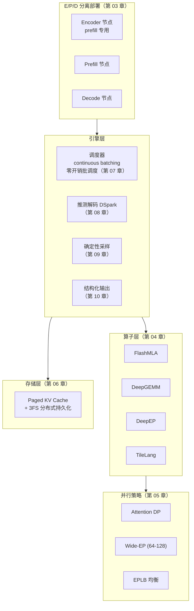

# 01 总览：推理框架是什么

!!! question "本章问题"
    - 「推理」和「训练」在系统层面到底差在哪？
    - 为什么大模型公司要自己写推理框架，而不是直接用 PyTorch？
    - DeepInfer 在开源生态里处于什么位置？

---

## 1. 推理是一个「服务」，训练是一个「作业」

训练是**批处理作业**：数据进、梯度出，跑完就结束，吞吐是唯一指标。
推理是**长驻服务**：请求随时到达、长短不一、延迟敏感，而且要 7×24
扛住流量波动。这个差别决定了两者系统形态的全面分野：

| 维度 | 训练 | 推理（DeepInfer 的战场） |
|---|---|---|
| 负载形态 | 稳定的大矩阵 | 变长的请求流、波动的到达率 |
| 关键指标 | 吞吐（tokens/s 总量） | **TTFT**（首 token 延迟）、**TPOT**（每 token 延迟）、吞吐 |
| 显存大头 | 激活值（backward 需要） | **KV Cache**（随请求数与长度线性增长） |
| 并行重心 | 数据并行 + 流水并行 | 请求级组批 + **E/P/D 分离**部署 |
| 数学密度 | 高（大 batch 矩阵乘） | prefill 高、**decode 极低**（batch=请求数，算术强度低） |

最后一点是推理系统全部复杂性的源头，值得单独一节。

## 2. decode 为什么「喂不饱」芯片

自回归生成每步只算**一个 token**。对一条请求，一个 decode step 是：

```text
读：整个 KV Cache（几十 GB 级） + 当前 token 的权重（全部）
算：一次前向（相对很小）
写：1 个 token 的 KV + logits
```

**访存量和计算量的比值（ arithmetic intensity ）极低** —— 芯片的算力
（TFLOPS）大量闲置，瓶颈全在 HBM 带宽上。这就是为什么：

- DeepInfer 的算子层（FlashMLA、DeepGEMM，见[第 04 章](04-kernels.md)）
  全在「省带宽」上下功夫；
- 推测解码（[第 08 章](08-speculative.md)）本质是**用闲置算力换带宽**：
  一次 forward「审」多个候选 token，摊薄每次访存的单位成本；
- 组批（continuous batching，[第 07 章](07-scheduler.md)）是**拼请求**：
  把 N 条请求的 decode 拼成一个大 batch，让一次权重读取服务 N 条请求。

!!! tip "一个心智模型"
    训练像搬家（一次装满卡车跑几趟），decode 像跑腿（每趟只送一个包裹）。
    推理框架的全部设计，都在想办法「一次跑腿多带几个包裹」。

## 3. 为什么不直接用 PyTorch

PyTorch 是**训练优先**的通用框架：动态图、调度灵活、算子全覆盖 ——
代价是运行时开销大、对「服务化」场景（连接管理、请求组批、KV 生命周期）
没有原生抽象。生产推理需要的东西它几乎都没有：

1. **迭代级调度**：每个 decode step 重新组批，请求随到随走 ——
   PyTorch 的 DataLoader 模型完全不适配；
2. **KV Cache 生命周期管理**：分页、共享、逐出、跨节点 ——
   这是推理框架最核心的状态机（[第 06 章](06-kvcache.md)）；
3. **CPU/GPU 流水线**：调度必须与 forward 重叠，否则 GPU 空转 ——
   需要 engine 层的深度介入（[第 07 章](07-scheduler.md)）；
4. **手写算子**：MLA 注意力核、MoE 通信核 —— 通用 kernel 库的
   性能与显存行为达不到要求（[第 04 章](04-kernels.md)）。

vLLM / SGLang / DeepInfer 这一层的框架，本质都是在补这四块。
DeepInfer 的特殊性：它由**模型的作者**写 —— 模型结构（MLA、MoE、SWA）
与引擎设计（FlashMLA、DeepEP、EPLB）是**同一场设计的两面**。

## 4. DeepInfer 在生态中的位置

| | vLLM | SGLang | **DeepInfer** |
|---|---|---|---|
| 出身 | 伯克利 / 社区 | LMSYS | **DeepSeek 自家线上服务** |
| 定位 | 通用推理引擎 | 通用 + 前端 DSL | **为 R 系列模型量身定制** |
| 算子 | 依赖 FlashAttention 等库 | 依赖库 + 自研 | **FlashMLA/DeepGEMM/DeepEP 全自研** |
| KV | PagedAttention（显存分页） | RadixAttention | **Paged + 3FS 分布式持久化** |
| 部署 | 单机为主 | 单机/集群 | **E/P/D 物理分离的集群形态** |

「模型作者写引擎」带来一个别人学不走的优势：**算法与系统的协同进化**。
MLA 压缩 KV 是模型侧为系统侧减负；FlashMLA 核是系统侧为 MLA 结构
定制 —— 每一代模型的架构变化都直接兑现成引擎的算子（[第 04 章](04-kernels.md)）。

!!! note "开源范围"
    DeepInfer 开源了引擎主体与算子库；**KV cache 管理与负载均衡组件
    未随仓发布**。本文涉及这两块时基于公开行为推断，均标注「推测」。

## 5. 一张地图



后续章节按这张地图逐层展开；每一章末尾给出对应的 **miniflow 教学实现**
（能跑、能测、能改），把「读懂」推进到「写得出」。

---

| 上一章 | 下一章 |
|---|---|
| — | [02 三大设计目标](02-goals.md) |