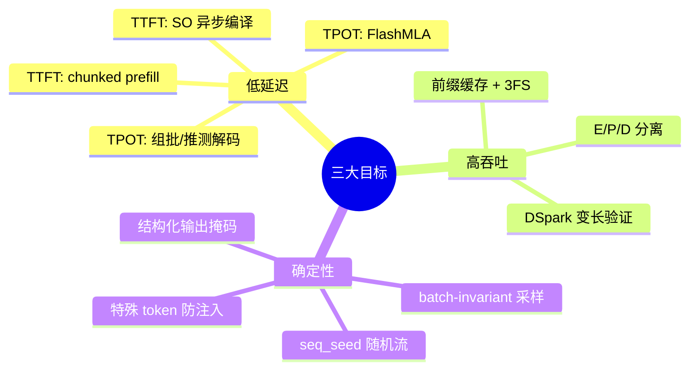

# 02 三大设计目标

!!! question "本章问题"
    - 一个「生产级」推理框架的验收标准是什么？
    - 延迟、吞吐、确定性 —— 这三个目标如何互相冲突，又如何被同时满足？

---

 DeepInfer 的全部子系统都能挂到三个目标上。理解这三个目标的**张力**，
就理解了每个设计「为什么长这样」。

## 目标一：低延迟

用户体感由两个数决定：

- **TTFT**（Time To First Token）：从发出请求到看到第一个字 ——
  决定「感觉快不快」；
- **TPOT**（Time Per Output Token）：之后每个字的间隔 ——
  决定「读得顺不顺」。

它们由完全不同的环节决定，优化手段也完全不同：

| | TTFT | TPOT |
|---|---|---|
| 瓶颈环节 | **prefill**（整段 prompt 一次前向） | **decode**（逐 token 前向） |
| 资源特性 | 计算受限（长序列大矩阵乘） | 访存受限（读全量 KV 与权重） |
| DeepInfer 手段 | chunked prefill、prefill/decode 分离部署 | FlashMLA、组批、推测解码 |
| miniflow 对应 | `Scheduler` 的 prefill 预算 | `PagedKVCache` + continuous batching |

一个容易忽略的 TTFT 杀手：**结构化输出的编译**。复杂 JSON Schema 编译
成语法自动机可能耗时可观，若阻塞首 token 就是灾难 —— DeepInfer 把编译
放在**专用 SO 机器上异步进行**，推理解码完全不等编译（[第 10 章](10-structured.md)）。

## 目标二：高吞吐（= 低成本）

同样的硬件，单位时间能出多少 token。关键认知：

> **吞吐和延迟在同一个 batch 维度上打架。**

batch 越大，单请求 TPOT 越差（分母变大）但吞吐越高（利用率高）。
DeepInfer 的解法不是折中，而是**让每个环节各自接近最优**：

1. **E/P/D 分离**（[第 03 章](03-architecture.md)）：prefill 节点满血
   算大 batch，decode 节点把 KV 驻满 —— 两类负载不再互相污染；
2. **前缀缓存 + 3FS 持久化**（[第 06 章](06-kvcache.md)）：共享系统
   prompt 的流量直接复用 KV，prefill 算力省下来就是吞吐；
3. **推测解码**（[第 08 章](08-speculative.md)）：DSpark 生产数据
   变长验证 +4~7% 吞吐 —— 听着不大，但这是**纯软件**换来的等效扩容。

!!! warning "吞吐数字的陷阱"
    「tokens/s」必须问清：什么模型、什么长度分布、什么并发。
    prefill-heavy 与 decode-heavy 流量的吞吐可差数倍。
    DeepInfer 用拟合的二次成本模型 cost(q, c) 评估 chunk 混跑代价 ——
    量化混跑损失，而不是拍脑袋决定「混不混」。

## 目标三：确定性与可控性

生产服务的隐性目标，学术界最容易忽视：

1. **批次不变性**（[第 09 章](09-sampling.md)）：同一条请求的输出
   **只取决于（输入, 种子）**，与批内邻居、批大小、请求顺序无关。
   没有它：回归测试不可复现、A/B 对比失真、分片重放对不齐；
2. **结构化输出**（[第 10 章](10-structured.md)）：Agent 场景要求
   输出严格匹配 schema —— 语法自动机 + 采样掩码，**约束不扭曲分布**；
3. **防注入**（[第 11 章](11-recipe.md)）：用户输入里的字面控制标记
   不能改变模型行为分界 —— deepseek-recipe 在分词层消毒；
4. **确定性重放**：同一输入重跑得到同一输出 —— miniflow 的
   [测试套件](https://github.com/yourname/deepinfer-lab) 里
   `test_batch_invariance.py` 把这作为硬契约钉死。

## 三个目标的共同底层：**把状态管起来**

细看会发现一个惊人的共性：三个目标的实现都绕不开**同一件事 ——
KV Cache 的生命周期管理**。

- TTFT ↓ ← 前缀命中跳过 prefill；
- 吞吐 ↑ ← 共享块物理复用、3FS 跨请求/跨时间复用；
- 确定性 ← KV 的「按层同步推进」语义是推测解码回滚、断点续算的基石。

这就是为什么第 06 章（KV Cache）是全书技术含量最高的一章，也是
DeepInfer **未开源**的两个组件之一恰好是「KV cache 管理」的原因 ——
它是整套系统的灵魂。

!!! note "miniflow 怎么教这一章"
    `examples/demo_scheduler.py preempt`（10 个物理块跑 3 条请求）把
    「状态管起来」的难度直接演给你看：块池吃紧 → 抢占 → 重算 →
    请求仍全部完成。背后是调度器与 KV 生命周期的深度耦合 ——
    miniflow 开发时在这上面踩过三重死锁（[lab/04](../lab/04-scheduler.md)）。

---

| 上一章 | 下一章 |
|---|---|
| [01 总览](01-overview.md) | [03 总体架构：E/P/D 分离](03-architecture.md) |