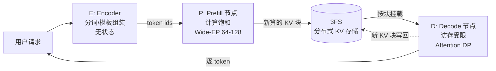
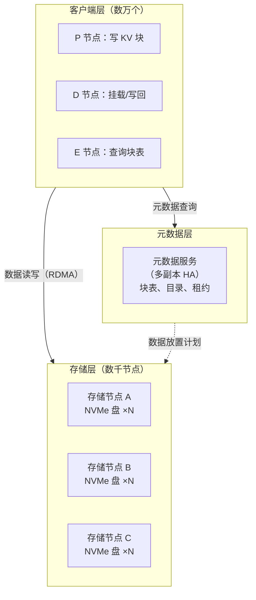
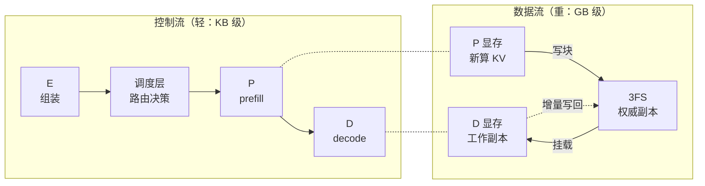
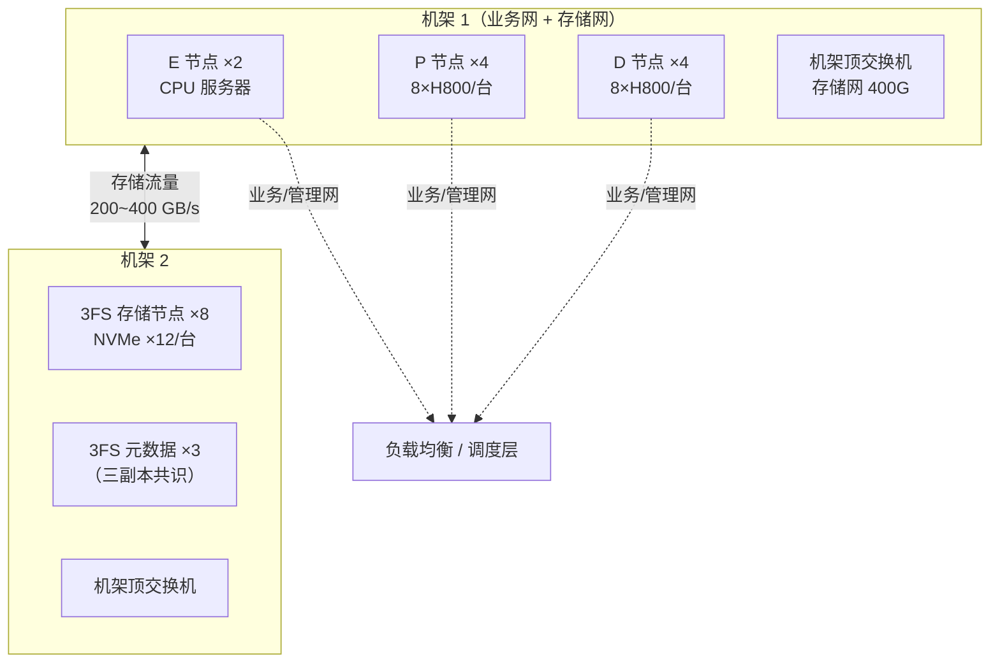

# 03 总体架构：E/P/D 分离

第 02 章说过，prefill 和 decode 一个计算受限、一个访存受限，混跑互相伤害。本章讲 DeepInfer 的结构性答案：把请求的生命周期拆到**三类物理隔离的节点**上——Encoder（E）、Prefill（P）、Decode（D），中间用一个分布式文件系统 3FS 串起来。读完这章你应该能回答：为什么拆的是这三段、KV 怎么在节点间流动、以及为什么一个「文件系统」会成为整个架构的枢纽。

本章是全书第一个「机制章」。它讲的不是某个算法，而是**把算法放到物理结构里的决策**——这类决策一旦定下，会约束后面所有章节的设计空间（P 节点的算子选型、D 节点的并行策略、3FS 的块语义，都是从这个结构推出来的）。读架构章的方法和读算法章不同：算法问「为什么对」，架构问「为什么值得」——每一个分离都有代价，值得与否取决于流量形态。

读完本章，你应该能不假思索地回答：

- prefill 和 decode 混跑，「互相伤害」的具体机制是什么？各伤对方什么资源？
- E/P/D 三类节点各自的「核心资产」是什么（无状态 / 算力 / 显存）？
- 3FS 承担的三个角色是什么？为什么一个存储系统能当架构枢纽？
- 一条请求的 KV 从诞生到回收，完整经过哪些物理位置？
- 哪个组件挂掉会导致什么后果？哪些故障用户无感？

## 1. 分离的动机：先把互相伤害讲具体

### 1.1 伤害一：prefill 打断 decode 的节奏

混跑一台机器上，伤害发生在两个方向。

**prefill 伤害 decode。** 一条 8000 token 的长 prompt 到达，prefill 要做一次 8000 个位置的大矩阵乘，独占计算单元几百毫秒到 1 秒。这期间同一块 GPU 上所有正在 decode 的请求全部停摆——用户屏幕上的字停了一下。

把这个伤害量化。假设 decode batch 里 32 条请求，每条 TPOT 正常 40 ms（用户体感流畅）。一条 8000-token 的 prefill 插进来，按第 02 章的账（600 TFLOPS 有效算力）要算约 1 秒。这一秒里：

- 32 条请求各暂停 1 秒 = 用户们共看到 32 次「卡壳」；
- 这 32 条请求的 ITL 各出现一个 1040 ms 的尖峰（40 ms + 1000 ms）——**P99 ITL 直接爆表**，SLO 违约；
- 更糟的是尖峰会「排队」：多个 prefill 接连到达时，decode 的停顿连成片。

注意受害的是**延迟分位数**而不是平均值：一天里长 prompt 占 5% 的话，平均 TPOT 几乎不变，但 P99 全烂。这就是为什么「平均看起来还行」的混跑集群，用户投诉不断——分位数的痛，平均值看不见。

### 1.2 伤害二：decode 挤占 prefill 的空间

**decode 伤害 prefill。** 这个方向更隐蔽，不是「慢」而是「分配失败」。

decode 侧为了吞吐，把几十条请求的 KV Cache 常驻在显存里（这是它高吞吐的前提，第 02 章的摊销账）。这批常驻显存挤压的是 prefill 需要的**临时激活空间**——prefill 一根 8000 token 的序列，每层中间结果是 8000×隐藏维度的张量（FP8 下，隐藏 7168 的模型一层激活约 8000×7168×1B ≈ 57 MB，几十层叠加上 MoE 的专家中间结果，一根长序列的峰值临时空间是 GB 级）。

KV 挤多了，长 prompt 直接分配失败（OOM）。OOM 的处理很难看：要么杀掉别的请求腾地方（用户请求被无端中止），要么拒绝新请求（TTFT 无限大）。而且它**专挑长 prompt 下手**——短 prompt 永远过得去，长 prompt 的用户（贴文档提问的重度用户、agent 的长上下文调用）反而最容易被拒。伤害的分布又是倒挂的。

### 1.3 更深的矛盾：最优硬件配置是反的

即使调度完美、互不干扰，两类负载对硬件的「最优配置」也是反的：

| 维度 | prefill 想要 | decode 想要 |
|---|---|---|
| 算力 | 越多越好（吃满 MFU） | 够用就行（算术强度 2，堆了也闲） |
| 显存带宽 | 中等（权重读一遍） | 越快越好（每步全量 KV 要读） |
| 显存容量 | 临时大进大出（激活） | 越深越好（驻留更多请求 KV） |
| 批形态 | 少数超长序列拼大 GEMM | 大量单 token 位置拼 batch |
| 通信 | Wide-EP 摊薄 all-to-all | 通信本地化（DP 复制权重） |

同一批节点按谁调优都亏：按 prefill 配（堆算力），decode 的钱花在永远闲着的 ALU 上；按 decode 配（堆显存带宽），prefill 的算力饥饿。硬件采购没有「既要又要」——**结构性的矛盾，最终只能用结构性的手段解**。

### 1.4 两档解法：软分离与硬分离

解法有两档。

**软分离**（chunked prefill，[第 07 章](07-scheduler.md)）：不拆机器，把长 prefill 切成小块，每算一块插一步 decode，用调度强制两类负载轮流用 GPU——单机小规模够用。优点是零额外硬件、零网络搬运；缺点是「轮流」本身有损耗（流水打断、调度开销），而且硬件配置的矛盾完全没解（还是那台折中的机器）。

**硬分离**（E/P/D）：直接拆到不同物理节点群，各自按自己的瓶颈配硬件和并行策略——这是 DeepInfer 这种大规模服务的选择。代价是 KV 要跨网络流动（下一节的 3FS 就是为此而生）和集群运维复杂度（三套节点群、容量配比、故障域都变多）。

选择哪档？流量说了算。量化地说，分离的收益 ≈ 混跑损失（1.1/1.2 的伤害折算成 SLO 违约和 OOM 率），分离的代价 ≈ KV 网络搬运延迟 + 运维成本。**流量越大、长 prompt 占比越高、SLO 越紧，分离越赚**。DeepSeek 官方服务的画像（巨大流量 + agent 时代的长上下文 + 严格 P99）全在「赚」的一侧，所以选了硬分离。

注意 DeepInfer 并没有放弃前者：分离部署的集群内部，P 节点自己跑多个并发 prefill 时仍然用 chunked 预算控制（QA 文档里的二次成本模型 cost(q, c) 就是用来反解最优 chunk 大小的——q 为 chunk 尺寸、c 为并发，拟合「chunk 内 decode 让路」的损耗，求导找最优点）。**软硬两档不是二选一，是嵌套使用**：集群级硬分离，节点内软微调。

### 1.5 业界的其他路

把镜头拉远一点，看这个问题的解法光谱（也帮你定位 DeepInfer 在其中的激进程度）：

- **完全混跑**（vLLM 默认单机形态）：一个进程、一个 GPU 池，chunked prefill 调度。简单，适合中小流量。P99 TPOT 的尖刺靠 chunk 调得细来压，压不干净；
- **逻辑分离**（vLLM/TensorRT-LLM 的多实例形态）：部署两套实例群，一套只接 prefill 一套只接 decode，中间用 KV 状态传输（NCCL/RDMA 点对点）。硬件异构了，但 KV 流动是「实例间握手」——两边的拓扑要对齐，扩容要成对扩；
- **存储中枢分离**（DeepInfer）：KV 彻底外置到 3FS，读写解耦成「生产者写文件、消费者挂载」，P/D 之间不直接握手。解耦最彻底，也最重——为一个模型家族造了一套分布式存储。

一路看下来是「耦合递减、基建递重」的谱系。DeepInfer 选最重的那端，因为它同时要三样东西：前缀跨时段复用（存储语义）、P/D 独立扩缩容（解耦语义）、D 故障无感切换（持久化语义）——三样都指向「KV 必须是持久化的共享事实，而不是某个进程的私有状态」。**先确定了 KV 的语义，才有了 3FS 的存在理由**——这个思考顺序值得记住：架构里最贵的决策往往关于「状态归谁所有」。

## 2. 三类节点各自是什么

### 2.1 E（Encoder）：把杂活从 GPU 节点上剥出去

请求进入集群的第一站。它做三件事：

**分词**：文本变 token id（第 01 章 1.1 的 BPE 过程，CPU 上微秒级）。

**模板组装**：按对话模板拼接 system / user / assistant 各轮消息，加特殊标记（`<|user|>`、`<|end|>` 这类）。听起来琐碎，但它有两个不容出错的职责：多轮对话的上下文拼接顺序（历史轮次的 KV 已在缓存里，拼错顺序就全错）、以及特殊 token 的**防注入**处理（用户输入里的字面 `<|end|>` 不能被当成真标记——第 11 章展开）。

**多模态编码**：图片走视觉编码器变成视觉 token 序列、文档走 OCR/解析。这块算力不小（视觉编码是个正经的神经网络推理），放 E 层用便宜的推理卡跑，不占 P/D 的主力 GPU。

E 的设计要义是**无状态**——不碰主力模型权重、不存 KV，处理完就把 token 序列交给调度层。无状态带来两个架构红利：

- **天然水平扩展**：流量翻倍就加 E 机器，不需要任何状态迁移。大促、新功能发布带来的入口流量尖峰（还没到 GPU 就被挡住的：格式错误、超长截断、限流）全在 E 层消化；
- **解耦入口抖动**：入口的流量毛刺（重试风暴、爬虫）不直接传导到推理节点——E 层可以持有一小段缓冲队列，把毛刺削平了再往调度层放。

单独设 E 这一层，本质是把「杂活」从昂贵的 GPU 节点上剥出去：主力 GPU 每秒每卡的摊销成本数倍于 CPU 服务器，让它们算分词是烧钱。**架构分层的原动力经常就是价格分层**。

### 2.2 P（Prefill）：KV 的生产者

专职 prefill。它的特征几乎全部来自第 01 章的推导——prefill 是计算受限的，所以 P 节点的一切围绕「算力饱和」组织：

**追求计算饱和**：把多条请求的 prompt 拼成大 batch 一起算，让 DeepGEMM 的分块矩阵乘吃满算力（[第 04 章](04-kernels.md)）。多条 3000 token 的请求拼成 12000 token 的超长批，GEMM 的尺寸越大 MFU 越高——P 侧的调度器是个「攒批艺术家」，等一等凑一凑是常态（反正 TTFT 预算还有富余）。

**MoE 通信划算**：DeepSeek 的 MoE 层每算一层，激活的 token 要按路由发往各专家所在的卡（all-to-all 通信）。batch 越大，单次通信摊到的 token 越多，通信成本占比越低——12000 token 的批，一次 all-to-all 发 12000 个 payload，通信初始化的固定开销被摊成零头。所以 P 侧敢把专家并行开到很宽（**Wide-EP，64~128 卡**，[第 05 章](05-parallelism.md)）——用超大并行度把单卡放不下的专家矩阵摊薄，同时靠大 batch 把跨卡通信的占比压住。

**不驻留 KV**：prefill 算出的 KV 是**产物**，算完就写入 3FS，本地不长期保存。P 节点的显存全部留给大 batch 的临时激活——它是「无状态的加工车间」：原料（token）进来，产品（KV 块）出厂，车间里不堆库存。

这个「车间」隐喻还提示了 P 的容量弹性：加工完就交货，所以 P 节点可以激进地过载（队列里等 prefill 的请求不影响在算的）——深夜流量低谷时 P 群可以缩容到极小，白天洪峰再扩。**P 的弹性是三类节点里最好的**。

### 2.3 D（Decode）：KV 的消费者

专职逐 token 生成。特征来自第 01 章另一半推导——decode 是访存受限的，所以 D 的一切围绕「KV 驻留密度」组织：

**核心指标是 KV 驻留密度**：HBM 里塞下越多并发请求的 KV，每步组批越大，带宽利用率越高（第 02 章摊销表的 $\frac{W}{B}+K$：B 越大单 token 越便宜）。D 节点选卡的标准是「显存大、带宽快」而不是「算力强」——同样的钱买 141 GB HBM3e 的卡比买算力顶配的卡划算。**D 群是整个集群的「内存池」**，它的容量直接决定集群并发上限（Little 定律的 L）。

**并行策略反着来**：decode 每步只有很少的 token（batch 数 × 1 个位置），MoE 的 all-to-all 通信摊不满——batch=64 时一次 all-to-all 只发 64 个小 payload，通信的固定开销（延迟、同步）占比反噬延迟。所以 D 侧用 **Attention DP**（数据并行：每张卡独立服务一组请求的完整注意力，权重复制），MoE 专家权重按卡复制或小范围分片，把通信本地化（[第 05 章](05-parallelism.md)）。

代价是显存：每张卡要放完整注意力权重+部分专家。但注意 D 的 KV 是每请求私有的——DP 切分下每条请求整个住在一张卡上，KV 不用跨卡，**「KV 不动、权重动」是 D 侧并行的第一原则**（权重再大也只放一份，KV 乘以并发数才是大头）。

**KV 长驻 + 增量写回**：decode 每步新增的 KV 写入本地块表，并异步写回 3FS（供故障切换和 TTL 复用）。写回走后台带宽，不和读路径抢——3FS 的写是「追加块」，没有原地改写，天然好并行。



P 用大 EP、D 用小 EP/DP，这是「同一模型在集群两半跑两套并行策略」的实例——教科书上说并行策略是「模型属性」，DeepInfer 告诉你它其实是「负载属性」。怎么做到的：权重怎么切、KV 怎么流动，中间的粘合剂就是 3FS。

### 2.4 补充：D 节点接手请求的微观流程

「D 挂载块表到本地显存」这一句话里藏着一串步骤，值得拆开看（这是从架构图到实现的关键一跳）：

```text
1. 调度器发来派单：请求 R，前缀命中 4000 token，新算 300 token，
   KV 块列表 = [块#A1..A31(命中段), 块#B1..B3(新算段)]
2. D 查本地块表缓存：命中段的 34 个块哪些已在本地显存？
   （老用户回访的场景：大部分在——上次会话的块还驻留着）
3. 缺失的块向 3FS 发起批量读（一次 RDMA gather，不是逐块）
4. 读回的块装进本地块池的空闲槽位，更新 R 的本地块表
   （本地块表：逻辑位置 → 本地槽位的映射）
5. R 进入 decode 队列，等当前 step 结束就拼进 batch
```

三个微观细节决定了这个流程的效率：

**批量读**：34 个块一起请求，3FS 客户端把它们排成一个聚合 IO——每块几十 KB，聚合后 2 MB 级的读请求把网络往返的固定延迟摊掉。逐块读的话，34 次 × 100 μs = 3.4 ms 纯延迟；聚合后一次 500 μs 搞定。**「小 IO 聚合」是所有块存储系统的第一优化**。

**本地块表两级映射**：请求看到的是「token 位置 → 块」的逻辑表，D 节点再维护「块 → 本地槽位」的物理表。两级解耦让同一个块可以被多个请求引用（前缀共享），也让块在显存里的位置可以挪动（整理碎片）而不惊动请求视角。第 06 章的块表设计展开这个双层结构。

**挂载与 decode 的流水**：步骤 3 的网络读和步骤 5 的「等拼批」可以重叠——R 的 KV 还在路上时，调度器已经把它登记进下一个 batch 的计划，块到了直接加入，D 不空等。**IO 与计算的隐藏流水线，在架构图上不可见、在延迟曲线上看得见**（TTFT 比朴素串行流程低 30~50%）。

### 2.5 补充：P 节点内部：chunked 预算的微观管理

P 节点自己也不是「一个大 prefill 一口气算完」。多个请求的 prefill 在 P 上并发跑时，每个都切成 chunk（第 02 章的 chunked prefill 在 P 内部重演），调度约束变成一个预算问题：

```text
每个 step 的算力预算 = 600 TFLOPs × step 时长（比如 100 ms）
                     = 60 TFLOPs 的「计算额度」

候选工作：请求 A 的下一个 chunk（3000 token ≈ 22 TFLOPs）
         请求 B 的下一个 chunk（2000 token ≈ 15 TFLOPs）
         请求 C 的第一个 chunk（8000 token ≈ 59 TFLOPs，单独就超预算 → 再切）

拼批目标：塞满 60 TFLOPs 额度，同时各请求的 chunk 间隔均匀
         （间隔不均 = 某请求的 prefill 总时长波动 = TTFT 抖动）
```

官方 QA 提到的二次成本模型 cost(q, c)（q 为 chunk 大小、c 为并发）拟合的就是这个「切多碎、同时跑几个」的联合最优：

- q 太小：每个 chunk 的 kernel 启动开销占比高、GEMM 尺寸小 MFU 低——**算力浪费**；
- q 太大：单个 chunk 独占整个 step，其他并发 prefill 的等待变长（它们的 TTFT 抖动）——**公平性恶化**；
- c 太大：激活显存吃紧（每并发一个 chunk 都要临时空间）——**OOM 风险**。

用生产流量拟合出 cost(q, c) 曲面，在「显存安全」的约束下找曲面最低点——**每个 P 集群的 chunk 参数都不一样，因为流量画像不一样**。这是一个「用数据代替拍脑袋」的完整案例：模型简单（二次拟合），但换来的是每天自动跟随流量调参，而不是工程师每月人肉调一次。

（miniflow 的 P 侧模拟在 `miniflow/scheduler.py`：chunk 大小是构造参数，lab/04 会带你做「扫 q 看 TTFT 分布」的实验，亲手看到这个曲面的一维切片。）

## 3. KV 的「搬家」：3FS 是枢纽

### 3.1 搬家问题：分离的「过路费」

分离部署最贵的问题立刻出现：**prefill 算出的 KV 在 P 节点的显存里，decode 却发生在 D 节点。** KV 必须跨节点流动，而且流量不小——每个生成的 token、模型每一层都要写一段 K/V，乘上并发请求数，就是一条持续的数据河。

先算算这条河有多宽，确认它值得一套专门设施。一条 2000-token prompt 的请求，KV（MLA 压缩后，第 06 章精确算）约 500 MB 量级要一次搬完；1000 条/秒的请求到达率对应 P→存储 500 GB/s 的持续写入。加上 D 侧的挂载读取、decode 增量写回（每 token 每层），全集群 KV 河流量在 TB/s 量级。**这不是「传个文件」，这是集群里最大的数据流**——比模型权重加载、比参数同步（推理没有同步）都大。为它专门造设施，值得。

朴素解法（点对点传输：P 直接把 KV 发给 D）有三个硬伤：

1. **耦合时机**：P 算完时 D 可能还没腾出手（挂载要显存空位），P 只能等着或暂存——生产者和消费者的速度差没有缓冲；
2. **路由复杂**：P 算完才知道 KV 该多大，D 的选择要等调度决策——两者之间的「握手」协议状态多、易错；
3. **无复用**：点对点发完就完，下一个请求同样前缀来了还得重算——没有「存」就没有「享」。

DeepInfer 的答案绕开这三点：让 KV 彻底归存储层所有。**KV 数据本身和「哪个请求的哪个位置映射到哪个块」的块表，都以块为单位存在 3FS 上**（3FS 是 DeepSeek 自研的高性能分布式文件系统，为高吞吐随机读写设计，生产块大小 128 token）。P 节点算完 prefill，把 KV 块写进 3FS；D 节点接手请求时，按块表把需要的块挂载到本地显存，接着 decode；decode 过程中新增的 KV 块再持续写回。

### 3.2 3FS 的三重角色

只当「搬运工」还不足以解释它的地位。3FS 同时扮演三个角色：

**角色一：KV 总线。** E/P/D 三类节点之间所有 KV 的流动都走它。节点间不需要点对点传输 KV——写的人写文件，读的人读文件，解耦了生产消费的时间差（P 算完可以去干下一条，D 空闲了再挂载）。总线语义还天然支持一对多：同一段 system prompt 的 KV 块，一百个 D 节点可以同时挂载——**共享不需要协调，只需要都去读同一个文件**。

**角色二：前缀缓存仓库。** KV 块持久化在 3FS 上并带 **TTL（存活时间）**：agent 流量 3 天、chat 流量 7 天（官方 QA 文档原文数字）。TTL 内，任何新请求只要前缀和已有块匹配，直接挂载复用，prefill 整段跳过——这比「进程内前缀缓存」强三个维度：

| 维度 | 进程内缓存（vLLM/SGLang 单机） | 3FS 缓存（DeepInfer） |
|---|---|---|
| 跨请求 | ✓ 同进程内不同请求 | ✓ 全集群所有请求 |
| 跨时间 | ✗ 重启即失 | ✓ TTL 内跨天复用 |
| 跨节点 | ✗ 绑定单机 | ✓ 任何 D 节点可挂载 |
| 容量 | 单机显存 | 存储集群（大数倍） |

第 02 章算过 Zipf 头部的经济学：头部前缀被重复使用千百次，3FS 把「重复」的时间窗从毫秒级（同批）拉到天级（TTL）——同一个 system prompt，全生命周期只 prefill 一次。**这是 DeepInfer TTFT 和吞吐的胜负手**。

**角色三：断点续算的持久层。** D 节点故障时，另一台 D 节点挂载同一批 KV 块，从最后写入的位置继续 decode——请求不重头算，用户几乎无感。这是「把状态管起来」（第 02 章）在集群维度的形态。细节在第 5 节的容灾走查里展开。

一个存储组件同时解决**传输、复用、容灾**三个架构级难题——这就是「枢纽」的全部含义。回看第 02 章的结论「三个设计目标都压在 KV 生命周期管理上」，3FS 就是那个管理器的物理载体。这也解释了为什么 DeepInfer 未开源的组件里恰好有「KV cache 管理」：它与 3FS 的块语义、集群拓扑深度耦合——**开源一个引擎容易，开源一坨和自家存储系统长在一起的神经很难拆**。

### 3.3 为什么不用现成的分布式文件系统

合理的疑问：Lustre、Alluxio、JuiceFS 这些成熟系统为什么不直接用？三个不匹配：

**访问模式不匹配。** 通用文件系统的负载假设是「大文件顺序读写 + 元数据操作少」；KV 的负载是「海量小块（128 token ≈ MLA 下数十 KB）的随机读写、极高并发、微秒级延迟敏感」。为前者优化的元数据服务和数据布局，在后者的负载下全部变成瓶颈。

**规模假设不匹配。** 3FS 的设计目标盘是**万卡集群**：数千存储节点、数万客户端（每张 GPU 卡都是客户端）、聚合带宽要到几十 TB/s。这个量级的客户端数量和带宽密度，通用系统的锁管理、元数据热点都会先崩。

**语义匹配的红利。** 因为是自己造，块大小、布局、I/O 路径都可以和 KV 的语义咬死：块对齐 128 token（和 KV 分页的块一致——文件块=缓存块=调度单位，「三块合一」）、写入走追加式（KV 永不改写历史，只追加新块——文件系统的 append 语义完美贴合）、读取模式可预测（块表在手，prefetch 下一批块的地址先验已知）。

当然代价是：又一个只服务 DeepSeek 系的专有组件（第 01 章「目标单一」的又一实例），以及社区没法直接复用的遗憾。

### 3.4 3FS 内部一览：三层结构

既然它是枢纽，值得多看两眼内部。3FS 的三层结构和所有分布式文件系统同源，但每层的参数都被 KV 负载重新校准过：



**元数据层**管「名字」：哪条请求的哪些块、每个块在哪些存储节点上。它是最需要 HA（高可用）的组件（第 5 节剧本三的恐惧来源），多副本共识维持一致性；同时是性能敏感组件（每次挂载/写入都要过它），所以块表查询做了激进的客户端缓存——D 节点对正在服务的请求块表烂熟于心，只有「接新请求」时才去元数据层问一次。

**存储层**管「字节」：每台存储节点一排 NVMe SSD，块数据按副本或纠删码摊在节点间。KV 负载的写入是追加式、读取是按块随机——NVMe 的小块随机性能（百万 IOPS 级）恰好是这个负载的天选介质。数据层的带宽是「KV 河」的河床宽度，直接决定 P→D 的 KV 转移延迟和前缀命中的取回速度。

**客户端层**是「职能分工」：P 主要写、D 读写混合、E 只查元数据。客户端库直接跑在 GPU 节点的进程里，走 RDMA（Remote DMA，远程直接内存访问——网卡直接读写对端内存，绕过两边的内核协议栈）把数据搬运延迟压到微秒级。**推理节点和存储之间不经过任何中间服务器**，这一点对带宽密度至关重要。

一个容易忽略的设计红利：**3FS 同时服务训练和推理**。DeepSeek 的训练集群用 3FS 存海量训练数据（它的出身就是训练数据基础设施），推理集群把它复用为 KV 层——同一套存储、两种负载分时错峰（训练夜间跑、推理白天跑，磁盘和网络互相填谷）。这个「一鱼两吃」摊薄了存储集群的固定成本，是 DeepSeek 基础设施账本里漂亮的一笔。

### 3.5 KV 河的宽度：网络与存储的预算表

把「KV 河流量」算成预算表（数字量级示意，MLA 压缩后每 token 全模型 KV 约 70 KB 量级——第 06 章给完整推导）：

```text
设：到达率 1000 req/s，平均输入 2000、输出 500 token，命中率 60%

写侧：
  P → 3FS：未命中段的 KV = 1000 × 800 tok × 70 KB ≈ 56 GB/s
  D → 3FS：decode 增量 = 1000 × 500 tok × 70 KB ≈ 35 GB/s
  合计写入 ≈ 90 GB/s（还要乘副本/纠删码开销 ×1.5~2）

读侧：
  D ← 3FS：接手挂载（新请求 + 迁移 + 故障恢复）
  ≈ 与写入同量级，命中率越高读越多

全集群 KV 河总流量 ≈ 200~400 GB/s
单存储节点（8×NVMe，每盘 3 GB/s）≈ 24 GB/s → 需要 10~20 台存储节点
网络：每台 GPU 节点需要 25~100 GbE 专口对接存储（不与参数面抢）
```

这张表的读法：**存储带宽是架构的硬通货**，它同时是 P→D 转移延迟的下界、前缀取回速度的上界、故障恢复窗口的长度。第 11 章的部署配方里存储容量/带宽的规划占一大节，原因就在这——**枢纽的宽度决定整个分离架构的收益能否兑现**。3FS 论文里报告的聚合带宽数字（训练场景 TB/s 级）就是这条河的防洪标准。

### 3.6 TTL 策略：缓存生命的经济学

TTL 的两个数字（agent 3 天、chat 7 天）看起来是拍脑袋，其实有讲究：

**为什么 chat 比 agent 长？** chat 的前缀（system prompt + 历史对话）在会话存续期会被多轮命中——用户平均会话持续 1~2 天，7 天 TTL 覆盖绝大多数「回访续聊」。agent 的前缀是任务态的（一次任务的工作记忆），任务完成后的复用价值快速归零，3 天后大概率是死数据——**TTL 匹配前缀的「复用半衰期」**。

**TTL 太长的代价**：存储成本（每 GB 存储都是钱）+ 命中率的稀释（块池里堆满死块，活跃块的查找和挂载变慢）。太短则错过跨天复用。这个权衡和第 02 章 Zipf 经济学的「头部识别」是同一件事——TTL 是最朴素的头部淘汰机制（时间维度上的 LRU）。

**TTL 之外还有逐级淘汰**：3FS 之上的显存层有自己的逐出策略（D 节点显存 → 3FS），3FS 层再按 TTL 过期。两级缓存的经典问题（写穿、不一致）在「KV 只追加不改写」的语义下天然消失——**不可变数据是缓存一致性的终极答案**，这也是块语义设计的又一红利。

## 4. 一个请求的完整旅程

把全链路按时间顺序串一遍（带典型耗时，单机视角的数字，集群叠加网络）：

```text
1. 请求到达 → 负载均衡 → E 节点（1~10 ms）
   分词、按模板组装 → token id 序列

2. 调度决策：前缀查询 3FS（1~5 ms，块表查找）
   命中   → 命中段直接挂载已有 KV 块，跳过这段 prefill
   未命中 → 请求发往某个 P 节点，对剩余 prompt 段做（chunked）prefill
   （4000 token 未命中段 ≈ 0.5 s 计算 + 排队）

3. P 节点算出的新 KV 块写入 3FS（异步，~10 ms 量级）
   请求路由到某个 D 节点；D 挂载块表到本地显存（百 MB 级，~50 ms）

4. D 节点进入 decode 循环（每步 10~50 ms）：
   组批（continuous batching）→ forward（FlashMLA）
   → （可选）DSpark 推测解码 → 采样 → 结构化输出掩码
   新 KV 块随生成持续写回 3FS（后台异步）

5. 终止条件（EOS / max_tokens / stop）→ 请求结束
   KV 块不立即删除，按 TTL 留在 3FS 等待复用，过期自动回收
```

两个值得停留的瞬间。

第 2 步的「前缀查询」是 TTFT 的大杀器：一条带 4000 token system prompt 的 agent 请求，如果 prompt 已在 3FS 里（TTL 内有人用过），prefill 只需算新增的对话部分——TTFT 从约 0.6 s 掉到 0.15 s，且 P 群完全没被占用（省下的算力服务别的请求）。**命中率高时，P 群的容量需求成倍下降**——这就是第 02 章「缓存命中率经济学」在集群维度的兑现。

第 4 步的循环内部还有一个隐形的调度世界：块池吃紧时调度器会**抢占**低优先级请求——回收它的 KV 块、把它退回等待队列稍后重算，把显存让给更急的请求。抢占-重算的完整逻辑在 [第 07 章](07-scheduler.md)，miniflow 一比一复刻了这个行为。

还有一个跨步骤的全局视角值得建立：**这条旅程里「请求」和「KV」是两个独立流动的实体**。请求的控制流走 E→调度→P→D（轻量，token id 和元数据）；KV 的数据流走 P 显存→3FS→D 显存（重量，全部中间状态）。两条流在 D 节点汇合（decode 要同时拿到「请求的当前位置」和「全部历史 KV」）。

把双流画出来（这是本章最重要的一张图，值得盯一分钟）：



**控制流轻、数据流重、以存储为汇合点**——这是数据密集系统的经典拓扑（CPU 与内存以缓存汇合、数据库与磁盘以页缓存汇合），DeepInfer 把它复刻到了推理集群。这个视角立刻解释了三个设计：

- 为什么 P 算完可以立刻去干下一条（它只发控制消息说「KV 写好了」，数据异步流走）；
- 为什么 D 可以弹性增减（新 D 只是「数据流的一个新读者」，控制流把它登记进调度即可）；
- 为什么故障恢复是「重新汇合」而不是「重算」（数据流的事实在 3FS 没丢，控制流把它指给新的 D 就恢复运行）。

以后读任何「计算与存储分离」的系统（数据库存算分离、流处理的 checkpoint、状态的 CRDT 同步），先画这张双流图——**汇合点选在哪，几乎决定了那个系统全部的个性**。

## 5. 失效与容灾：每种故障的剧本

分离架构把故障域也拆成了三类，每类有自己的剧本。逐一走查（这是理解架构「为什么长这样」的最快方式——**看它怎么坏**）：

**剧本一：D 节点宕机（最常见）。** 一台 D 挂掉，它上面几百条正在 decode 的请求怎么办？因为有 3FS：请求的 KV 块最新副本在存储上（增量写回是异步的，最多丢最后几十 ms 的新块）；调度器发现心跳丢失，把这台机器上的请求列表重新派发给其他 D 节点；新节点挂载 KV 块，从最后确认的位置继续 decode。用户体感：出字停了一两秒，然后继续——**请求不重算，会话不丢失**。没有 3FS 的架构里，这批请求全部重头 prefill（P 群瞬间被几百条长 prefill 打爆，TTFT 雪崩），用户看着自己的长回答重新生成一遍。

**剧本二：P 节点宕机。** P 是无状态车间，挂了就挂了——它手上没算完的请求退回调度队列，发往别的 P 节点重算。用户体感：TTFT 略涨（重排队），无其他影响。**P 的容灾 = 无状态 + 冗余**，最便宜的剧本。

**剧本三：3FS 部分故障（最凶险）。** 存储是枢纽也是单点风险域。3FS 内部有冗余（分布式文件系统的多副本/纠删码），单存储节点挂掉降带宽不丢数据。但**元数据服务故障**是真正的噩梦：块表查不到，全集群的 KV 挂载停摆——新请求全部退化成「无缓存全量 prefill」，P 群过载，SLO 全面违约。这是架构里最需要砸可靠性的组件（3FS 论文里元数据服务的 HA 设计占了大量篇幅，可以体会这个恐惧的具象化）。

**剧本四：E 节点宕机。** 无状态入口，流量自动切到其他 E，用户无感。 boring is good—— boring 的组件才是可信的组件。

四个剧本放一起看规律：**故障的破坏力 ∝ 该组件的状态量**。E（无状态）挂了无感，P（轻状态）挂了重算，D（重状态）挂了靠 3FS 续命，3FS（状态本体）挂了要靠它自身的冗余。**「把状态收拢到专门保护的组件」是容灾设计的核心动作**——这和第 02 章「把状态管起来」是同一句话的两种说法。

### 5.5 容灾演练：纸面剧本不算数

剧本写在文档里只是愿望，**容灾能力的唯一证明是演练**——而且是有观众、有计时、有评判的演练。一次标准的 D 节点故障演练长这样：

**准备**：选一台承载 300 条 decode 请求的 D 节点；监控大盘对着它的请求列表；演练开始前记录每条请求的「最后确认 token 位置」（3FS 上的写回水位）。

**引爆**：`ipmitool power off`（直接断电，不是温和的进程 kill——后者会走优雅退出路径，测不到真故障）。

**观察三段**：

1. **检测窗口**：心跳丢失到调度器标记「死」要多久？（目标 < 5 s；拉长的话，请求们在尸体上白白停了 5 秒）
2. **接管窗口**：新 D 节点挂载 KV 到恢复 decode 要多久？（目标 < 2 s；这里会暴露块读的聚合效率、元数据查询的缓存命中）
3. **用户体验**：受影响的 300 条请求，ITL 尖峰多高、恢复后有没有输出错乱（截断位置错了会吐出重复或跳过的内容——确定性校验在这里登场）。

**判卷**：三段时长 + 错乱率，和上季度的成绩比。退步就是回归（哪次发布改坏了接管路径）。

有意思的是演练发现的 bug 类型（都是真实世界常见的）：

- 心跳超时设太保守，检测窗口 30 秒——用户早就骂完了；
- 接管路径没测过「写回水位恰好在一个块的中间」（截断位置计算错误，输出重复两个 token）；
- 演练时段的 3FS 带宽被一个备份任务占着，接管窗口翻倍——**容灾依赖的资源和日常任务没隔离**；
- 恢复后的请求全挤到一个新 D 节点（调度器的「疏散」没有均摊），二次故障风险。

每个 bug 都不是「架构错了」，是「架构的承诺没有兑现到最后一公里」。**分离架构的容灾是设计出来的，更是演练出来的**——这也是第 11 章把「混沌工程」列为部署配方一环的原因。

## 6. 负载均衡：分离架构的代价

拆成三类节点后，「均衡」从一个问题变成三个，而且一个比一个难：

**P 侧：专家热度不均。** MoE 的专家负载天然不均（热门专家被路由的频率可能数倍于冷门专家），同 batch 内不同卡的专家忙闲差几倍，先忙完的卡等最慢的卡。解法是 EPLB（Expert Placement Load Balancing）动态重排专家到卡的放置——按路由统计把热专家摊开（[第 05 章](05-parallelism.md)）。难点在「动」的代价：专家迁移要把它的权重搬过去（几十 GB 级的搬运不能打扰服务），只能在低峰窗口慢慢挪。

**D 侧：生成长度不可知。** 请求会生成多长**事前未知**——按请求数均衡是滞后的（某台 D 节点可能恰好接了一堆长请求把显存驻满，隔壁节点早闲着）。按「预期 KV 增量」均衡需要长度预测（对 prompt 的分布特征做在线学习），预测错还是倾斜。生产现实是混合策略：接入时按预测分流 + 运行中按显存水位再均衡（把部分请求迁移出去——注意迁移 = KV 挂载转移，有 3FS 的架构里这个操作出奇地便宜，不迁移 KV 只迁移「谁来服务它」）。

**存储侧：前缀热度的管理。** 哪些前缀值得留在 3FS（TTL 之外要不要续命），本质是流量预测问题——第 02 章 Zipf 经济学讲过头部漂移，识别新头淘汰旧头是存储侧均衡的日常。

这三个问题分别需要不同的信息（路由统计、生成长度分布、前缀热度），没有任何一个是「通用正确」的解——它们和 DeepSeek 内部的流量特征深度绑定。这就是第二个未开源组件「负载均衡」的由来：不是藏着掖着，而是离开它的流量土壤就没有意义（把它的策略搬到你的流量上，大概率负优化）。

## 7. 容量配比：E:P:D 的黄金比例

集群设计的第一道算术题：三类节点买多少？比例由流量画像和「单节点能力」共同决定：

```text
假设（量级示意）：
  每秒 1000 条请求到达，平均输入 2000 token、输出 500 token
  前缀命中率 60%（有效 prefill 段 800 token/条）

P 群需求：1000 × 800 = 800K token/s 的 prefill 产能
  单 P 节点（8 卡，MFU 60%）≈ 12K token/s → 需要 ~70 台

D 群需求：1000 × 500 = 500K token/s 的 decode 产出
  单 D 节点（8 卡，batch 64/卡）≈ 8×90×64 ≈ 46K token/s → 需要 ~11 台

E 群需求：1000 请求/s 的分词+模板（CPU 活）
  单 E 节点（64 核）≈ 万级/s → 1~2 台（多模态另算）

3FS：P 写 800K token/s × KV/token + D 增量写回
  ≈ 数百 GB/s 持续写入 + 读 → 十几台存储节点

E : P : D : 3FS ≈ 1 : 70 : 11 : 15（量级示意，非真实数字）
```

P 远多于 D——因为 prefill 的计算密度高（800K token 的计算 vs 500K token 的带宽活）。**提高前缀命中率直接砍 P 群规模**：命中率 60%→80%，P 需求降到 40 台（省四成）——这就是为什么 3FS 的缓存能力是整个架构的经济支柱，而不只是性能装饰。

配比还是动态的：白天 agent 流量（长输入短输出）P 吃紧，晚间闲聊流量（短输入长输出）D 吃紧——**P 群的日夜弹性 + D 群的稳定水位**是部署运营的常态（第 11 章容量规划展开）。分离架构的好处在这里兑现：两类节点各自独立伸缩，不用成对扩容。

配比漂移的具体样子（用上面的算式推演两个极端日）：

```text
工作日白天（agent 高峰）：
  输入 6000 / 输出 300，命中率 75%
  P 需求：1000 × 1500 = 1.5M token/s → ~125 台
  D 需求：1000 × 300 = 0.3M token/s  → ~7 台
  P : D ≈ 18 : 1 —— P 群满负荷，D 群空闲大半

周末夜间（闲聊高峰）：
  输入 200 / 输出 800，命中率 40%
  P 需求：1000 × 120 = 0.12M token/s → ~10 台
  D 需求：1000 × 800 = 0.8M token/s  → ~18 台
  P : D ≈ 0.5 : 1 —— 完全反转
```

两个极端日之间 P 需求差 12 倍——**混跑架构下这个摆动意味着「按峰值买 125 台全天开着」**，分离架构下 P 群可以日内弹性（夜间缩到 10 台、白天扩回），账单直接砍半。这是分离架构在 TCO（总拥有成本）维度的核心红利，比任何单项性能提升都值钱。云上竞价实例、容器化 P 群都是这个思路的运维兑现。

（当然弹性的前提是扩缩容速度跟得上流量曲线——P 节点冷启动要拉权重、预热编译缓存，分钟级；这就要求容量预测提前 30 分钟动手。「预测-预热-伸缩」链路是第 11 章部署配方的主菜。）

## 8. miniflow 对应实验

miniflow 是单进程单机引擎，跑不了集群，但把这套架构的**逻辑形态**完整保留了——你可以逐个模块对回本章概念：

| DeepInfer | miniflow | 位置 |
|---|---|---|
| E 节点的分词/模板 | `Tokenizer.encode` | `miniflow/tokenizer.py` |
| P/D 分离的流水 | `LLMEngine.step()`：prefill 与 decode 同批异构推进 | `miniflow/engine.py` |
| 3FS 块级 KV | `PagedKVCache`：块池 + 块表 + 引用计数 | `miniflow/cache/paged_kv.py` |
| 前缀缓存 / TTL | `PrefixCache`：条目持块引用，跨序列复用 | `miniflow/cache/prefix_cache.py` |
| 调度让路（抢占） | `Scheduler`：最晚到达者被回收重算 | `miniflow/scheduler.py` |

```bash
python examples/demo_paged_kv.py       # 块的分配/回收/引用计数
python examples/demo_prefix_cache.py   # 前缀命中跳过 prefill
python examples/demo_scheduler.py      # 抢占-重算-全部完成
```

三个 demo 对应本章三个核心概念（块语义、前缀复用、调度让路）。跑的时候带一个观察点：demo_paged_kv 里块的「分配-引用-释放」循环就是 3FS 语义的进程内投影——**块的生命周期逻辑一致，只是介质的持久性不同**（显存 vs 分布式存储）。理解了这一点，「为什么 3FS 能当枢纽」就从结论变成了直觉。

## 9. 部署拓扑：机架、网络与故障域

架构图上的三个框落到机房里是什么样？一个生产级 E/P/D 集群的物理拓扑：



三个值得标注的拓扑决策：

**网络分平面。** 生产集群至少两张物理网：**业务网**（用户请求进出、节点间控制消息，10~25 GbE 够用）和**存储网**（KV 河的全部流量，100~400 GbE，RDMA 直连）。分开的原因是隔离故障和拥塞——存储网的洪峰（故障恢复时全集群挂载 KV）绝不能把业务网的心跳挤掉，否则「故障恢复触发二次故障」的雪崩就来了。大型集群还有第三张**参数面**（模型权重分发），这里不展开。

**故障域的错位分布。** D 节点和它依赖的 3FS 副本不放同一排机架/同一个电源域——机房级故障（整排断电）时「计算和它需要的数据一起没」是最坏情形。分布式系统的一致性课在 GPU 集群照样要上。

**E 的位置很自由。** 无状态所以放哪都行（甚至可以跨机房/边缘节点——离用户近一点，网络 RTT 少一点），这是架构里唯一「云原生友好」的部分。有状态的三类（P 的队列、D 的 KV、3FS 本体）都钉死在低延迟网络可达的域内。

**扩缩容的物理约束**顺带浮出：加一台 D 节点 = 接入存储网 + 从 3FS 拉权重（本地缓存 expert 权重）+ 调度器注册——分钟级，很快。加一排存储 = 数据再平衡（TB 级搬运）——小时到天级，慢。**两类节点的弹性节奏完全不同**，容量规划（第 11 章）要按各自的节奏排期。

## 10. 运维视角：分离架构的仪表盘

架构跑起来之后，工程师每天盯什么？分离架构的可观测性有自己的指标体系（第 11 章给完整的监控配方，这里先建立直觉）——每类节点一个「命根子指标」：

| 节点类型 | 命根子指标 | 健康线（示意） | 烂了说明什么 |
|---|---|---|---|
| E | 队列深度 + 错误率 | 队列 < 100 | 入口消化不动（限流/扩容） |
| P | MFU + prefill 排队时长 | MFU > 50%，排队 < 200 ms | 算力饥饿或批没拼大 |
| D | KV 驻留率 + ITL P99 | 驻留 > 70%，P99 < 100 ms | 显存用不满或 step 太重 |
| 3FS | 读写带宽水位 + 元数据延迟 | < 80% 带宽，P99 < 1 ms | 河要溢流或元数据热点 |
| 全局 | 前缀命中率 + Goodput | 命中 > 60% | 缓存策略和流量错配 |

两个「组合读法」比单指标更重要：

**P 的 MFU × D 的 KV 驻留率**是集群的「双引擎转速」：一个代表计算饱和度、一个代表带宽饱和度。两个都健康 = 分离架构的全部收益兑现；一个高一个低 = 流量画像和配比错配（比如 chat 流量涌进配了 P 重 D 轻的集群）。

**前缀命中率的变化率**是流量画像的先行指标：突然下滑往往意味着「用户行为变了」（新功能上线带来新 system prompt、热点事件改了提问模式）——缓存策略要跟着调，否则一周后 P 群容量告警。**好的运维不是看告警，是看告警之前的曲线拐弯**。

这些指标在 miniflow 里都有进程内版本（`examples/` 各 demo 的统计输出），跑起来对着看，比记表格有效。

## 11. 演进史：分离不是一天建成的

把镜头切到时间轴上，看这个架构怎么长出来的——演进路径往往比静态结构更有教学价值，因为每一步都是被具体的痛逼出来的。

**阶段一（2023，V2 时代）：朴素混跑。** 早期 DeepSeek 的服务就是「vLLM 式」的单机混跑：一个进程，chunked 都还没有，prefill 和 decode 抢同一块 GPU。当时的痛：长 prompt 上线（上下文从 4K 涨到 32K）后 P99 ITL 开始烂——就是 1.1 节的伤害一。工程师的第一反应是调 chunk 参数（软分离），能压住一部分，但 SLO 越来越紧（用户对体感的要求随竞争升级）。

**阶段二（2024，V2.5/V3 时代）：逻辑分离 + MoE 换代。** 流量涨到单机混跑完全顶不住，部署改成「prefill 实例群 + decode 实例群」，中间点对点传 KV。同时 V3 换代 MoE（256 专家、 MLA 压缩），decode 的带宽压力缓解了一截。新的痛：点对点 KV 传输的耦合（1.5 节的三个硬伤在规模上全部显形）——扩容要成对协商、故障恢复复杂、前缀复用只能进程内。工程师意识到：**痛的不是「分离」，是「分离的粘合方式」**。

**阶段三（2025，V3/R1 时代）：3FS 枢纽化。** R1 上线带来推理模型流量（思考链让 decode 量暴涨百倍），同时 3FS 在训练侧成熟（存训练数据的基建已就位）。两个时机咬合：把 KV 从「实例间的握手消息」升格为「存储上的共享事实」——P/D 彻底解耦、TTL 复用上线、故障无感切换。这就是本章讲的形态。

三个阶段的规律值得提炼：**架构升级的触发器从来不是「新技术出现」，而是「旧痛超过阈值」**——SLO 烂到用户投诉（阶段一）、耦合复杂到扩不动容（阶段二）、R1 流量压垮旧粘合方式（阶段三）。而每次升级的「可复用资产」是上一阶段攒下的基建（3FS 本来是训练的）。读任何公司的架构演进，都带着这两问：什么痛超标了？什么资产被复用了？

对照着看业界的平行演进：vLLM 社区在 2024~2025 也走完了阶段一到二（disaggregated prefill/decode 的 proposal 和实现），多数停在阶段二——阶段三需要「自研分布式存储」这一重资产，通用框架没有 DeepSeek 那样的训练基建可复用。**架构的激进程度，最终由家底决定**。

## 12. 后端工程师的类比：一张翻译表

如果你有 Web 后端经验，这张翻译表能让你三十秒建立 E/P/D 的直觉——但每个类比都标注了「哪里失效」，失效点正是 LLM 推理的独特之处：

| Web 后端 | DeepInfer | 相似 | 失效点 |
|---|---|---|---|
| 接入层（Nginx） | E 节点 | 无状态、水平扩展、削峰 | E 还做多模态编码（有算力） |
| 计算服务（无状态 API） | P 节点 | 车间模式、即产即走 | P 的「请求」是分钟级重计算，不是毫秒级查库 |
| 会话粘性 / 有状态服务 | D 节点 | 状态驻留、扩容难 | D 的状态是 GB 级且持续增长（KV），不是 KB 级 session |
| Redis / 分块缓存 | 3FS 前缀缓存 | 热点加速、TTL | 3FS 是事实源（丢了要重建事实），Redis 丢了只损性能 |
| Kafka | 3FS 的总线角色 | 解耦生产消费、削峰 | 3FS 按块随机读，Kafka 是顺序消费 |
| 故障切换（换实例+拉缓存） | D 故障续算 | 从持久层恢复状态 | 续算要求「精确到最后一个 token」，比 session 恢复严格得多 |

最有教学价值的是最后一行：**「有状态服务的容灾」在 Web 语境里是「重新登录一下」，在推理语境里是「从最后一个字无缝继续」**——状态恢复的精度差了两个数量级，所以 3FS 的块语义和写回机制比一般持久层苛刻得多。类比帮你入门，失效点帮你深入。

## 13. 常见误解澄清

**误解一：「P/D 分离是为了性能。」** 更准确说是为了**隔离**：混跑的性能损失（互相伤害）本质是延迟分位数的污染，单看吞吐混跑反而略高（少一次 KV 网络搬运）。分离买的是 P99 和可运维性，付出的是搬运成本——说「为性能」把交易说糊涂了。

**误解二：「3FS 是个缓存系统。」** 它是**持久化的共享事实源**（source of truth）：KV 的权威版本在 3FS，显存里的反而是「缓存的副本」。这个方向性决定了很多设计（写回是必须的不是优化、故障恢复从它读取）。把它想成「缓存」就会问「缓存丢了怎么办」这种不存在的问题——它不丢（有冗余），丢的是 TTL 到期的正常淘汰。

**误解三：「无状态 = 没用状态。**」E/P 的「无状态」指不拥有**跨请求**的持久状态，单条请求处理中的临时状态当然有。「状态所有权」的精确含义是：**谁挂了不需要恢复状态**。按这个标准：E 挂了无需恢复（无状态）、P 挂了恢复请求本身（轻状态）、D 挂了靠 3FS 恢复 KV（重状态但外置了）、3FS 挂了靠自身冗余（状态本体自保护）。

**误解四：「分离部署就能解决所有 SLO 问题。」** 分离解决的是「prefill 打断 decode」这一种尖峰来源。排队雪崩、显存耗尽的抢占、MoE 路由热点、网络抖动——这些 SLO 杀手与 P/D 无关，各有各的战场（07/05/11 章）。架构级方案是地基不是银弹，读下一章时保持这个清醒。

## 14. 小结

- **分离的动机是隔离**：prefill 打断 decode 的节奏（P99 ITL 尖峰）、decode 挤占 prefill 的空间（长 prompt OOM）、最优硬件配置相反——三重矛盾里前两个可软调度缓解，第三个只能硬分离。选择哪档由流量画像决定（SLO 越紧、长 prompt 越多、流量越大，分离越赚）。
- **E/P/D 各有资产**：E 无状态（水平扩展、消化抖动、把杂活从 GPU 剥出去）、P 是算力车间（Wide-EP + 大 batch + chunked 预算 + KV 即产即走，弹性最好）、D 是内存池（KV 驻留密度即吞吐、Attention DP 让 KV 不跨卡、挂载有微观流水）。
- **3FS 的三重角色**：KV 总线（解耦生产消费）、前缀仓库（跨请求/时间/节点的复用，TTL 匹配复用半衰期，命中率直接砍 P 群规模）、续算持久层（D 故障无感切换）。三层内部结构（元数据/存储/客户端）都被 KV 负载重新校准；它是同时服务训练与推理的一鱼两吃。
- **双流视角**：控制流轻（请求元数据）、数据流重（KV 块）、以存储为汇合点——这个拓扑决定了扩缩容、故障恢复、批组织的一切个性。
- **故障破坏力 ∝ 状态量**：E 无感、P 重算、D 靠存储续命、存储靠自身冗余——容灾是设计出来的更是演练出来的（检测/接管/体验三段式）。
- **容量配比 P ≫ D 且随流量昼夜摆动**（agent 日 vs 闲聊日差 12 倍），P 群的日内弹性是 TCO 的核心红利；3FS 的 KV 河总流量数百 GB/s 是架构硬通货。
- 演进规律：**升级触发器是「旧痛超阈值」，可复用资产是上阶段基建**——3FS 本来是训练的存储。
- miniflow 把块语义、前缀复用、调度让路在单进程里投影——逻辑同构，介质不同。

## 15. 本章术语速查表

| 术语 | 一句话解释 |
|---|---|
| E/P/D | Encoder/Prefill/Decode 三类物理分离的节点群 |
| 软/硬分离 | chunked prefill 时间切片 / 物理拆机两档解法 |
| Wide-EP | P 侧把 MoE 专家并行开到 64~128 卡 |
| Attention DP | D 侧每卡独立服务一组请求的完整注意力 |
| 3FS | DeepSeek 自研分布式文件系统，KV 的持久层 |
| 块表（block table） | 请求位置 → KV 块的映射，与文件块三块合一 |
| 挂载 | D 节点把 3FS 上的 KV 块载入本地显存 |
| TTL | KV 块在 3FS 的存活时间（agent 3 天/chat 7 天） |
| EPLB | 专家放置负载均衡，P 侧治专家热度不均 |
| 断点续算 | D 故障后新节点从 3FS 挂载 KV 继续 decode |
| 追加式写 | KV 只增不改的写语义，缓存一致性的红利 |
| OOM | 显存分配失败，混跑时长 prompt 的典型受害 |
| 控制流/数据流 | 请求元数据的轻流 / KV 数据的重流 |

## 自测：开篇问题的参考答案

**Q1：互相伤害的具体机制？** prefill 伤 decode：长 prompt 的大矩阵乘独占算力几百毫秒到 1 秒，decode 全停（P99 ITL 爆表，一天 5% 的长 prompt 就够烂掉分位数）；decode 伤 prefill：几十条请求的 KV 常驻显存，挤压 prefill 的临时激活空间，长 prompt OOM——伤害都集中在分位数和长请求上，平均值无感。

**Q2：三类节点的核心资产？** E 的资产是「无状态」（水平扩展、消化入口抖动，把杂活从贵的 GPU 剥到便宜的 CPU）；P 的资产是「算力饱和」（Wide-EP 64~128 卡 + 大 batch 拼 GEMM，KV 即产即走所以弹性最好）；D 的资产是「显存深度」（KV 驻留密度直接等于并发上限和吞吐，Attention DP 保证 KV 不跨卡）。

**Q3：3FS 的三个角色？** KV 总线（P 写 D 读、解耦生产消费时机、共享不需要协调只需要都去读）；前缀仓库（TTL 内跨请求/跨时间/跨节点复用，命中率直接决定 P 群规模）；续算持久层（D 故障后新节点挂载块续 decode，请求不重算）。一个组件解了传输、复用、容灾三个架构难题——枢纽的全部含义。

**Q4：KV 的物理旅程？** P 显存（诞生：prefill 计算产出）→ 3FS（权威副本：追加写）→ D 显存（工作副本：按块表挂载）→ decode 增量写回 3FS → 请求结束后按 TTL 驻留 → 过期回收。注意「权威在存储、显存是缓存」的方向性——这决定了写回是义务、故障恢复从 3FS 读。

**Q5：每种故障的后果？** E 挂：无感（无状态冗余）；P 挂：请求重排队重算（TTFT 涨）；D 挂：靠 3FS 续算（用户停一两秒）；3FS 元数据挂：全集群退化（缓存失效、全量 prefill）——所以它是全系统最需要 HA 的组件。规律：破坏力 ∝ 状态量。

## 思考题

1. 混跑集群上，你观察到「P99 ITL 每小时尖刺若干次，但平均 TPOT 完美」。画出这个现象的完整因果链（从长 prompt 到达到用户屏幕卡顿），并指出因果链上每一环的「责任人组件」。然后分别给出在软分离和硬分离架构下的解法位置。
2. 用容量配比的算式推演：流量从「输入 2000/输出 500」变成「输入 8000/输出 500」（agent 化），E:P:D:3FS 的配比怎么动？如果变成「输入 500/输出 2000」（闲聊化）呢？哪种变化对集群成本更不友好（提示：P 和 D 的单价不同）？
3. 3FS 的元数据服务是全集群的故障单点风险。设计它的 HA 方案要解决什么问题（脑裂？元数据一致性和性能的矛盾？）？如果让你用「双活 + 租约」的思路做个草图，故障切换的窗口期里集群的行为是什么（退化还是停摆）？
4. D 节点故障切换的剧本里，「增量写回是异步的」意味着最多丢最后几十 ms 的 KV 块。丢了这些块的请求怎么恢复（提示：第 06 章「按层精确截断」的能力）？如果丢的是「中段」的块呢——为什么实际架构里中段丢失不可能发生（追加式写的语义）？
5. 对比题：vLLM 的「逻辑分离」（两套实例 + 点对点 KV 传输）和 DeepInfer 的「存储中枢分离」，在「扩缩容」这个维度各自的行为是什么？提示：逻辑分离下加一台 D 实例要做什么（P 侧的 KV 目的地要更新拓扑），存储中枢下呢？
6. 动手题：跑 `examples/demo_prefix_cache.py`，把前缀命中率从 0 到 100% 扫一遍（改脚本里的共享前缀长度），记录总 prefill 计算量。用结果验证「命中率 60%→80% 省四成 P 产能」的方向性结论，并讨论偏差来源（提示：demo 是单机、无排队、无网络）。
7. 引用 5.5 的演练三段（检测/接管/体验），设计 3FS 元数据服务的演练方案：怎么「引爆」（能 kill 元数据进程吗——共识协议会自动选主，这算不算测到了真故障）、观察什么、判定标准是什么。为什么元数据演练的难度远高于 D 节点演练（提示：它是「故障了也不能停」的组件，演练要测的是降级行为不是停机行为）。
8. 2.4 节的微观流程里，「本地块表缓存」让回访用户的大部分块已在显存。这个缓存和 D 节点的 KV 驻留是什么关系（同一块显存的两层语义：活跃请求的工作集 vs 回访用户的暖缓存）？暖缓存要不要参与「显存吃紧时的逐出」（提示：逐出策略第 06 章，这里先想：逐出暖块和逐出活跃块，代价各是什么）？

---

## 延伸阅读

- **DeepSeek 官方 QA / 技术博客**：E/P/D 集群形态、TTL 数字、cost(q, c) 成本模型的一手出处——本章多处的「官方数字」源头。
- **3FS 论文**（*3FS: A Fast Distributed File System for AI Workloads*）：三层结构、万卡规模带宽设计、元数据 HA 的细节——读它能体会「为 AI 负载造存储」和通用系统的分野。
- **DistServe / Mooncake 等分离式推理系统论文**（2024~2025）：P/D 分离的学术系统化讨论（KV 传输的最优时机、配比公式），与 DeepInfer 互为印证。
- **vLLM disaggregated prefill/decode 的 RFC 与实现**：通用框架走「逻辑分离」路线的现场，对比 3FS 路线的设计差异。
- **存算分离数据库的综述材料**：双流汇合点的视角（本章第 4 节那张图）在数据库界的对应讨论。

不急着全读。建议顺序：先读官方 QA（半小时，全是一手数字），再读 3FS 论文的架构图和带宽章节（跳过实现细节），其余按兴趣。

---

| 上一章 | 下一章 |
|---|---|
| [02 三大设计目标](02-goals.md) | [04 内核层：FlashMLA/DeepGEMM/DeepEP](04-kernels.md) |