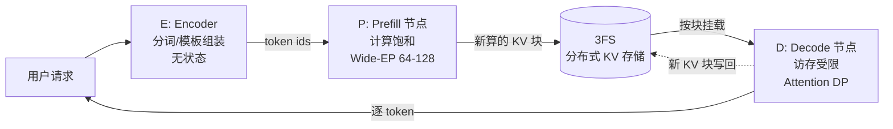

# 03 总体架构：E/P/D 分离

第 02 章说过，prefill 和 decode 一个计算受限、一个访存受限，混跑互相伤害。本章讲 DeepInfer 的结构性答案：把请求的生命周期拆到**三类物理隔离的节点**上——Encoder（E）、Prefill（P）、Decode（D），中间用一个分布式文件系统 3FS 串起来。读完这章你应该能回答：为什么拆的是这三段、KV 怎么在节点间流动、以及为什么一个「文件系统」会成为整个架构的枢纽。

## 1. 分离的动机：先把互相伤害讲具体

混跑一台机器上，伤害发生在两个方向：

**prefill 伤害 decode。** 一条 8000 token 的长 prompt 到达，prefill 要做一次 8000 个位置的大矩阵乘，独占计算单元几百毫秒。这期间同一块 GPU 上所有正在 decode 的请求全部停摆——用户屏幕上的字停了一下。长 prompt 越多，「卡顿」越频繁。

**decode 伤害 prefill。** decode 侧为了吞吐，把几十条请求的 KV Cache 常驻在显存里（这是它高吞吐的前提）。这批常驻显存挤压的是 prefill 需要的**临时激活空间**——prefill 一根 8000 token 的序列，每层中间结果都是 8000×隐藏维度的张量。KV 挤多了，长 prompt 直接分配失败（OOM）。

两种负载对硬件的「最优配置」也是反的：prefill 想要算力堆满、显存临时大进大出；decode 想要带宽快、显存深（驻留更多请求）。同一批节点按谁调优都亏。

解法有两档。**软分离**（chunked prefill，[第 07 章](07-scheduler.md)）：不拆机器，把长 prefill 切成小块，每算一块插一步 decode，用调度强制两类负载轮流用 GPU——单机小规模够用。**硬分离**（E/P/D）：直接拆到不同物理节点群，各自按自己的瓶颈配硬件和并行策略——这是 DeepInfer 这种大规模服务的选择。注意 DeepInfer 并没有放弃前者：分离部署的集群内部，P 节点自己跑多个并发 prefill 时仍然用 chunked 预算控制（QA 文档里的二次成本模型 cost(q, c) 就是用来反解最优 chunk 大小的）。

## 2. 三类节点各自是什么

### E（Encoder）：入口层

请求进入集群的第一站：分词（文本变 token id）、按对话模板组装（system / user / assistant 拼接、加特殊标记）、以及多模态输入的编码。它**无状态**——不碰模型权重、不存 KV，处理完就把 token 序列交给调度层。无状态意味着天然可以水平扩展（流量大了加机器就行），也意味着它和 GPU 推理解耦：入口的流量抖动不会传导到推理节点。单独设 E 这一层，本质是把「杂活」从昂贵的 GPU 节点上剥出去。

### P（Prefill）：KV 的生产者

专职 prefill。它的特征几乎全部来自第 01 章的推导——prefill 是计算受限的，所以：

- **追求计算饱和**：把多条请求的 prompt 拼成大 batch 一起算，让 DeepGEMM 的分块矩阵乘吃满算力（[第 04 章](04-kernels.md)）；
- **MoE 通信划算**：DeepSeek 的 MoE 层每算一层，激活的 token 要按路由发往各专家所在的卡（all-to-all 通信）。batch 越大，单次通信摊到的 token 越多，通信成本占比越低——所以 P 侧敢把专家并行开到很宽（**Wide-EP，64~128 卡**，[第 05 章](05-parallelism.md)）；
- **不驻留 KV**：prefill 算出的 KV 是**产物**，算完就写入 3FS，本地不长期保存。P 节点的显存全部留给大 batch 的临时激活。

### D（Decode）：KV 的消费者

专职逐 token 生成。特征来自第 01 章另一半推导——decode 是访存受限的，所以：

- **核心指标是 KV 驻留密度**：HBM 里塞下越多并发请求的 KV，每步组批越大，带宽利用率越高。D 节点选卡的标准是「显存大、带宽快」而不是「算力强」；
- **并行策略反着来**：decode 每步只有很少的 token（batch 数 × 1 个位置），MoE 的 all-to-all 通信摊不满，通信占比会反噬延迟——所以 D 侧用 **Attention DP**（数据并行：每张卡独立服务一组请求的完整注意力），MoE 专家权重按卡复制或小范围分片，把通信本地化（[第 05 章](05-parallelism.md)）；
- **KV 长驻 + 增量写回**：decode 每步新增的 KV 写入本地块表，并异步写回 3FS。



P 用大 EP、D 用小 EP/DP，这是「同一模型在集群两半跑两套并行策略」的实例。怎么做到的：权重怎么切、KV 怎么流动，中间的粘合剂就是 3FS。

## 3. KV 的「搬家」：3FS 是枢纽

分离部署最贵的问题立刻出现：**prefill 算出的 KV 在 P 节点的显存里，decode 却发生在 D 节点。** KV 必须跨节点流动，而且流量不小——每个生成的 token、模型每一层都要写一段 K/V，乘上并发请求数，就是一条持续的数据河。

DeepInfer 的答案是让 KV 彻底归存储层所有：**KV 数据本身和「哪个请求的哪个位置映射到哪个块」的块表，都以块为单位存在 3FS 上**（3FS 是 DeepSeek 自研的高性能分布式文件系统，为高吞吐随机读写设计，生产块大小 128 token）。P 节点算完 prefill，把 KV 块写进 3FS；D 节点接手请求时，按块表把需要的块挂载到本地显存，接着 decode；decode 过程中新增的 KV 块再持续写回。

只当「搬运工」还不足以解释它的地位。3FS 同时扮演三个角色：

**KV 总线。** E/P/D 三类节点之间所有 KV 的流动都走它。节点间不需要点对点传输 KV——写的人写文件，读的人读文件，解耦了生产消费的时间差（P 算完可以先干别的，D 空闲了再挂载）。

**前缀缓存仓库。** KV 块持久化在 3FS 上并带 **TTL（存活时间）**：agent 流量 3 天、chat 流量 7 天（QA 文档原文数字）。 TTL 内，任何新请求只要前缀和已有块匹配，直接挂载复用，prefill 整段跳过——这比「进程内前缀缓存」强得多：跨请求（不同用户共享 system prompt）、跨时间（今天的请求命中昨天算过的块）、跨节点（任何 D 节点都能读）。

**断点续算的持久层。** D 节点故障时，另一台 D 节点挂载同一批 KV 块，从最后写入的位置继续 decode——请求不重头算，用户几乎无感。这是「把状态管起来」（第 02 章）在集群维度的形态。

一个存储组件同时解决**传输、复用、容灾**三个架构级难题。回看第 02 章的结论——三个设计目标都压在 KV 生命周期管理上——3FS 就是那个管理器的物理载体。这也解释了为什么 DeepInfer 未开源的组件里恰好有「KV cache 管理」：它与 3FS 的块语义、集群拓扑深度耦合。

## 4. 一个请求的完整旅程

把全链路按时间顺序串一遍：

```text
1. 请求到达 → 负载均衡 → E 节点：分词、按模板组装 → token id 序列
2. 调度决策：前缀查询 3FS
     命中   → 命中段直接挂载已有 KV 块，跳过这段 prefill
     未命中 → 请求发往某个 P 节点，对剩余 prompt 段做（chunked）prefill
3. P 节点算出的新 KV 块写入 3FS；请求路由到某个 D 节点
4. D 节点挂载块表到本地显存，进入 decode 循环：
     组批（continuous batching）→ forward（FlashMLA）
     → （可选）DSpark 推测解码 → 采样 → 结构化输出掩码
   新 KV 块随生成持续写回 3FS
5. 终止条件（EOS / max_tokens / stop）→ 请求结束
   KV 块不立即删除，按 TTL 留在 3FS 等待复用，过期自动回收
```

两个值得停留的瞬间。第 2 步的「前缀查询」是 TTFT 的大杀器：一条带 4000 token system prompt 的 agent 请求，如果 prompt 已在 3FS 里（TTL 内有人用过），prefill 只需算新增的对话部分。第 4 步的循环内部还有一个隐形的调度世界：块池吃紧时调度器会**抢占**低优先级请求——回收它的 KV 块、把它退回等待队列稍后重算，把显存让给更急的请求。抢占-重算的完整逻辑在 [第 07 章](07-scheduler.md)，miniflow 一比一复刻了这个行为。

## 5. 负载均衡：分离架构的代价

拆成三类节点后，「均衡」从一个问题变成三个：

- **P 侧**：MoE 的专家负载天然不均（热门专家被路由的频率可能数倍于冷门专家），需要 EPLB 动态重排专家到卡的放置（[第 05 章](05-parallelism.md)）；
- **D 侧**：请求会生成多长**事前未知**——按请求数均衡是滞后的，某台 D 节点可能恰好接了一堆长请求把显存驻满；
- **存储侧**：哪些前缀值得留在 3FS（TTL 之外要不要续命），本质是流量预测问题。

这三个问题分别需要不同的信息（路由统计、生成长度分布、前缀热度），没有任何一个是「通用正确」的解——它们和 DeepSeek 内部的流量特征深度绑定。这就是第二个未开源组件「负载均衡」的由来：不是藏着掖着，而是离开它的流量土壤就没有意义。

---

## miniflow 对应实验

miniflow 是单进程单机引擎，跑不了集群，但把这套架构的**逻辑形态**完整保留了——你可以逐个模块对回本章概念：

| DeepInfer | miniflow | 位置 |
|---|---|---|
| E 节点的分词/模板 | `Tokenizer.encode` | `miniflow/tokenizer.py` |
| P/D 分离的流水 | `LLMEngine.step()`：prefill 与 decode 同批异构推进 | `miniflow/engine.py` |
| 3FS 块级 KV | `PagedKVCache`：块池 + 块表 + 引用计数 | `miniflow/cache/paged_kv.py` |
| 前缀缓存 / TTL | `PrefixCache`：条目持块引用，跨序列复用 | `miniflow/cache/prefix_cache.py` |
| 调度让路（抢占） | `Scheduler`：最晚到达者被回收重算 | `miniflow/scheduler.py` |

```bash
python examples/demo_paged_kv.py       # 块的分配/回收/引用计数
python examples/demo_prefix_cache.py   # 前缀命中跳过 prefill
python examples/demo_scheduler.py      # 抢占-重算-全部完成
```

| 上一章 | 下一章 |
|---|---|
| [02 三大设计目标](02-goals.md) | [04 内核层：FlashMLA/DeepGEMM/DeepEP](04-kernels.md) |