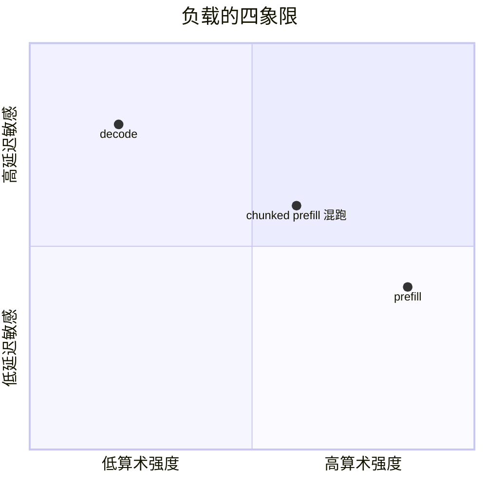
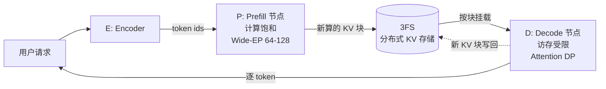

# 03 总体架构：E/P/D 分离

!!! question "本章问题"
    - 为什么要把 prefill 和 decode 拆到**物理上不同的节点**？
    - 一个请求的 KV 如何在集群里「搬家」？
    - 3FS 在这套架构里扮演什么角色？

---

## 1. 分离的动机：两种负载，两种芯片用法

[第 01 章](01-overview.md) 已经看到：prefill 是**计算受限**的大矩阵乘，
decode 是**访存受限**的单 token 前向。混跑在同一批节点上会互相拖累：



- 一个长 prompt 的 prefill 突然进来，decode 的批被挤占 → 在跑请求的
  TPOT 瞬间劣化（用户看到「卡了一下」）；
- decode 常驻的大 KV 挤占 prefill 需要的临时激活显存 → 长 prompt
  直接 OOM。

解法有两档：

| 方案 | 做法 | 适用 |
|---|---|---|
| **chunked prefill**（软分离） | 把长 prompt 切块，按时间预算混进 decode 批 | 单机/中小规模 |
| **E/P/D 分离**（硬分离） | prefill 与 decode 跑在**不同物理节点** | 大规模、 DeepInfer 的选择 |

DeepInfer 两者都用：分离部署的骨架 + 集群内仍保留 chunked prefill 的
预算控制（QA 里提到的二次成本模型 cost(q, c) 反解 chunk 大小 q ——
[第 07 章](07-scheduler.md) 详述）。

## 2. 三类节点

**E（Encoder）**：把文本变成 token id 序列 +（推测）附带的编码服务。
入口层，无状态，天然可水平扩展。

**P（Prefill）**：专职 prefill。特点：

- 计算饱和：大 batch 矩阵乘把算力喂满，用 DeepGEMM 的
  分块满血矩阵乘（[第 04 章](04-kernels.md)）；
- 算完的 KV 是「产物」—— 它不消费 KV，只**生产** KV；
- MoE 层的 all-to-all 通信在大 batch 下摊薄 —— **Wide-EP**
  （EP64~128，专家并行开到 64~128 卡）在这一侧划算
  （[第 05 章](05-parallelism.md)）。

**D（Decode）**：专职 decode。特点：

- 访存受限：核心指标是「KV 驻留密度」—— 谁能让 HBM 里塞下更多
  请求的 KV，谁的吞吐就高；
- **Attention DP**（数据并行）而非大 EP：每个卡独立服务一组请求的
  完整注意力，避免 decode 小 token 数下 all-to-all 的通信死亏；
- MoE 专家权重按卡复制/分片，路由本地化。



## 3. KV 的「搬家」：3FS 是枢纽

分离部署最贵的问题：**prefill 算出的 KV 在 P 节点的显存里，decode
却发生在 D 节点**。KV 必须跨节点流动，而且流量巨大（每个 token、每层
都要 K/V）。

DeepInfer 的答案：**KV 与「KV 到 slot 的映射」都归存储层所有** ——
3FS（Fire-Flyer File System，DeepSeek 自研的高性能分布式文件系统）：

- KV 以**块**（生产块大小 128 token）为单位持久化在 3FS 上；
- P 节点算完 prefill，块写入 3FS；D 节点按块表**挂载**这些块到本地
  显存继续 decode；decode 新增的 KV 再写回；
- **TTL 分级**：agent 流量 3 天、chat 流量 7 天（QA 原文数字）——
  过期块自动回收，同一前缀的后续请求在 TTL 内直接命中，prefill 整段
  跳过。

!!! tip "3FS 的三个身份"
    1. **KV 总线**：E/P/D 之间 KV 的传输通道；
    2. **前缀缓存仓库**：跨请求、跨时间、跨节点的块级复用；
    3. **断点续算的持久层**：decode 节点故障，另一节点挂载同一批块
       从断点继续 —— 请求不重头算。

    一个存储组件同时解决三个架构级难题，这是 DeepInfer 架构里
    最「划算」的一笔设计。

## 4. 请求的完整旅程

把全链路串起来（结合 QA 里的部署形态）：

```text
1. 用户请求 → 负载均衡 → E 节点分词、组装模板
2. 调度决策：前缀能否命中 3FS 里的现存块？
   命中  → 跳过命中的 prefill 段
   未命中 → P 节点对剩余 prompt 段做 prefill（chunked）
3. 新 KV 块写入 3FS；请求路由到某 D 节点
4. D 节点挂载块表，进入 decode 循环：
     组批（continuous batching）→ forward（FlashMLA）
     → （可选）DSpark 推测解码 → 采样 → 结构化输出掩码
   新 KV 块持续写回 3FS
5. EOS / max_tokens / stop → 终止，KV 块按 TTL 生命周期留存
```

注意第 2 步与第 4 步各有一个「调度让路」的时刻 —— 高峰期块池吃紧时，
调度器会**抢占**低优先级请求（回收其 KV，状态回退，稍后重算）。
miniflow 的 `demo_scheduler.py preempt` 一比一复刻了这个行为
（[lab/04](../lab/04-scheduler.md)）。

## 5. 为什么「负载均衡」是第二个未开源组件

E/P/D 分离把「均衡」变成了三维难题：

- **P 侧**：MoE 专家负载不均 → EPLB（Expert Parallelism Load
  Balancer）动态重排专家放置（[第 05 章](05-parallelism.md)）；
- **D 侧**：请求长度未知（事前不知道会生成多少 token）→ D 节点间
  的请求数均衡天然滞后于真实负载；
- **存储侧**：哪些块值得留在 3FS（TTL 之外的淘汰策略）本质是
  流量预测问题。

DeepInfer 未开源 KV cache 管理与负载均衡这两个组件 —— 大概率因为
它们与内部集群拓扑、流量特征深度耦合，剥离不出「通用正确」的版本。

---

## miniflow 对应实验

miniflow 是单进程单机的，但把架构的**逻辑形态**完整保留：

| DeepInfer | miniflow | 位置 |
|---|---|---|
| P/D 分离的流水 | `LLMEngine.step()`：prefill 与 decode 同批异构推进 | `miniflow/engine.py` |
| 3FS 块级 KV | `PagedKVCache`：块池 + 块表 + 引用计数 | `miniflow/cache/paged_kv.py` |
| 前缀缓存/TTL | `PrefixCache`：条目持块引用，跨序列复用 | `miniflow/cache/prefix_cache.py` |
| 调度让路 | `Scheduler._preempt()`：最晚到达者被回收重算 | `miniflow/scheduler.py` |
| 零开销批调度 | `AsyncLLMEngine`：双线程 schedule/forward 流水线 | `miniflow/engine.py` |

```bash
python examples/demo_paged_kv.py      # 块的分配/回收/引用计数
python examples/demo_prefix_cache.py  # 前缀命中跳过 prefill
python examples/demo_scheduler.py preempt  # 抢占-重算-全部完成
```

| 上一章 | 下一章 |
|---|---|
| [02 三大设计目标](02-goals.md) | [04 内核层：FlashMLA/DeepGEMM/DeepEP](04-kernels.md) |