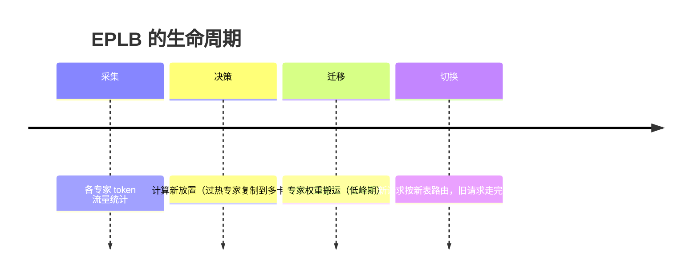

# 05 并行策略：Attention DP + Wide-EP + EPLB

!!! question "本章问题"
    - 为什么 decode 的注意力用 **DP**（每卡独立整段序列），prefill
      却敢用 **EP64~128** 的宽专家并行？
    - MoE 的专家放置为什么需要**动态重排**（EPLB）？
    - 「Attention DP + Wide-EP」这个组合拳妙在哪？

---

## 1. 先问：并行是为了解决什么

单卡放不下 R 级模型（权重 + KV + 激活），必须切。但**怎么切**，
prefill 与 decode 的最优解完全不同 —— 这章是 [第 03 章](03-architecture.md)
「分离部署」在并行维度的续篇。

## 2. 注意力：decode 用 DP

**Attention Data Parallel**：每个卡独立服务**完整的一组请求序列**
（所有层、所有头都在本卡），卡间在注意力部分零通信。

为什么 decode 侧这样选：

- decode 的注意力计算 = 读自己序列的 KV + 算 1 个新 token 的注意力
  —— **纯本地操作**，没有跨卡需求；
- 若把一条序列切到多卡（tensor parallel 注意力），每层每步都要
  all-reduce —— decode 每 token 一次通信，TPOT 直接被通信延迟吃掉；
- DP 的扩展性：卡数 ↑ = 可服务的并发请求数 ↑，线性且无通信成本。

代价：每张卡要有**完整模型的注意力权重**（与 EP 部分正交，见下）。

## 3. MoE：Wide-EP（64~128 卡）

MoE 层的 token 要**路由到专家所在卡**（[第 04 章](04-kernels.md)
DeepEP），这决定了它的并行选择与注意力完全不同：

- **EP（Expert Parallel）**：专家分散在多卡，token 按 dispatch 发送；
- **Wide-EP（64~128）**：专家并行开得很宽 —— 每卡放的专家少、
  单卡专家 batch 反而大（分摊到 fewer experts per card 后，
  每个专家分到的 token 更多），DeepGEMM 的「分块满血」模式才能吃满。

!!! tip "组合拳：Attention DP × Wide-EP"
    同一张卡上有两种身份：

    ```text
    注意力层：DP 成员 —— 本卡请求的完整注意力（无通信）
    MoE 层：  EP 成员  —— 全局 token 路由到本卡专家（all-to-all）
    ```

    attention 的「无通信」+ MoE 的「宽 EP 大 batch」各取所需。
    这是 DeepInfer 集群效率的关键拼图：**按层类型混搭并行策略**，
    而不是全局统一一种。

## 4. prefill 侧为什么敢更宽

prefill 一次算几百上千 token：

- token 数大 → 每个专家分到的 batch 大 → **EP 通信的固定延迟被
  摊薄**，宽 EP（64~128）划算；
- DeepGEMM 分块满血模式在 P 节点吃满算力（[第 04 章](04-kernels.md)）；
- 反之 decode 每 token 才 1 个新 token，宽 EP 的通信占比高到不可接受
  —— 这就是 D 节点用 Attention DP 的原因（回看第 2 节）。

## 5. EPLB：专家放置的动态均衡

MoE 的路由是**数据驱动的**：某段时间「代码专家」热、「数学专家」冷，
负载就会歪 —— 热专家所在的卡排队，冷专家的卡闲着。EPLB
（Expert Parallelism Load Balancer）做三件事：

1. **监控**：持续统计各专家的真实 token 流量；
2. **重排**：把过热专家**复制/搬移**到轻载卡（专家权重可复制多份，
   路由层按副本均衡分发）；
3. **无扰切换**：重排期间新请求用新放置，在跑请求沿旧路径走完。



!!! note "未开源组件之二"
    DeepInfer 未随仓发布负载均衡组件（与 KV cache 管理并列的两个空缺）。
    推测原因：均衡策略与集群拓扑、专家容量配置、流量画像深度耦合 ——
    剥离出「通用正确」版本的工程成本高于收益。

## 6. miniflow 的教学对应

miniflow 单进程跑 CPU，物理并行不存在，但**结构决策**全部保留：

| DeepInfer 并行概念 | miniflow 结构 | 位置 |
|---|---|---|
| GQA / MLA 压 KV | `num_kv_heads < num_attention_heads` 的 GQA | `miniflow/config.py` |
| MoE top-k 路由 | 逐 token 的专家路由 + 加权求和 | `miniflow/model/moe.py` |
| 专家容量/过载 | top-k 之外的专家不激活（无容量丢弃，教学简化） | `miniflow/model/moe.py` |
| SWA 稀疏层 | 滑动窗口注意力（窗口外不参与） | `miniflow/model/layers.py` |
| 层类型异构 | dense 层与 MoE 层混排 | `miniflow/model/transformer.py` |

值得注意的观察点：**「哪些层用 MoE、哪些层用 SWA」写在 config 里** ——
模型结构的异构性（dense/MoE、全注意力/SWA 混排）是 DeepSeek V4.1 的
形态，也是并行策略「按层混搭」的物质基础。

---

| 上一章 | 下一章 |
|---|---|
| [04 内核层](04-kernels.md) | [06 KV Cache：分页/3FS/SWA/有界重放](06-kvcache.md) |