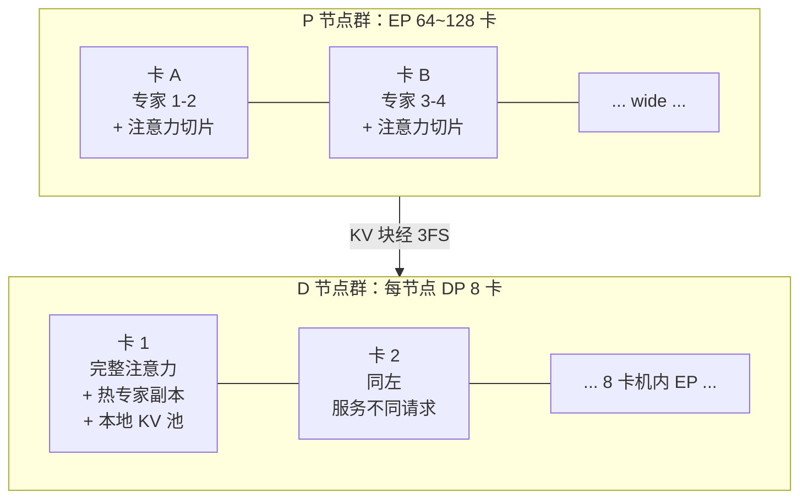

# 05 并行策略：Attention DP + Wide-EP + EPLB

671B 的模型，权重 FP8 要 671 GB，加上 KV Cache 和临时激活，任何单卡（H800 显存 141 GB）都放不下，必须切到多卡。**怎么切**就是并行策略。本章的核心结论先给出来：prefill 和 decode 的最优切法完全不同，而且 DeepInfer 在**同一个模型的不同层上混搭了两种并行**——注意力层用数据并行（DP），MoE 层用专家并行（EP）。这个混搭是本章要讲透的东西。

本章路线：先建立并行的词汇表（三种切法各自的直觉和代价），再逐个回答「decode 注意力为什么 DP」「MoE 为什么 EP 且要宽」，然后拼出组合拳（一张卡的双重身份），最后讲 EPLB（路由热度不均的动态解药）。穿插的算账都基于第 01/04 章的数字。

本章路线：先建立并行的词汇表（三种切法 + 两个通信原语的解剖），再逐个回答「decode 注意力为什么 DP」「MoE 为什么 EP 且要宽」，然后拼出组合拳（一张卡的双重身份），讲 EPLB（动态均衡），最后给一张通信总账的决策卡和一棵部署形态决策树。所有的选型结论都落在可复算的算术上——**结论有半衰期，决策卡是保鲜手段**。

读完本章，你应该能回答：

- DP/TP/EP 各切什么？各自的通信发生在哪、代价是什么？
- 为什么 decode 的注意力是 DP 的完美场景、而 TP 在 decode 是灾难？
- Wide-EP 为什么是 prefill 专属？decode 侧的 MoE 怎么绕开通信？
- 「按层混搭并行」的物质基础是什么（模型结构预埋了什么）？
- EPLB 解决什么问题？专家复制和无扰切换是怎么做到的？

## 1. 先建立词汇：切模型有哪几种切法

并行的教科书分类，按「切的是什么」分三种。第一次接触不必怕，记住直觉就够了。

### 1.1 数据并行（DP）：复制模型，切数据

**每张卡放完整的模型，各自处理不同的数据**。

训练里最常见：每卡算自己那批数据的梯度，再同步（把各卡梯度加起来更新权重）。卡间通信只发生在同步点——每步一次、通信量与参数量同级。

放到推理里：每张卡服务不同的一组请求，**从头到尾互不打扰**——请求 A 住在卡 0，它的所有层、所有 token 都在卡 0 算完。通信只在「引擎层调度」发生（决定哪个请求去哪张卡），计算层零通信。

DP 的代价一目了然：**每张卡要装下完整模型**。671B 的模型一张卡装不下，所以纯 DP 在大模型推理里不存在——但本章后面会看到，DeepInfer 的「Attention DP」是**按层**的 DP：注意力层不大（参数占比小），每卡装下完整注意力层是可行的——「DP」这个词用在了层粒度上，这是初学者最容易迷糊的点，先钉住。

### 1.2 张量并行（TP）：切矩阵本身

**把单个矩阵切开**——比如一个大权重矩阵（7168×16384）按列切成两半，两张卡各算一半（每卡算 7168×8192 的乘法），结果再拼起来。

切的 granularity 是「矩阵的维度」，所以**模型多小都能切**（这是它和 DP 的本质区别——TP 是「装不下」问题的直接解药）。代价藏在做乘法的流程里：每张卡算的是「部分和」，完整结果要求每卡拿到其他卡的部分和——**每层每步都要一次 all-reduce 通信**（把各卡的部分结果加起来、再广播回去）。

通信频率是 TP 的死穴：61 层 × 每层 2 次 all-reduce（注意力+MLP 各一次）= 每 step 122 次同步。这些通信在 NVLink 上单次几百微秒，但**串行地嵌在层与层之间**（下一层要等上一层 all-reduce 完）——延迟累加，且不能靠「算得快」掩盖。

### 1.3 专家并行（EP）：MoE 专用的模块切法

MoE 有几百个独立的「专家」（小网络），token 按路由表被发给「持有目标专家的卡」去算，算完发回来。**天然按模块边界切**——专家本来就是独立的小矩阵，切开不伤任何单个计算。

通信发生在 dispatch/combine（[第 04 章](04-kernels.md) DeepEP）：每层两次 all-to-all，通信量 = token 数 × top-k × hidden 维度。注意这个量**和专家数无关**（256 个专家分布在多少张卡上，每个 token 都是发给 8 个专家所在的卡）——**EP 的通信量只看 token 数，不看切了多宽**。这个性质是「Wide-EP」可行的数学基础（后面 3.2 节展开）。

还有一个流水并行（PP，按层切：卡 0 算 1~15 层、卡 1 算 16~30 层……像流水线传送带），DeepInfer 的集群里用得不多（推理的流水 bubble 吃不到训练 batch 的摊销），本文略过。

### 1.4 一张对比表

| | 切什么 | 每卡放什么 | 通信模式 | 通信频率 | 通信量 |
|---|---|---|---|---|---|
| DP | 数据（请求） | 完整模型（或完整某层） | 无（调度层才路由） | 零 | 零 |
| TP | 矩阵维度 | 每层的 1/N | all-reduce | **每层每步** | 与激活同级 |
| EP | 模块（专家） | 1/N 的专家 | all-to-all | 每层（MoE）一次 | token×top-k×hidden |
| PP | 层 | 1/N 的层 | 点对点（层间） | 每层边界 | 激活 |

记住这张表，后面所有的「为什么选它不选它」都是在这张表上做算术。

现在可以问本章真正的问题了：**decode 的注意力为什么选 DP？MoE 为什么选 EP 而且开到 64~128 卡这么宽？**

### 1.5 预备：集合通信的两个原语

1.4 表里反复出现的 all-reduce 和 all-to-all，值得两段解剖——后面所有通信的账都建立在这两个原语的成本模型上。

**all-reduce（求和广播）**：所有卡各持一个向量，结束时**每张卡都要拿到所有人的总和**。TP 的每层同步靠它。经典实现是 **Ring 算法**：64 张卡围成环，数据切成 64 段，每步每卡把自己的段传给邻居、累加收到的段——转 63 圈后每卡拼出完整和。

Ring 的成本模型（记住这个，通信的直觉就有了）：

$$
\text{数据量每卡} = \frac{2(N-1)}{N} \times V, \quad \text{时间} \approx \frac{2(N-1)}{N} \times \frac{V}{\text{带宽}}
$$

其中 $V$ 是单卡的向量大小、$N$ 是卡数。两个关键性质：(1) **每卡发送量与卡数无关**（趋近 2V）——数据量不随集群变大有分摊效应；(2) 但**延迟随跳数累积**——小消息时（延迟主导）环要串行转 N 圈，$N$ 越大越慢。所以：**all-reduce 吃大消息（带宽模型），怕小消息高频次（延迟模型）**——这正是它在 prefill 友好、decode 恶劣的根子。

**all-to-all（全交换）**：每张卡给**其他每张卡**发一份**不同的**数据（64 卡就是 63 出 93 进的矩阵式流动）。MoE 的 dispatch/combine 靠它。它的成本模型更「碎」：

$$
\text{每卡发出} = \sum_j V_{ij}, \quad \text{时间} \approx \max_j \text{(路径拥塞)} + \text{固定开销}
$$

没有 ring 那样的优雅摊销——它是 $N^2$ 条流的调度问题，**最大的一条流或最堵的一条路决定总时间**（木桶的通信版）。这个「木桶性」正是 5.1 节负载不均直接砸进通信时间的原因：热专家的那条流最长，全员等它。

两个原语的性格差异可以一句话记住：**all-reduce 是合唱（大家同一个剧本），all-to-all 是私聊（每人不同的话说给不同的人）**——合唱好指挥，私聊怕话痨。

## 2. decode 注意力：DP 的完美场景

### 2.1 decode 注意力的数据范围：私有、私有、还是私有

decode 每步对一条请求做的事：读它自己的全部 KV Cache，算 1 个新 token 对全部历史的注意力。

注意这个操作的**数据范围**：

- KV Cache 是这条请求私有的（别的请求不读它）；
- 新 token 也是这条请求私有的（别的请求不参与）；
- 权重是共享的——但推理的权重只读不写，共享读取不需要同步。

「各条请求的数据互相独立 + 权重只读」——这正是 DP 的理想条件：**只要一条请求从头到尾住在同一张卡上，decode 的注意力就是纯本地计算，卡间零通信。** 这正是 Attention DP 的安排：每个 D 节点的每张卡独立服务一组完整请求（注意力部分的所有层、所有头都在本地），请求进卡后不再搬家。

### 2.2 反面对照：TP 在 decode 是灾难

如果为装下模型把注意力按头切到 8 张卡（TP8），每层每步都要一次 all-reduce。算一笔 TPOT 账：

```text
decode 一个 step（61 层，TP8）：
  计算本体：~10 ms（带宽受限，第 01 章的账）
  通信：61 层 × 2 次 all-reduce × 约 0.3 ms（NVLink 单次 + 同步开销）
      ≈ 37 ms
  总计 ≈ 47 ms —— 通信是计算的 3.7 倍！

  若跨机 TP（RDMA，单次 ~2 ms）：
  通信 ≈ 61 × 2 × 2 ms ≈ 244 ms —— TPOT 直接爆掉 SLO 十倍
```

decode 的毫秒预算里**塞不下每层通信**——结论清晰：decode 侧的并行策略必须把通信从「每层」降到「每层内的通信逃逸项」。Attention DP 把它降到零。

prefill 反过来一个 step 几百毫秒，通信 37 ms 占比 10~20%——痛但不致命，且 prefill 的 TP 能把大层切开吃满算力（M 肥硕的 GEMM 切到多卡并行算，MFU 反而更高）。**同一个 TP，在 prefill 是工具、在 decode 是毒药**——「并行策略是负载属性不是模型属性」（第 03 章的结论）在 TP 身上最极端地体现。

### 2.3 Attention DP 的账：装得下吗

DP 的代价是每张卡要有完整的注意力权重。算一下：

```text
DeepSeek-V3 注意力层的参数（每层）：
  Q 投影：7168 × (128头×128维) = 7168 × 16384 ≈ 117M
  O 投影：16384 × 7168 ≈ 117M
  MLA 的 W_down/W_up（latent 512 + 解耦 RoPE 64）：
    7168 × 576 + (576+64) × 16384 ≈ 12M ≈ 可忽略
  合计每层 ≈ 236M 参数 → FP8 下约 236 MB
  61 层（其中 3 层 dense、58 层 MoE，注意力都在）× 236 MB ≈ 14.4 GB
```

一张 H800 的 141 GB：注意力全量 14.4 GB + MoE 份额（下一节）+ KV 池（大头）——**装得下，还很宽裕**。这就是 Attention DP 可行的物质基础：注意力只占模型参数的约 4%（MoE 占 96%），复制这点权重的浪费「买得起」。

**DP 的扩展性**也最干净：卡数翻倍 = 可服务的并发请求数翻倍，卡间注意力零通信，没有协调成本。D 节点加卡是纯线性扩容（第 03 章「D 群弹性」的并行学基础）。

### 2.4 注意力的 KV：为什么 DP 顺便解决了它

还有一个隐性的收益值得点名：**KV Cache 天然不需要跨卡**。

DP 下一条请求整体住一张卡，它的 KV 就在那张卡的 HBM 里增长——不存在「KV 切到多卡、注意力算的时候再聚合」的问题（TP8 下 KV 也要按头切，每步的 all-reduce 里含着 KV 的读取聚合）。KV 是 decode 每步都要全量读的大头（第 02 章 $\frac{W}{B}+K$ 的 K 项），**让 K 完全本地化 = 让每步最大的读取不过网络**。

「KV 不动、权重动」——D 侧并行的第一原则（第 03 章 2.3 节说过）在并行策略层的落实：权重复制一份是静态成本（放一次就完），KV 跨卡是动态成本（每步都付）。**静态成本再大也优于动态成本**——这是推理并行设计的普适剪刀。

### 2.5 边界情形：DP 的两个裂缝

Attention DP 在 decode 是完美场景，但诚实起见要标出两个裂缝——它们是「DP 神话」的边界：

**裂缝一：请求的负载不均传导到卡。** DP 把请求整条分给卡，卡的负载 = 分到请求的总 KV 量 + 各自生成长度。调度器按「请求数」均衡分卡时，一条 100K token 的长请求等于几百条短请求的 KV——分到它的卡先显存耗尽。按「预期 KV」均衡（第 03 章 6 节 D 侧均衡）是补救，但生成长度事前未知，预测总会错。**DP 把「路由不均」（MoE 的问题）换成了「请求不均」（注意力侧的问题）**——木桶没有消失，只是换了根板。解药是运行时再均衡（迁移请求 = KV 挂载转移，3FS 让这个操作出奇便宜）。

**裂缝二：prefill 侧的 DP 是浪费。** P 节点若也用 Attention DP，每卡只能算「分给自己的请求」的 prefill——P 的大 GEMM 吃不满（batch 被切成 1/64）。所以 P 侧注意力用 TP（切分吃满算力）——**同一个注意力层，D 侧 DP、P 侧 TP**，两副面孔（3.5 节对照表）。这个分裂再次印证主旋律：并行策略跟着负载走，连「同一个层」都不例外。

裂缝的存在不是 DP 的失败——是「任何静态切分都有边界情形」的普遍规律。识别裂缝、配上动态补救（再均衡/切换切法），比追求完美静态方案更工程正。

## 3. MoE：Wide-EP（64~128 卡）

### 3.1 MoE 为什么必须切

注意力之外的参数大头在 MoE 层：58 层 × 每层 256 个专家（路由 8 个）+ 1 个共享专家。算总账：

```text
每专家：两层 MLP ≈ 7168 × 2048 × 2 ≈ 29M 参数
每层 MoE：256 × 29M ≈ 7.5B 参数 + 共享专家 ≈ 0.03B
58 层 × 7.5B ≈ 434B 参数 —— 全模型 671B 的 65%
FP8 下 ≈ 434 GB —— 30 张 H800 才装得下
```

434 GB 的专家权重没法复制（每张卡都放全量？434 GB × 64 卡 = 27 TB 的显存预算，天文数字）——**MoE 只能切**：256 个专家分到 64 张卡（每卡 4 个），这就是 EP。**注意力（4% 参数）选择复制（DP），MoE（96%）只能切分（EP）**——组合拳的形态由参数分布直接决定，不是设计趣味。

### 3.2 「宽」的数学：EP 的通信量与宽度无关

EP 的通信量 = token 数 × top-k × hidden 维度。注意这个式子里**没有卡数**——256 个专家分布在 8 张卡还是 128 张卡上，每个 token 都是发给 8 个专家所在的卡、每个专家回一份结果。

所以加宽 EP（更多卡）**不增加通信量**，只增加 all-to-all 的「扇出」——通信的并行度反而更高（128 卡的 all-to-all 比比 8 卡的更「散」，但 DeepEP 的拓扑路由能吃满 NVLink+RDMA 的复合带宽）。

加宽的收益是直接的：

- **每卡专家数变少**：64 卡 → 每卡 4 个专家；128 卡 → 每卡 2 个。每卡要驻留的专家权重从 54 GB 降到 27 GB——**省下的显存给 KV 池**（D 节点）或给激活（P 节点）；
- **单专家的 batch 变肥**：10000 个 token 进来路由到 256 专家，平均每专家约 312 个 token（10000×8÷256）。这个数**与卡数无关**（路由是按专家不按卡），但每卡的 batch（4 个专家共约 1250 token）随宽度上升——**DeepGEMM 满血模式的 M 维直接变肥**（第 04 章 2.3 节），MFU 跟着涨。

「宽」的本质：**用通信的并行度换显存的池化**——专家权重摊薄到更宽的卡群，每卡的显存压力下降、GEMM 的形状变好，代价为零（通信量不变）。这是 Rare 的「free lunch」结构，来自 MoE 的模块化天赋。

### 3.3 prefill 侧：敢开宽的前提

prefill 一次发 10000+ 个 token，每个 all-to-all 消息都很大（~570 MB/层，第 04 章 3.2 节的账），**带宽主导、固定延迟占比微不足道**。token 数还保证每个专家分到的 batch 足够大——分母（每卡专家数）越小、分子（总 token）越大，单专家 batch 越肥，DeepGEMM 的「分块满血」模式（[第 04 章](04-kernels.md)）才能吃满算力。所以 P 节点敢开到 EP64~128。

反过来 **decode 侧的 EP 是噩梦**：每卡每步只发一两个 token，all-to-all 变成「高频小消息」——第 04 章算过，固定延迟反噬 TPOT。所以 D 节点的 MoE 用**小范围 EP + 专家复制**（下节展开）。

同一个 EP，prefill 开到 128、decode 收缩到个位数——**宽度也是负载属性**。

### 3.4 decode 侧的 MoE：小 EP + 复制

decode 的 MoE 通信怎么解？DeepInfer（据公开信息推断，标注「推测」）的思路是**把通信本地化**：

**专家复制**：热门专家的权重在多卡放副本（D 节点内或小集群内），路由就近命中副本，通信尽量不出卡/不出机。复制系数是权衡：复制 k 份显存成本 ×k，但该专家的通信流量 ÷k——按专家热度分配复制系数（热的多复制），正是 EPLB（第 5 节）的工作。

**小范围 EP**：不追宽度，D 侧的专家并行收在一台机器（8 卡 NVLink 域）内——NVLink 的 ~900 GB/s 和亚微秒延迟，配合 DeepEP 低延迟内核（第 04 章 3.3 节），8 卡 all-to-all 的固定开销压到微秒级——**decode 的毫秒预算勉强塞得下「机内 EP」**。

组合效果：注意力零通信（DP）+ MoE 机内小 EP（低延迟内核 + 复制）——一个 decode step 的通信被压到「MoE 层的机内微秒级」，TPOT 完整性保住。

### 3.5 P 侧 vs D 侧的完整对照

把本章到现在为止的结论拼成对照表（这张表是本章的「总账」）：

| 维度 | P 节点（prefill） | D 节点（decode） |
|---|---|---|
| 注意力并行 | TP/大计算切分（吃满算力） | **Attention DP**（零通信） |
| MoE 并行 | **Wide-EP 64~128**（带宽主导，越宽越好） | 小范围 EP + 专家复制（延迟主导） |
| EP 消息形态 | 大消息（每步几十万 token） | 小消息（每卡 1~2 token） |
| 通信的敌人 | 带宽（GB/s） | 延迟（μs） |
| 权重驻留 | 全部激活专家摊薄到宽卡群 | 注意力全量 + 热专家复制 |
| 显存的大头 | 临时激活（大 batch 的中间结果） | KV 池（并发请求的驻留） |
| 扩展瓶颈 | 算力（加卡 = 加 MFU 池） | 显存（加卡 = 加 KV 容量） |

两张面孔背后是同一条公式（第 04 章 2.6 节的 Roofline 决策树）：**P 在屋顶右侧（算力受限）怎么切都为了 MFU，D 在屋顶左侧（带宽/延迟受限）怎么切都为了少通信**。第 03 章 P/D 分离的「架构级解法」，在这一章落成了「并行级解法」——两个层次说的是同一件事的两层皮。

### 3.6 附录：四种切法的通信总账（一张可打印的决策卡）

把本章所有的通信账合成一张「给定 batch 和模型，各切法每 step 通信多少」的决策卡。设定：61 层、hidden 7168、batch B 条请求、FP8（1 B/数）、NVLink 900 GB/s、RDMA 400 GB/s、消息固定开销 NVLink 0.05 ms / RDMA 0.5 ms（量级示意）：

```text
场景 A：prefill，B 条请求各 L token（每卡视角，8 卡切分）

TP8（注意力+全层切）：
  每层 2 次 all-reduce，每次激活量 BL×7168×1B
  通信 = 61×2×BL×7168B ≈ 0.87×BL MB
  B=8, L=4000 → 27.8 GB → NVLink 31 ms（step 计算约 300 ms，占比 10%）
  ✓ 可接受

EP64（MoE 专家分散）：
  每层 dispatch+combine，量 = BL×8×7168B（token×topk×hidden）
  通信 = 58×2×BL×57KB ≈ 6.6×BL MB
  B=8, L=4000 → 211 GB ÷ 64 卡分担 → 每卡 3.3 GB
  混合带宽（NVLink+RDMA 平均 ~600）→ 5.5 ms/层 → 全层 320 ms？
  —— 但有 DeepEP 重叠 + 大消息带宽摊销，实际墙钟 ≈ 计算时间
  ✓ 可接受（通信被覆盖）

场景 B：decode，B 条请求各 1 新 token

TP8：
  每层 2 次 all-reduce，量 = B×7168×1B ≈ 7KB×B
  B=64 → 458 KB/次 → 带宽时间 0.5 μs，但固定开销 50 μs 主导
  61×2×50 μs ≈ 6.1 ms（NVLink）—— 计算才 ~10 ms，通信 60%！
  ✗ 灾难（2.2 节的账重演）

Attention DP（注意力）+ 机内 EP8（MoE）：
  注意力：0
  MoE：每层 dispatch B×8 个对 ÷ 8 卡、combine 同量
       机内 NVLink + 低延迟内核（固定开销 ~5 μs）
       58×2×(5 μs + 458KB/900GB/s) ≈ 0.7 ms
  ✓ 通信 7%，SLO 内

场景 C：decode 的 MoE 若用跨机 EP64（反例）：
  58×2×(500 μs + ...) ≈ 58 ms —— ✗ 超 SLO 六倍
```

这张卡的用法：**新硬件/新模型出现时，重算这三个场景的数字，选型自动浮出**。比如 NVLink 单代翻倍：场景 B 的 TP 通信从 6.1→3.2 ms，仍不可接受（结论稳定）；带宽 + 固定开销同时降一个量级（下一代互联的承诺）：TP 的 decode 开始「可以谈」——那时第 2 节的结论要重审。**结论有半衰期，决策卡是保鲜手段**——把推理写成显式的算式，硬件换代时花十分钟重算，好过拍脑袋的「经验」悄悄过期。

### 3.7 部署形态决策树

把本章 + 第 03 章的结论合成一棵「你的场景该用什么并行组合」的决策树（初学者的实用工具）：

```text
你的模型多大？
├─ < 单卡显存（如 7B FP16 = 14 GB < 80 GB）
│    → 单卡跑，无需并行（本文全部章节是它的「长大后」版本）
├─ 单机多卡装得下（如 70B FP8 = 70 GB < 8×141 GB）
│    → TP2~8（节点内 NVLink）+ 或 DP（放得下就复制）
│    → 交互式单用户：TP（延迟最优、批小）
│    → 批量服务：DP（吞吐最优、零通信）
└─ 单机装不下（如 671B = 671 GB）
     → 必须跨机。此时每层 all-reduce 的跨机延迟杀死 TP
     → MoE 模型：EP（宽，模块化天赋）
     → dense 注意力部分：Attention DP（层粒度复制）
     → 流量大 + SLO 严：P/D 物理分离（第 03 章）
     → 流量小：单集群混跑 + chunked（第 07 章）
```

两个使用提示：第一，这棵树的每个分叉点都是**一次通信成本的算术**（不是品味）——拿到新场景先跑 3.6 的决策卡再查树，理解每一步「为什么」。第二，树会随硬件代际修剪（3.6 末尾的例子）——把它当活文档维护，别当教条背诵。

## 4. 组合拳：一张卡的双重身份

### 4.1 混搭的结构

现在把第 2、3 节拼起来，得到 DeepInfer 集群最独特的结构——**同一个模型，按层类型混搭两种并行**：

```text
注意力层：  每卡是 DP 成员  —— 服务本地请求的完整注意力，零通信
MoE 层：    每卡是 EP 成员  —— 接收全局路由来的 token，算本地专家
```

一次 decode step 里，一张卡的经历是这样的：

```text
[层 1..61 循环]
  1. 注意力子层（DP 身份）：
     取本地请求的 KV（本地 HBM）→ FlashMLA → 输出激活（本地）
     —— 零通信
  2. MoE 子层（EP 身份）：
     dispatch：本地 token 按路由表发给各专家所在卡（all-to-all）
     同时接收别的卡发来的、目标专家在本卡的 token
     compute：本卡专家对自己的 token 算 GEMM（连续布局模式）
     combine：结果发回原卡，加权求和
     —— 集中通信（机内 NVLink）
  3. 回到 1（下一层）
```

注意力段完全不通信、MoE 段集中通信——**每层的并行策略贴着该层的负载特性选**，而不是全局统一一种切法。

### 4.2 为什么这个组合是「互相救赎」

这个组合高效的原因值得说透：**两种并行各自的缺点被对方的场景回避了**。

DP 的缺点是「权重复制浪费」——但发生在注意力层，参数只占 4%，浪费得起（14.4 GB/卡，第 2.3 节的账）。EP 的缺点是「通信重」——但发生在 MoE 层，且 P 侧 token 多摊得薄（大消息带宽主导）、D 侧用复制+机内 EP 绕开（小消息延迟主导）。

**如果反过来会怎样**（思想实验）：注意力用 TP、MoE 用 DP？

- 注意力 TP：decode 每层 all-reduce，TPOT 爆炸（2.2 节的账）；
- MoE DP：每卡放全量 434 GB 专家——物理不可能。

两个「不行」都来自模型的结构事实（注意力小、MoE 大且模块化）——**混搭不是设计趣味，是参数分布的强制解**。DeepSeek 模型设计时「注意力压缩（MLA）+ 前馈稀疏化（MoE）」的选择，在推理部署时兑换成了「注意力可复制 + MoE 可切分」的并行自由度。第 01 章说「模型结构和引擎算子互相成就」，这里再加一层：**模型结构和并行策略互相成就**。

### 4.3 全局的并行地图

把镜头升到集群，完整的并行地图：



（P 侧的注意力用 TP 切分吃满算力——prefill 的大 GEMM 切到多卡并行算，MFU 更高；D 侧每卡独立完整注意力。同一模型两套切法，靠 3FS 的块语义衔接——第 03 章的枢纽地位又立功了：**KV 块的存储格式不依赖任何一侧的切分方式**，P 按它的切法写、D 按它的切法挂载。）

### 4.4 深挖一层：混搭的「身份切换」怎么实现

「一张卡在 DP 身份和 EP 身份之间切换」听起来像某种高级魔法，实现上却朴素得让人安心——值得拆开看一眼，破除「混搭并行一定很复杂」的想象。

关键洞察：**并行身份是「数据路径」的属性，不是「代码」的属性**。一张卡的每个 step 里：

```python
# 伪代码：一层的前向（本卡视角）
def layer_forward(local_tokens):
    # DP 段：注意力
    attn_out = flash_mla(q=local_tokens, kv=local_kv_pool)  # 只碰本地数据
    # EP 段：MoE
    dest = route(attn_out)                    # 每个 token 的目标卡表
    out_buf = ep_dispatch(attn_out, dest)     # 发出+收进（all-to-all）
    expert_out = local_experts(out_buf)       # 只算本地专家的份额
    moe_out = ep_combine(expert_out)          # 发回原卡+聚合
    return moe_out
```

「DP 身份」就是 `flash_mla` 只读本地数据的那个调用；「EP 身份」就是 `ep_dispatch/combine` 跨卡的那两个调用。**没有运行时的模式切换开关，只有「哪些函数碰远端数据」的静态划分**——注意力代码天生不碰远端（KV 本地、权重本地），MoE 代码天生碰远端（专家在别的卡）。

这个朴素实现的深意：**并行的「混搭」发生在函数调用的自然边界上**——模型代码本来就按子层组织（attention 子层 / mlp 子层），并行策略贴着子层边界装上去，一行模型的数学代码都不用改。改的只是「每个子层的输入从哪来、输出到哪去」（本地直通 vs 通信原语）。**好的并行设计对模型代码是透明的**——这也是为什么同一套 DeepSeek 模型权重，能在 P 群和 D 群跑两套完全不同的并行（第 03 章）：权重不知道自己被怎么切，切分信息全在引擎的路由表和通信原语里。

（miniflow 的 `transformer.py` 按层类型异构组装——dense/MoE/SWA 层混排——正是这个「子层边界即并行边界」的结构基础。你在 config 里看到的层类型清单，就是并行策略的挂载点清单。）

## 5. EPLB：专家放置的动态均衡

### 5.1 EP 的内生问题：路由是数据驱动的

EP 有一个结构性的麻烦：**放置是静态的（每卡 4 个专家），路由却是数据驱动的**。

哪段时间流量偏代码，「代码专家」被路由的频率可能是冷门专家的几倍。热专家所在的卡排队，冷专家的卡闲着——整集群吞吐被最热的卡卡住（**木桶效应**：EP 的有效吞吐 = min(各卡吞吐)）。

量化一下木桶的痛：假设 64 卡里 4 张卡上的专家承接了 30% 的流量（路由热点），这 4 张卡的计算量是其他卡的 4 倍多——其他 60 张卡每层都在等它们算完（同步语义的 all-to-all），**全集群吞吐掉到均衡状态的 1/4**。热点越尖，浪费越大。

而路由热点是常态不是异常：语言有领域（代码/数学/闲聊的专家分工）、时间有周期（工作日代码流量、周末闲聊）、甚至新闻事件都会造成某领域流量突增。**静态放置 + 动态路由 = 注定的不均衡**。

### 5.2 EPLB 闭环

EPLB（Expert Parallelism Load Balancer）闭环解决：


四个环节各有一个值得展开的细节：

**采集**：路由器天然知道每个 token 发给了谁——统计是免费的副产品。但要注意时间窗口：太短（分钟级）被瞬态毛刺带偏，太长（天级）追不上热点漂移。生产用的窗口在小时级 + 按领域分层统计。

**决策**：目标函数是「各卡期望流量尽量均匀」，决策变量是「每个专家放几张卡、放哪几张」。这是经典的装箱问题变体（NP-hard），工程上用贪心 + 局部搜索足够——**放置的精度要求不高，方向对就行**（负载均衡的收益曲线很平缓，90 分的方案和 95 分的差距很小）。

**迁移**：专家搬家 = 搬 29 MB × 专家数的权重（单个专家不大！）+ 更新路由表。搬运走存储网或 NCCL，不打扰服务流量。低峰期窗口执行（第 03 章「专家迁移只能在低峰窗口慢慢挪」的实操层）。

**切换**：新请求立即用新放置表，在跑的请求沿着旧路径走完——不存在「一半 token 在旧卡、一半在新卡」的撕裂窗口。这个无扰切换的物理基础是「每层 dispatch 是独立事务」：第 N 层用旧表发完、第 N+1 层起用新表，层间没有跨层状态依赖。

### 5.3 专家复制：比搬家温和的药

两个细节里最值得单独说的是**专家是可复制的**：一个热门专家可以在 4 张卡各放一份，路由层把发给它的 token 在副本间均衡分发。

复制比搬家（迁移）温和得多：

- **零迁移成本**：不用等低峰窗口，复制完成即生效（副本的显存成本立即支付，但服务无中断）；
- **可逆性好**：热点过去了删掉副本即可，决策试错成本低；
- **和迁移互补**：短周期热点用复制响应（快），长周期漂移用迁移根治（省显存——副本多份是持续成本，最终要收敛到单份+新位置）。

**复制系数的分配就是 EPLB 的核心输出**：冷专家 1 份（不浪费显存）、热专家 2~8 份（按热度线性）。这个「按热度分配冗余度」的思路，和第 02 章 Zipf 头部的缓存经济学、第 03 章 TTL 的头部识别是同一族思想——**资源按流行度加权分配**，分布式系统的万金油。

!!! note "未开源组件之二"

    DeepInfer 未随仓发布负载均衡组件（与 KV cache 管理并列的两个空缺，见
    [第 03 章](03-architecture.md)）。可以推测原因：均衡策略与集群拓扑、
    专家容量配置、真实流量画像深度耦合，剥离出「通用正确」版本的
    工程成本高于收益。

### 5.4 均衡的另一面：路由侧的配合

EPLB 治「放置跟不上路由」，还有另一个方向：**让路由别那么偏**。

DeepSeek-V3 的路由器训练时加了「负载均衡辅助损失」（auxiliary loss）——专家被选中的分布越均匀，损失越小——模型自己学会了「别把鸡蛋放一个篮子」。这是模型侧的先验均衡，EPLB 是系统侧的后验均衡，两者互补：辅助损失保证路由分布「不极端」（最大偏斜可控），EPLB 在可控范围内做精细放置。

注意辅助损失的代价：它和模型质量是**对抗**的（强推均衡会逼模型用不合适的专家）——DeepSeek 公开讨论过这个权衡（V3 的「无辅助损失均衡」变体：只在训练早期用弱均衡信号）。**模型侧的每个「为系统服务的设计」都可能在掏模型质量**——这条张力线贯穿 MLA（压缩 vs 表达）、路由均衡（均衡 vs 精准），读模型论文时带着它，能看到论文里不写的工程账。

## 6. 一个 decode step 的完整通信时间线

把本章所有结论压进一条时间线——一个 8 卡 D 节点的 decode step（batch=64，8 请求/卡），逐毫秒走查通信发生在哪：

```text
t = 0      step 开始（调度器已组好批，第 07 章的活）

[层 1 注意力：DP，纯本地]                    通信：0
t = 0~1.5  每卡对本地的 8 条请求跑 FlashMLA
           （读本地 KV 池约 8 GB，带宽 11 ms？不对——每卡只有 8 条请求，
            KV 约 8×0.5 GB=4 GB，读权重 14.4 GB 中注意力份额
            ≈ 0.14 GB/层 × 8 请求摊销 → 每层约 0.2 ms）

[层 1 MoE：机内 EP，NVLink all-to-all]       通信：集中
t = 1.5    dispatch 发起：每卡 8 token × top-8 路由
           = 64 个 (token,expert) 对发往 8 卡（每卡平均收 64 个）
t = 1.5~1.55  低延迟内核传输（~50 KB 消息，机内 NVLink）
t = 1.55   各卡专家 GEMM（连续布局，M≈64/卡 ÷ 4 专家）
t = 1.55~2.1   专家计算（约 0.5 ms）
t = 2.1    combine 发回 + 加权聚合
t = 2.1~2.2    传输+聚合（~50 KB）

[层 2..61 循环：同上 × 61]                  每层约 2.2 ms
t ≈ 134 ms？—— 注意：这是「无优化的串行想象」；
实际 61 层 × 2.2 ms ≈ 134 ms 太慢了！

（这里暴露了教学账的粗糙：实际 D 节点的 MoE 计算被
 DeepGEMM/DeepEP 的重叠、以及专家复制的本地化大幅压缩，
 真实 step 在 10~20 ms 量级——恰好是 SLO 的预算内。
 账的教训：**纸面串行推导给出上界，重叠优化给出实际值**，
 两者差 5~10 倍就是 DeepEP 三板斧的价值）
```

这条时间线尽管粗糙，结构信息是准确的：**每个 step 里通信只在 MoE 段发生（注意力段零通信）、且通信是机内（NVLink 域）**——这两个「结构事实」就是本章并行策略的全部产出。数值层面，它也诚实地展示了一个方法论教训：**算上界的账（串行、无重叠）和算实际值的账（含优化）都要会**——前者定架构（选不选 DP），后者定验收（SLO 过不过）。

对比一下「如果选错并行」的同一条时间线（TP8 + 宽 EP 的 decode）：每层注意力加 2 次 all-reduce（~0.6 ms）+ 每层 MoE 的跨机 all-to-all（~2 ms）→ 每 step 通信 158 ms——超 SLO 十六倍。**并行选型一步错，SLO 就没了**，这是本章的账要传达的压迫感。

## 7. 从训练到推理：并行的传承与分野

本章的词汇（DP/TP/EP/PP）全部继承自训练时代——但推理把它们「按负载重新洗牌」了。这场传承与分野值得单独一节，因为它解释了一个常见困惑：**为什么训练集群的并行方案抄到推理上总水土不服**。

训练时代的并行套餐（以 Megatron 为代表）：

```text
典型 8 卡节点 + 多节点：TP8（节点内）× PP（跨节点分层）× DP（复制整条流水线）
通信画像：TP 的每层 all-reduce（大消息、NVLink）+ PP 的层间点对点
          + DP 的每步梯度同步（超大消息、跨机）
批处理节奏：每个 step 毫秒~秒级，通信占比 20~40% 可接受
```

推理洗牌了三处：

**第一处：TP 从主角变反派。** 训练的 step 长（大 batch 的前向+反向），每层 all-reduce 摊得起；decode step 十几毫秒，同样的通信变成绝症（2.2 节的账）。**同一个原语的成本模型没变，变的是「分母」（step 时长）**——通信成本的相对论。

**第二处：DP 的语义从「梯度同步」变「请求隔离」。** 训练 DP 的卡间要同步（梯度一致性是数学正确性要求），推理 DP 的卡间老死不相往来（各服务各的请求）。**「DP」这个词从「会合的并行」变成了「分居的并行」**——教科书定义和工程用法在这里分叉，初学者按训练定义理解 Attention DP 会困惑「为什么不同步」，答案是不需要。

**第三处：EP 从训练的选修变成推理的主科。** 训练里 EP 主要解决「专家太多显存放不下」，通信用现成的 all-to-all 集合通信（NCCL）；推理 decode 把 all-to-all 的延迟敏感面暴露出来，逼出了 DeepEP 的双模式自研（第 04 章）——**训练的通信库在推理的极端负载下不够用，是算子层自研的又一根源**。

分野的深层原因一句话：**训练是「批处理世界观」（步长可控、通信可摊），推理是「流式世界观」（步长被 SLO 钉死、通信是纯开销）**。世界观不同，同一套并行原语的最优组合完全不同——这也是为什么「拿训练框架直接服务」（比如早期用 deepspeed inference）的尝试都滑向了重写。

（顺带一提：这个「传承与分野」的模式在系统史上一再重演——数据库的 OLTP 并行继承自 OLAP 但洗牌了锁策略、流处理继承自批处理但重定义了时间语义。**新负载从不白手起家，但总要背叛一点出身**——识别「哪里传承、哪里背叛」是读架构史的乐趣，也是你面对下一个新负载时的方法论。）

## 8. miniflow 的教学对应

miniflow 单进程跑 CPU，物理并行不存在，但模型**结构的可并行性**全部保留——你能在 config 里看到 DeepSeek 系模型「可被按层混搭切分」的物质基础：

| DeepInfer 并行概念 | miniflow 结构 | 位置 |
|---|---|---|
| MLA/GQA 压 KV | `num_kv_heads=2 < num_attention_heads=4` 的 GQA | `miniflow/config.py` |
| MoE top-k 路由 | 逐 token 的专家路由 + 加权求和 | `miniflow/model/moe.py` |
| 专家容量/过载丢弃 | top-k 之外的专家不激活（无容量丢弃，简化） | `miniflow/model/moe.py` |
| SWA 稀疏层 | 滑动窗口注意力（窗口外位置不参与） | `miniflow/model/layers.py` |
| dense/MoE 层混排 | transformer.py 按层类型异构组装 | `miniflow/model/transformer.py` |

最值得看的观察点：**哪些层是 MoE、哪些层带 SWA，全部写在 config 里**。模型结构的异构性（dense/MoE、全注意力/SWA 混排）正是并行策略「按层混搭」的前提——**并行不是部署阶段强加的，是模型设计阶段就预埋的自由度**。

（想「摸到」并行逻辑的话，miniflow 的 MoE 前向就是 EP 的单进程投影：`model/moe.py` 里「路由 → 按 (token, expert) 分组 → 各组独立 GEMM → 加权聚合」四步，就是 dispatch/compute/combine 的循环版——把「发给别的卡」想象成「追加到本地的专家分组」，数学完全同构。第 04 章 DeepGEMM 连续布局的「拼小为大」也藏在这：分组后的 GEMM 形状 M 变肥，正是连续布局模式的雏形。）

### 8.1 一个实验：把 miniflow 的 MoE「切」开

一个半小时的动手实验，把 EP 的「模块化切分」在单进程里演出来：

**步骤一**：跑通基线。`python examples/offline_inference.py`，看 MoE 前向的总计算量（demo 会打印路由统计：每个专家收了多少 token）。

**步骤二**：模拟「两卡 EP」。改 `model/moe.py` 的调用（或写个小脚本包装）：把专家按编号奇偶分成两组，token 路由时判断目标专家在哪组、把 token 的 hidden 向量「登记」到那组的输入缓冲——两组各自跑 GEMM、再按路由表把结果「发回」聚合。你刚才手写的两段缓冲，就是 dispatch/combine 的接收/发送窗口。

**步骤三**：故意造不均。把输入改成同一句代码文本重复 50 次（路由会高度集中到某几个专家），观察两组的 token 数失衡——**木桶效应的可视化**：总耗时由「分到 token 多的那组」决定。

**步骤四**（EPLB 模拟）：把最热的专家复制到两组各一份、路由在副本间轮询——重跑步骤三，看耗时被拉平多少。

四步做完，你在单进程里走完了「EP → 不均 → 复制均衡」的完整闭环——第 5 节的所有概念都有了肌肉记忆。写的代码不到百行，但它是理解 DeepEP+EPLB 的最短路径（比读 CUDA 源码短两个数量级，且逻辑完全同构）。

## 9. 常见误解澄清

**误解一：「并行度越高越好。」** 宽度是有条件的：EP 加宽不增通信（模块化天赋），TP 加宽每层 all-reduce 线性增加同步开销，DP 加宽要求每卡放全量（显存墙）。**每种并行的扩展成本结构完全不同**——「开到 128 卡」只在 EP 的语境下是好消息。看到任何「XX 模型跑在 N 卡上」的新闻，第一反应应该是问「哪种并行」。

**误解二：「DP 就是每卡放整个模型。」** 教科书的 DP 确实如此，但大模型推理的「Attention DP」是**层粒度**的 DP——注意力层每卡全量、MoE 层每卡切分，同一张卡在不同子层有不同并行身份。术语复用但粒度变了，这是读 DeepInfer 相关材料的第一道门槛。

**误解三：「通信快就不怕通信多。」** NVLink 的亚微秒延迟依然压不住「每层两次 × 61 层」的频率——**延迟 × 频率才是通信总账**。DeepEP 低延迟内核把单次开销砍一个量级（第 04 章），本章的并行策略把频率砍掉（DP 零通信）——两边必须同时做，单边优化会被另一边吃掉。

**误解四：「EPLB 能根治负载不均。」** EPLB 治「放置落后于路由」，治不了「路由本身的极端热点」（某个专家突然承接 20% 流量时，复制也追不上突刺）。兜底手段是路由层的「溢出重路由」（超容量 token 强制改选次优专家）——代价是模型质量的轻微损失。**均衡是分层的防御：模型侧先验 + 放置侧后验 + 路由侧兜底**，缺一层都有穿透场景。

**误解五：「推理并行比训练简单（不用同步梯度）。**」 梯度同步是「每步一次的大通信」，推理的 all-to-all 是「每层每步的碎通信」——后者对延迟更敏感、对拓扑更挑剔。训练的并行难题是「量大」，推理的并行难题是「频繁」——两种不同的难，谁也不比谁简单。

**误解六：「并行策略定了就一劳永逸。」** 本章所有的选型结论都建立在当前硬件参数（NVLink 900 GB/s、all-reduce 固定开销微秒级）上——3.6 节的决策卡演示了硬件代际怎么翻转结论（下一代互联可能让 decode 的 TP「可以谈」）。**并行选型是硬件参数的函数，硬件换代就要重算**——把结论背成教条的人，会在下一代 GPU 上做出错误部署。决策卡的价值就是让「重算」变成十分钟的算术。

**误解七：「负载均衡是 EPLB 一个组件的事。」** 均衡是分层的防御体系：模型侧辅助损失（先验：路由分布别太偏）→ 放置侧 EPLB（后验：热专家复制/迁移）→ 路由侧溢出重路由（兜底：极端尖刺强制改道）。只部署其中一层都有穿透场景——5.4 节的三层互补不是设计冗余，是每层的失效模式不同。**单点组件思维是分布式系统的常见坑，「纵深防御」才是正解**。

## 10. 小结

- **切法的词汇**：DP 复制模型切数据（零通信、显存贵）、TP 切矩阵本身（装得下、每层 all-reduce）、EP 切模块（MoE 天赋、通信量与宽度无关）。「并行策略是负载属性」——同一种并行在 prefill/decode 是工具/毒药两种身份。
- **decode 注意力 = DP 完美场景**：KV 私有 + 权重只读 → 请求整住一卡零通信。反例账：TP8 的每层 all-reduce 让 TPOT 从 10 ms 变 47 ms（NVLink）或 254 ms（跨机）——**「KV 不动、权重动」是 D 侧第一原则**（静态成本优于动态成本）。
- **MoE 只能 EP**（434 GB 复制不起）：注意力 4% 参数选复制、MoE 96% 只能切分——**混搭是参数分布的强制解**。Wide-EP（P 侧 64~128 卡）的 free lunch：通信量与宽度无关，加宽 = 显存摊薄 + GEMM 变肥。D 侧小 EP + 热专家复制，机内 NVLink 域塞进延迟预算。
- **一张卡双重身份**：注意力段（DP，零通信）和 MoE 段（EP，机内 all-to-all）交替——每层贴着负载特性选并行。3FS 的块语义衔接 P/D 两套切法（存储格式不依赖切分方式）。
- **EPLB 闭环**：采集（路由统计免费）→ 决策（装箱贪心）→ 迁移（低峰窗口）→ 切换（层间无扰）。**专家复制**是比迁移温和的药（按热度分配冗余度——和 Zipf 缓存经济学同族）。模型侧的辅助损失是先验均衡，和 EPLB 的后验均衡互补，代价是模型质量的张力。
- miniflow 保留结构的可并行性（GQA/MoE 路由/SWA/混排在 config 里）——**并行自由度是模型设计预埋的**。

## 11. 本章术语速查表

| 术语 | 一句话解释 |
|---|---|
| DP | 数据并行：复制模型，各卡服务不同请求 |
| TP | 张量并行：切矩阵维度，每层 all-reduce |
| EP | 专家并行：按模块（专家）切，all-to-all 通信 |
| PP | 流水并行：按层切，像传送带（推理少用） |
| Attention DP | 层粒度 DP：注意力层每卡全量，请求整住一卡 |
| Wide-EP | P 侧把专家并行开到 64~128 卡 |
| 木桶效应 | EP 有效吞吐 = 最热卡的单卡吞吐 |
| EPLB | 专家放置负载均衡：采集/决策/迁移/切换闭环 |
| 专家复制 | 热专家多卡放副本，路由就近（比迁移温和） |
| 无扰切换 | 新请求用新放置表、旧请求走完旧路径 |
| 辅助损失 | 训练时推路由均匀化的损失项（模型侧均衡） |
| 复制系数 | 每个专家放的副本数，按热度分配 |
| 静态/动态成本 | 权重复制（放一次）vs KV 跨卡（每步付） |
| 溢出重路由 | 超容量 token 改选次优专家的兜底 |
| all-reduce / all-to-all | 求和广播 / 全交换两种通信模式 |

## 自测：开篇问题的参考答案

**Q1：DP/TP/EP 各切什么？** DP 复制模型切数据（每卡完整模型/层、服务不同请求、零通信但显存贵）；TP 切矩阵维度（任何模型都装得下，但每层每步 all-reduce——Ring 算法大消息友好、小消息高频是灾难）；EP 切模块边界（MoE 的专家天然独立，all-to-all 通信量 = token×top-k×hidden，**与宽度无关**）。

**Q2：decode 注意力为什么 DP、TP 为什么灾难？** decode 注意力的数据全私有（KV 私有+token 私有+权重只读）→ 请求整住一卡零通信。TP 的账：61 层 × 2 次 all-reduce × 0.3 ms ≈ 37 ms 通信 > 10 ms 计算（NVLink）；跨机直接爆 SLO 十倍。**「KV 不动、权重动」——静态成本优于动态成本**。

**Q3：Wide-EP 为什么 prefill 专属？** EP 通信量与卡数无关（加宽白拿显存摊薄+GEMM 变肥的收益）；但这个 free lunch 的前提是**大消息带宽主导**（10000 token 的 all-to-all 把固定延迟摊没）——prefill 成立。decode 每卡 1~2 token 的小消息里固定延迟反客为主，只能机内小 EP + 热专家复制（复制按热度分配冗余度）。

**Q4：混搭的物质基础？** 参数分布：注意力仅 4%（14.4 GB）复制得起（DP），MoE 占 96%（434 GB）只能切（EP）——**混搭是参数分布的强制解**，且模型设计（MLA 压缩+MoE 模块化）预埋了这个自由度。3FS 的块语义衔接 P/D 两套切法。

**Q5：EPLB？** 治「静态放置 vs 动态路由」的木桶效应（EP 有效吞吐=最热卡的单卡吞吐）。闭环：采集（路由统计免费）→ 决策（装箱贪心）→ 迁移（低峰窗口搬权重）→ 切换（层间无扰，新旧路径不撕裂）。专家复制比迁移温和（零中断、可逆、按热度分配）。与模型侧辅助损失（先验均衡）互补。

## 思考题

1. 用 2.2 节的公式重算：如果未来的 NVLink 单次 all-reduce 降到 0.1 ms，TP8 的 decode step 通信总账变成多少？还超不超 SLO？再想想：那时 TP 相对 DP 还有劣势吗（提示：TP 下 KV 按头切，每卡 KV 减到 1/8——D 节点能多驻留 8 倍请求）？**并行选型会随硬件代际翻转**——试着把这道题的结论写成一句「分界线」。
2. EP 通信量与宽度无关的前提是「路由均匀地把 token 发往全部专家」。若路由极度不均（80% token 去同一专家所在的卡），这个不变式还成立吗？此时加宽 EP 的通信账怎么变（提示：all-to-all 退化成「多数卡给一张卡发」的扇入热点）？EPLB 的哪一环正是为了治这个？
3. 专家复制的显存账：D 节点每卡 141 GB，注意力 14.4 GB + 基础专家池 X GB + KV 池要留 80 GB。若复制系数平均 1.5（一半专家有 2 份），X 比无复制时涨多少？用 3.1 节的「每专家 29 MB」算：256 专家 × 1.5 × 29 MB ÷ 8 卡（机内分布）——复制成本到底贵不贵？
4. 「静态成本优于动态成本」的剪刀（2.4 节）：找出这个原则在本章之外的两个应用（提示：第 03 章 3FS 的「权威副本+工作副本」哪个是静态、第 04 章 DeepEP 的零拷贝布局把什么从动态变成静态）？再找一个反例场景——什么时候动态成本反而值得付（提示：迁移中的专家权重是临时的动态成本）？
5. 辅助损失和无辅助损失路由（5.4 节）的权衡：如果你训练一个小 MoE 模型，会选哪种？分别估计「路由不均导致的吞吐损失」和「均衡损失导致的模型质量损失」怎么测量（前者看 EPLB 统计，后者看什么评测）？
5. 用 1.5 节的 Ring 成本模型算：64 卡 all-reduce 一个 458 KB 的向量（decode batch=64 的激活），理论带宽时间多少？叠加环上 63 跳的串行延迟（每跳 1 μs）后实际多少？对照「Tree all-reduce」（两两配对的对数深度算法，深度 log₂64=6）重算延迟项——为什么小消息场景大家都换 Tree？（这题连接第 04 章 DeepEP「砍固定开销」的动机。）
6. 动手题：打开 `miniflow/model/moe.py`，找到路由→分组→GEMM→聚合的四步。手工模拟 6 个 token、4 个专家、top-2 的路由（自己编路由权重），把「哪些 token 进哪个专家的分组」列成表——对照第 04 章 DeepGEMM 连续布局的描述，体会「分组即拼接」的物理含义。然后想：dispatch 在这个单进程版里对应哪一行（提示：它消失了——因为「别的卡」就是「本地的下一段内存」）。
7. 8.1 节的四步实验做完后，回答：步骤三的木桶效应里，「两组的 token 数比」是多少时总耗时开始显著拉长（1.2 倍？2 倍？）？把「复制最热专家」改成「复制前二热」收益还大吗——**收益边际递减的拐点在哪**（提示：Zipf 头部集中度，回到第 02 章的经济学）？

---

## 延伸阅读

- **DeepSeek-V3 技术报告的模型结构节**：辅助损失均衡、无辅助损失变体、MLA/MoE 的结构决策——本章 5.4 节张力的原始论述。
- **Megatron-LM 论文**（TP/PP 的经典）与 **Alpa / FlexFlow**（自动并行的形式化）：并行的教科书谱系，本章 1 节词汇的深度版。
- **DeepEP 的 GitHub README**：两种模式内核的参数、benchmark 形状——本章 3.3/3.4 节的实证材料。
- **EPLB 相关的公开讨论**（DeepSeek 天使日 / AMA 记录）：负载均衡组件未开源但策略被零散披露——拼图式理解的好素材。
- **Switch Transformer / GShard 论文**（MoE 的容量因子与溢出路由）：5.4 节「溢出重路由」的出处。

建议顺序：先读 DeepSeek-V3 报告的模型结构（把第 1 节词汇对上真身），再读 Megatron 的 TP 章节（理解 all-reduce 的成本模型），其余按兴趣。

---

| 上一章 | 下一章 |
|---|---|
| [04 内核层](04-kernels.md) | [06 KV Cache：分页/3FS/SWA/有界重放](06-kvcache.md) |