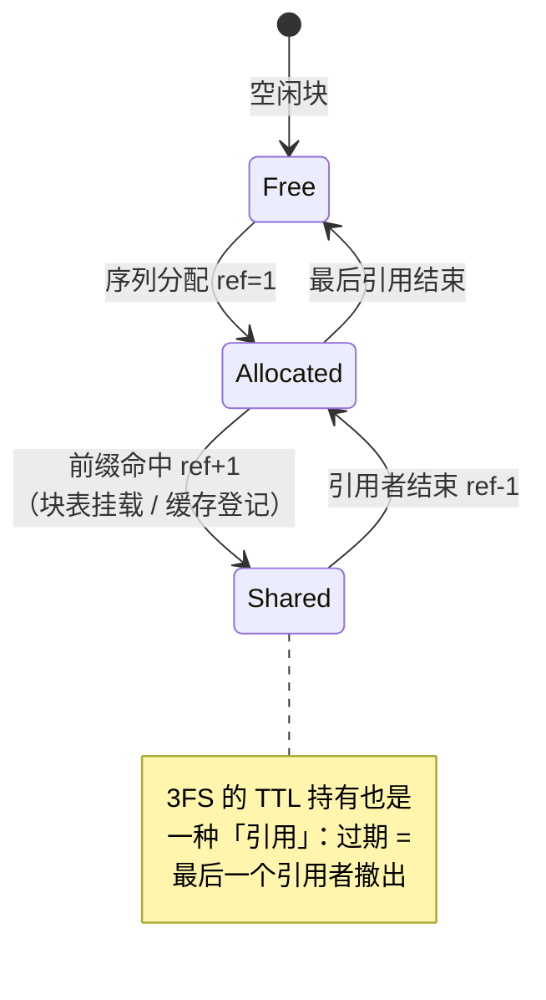

# 06 KV Cache：分页 / 3FS / 前缀缓存 / SWA 有界重放

!!! question "本章问题"
    - PagedAttention 的「分页」到底省了什么？碎片上限是多少？
    - 前缀缓存命中时，**物理块被共享**意味着什么？（引用计数！）
    - SWA 层的 KV 为什么不进块池？bounded replay 是什么？
    - 为什么说「按层同步推进」是断点续算与推测解码回滚的基石？

---

KV Cache 是推理系统最大的状态、最贵的资源、最复杂的生命周期。
[第 02 章](02-goals.md) 已经论证：三大目标的实现全部绕不开它。
DeepInfer 未开源的组件恰好是「KV cache 管理」—— 本章按公开行为
推断其设计，并用 miniflow 的实现验证逻辑自洽。

## 1. 为什么需要 KV：再算一遍太贵，全存又太多

自回归注意力：第 t 个 token 的注意力要读**全部前文**的 K/V。
不缓存 → 每步重算全序列（O(t²) 累计，不可接受）；缓存 → KV 随长度
线性增长（每 token、每层都要存）。KV cache 的管理因此成为系统主战场。

## 2. 分页：借操作系统虚拟内存的思想

**朴素方案**：每条序列预留 `max_len` 连续显存。问题：

- **内部碎片**：预留 8K，实际生成 200 token → 97% 浪费；
- **外部碎片**：长度不一的连续块反复分配/释放，显存被洞撕碎。

**PagedAttention 方案**：物理池切固定大小**块（block）**，每条序列一张
**块表（block table）**：逻辑位置 → 物理块号。序列增长按块追加，
结束按块回收。

```text
序列 A 的块表: [块 7, 块 3, 块 11]      逻辑第 0..127 token 在块 7
序列 B 的块表: [块 9, 块 3*]             *块 3 被共享（前缀缓存命中）
```

- 内部碎片上限 = **每序列最多一个块**的尾部浪费；
- 外部碎片归零（块是等大的，物理位置无关紧要）。

DeepInfer 生产块大小 **128 token**；miniflow 用 4（`CacheConfig.block_size`）
—— 块小才能在 10 个块的池子里看清调度行为（教学演示需要）。

!!! note "尾浪费的度量"
    miniflow 的 `PagedKVCache.stats()["tail_waste_slots"]` 直接输出
    「已分配块的未用槽位」—— `examples/demo_paged_kv.py` 可观测。
    生产上报这个数就是为了回答「块大小选多大」。

## 3. 块被共享 → 引用计数

前缀缓存命中时，**物理块被多条序列同时引用**（见上图块 3）。此时
「序列结束」不能直接回收块 —— 必须等**最后一个引用者**结束：

```python
# miniflow/cache/paged_kv.py 的真实实现（对应 DeepInfer 的共享块）
def free_seq(self, seq_id):
    for b in self.block_tables.pop(seq_id, []):
        self.ref_counts[b] -= 1
        if self.ref_counts[b] <= 0:
            self.free_blocks.append(b)      # 归零才真正回收
```

三个引用路径（miniflow 全部实现）：

| 路径 | 操作 | 生产对应 |
|---|---|---|
| 序列自身分配 | `ref = 1` | 普通块 |
| 前缀命中挂载 | `acquire_blocks: ref += 1` | 块表共享 |
| 缓存条目登记 | `acquire_reference: ref += 1` | 3FS 块的 TTL 期内持有 |

!!! danger "miniflow 踩坑实录：引用泄漏"
    早期版本里，调度器对 waiting 序列**先挂载命中块、后检查容量** ——
    检查失败 break 时已挂的引用不回滚，下轮重试再挂一遍：引用计数
    只增不减，块永远无法回收。修复：**先检查后挂载**（检查时把命中
    块算作「不需要新分配的已覆盖部分」）。见 `miniflow/scheduler.py`
    的 `need_new = blocks_needed(...) - len(hit_blocks)`。

## 4. 3FS：KV 与映射归存储所有

[第 03 章](03-architecture.md) 已给出 3FS 的枢纽角色，这里补 KV
视角的三个细节：

1. **块是持久化单位**：TTL 3 天（agent 流量）/ 7 天（chat 流量）——
   过期前同前缀请求直接命中，prefill 整段跳过；
2. **所有权哲学**：「KV 数据 + KV 到 slot 的映射」都归存储层 ——
   计算节点只是**临时挂载者**。decode 节点故障 → 另一节点挂载同一批
   块从断点续算，请求不重头跑；
3. **命中语义的硬约束**：命中长度必须收缩到「至少留 1 个 token 给
   forward 产出采样 logits」—— prefill 至少重算最后一个 token
   （vLLM 同款约束；miniflow 的 `max_blocks = (num_tokens - 1) //
   block_size` 一比一复刻）。

## 5. SWA 层：不进块池的 KV

V4.1 的部分层用**滑动窗口注意力**（SWA）：只 attend 最近 W 个 token。
这从根本上改变了 KV 需求 —— **窗口外的历史 KV 永远不再被读**：

- 存它们 = 纯浪费 → SWA 层的 KV 不进块池，走**定长 StateBlock**
  （环形缓冲，只保留最近 W 个 token 的 KV）；
- 块池容量因此只被「全注意力层」的 KV 消耗 —— 等效扩容。

**Bounded replay（有界重放）**：SWA 的 KV 有定长状态，但注意力核
需要连续窗口。做法是每次 forward 只重算/重放**窗口边界内的有界段**，
而不是全序列 —— 重算量有上界（窗口大小），与序列长度无关。
miniflow 的对应：`ModelConfig.swa_window=16` + `layers.py` 里窗口外
的 KV 根本不进入注意力计算。

## 6. 按层同步推进：断点续算的基石

一个容易被忽视的语义：**KV 的「已计算进度」是按层独立的**。

一次 forward 里第 L 层刚写入的新 KV，第 L+1 层**尚不可见**（它算第
L+1 层注意力时，用的 K/V 是第 L+1 层自己的池）。这个「按层同步推进」
的语义是三个高级特性的地基：

1. **断点续算**：forward 中途故障 → 每层保留各自进度 → 从未完成层
   继续，不用重头；
2. **推测解码回滚**：draft 被拒 → 进度回退到保留长度，被拒槽位
   **无需物理擦除**（下次 forward 覆盖写）；
3. **chunked prefill**：长 prompt 分多步算，每步推进若干层 × 若干块。

miniflow 里它是一等公民：

```python
# miniflow/cache/paged_kv.py
self.computed: Dict[seq_id, List[int]]    # 每层各自的已算 token 数
def reset_computed(self, seq_id):          # 推测解码回滚：退回保留长度
    keep = self.computed[seq_id][0]
    self.computed[seq_id] = [keep] * self.mcfg.num_layers
```

!!! danger "miniflow 踩坑实录：进度语义错位"
    推测解码早期版本把 KV 进度回滚到 `num_tokens`（全部算完）——
    下一步 draft 的第一次 forward 发现「没有新 token 可算」，增量
    契约直接断言失败。正确不变量：**进入每次 forward 时恰有 1 个
    未算 token**（算最后一个 token 才能得到下一位置的分布）。
    详见 [lab/05](../lab/05-speculative.md)。

## 7. 生命周期总览



## miniflow 对应实验

```bash
python examples/demo_paged_kv.py       # 分配/回收/引用计数/尾浪费
python examples/demo_prefix_cache.py   # 命中挂载 + 跳过 prefill
python -m pytest tests/test_prefix_cache.py -q   # 复用不改输出（契约）
```

| 上一章 | 下一章 |
|---|---|
| [05 并行策略](05-parallelism.md) | [07 调度器](07-scheduler.md) |