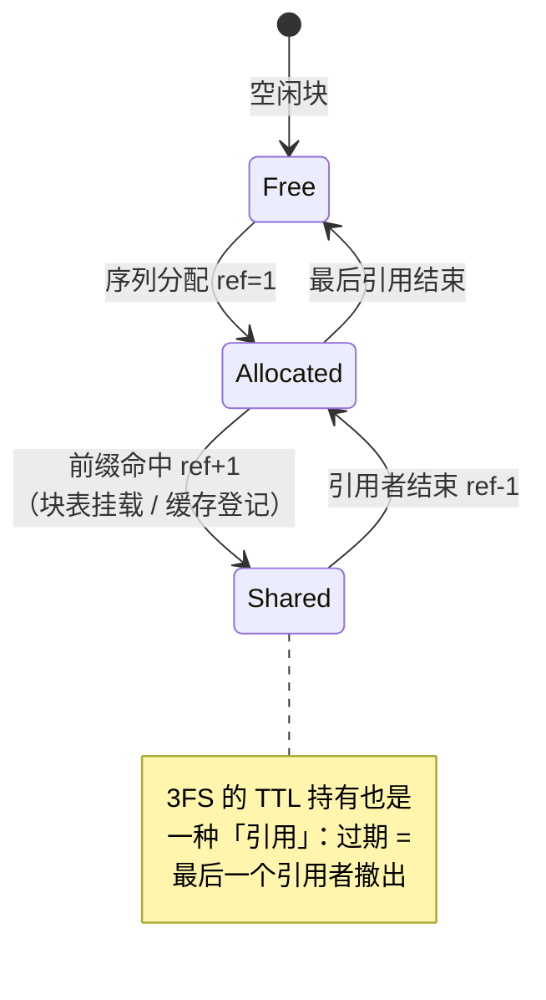

# 06 KV Cache：分页 / 3FS / 前缀缓存 / SWA 有界重放

KV Cache 是推理系统里最大的状态、最贵的资源、生命周期最复杂的对象。第 02 章论证过：三大设计目标的实现全部压在它身上；第 03 章看到 3FS 围绕它成为架构枢纽。本章把 KV Cache 自身讲透：为什么必须分页、共享为什么需要引用计数、SWA 层为什么特殊、以及「按层推进」这个不起眼却承重的语义。DeepInfer 恰好未开源「KV cache 管理」组件，本章按公开行为推断其设计——每处推断都有 miniflow 的实现验证逻辑自洽。

第 02 章说过「如果本书只能精读一章，读 06」——现在兑现这句话。本章的技术密度是全书之最，但主线只有一条：**KV Cache 的本质是一个存储系统，用操作系统的全套思想（分页、引用计数、换页、一致性）来经营它**。你会看到 1970 年代的虚拟内存设计在 2020 年代的 GPU 显存上完整复活——不是复古，是问题同构。

本章路线：先算清 KV 到底多大（字节公式），然后分页（2 节）、共享与引用计数（3 节）、命中的边界约束（4 节）、SWA 特殊层（5 节）、按层推进语义（6 节）、逐出与两级缓存（7 节），最后生命周期总览和 miniflow 实验。

读完本章，你应该能回答：

- 给定模型配置和请求数，KV Cache 的字节数怎么手算（MHA/GQA/MLA 三个版本）？
- 内部碎片和外部碎片分别怎么被分页消灭？块大小怎么选？
- 引用计数的 +1/-1 各发生在哪些路径？漏一个会怎样？
- 前缀命中为什么必须留 1 个 token 不命中？
- SWA 层的 KV 为什么不进块池？有界重放的「有界」指什么？
- 逐出策略在「显存-3FS 两级缓存」里怎么设计？

## 1. 为什么需要 KV：不存则贵，存则涨

### 1.1 KV 从哪来：注意力的回看需求

自回归注意力的工作方式：生成第 $t$ 个 token 时，它的查询向量（Q）要和**全部前文**的键（K）算相似度、再对全部前文的值（V）加权求和。

前文的 K/V 是由前文的 token 经各层投影算出来的——问题在于，这些 K/V **每步都要用、且永不变**（权重不变、输入已定 → 输出确定）。「每步都要用」决定它必须存在快速可访问的地方（显存）；「永不变」决定存一份就够（追加式写入，永不改写——第 03 章说这是缓存一致性的红利，源头在这里）。

不缓存的话，每生成一个 token 都要把前文全部重算一遍（前文 t 个 token 的 K/V 要逐层恢复），整个生成的总计算量是 $O(t^2)$ 级——4000 token 的请求要算 4000 次完整前向，完全不可接受。所以必须缓存。

### 1.2 字节公式：KV 到底多大

但缓存意味着：**每个 token、每一层，都要存它的 K/V**——随序列长度线性增长，且乘上并发请求数。这个「多大」值得精确算——它是后面所有容量决策的地基，也是三代注意力结构的价值标尺。

**MHA 版本**（标准多头注意力）：

$$
\text{KV bytes/token} = n_{layers} \times 2 \times n_{heads} \times d_{head} \times \text{bytes/数}
$$

代 DeepSeek-V3 的形状（61 层、128 头、每头 128 维、FP16）：

$$
61 \times 2 \times 128 \times 128 \times 2 \text{ B} = 61 \times 65{,}536 \text{ B} \approx 4 \text{ MB/token}
$$

一条 4000 token 的请求：**16 GB**。一张 H800（141 GB）放完模型权重后剩约 70 GB——**4 条请求就满了**。这就是第 04 章说「D 节点 KV 驻留密度直接崩盘」的原始数字。

**GQA 版本**（KV 头砍到 $n_{kv}$ 个）：把 $n_{heads}$ 换成 $n_{kv}$。Llama-70B 用 8 个 KV 头（vs 64 个 Q 头）：$80 \times 2 \times 8 \times 128 \times 2 \text{B} \approx 655\text{KB/token}$——8 倍压缩，4000 token 的请求约 2.6 GB。可用，但不宽裕。

**MLA 版本**（存 latent）：每层存 576 个数（512 latent + 64 解耦 RoPE key，FP16 下 1152 B）：

$$
61 \times 576 \times 2 \text{ B} = 70 \text{ KB/token}
$$

一条 4000 token 的请求：**280 MB**。对比 MHA 的 16 GB——**57 倍压缩**（第 04 章 1.2 节的数字在这里落地）。

「512 + 64」这个构成值得停下来拆开——它是第 04 章埋的伏笔（「解耦 RoPE 的细节第 06 章展开」）的兑现：

**为什么 latent 不是完整的 576 维而是「512 + 64 分开存」？** 问题出在位置编码。RoPE（旋转位置编码）对 Q 和 K 施加「按位置旋转」的变换：$K_{rot} = R(pos) \cdot K$。注意这个变换**在注意力点积之前**、且**依赖每个 token 的位置**——它和「吸收」技巧冲突了：

$$
q^\top R(pos) \, W_{up} c \neq (\text{某些预乘}) \, c
$$

旋转矩阵 $R(pos)$ 夹在中间，**不能被搬进 $W_{up}$ 吸收掉**（每个历史 token 的 pos 都不同，一份预乘吃不下所有位置）。如果 latent 里混着「待旋转的 K」，恢复-旋转-点积的链条就必须逐 token 展开——压缩的加速全毁。

DeepSeek 的解法是**解耦**（decoupled RoPE）：把注意力的键拆成两路——

- **内容路**：latent $c$（512 维）走吸收路径（无位置信息，纯内容相似度）；
- **位置路**：一个小维度的「位置 key」（64 维）单独存，带 RoPE 旋转后的形态——它小到不需要压缩，直接存旋转后的结果。

点积 = 内容路的 $(q^\top W_{up})c$ + 位置路的 $q_{rot}^\top k_{rot}$。两路各自最优（大的吸收、小的直存），总值不变。**KV 的 576 = 512 latent + 64 位置 key 的构成，是一次「数学不相容 → 结构解耦」的手术痕迹**——你以后在任何系统里看到「X + Y 分开存」，多半背后也有类似的「合不了」的数学或工程约束。

（miniflow 的 GQA 不用 RoPE 解耦——KV 头共享天然没有这个冲突，教学模型避开了 MLA 最绕的一步。想深入的同学可以读 V3 技术报告的附录：解耦后注意力的完整公式只有四行，但推导它撞墙的过程没写——你刚才五分钟的困惑，就是当年工程师几周的困惑。）

三代结构摆一起，D 节点的容量画像完全不同：

| 结构 | KB/token | 4000-token 请求 | 70 GB 显存的并发容量 |
|---|---|---|---|
| MHA | ~4000 | 16 GB | 4 条 |
| GQA (8 头) | ~655 | 2.6 GB | 27 条 |
| **MLA** | **~70** | **280 MB** | **250 条** |

MLA 让 D 节点从「惨淡经营」变成「驻留密度是核心资产」（第 03 章）——**注意力结构的选择直接定义了推理集群的经济学**。第 04 章讲 MLA 的数学，本章用它的容量结论。

量级总感受：1 万条并发请求、平均 4000 token，MLA 下约 2.8 TB 的 KV 状态——比模型权重（671 GB）还大 4 倍。**KV 是比权重更大的「模型」**，这就是为什么它值得一个存储系统来管。

（miniflow 对应：`miniflow/config.py` 的 GQA 配置 `num_kv_heads=2 < num_attention_heads=4`——KV 头数减半，字节公式里的 $n_{heads}$ 换成 $n_{kv}$，`tests/` 里有按公式断言块池用量的测试。）

### 1.3 KV 的访问模式：为什么它注定难管

在进入管理机制之前，把 KV 的「访问模式画像」列全——这些性质共同决定了后面每个设计：

| 性质 | 数值/描述 | 推出的设计 |
|---|---|---|
| 追加式写入 | 每个 decode step 每请求新增 1 token 的量 | 块粒度分配、append-only 语义 |
| 全量重读 | 每步注意力要读全部历史 KV | decode 带宽受限的 K 项（第 02 章） |
| 请求间私有 | 活跃 KV 互不共享 | DP 下整请求住一卡（第 05 章） |
| 前缀间公共 | system prompt 段高度共享 | 前缀缓存 + 引用计数（本章 3 节） |
| 长度不可知 | 生成多长事前未知 | 分页的动态扩容（不能预留） |
| 生死异构 | 请求结束 ≠ 块可释放 | TTL 窗口 + 缓存条目持有 |
| 层间独立 | 每层一套池、进度各异 | computed[seq][layer] 记账（本章 6 节） |

七条性质里最常被低估的是最后一条（层间独立）——它看起来是实现细节，实际是断点续算和推测解码的地基（第 6 节整节讲它）。而最容易引发事故的是「生死异构」——「请求结束了就 free」的直觉实现会把未来命中扼杀在摇篮里（或相反，不 free 导致显存泄漏）——第 3 节的引用计数就是为它而生。

把这张表放在心上再读本章：**每个机制都是对这张表某几行的回应**。读完回头检查：七行各自被哪个机制照顾到了？（答案全部在正文里，能独立对上就是真懂了。）

## 2. 分页：借操作系统虚拟内存的思想

### 2.1 朴素方案坏在哪

直接想法：每条序列预留一段**连续**显存，大小按 `max_len` 算。两个问题，都用数字看：

**内部碎片**（预留在、用不上）：`max_len=8192`，用户实际只生成了 200 token 就说完了——预留的 8K 位置里 97% 白白占着。预留是为了「万一长」，但绝大多数请求短，平均浪费率高得离谱。设 8192 预留、平均实际 600 token：**显存利用率 7.3%**——93% 的 D 节点预算在为「不会发生的长请求」空转。这个数字直接杀掉朴素方案。

**外部碎片**（显存被洞撕碎）：长短不一的连续段反复分配、释放后，显存里剩下无数个大小不等的洞。总量明明够，却找不到一段**连续**的空闲区放下新请求——操作系统教材的经典问题。

一个数字例子：显存剩 60 GB，两个空洞各 30 GB（中间隔着活跃请求）。新来一条需要 35 GB 连续的请求——总量 60 ≥ 35，但**最大的连续块只有 30**，分配失败。而碎片会随运行时间**单调恶化**（反复分配释放的长短请求像 shaking 一样摇碎显存）——早高峰前还健康的服务，晚高峰 OOM。

### 2.2 分页方案

操作系统的解法直接搬过来：把物理显存切成**大小固定的块**（block），每条序列持有一张**块表**（block table），记录「逻辑位置 → 物理块号」的映射。序列增长就追加新块（物理上不需要连续），结束就整块归还池子。

```text
序号 A 的块表: [块 7, 块 3, 块 11]   → 逻辑第 0..127 token 在块 7，第 128..255 在块 3 …
序号 B 的块表: [块 9, 块 3*]          → *块 3 被两条序号共享（前缀缓存命中，见下节）
```

两个碎片同时消失：

- 内部碎片的上限是**每条序列最多半个块**的尾部浪费（最后一块没填满）——128-token 块、平均 600 token 的请求，尾浪费期望约 64 token ≈ 10%（对照朴素方案的 93%！）；
- 外部碎片为零——块是等大的，物理位置放哪都行，永远有「洞」可用。

分页的代价要诚实列出：**间接寻址**（每次 KV 访问都要过块表：逻辑位置 → 块号 → 块内偏移，一次额外查表）。通用注意力核被这个间接层拖慢（访存模式不再连续）——**FlashMLA 的 decode 专用布局（第 04 章 1.5 节）本质上就是把块表的间接寻址摊平成大段连续读的工程**。vLLM 的 PagedAttention 论文完整论证了「间接寻址的代价 ≪ 碎片的代价」，这个权衡在 CPU 的虚拟地址翻译（TLB）上早就验证过一次。

DeepInfer 生产块大小 128 token；miniflow 用 4（`CacheConfig.block_size`）。块小是为了教学：10 个块的池子里，一次调度决策能看得清清楚楚。尾浪费在 miniflow 里可观测——`PagedKVCache.stats()["tail_waste_slots"]` 输出「已分配块的未用槽位」，生产上报这个数就是为了回答「块大小选多大才合适」。

### 2.3 块大小怎么选

128 这个数字值得停下来想——块大小是分页系统的第一个超参，它同时牵动四个量：

| 块大小 | 尾浪费 ↓ | 前缀命中粒度 ↓ | 块表长度 ↑ | 3FS IO 效率 ↑ |
|---|---|---|---|---|
| 小（16/32） | 少 | 细（短前缀也能命中） | 长（元数据多） | 差（碎 IO） |
| 大（256/512） | 多 | 粗（要长前缀才命中） | 短 | 好（大段 IO） |

逐项解释：

**尾浪费**：平均 $\text{block}/2$ token 的尾部空置。块 128 → 平均 64 token（MLA 下约 4.5 KB/请求）；块 512 → 平均 256 token（18 KB）——绝对值都不大，但万级并发下乘起来是 GB 级。

**命中粒度**：前缀匹配以块为单位（共享的最小单位是一个块）——两条请求的前缀共同部分是 300 token，块 128 时能共享 2 块（256 token），块 512 时共享 0 块（300 < 512，整块对不齐）。**小块让「短前缀共享」成为可能**，agent 流量里 100~300 token 的共享段（工具定义、少 shot 模板）很常见。

**块表长度**：4000 token 的请求，块 128 → 32 项；块 32 → 125 项。块表是每层每请求的活跃元数据（第 05 章说 DP 下它是每卡本地的），125 项的查表开销在 decode 的访存里开始可见。

**IO 效率**：3FS 的块读写以文件块为单位——KV 块 = 文件块 = 网络 IO 单位（第 03 章「三块合一」）。块 128（MLA 下约 9 KB/层/块，61 层共约 550 KB/块组）……实际上 3FS 侧的 IO 聚合把多个 KV 块合一次传输（第 03 章 2.4 节的批量读），所以 IO 效率不是硬约束。

128 的选择大致是「尾浪费可忽略 + 命中粒度够细 + 块表不臃肿」的中间值——**不是神数，是流量画像的函数**（前缀共享段平均长度变了，最优块大小跟着变）。miniflow 用 4 是教学极端（10 块的池子里看分配回收），生产别抄。

## 3. 块被共享 → 引用计数

### 3.1 前缀缓存：分页送的礼物

分页还送了一个意想不到的能力：**物理块共享**。

前缀缓存（[第 03 章](03-architecture.md)）命中时，新序列 B 的前缀和已有序列 A 相同——这段的 KV 计算结果完全一致（确定性前向），B 直接把 A 的块挂进自己的块表就行，一个字节都不用重算。2.2 节图里的块 3 就处于这个状态。

共享的正确性依赖一个不变式：**同一段 token 序列 + 同一权重 → 同一份 KV**（逐位确定）。第 02 章的确定性目标（batch-invariance）在这里从「工程美德」变成「正确性前提」——如果前向不是确定的（浮点归约随批组成变），A 算的 KV 和 B 自己算的可能差几位，**共享变成了「共享了错的」**。这就是 DeepInfer 把确定性当设计目标的深层原因之一：**KV 共享省下的计算量（吞吐），是用数值确定性（工程纪律）换的**。

命中判定的数据结构是前缀树（Radix Tree）：所有已缓存前缀挂在树上，新请求的 token 序列沿树走，走到分叉点 = 最长公共前缀，之后的 token 才需要现算。第 02 章说过命中率的 Zipf 经济学（头部前缀贡献几乎全部命中），这里补执行细节：树的每个节点 = 一个块（128 token）——**前缀树的粒度就是块大小**，2.3 节「命中粒度」的又一体现。

### 3.2 引用计数：块的多主问题

共享立刻引入一个新问题：**块 3 现在有两条命**。A 结束时不能回收块 3（B 还在用），B 结束也不能（可能还有 C）。答案是操作系统同款的**引用计数**：块被挂载一次计数 +1，引用者结束 -1，**归零才真正归还池子**：

```python
# miniflow/cache/paged_kv.py 的真实实现
def free_seq(self, seq_id):
    for b in self.block_tables.pop(seq_id, []):
        self.ref_counts[b] -= 1
        if self.ref_counts[b] <= 0:
            self.free_blocks.append(b)      # 归零才真正回收
```

三个会让计数 +1 的路径，miniflow 全部实现：

| 路径 | 操作 | 生产对应 |
|---|---|---|
| 序列自身分配 | `ref = 1` | 普通块 |
| 前缀命中挂载 | `acquire_blocks: ref += 1` | 块表共享 |
| 缓存条目登记 | `acquire_reference: ref += 1` | 3FS 块在 TTL 期内被持有 |

第三个路径值得多说一句：3FS 上持久化的块，在 TTL 内被「缓存条目」这个抽象所有者持有（否则没有请求引用它时就被回收了，前缀复用无从谈起）。TTL 过期 = 这个引用撤出——本质和序列结束是同一种事件。

**引用计数和 GC 的取舍**顺带一说：为什么不用追踪式 GC（标记-清除）管块？引用计数的优点是**回收即时**（最后一个引用结束，块立刻回池——decode 的显存预算按秒计，延迟回收 = 少服务请求）；缺点是**循环引用漏回收**。KV 块的引用图是 DAG（块表 → 块，缓存条目 → 块，无块 → 块的反向边），没有环——引用计数在这个场景是无死角的。**数据结构的性质（无环）决定了算法的选择（计数 vs 追踪）**——这种「先看数据性质再选算法」的思路值得移植到你自己的系统里。

!!! danger "miniflow 踩坑实录：引用泄漏"

    早期版本里，调度器对 waiting 序列**先挂载命中块、后检查容量**——
    检查失败 break 时已挂的引用不回滚，下轮重试再挂一遍：引用计数
    只增不减，块永远无法回收。修复：**先检查后挂载**（检查时把命中块
    算作「不需要新分配的已覆盖部分」）。见 `miniflow/scheduler.py`
    的 `need_new = blocks_needed(...) - len(hit_blocks)`。

    这个 bug 的通用教训：**「先做后检」的模式在有副作用的操作上是泄漏
    温床**——每次失败重试都留下一次副作用。正确模式是「先检后做」或
    「失败补偿」，二选一，且要在 code review 时专门盯这种路径。

## 4. 命中语义的一个硬约束：至少留 1 个 token

前缀命中「跳过 prefill」有一个初学者想不到的边界：**命中长度不能覆盖到最后一个 token**。规则是 `max_blocks = (num_tokens - 1) // block_size`——就算整条 prompt 都命中了，也必须把最后一个 token 留给 prefill 重算。

为什么？回到 KV Cache 和输出的关系：prefill 算完第 $n$ 个 token，得到的是**第 $n+1$ 个位置**的输出分布（采样出第一个生成 token）。用第 01 章 1.3 的走查表看：「法国的首都是」4 个 token 都进 forward，输出才是「巴黎」。

如果命中覆盖了全部 $n$ 个 token、一个未算的都不剩，那么这次 forward 没有任何位置产出 logits——**第一个生成 token 无从采起**。KV 里存着第 $n$ 个位置的 K/V，但「第 $n$ 个位置的输出分布」从来没有被算过（它是在「第 $n-1$ 个 token 的 forward」里算出来的——当时的请求和现在不同）。所以至少要重算最后一个 token，用它的 forward 拿到第一个输出位置的分布。vLLM 同款约束，miniflow 一比一复刻。

这个约束的深层语义：**KV Cache 存的是「每个位置的计算结果」，而「下一位置的预测」是 forward 的副产品**——两者不是一回事。cache 里有第 n 个位置的 KV ≠ 你拥有第 n+1 位置的采样分布。把这两个概念分开，这个「留 1」规则就从怪癖变成了显然。（lab/03 有个实验专门打这个：故意把命中开满，看引擎怎么在第 0 个生成 token 上挂掉——错误信息「no logits position」就是这个语义的报错翻译。）

同样的道理反过来用：**连续对话为什么便宜**。用户发了第二条消息（拼接历史后第 n+1..n+k 个 token 都是新的），引擎只需 prefill 新增的 k 个 token——历史 n 个的 KV 直接复用。留 1 规则自动满足（新增部分 ≥ 1）。「多轮对话 = 增量 prefill」这个产品级体验，就是前缀缓存的直接兑现。

## 5. SWA 层：不进块池的 KV

### 5.1 滑动窗口注意力：另一种「历史观」

V4.1 的部分层用**滑动窗口注意力**（SWA，Sliding Window Attention）：只 attend 最近 W 个 token（比如 W=2048），窗口外的历史位置**永远不再被读**。

这从根本上改变了这些层的 KV 需求。全注意力层的 KV 是「只增不删的档案」（任何历史都可能被回看）；SWA 层的 KV 是「只留最近 W 个」的滚动窗口——窗口外存着也是纯浪费。

按字节公式重算 SWA 层的 KV 需求：不是「随长度线性增长」而是**恒定 W 个 token 的量**。100K token 的长请求，全注意力层要 100K×70KB ≈ 7 GB，SWA 层只要 2048×70KB ≈ 143 MB——**70 倍差距**。长上下文时代（128K~1M token），SWA 层的存在让长请求的 KV 需求掉一个数量级。

### 5.2 定长 StateBlock：环形缓冲

所以 DeepInfer 让 SWA 层的 KV 不进块池，走**定长 StateBlock**（环形缓冲：新 token 覆盖最老的）。

环形缓冲（ring buffer）是老朋友：网络驱动的收发包队列、音频流的缓冲、日志的定长窗口——都是「固定容量 + 新覆盖旧」的同一个思想。实现上它是最简单的数据结构之一（一个数组 + 读写指针取模），但放在 KV 管理的语境里有一个精妙的语义收益：**块池的容量预算只被全注意力层消耗**——同样显存，能驻留的请求数显著变多，等效扩容。

为什么不把 SWA 的窗口也用块池管（分配 W/block_size 个块，窗口滑动时释放头块、追加尾块）？可行但丑：滑动意味着每 token 一次「释放+分配」的块操作（元数据流量大），且窗口边界的块只部分有效（尾浪费概念在滚动窗口里翻倍——头尾两个半块）。定长覆盖的 StateBlock 一次分配、零元数据流量、无尾浪费——**负载的「定长」性质匹配了数据结构的「定长」性质**。

效果是分页系统里开了一个特例通道：**「变长的进块池（分页最优），定长的进环形缓冲（覆盖最优）」**——按数据的增长模式分流，比统一一套管理更省。miniflow 对应：`ModelConfig.swa_window=16`，`layers.py` 里窗口外的 KV 根本不进入注意力计算。

### 5.3 Bounded replay：有界重放

**Bounded replay（有界重放）**是 SWA 的配套机制，处理一个微妙的边界情形。

SWA 的状态是定长的，但注意力核处理「连续输入」最自然——当需要重建窗口边界附近的连续性（比如推测解码回滚、断点恢复）时，做法是**只重放窗口内的有界段**：重算量以窗口大小 W 为上界，与序列全长无关。

一条 100K token 的请求发生回滚，全注意力层要考虑的前缀很长，SWA 层的重算最多就是 W——这就是「有界」的含义。

一个具体的触发场景推演（推测解码回滚，第 08 章的完整机制在此预演）：draft 猜了 4 个 token、验证拒绝后 2 个。回滚时：

- **全注意力层**：把「computed 进度」退回保留位置（第 6 节的按层记账），KV 块不需要物理擦除——进度回退后，被拒槽位变成「未计算」，下次 forward 覆盖写；
- **SWA 层**：环形缓冲里被拒 token 已经覆盖了「最老的有效位置」（写指针前进了 4 格）——窗口内容被污染了 2 格。**有界重放**：重算这 2 个位置（从保留位置到写指针的差），恢复窗口一致性。重算量 = 被拒的 token 数 ≤ 窗口大小的差量——**有界**。

两个机制对比着看：全注意力层的回滚是**改账本**（进度回退、数据不擦）；SWA 层的回滚是**补算**（窗口被污染的部分重算）。为什么不同？因为全注意力层的历史「永不变」（KV 是 append-only 的档案，被拒 token 的 KV 还在但它后面的进度回退了——下次覆盖）；SWA 层的窗口「会被覆盖」（被拒 token 抢占了老 token 的位置，覆盖不可逆）——**数据结构的行为差异（append-only vs 覆盖式）决定了回滚协议的差异（改账本 vs 补算）**。又一次「先看数据性质再选协议」。

## 6. 按层同步推进：最不起眼却最承重的语义

### 6.1 进度为什么是每层一个数

一个容易被整体忽视的细节：**KV 的「已计算进度」是按层独立记账的**。

为什么必然如此：一次 forward 里，第 $L$ 层刚算出的新 KV，第 $L+1$ 层用的是**它自己的**池（第 $L+1$ 层的 K/V 由第 $L+1$ 层的输入算出，而那个输入此刻还没被算出来）。「一个 forward 的中间态」就是「每层算到不同 token」的瞬时快照——层间进度天然不一致。

所以进度表是 `computed[seq_id][layer]` 这样一个**每层一个数**的表，而不是「序列已算到第几个 token」一个数。它看起来是实现细节，实则是三个高级特性的地基：

1. **断点续算**：forward 中途故障，每层保留各自进度，恢复时从未完成处继续，不用整层重头。第 03 章「D 故障无感切换」的可恢复粒度（精确到最后一个 token）就是这个表给的——恢复 = 从 `computed[seq][L]` 最小的层继续推进，不需要任何「全序列」级别的状态；
2. **推测解码回滚**：draft token 被拒绝时，进度整体退回「保留长度」——注意**被拒槽位的 KV 无需物理擦除**，它们只是变成「未计算」状态，下次 forward 会覆盖写。回滚是改账本，不是擦数据；
3. **chunked prefill**：长 prompt 分多步算，每步推进「若干层 × 若干块」，层间进度天然允许不一致。第 03 章 P 节点的 chunked 预算调度（2.5 节）的可行性基础——没有按层记账，chunk 之间要么浪费（必须整层对齐）要么出错（进度丢失）。

### 6.2 「进入 forward 时恰有 1 个未算 token」不变量

按层记账之上还有一条更细的不变量（miniflow 的踩坑把它钉出来的）：**每次 forward 开始时，序列恰有 1 个未算的已定 token**——forward 算它，得到下一位置的分布。这条不变量连接了第 4 节的「留 1」规则（前缀命中的版本）和推测解码（每次 draft/verify 循环的版本）——**同一语义在不同机制里的三次出现**：

- 前缀命中：命中最多覆盖到倒数第 2 个 token（第 4 节）；
- 常规 decode：每 step 恰好新增 1 个已定 token（上一个 step 的输出）；
- 推测解码 verify：多个 draft token 一起 forward（「1 个未算」推广为「k 个未算」），验证后保留的部分成为新的「已定」。

miniflow 里它是一等公民：

```python
# miniflow/cache/paged_kv.py
self.computed: Dict[seq_id, List[int]]    # 每层各自的已算 token 数
def reset_computed(self, seq_id):          # 推测解码回滚：全部层退回第 0 层的进度
    keep = self.computed[seq_id][0]
    self.computed[seq_id] = [keep] * self.mcfg.num_layers
```

（注意 `reset_computed` 的实现细节：全部层**对齐到第 0 层的进度**——因为层 $L$ 的输入依赖层 $L-1$ 的输出，第 0 层算到哪，后续层最多算到哪。对齐取最小值是「层间依赖」的正确保守——又是一个「数据性质（依赖链）决定协议（取 min 对齐）」的小案例。）

!!! danger "miniflow 踩坑实录：进度语义错位"

    推测解码早期版本把 KV 进度回滚到 `num_tokens`（全部算完的位置）——
    下一步 draft 的第一次 forward 发现「没有新 token 可算」，增量契约
    直接断言失败。正确不变量：**进入每次 forward 时恰有 1 个未算 token**
    （算最后一个已定 token，才能得到下一位置的分布）。这个 bug 的
    完整推导见 [lab/05](../lab/05-speculative.md)。

## 7. 逐出与两级缓存：显存-3FS 的层次

### 7.1 逐出的问题定义

D 节点显存装不下所有想要的 KV 时（新请求要进来、老前缀想驻留、被抢占的请求要挂起），谁让位？这就是逐出（eviction）问题——两级缓存（显存 hot 层 / 3FS warm 层）的核心策略。

先把「住在显存里的 KV」分个类（它们的逐出代价完全不同）：

| KV 类别 | 谁在用 | 逐出代价 | 逐出到哪 |
|---|---|---|---|
| 活跃请求的 KV | 正在 decode 的请求 | 高（要挂起请求） | 3FS（挂起-恢复） |
| 共享前缀的 KV | 当前无请求，等未来命中 | 低（命中时从 3FS 取回） | 3FS（TTL 内） |
| 已结束请求的尾段 KV | 无（输出完的部分） | 零（除非前缀树要它） | 直接释放 / TTL 保留 |

第三类值得展开：一条请求结束后，它**全长的 KV 都可能成为未来请求的前缀**（多轮对话的回访、相似问题的复用）。所以「结束」不等于「释放」——把可能被复用的尾段按 TTL 留在 3FS，其余释放。**「请求的死亡」和「块的死亡」是两个事件**，中间隔着 TTL 的窗口——这个时间差就是第 03 章「跨时段复用」的机制本体。

### 7.2 策略设计：显存层逐出谁

显存层的逐出对象只能是第二类（共享前缀缓存）——活跃请求的 KV 是「工作集」，逐出它等于挂起请求（那是抢占，第 07 章的调度器决策，不是缓存的常规操作）。

在「共享前缀缓存」里选谁逐出，经典算法的适配版：

- **LRU**（最近最少使用）：按「最后被命中」排序。在头部漂移时反应慢（旧头部的 TTL 长但已过气）；
- **LFU**（最常使用）：按命中次数。惰性强（历史热门霸屏，新头部上不来）；
- **生产折中**：带衰减的 LFU（命中次数按时间衰减）+ 前缀树的结构信息加成（「位于树的高层」的前缀——共享它的子前缀多——天然权重高）。

一个容易忽略的信号：**逐出的「机会成本」不只是命中率**——逐出一个前缀块，未来命中时要付出「3FS 取回」的延迟（几十 ms，第 03 章 2.4 节）。如果这个前缀的命中频率高，取回的延迟成本会反复付。所以逐出评分的完整公式是「未来收益 / 重新载入成本」的比值，不只是「未来收益」——**缓存驱逐的经济学比教科书版多一个分母**。

### 7.3 写回：3FS 侧的一致性

显存层是 KV 的「工作副本」，3FS 是「权威副本」（第 03 章的双流视角）。两级的一致性靠「追加式写 + 增量写回」：

- decode 每步新增的 KV 块：填满一个块 → 异步写回 3FS（后台带宽，不挡 decode 的读路径）；
- 推测解码回滚：**回滚只改显存层的账本**（第 6 节），已写回 3FS 的被拒块怎么办？——它们携带「未确认」标记（写回时标注到哪个 token 为止是已验证的），权威副本在下次写回时覆盖性更新。**「未确认数据短暂存在于存储层」是性能和严格性的折中**——故障恢复时按标记截断到已确认位置（第 03 章 5 节「最多丢最后几十 ms」的实现细节）。

两级缓存的一致性经典难题（写穿 vs 写回 vs 失效）在「append-only + 标记截断」的组合下退化成简单问题——**数据性质再次拯救协议复杂度**（KV 不可变 → 不存在「修改的一致性」，只有「进度的确认」）。

### 7.4 容量规划：一个 D 节点的 KV 预算表

把本章全部公式压进一个「D 节点容量规划」的完整算例——它是第 11 章部署配方的核心组件，也是检验你是否真掌握了字节公式的试金石。

**设定**：单卡 H800（141 GB HBM），服务 DeepSeek-V3（61 层、MLA、块 128、FP16 KV）。

```text
第 1 步：静态扣除
  注意力权重（DP 全量复制）：      14.4 GB（第 05 章 2.3 节）
  MoE 专家份额（机内 EP8+复制）：约 12 GB（54 GB 基础池 ÷ 8 卡
                                  + 复制系数 1.3 的增量）
  运行时缓冲/激活（batch 64）：     约 2 GB
  CUDA 上下文/碎片预留：           约 2 GB
  小计：约 30 GB

第 2 步：KV 池预算
  141 - 30 = 111 GB 给 KV

第 3 步：并发容量（决定吞吐上限，第 02 章 B）
  按平均序列 4000 token（31.25 块）：
    111 GB ÷ (4000 × 70 KB) = 111×10⁹ / 280×10⁶ ≈ 396 条并发/卡
  按长尾请求 32K token（256 块）：
    111 GB ÷ (32768 × 70 KB) ≈ 48 条长并发/卡
  混合画像（80% 短 20% 长）加权：≈ 160 条有效并发

第 4 步：前缀缓存的份额（3FS 之外显存内驻留）
  若留 30% 显存给共享前缀（30 GB）：
    并发容量降到 ~112 条，但命中段免算——
    命中率 60% 时 P 群需求降 4 成（第 03 章容量配比的联动）
  若留 0%：并发最大化，但每次会话轮次都全量 prefill
  → 这个比例是「D 节点并发 vs 集群 P 产能」的跨节点权衡！

第 5 步：吞吐反推（第 02 章的摊销公式）
  B=112、K=0.28 GB/条：
    单 token 摊销 = 37/112 + 0.28 ≈ 0.61 GB → TPOT ≈ 0.18 ms? 
    ——不对，这是带宽理论的理想值；实际 TPOT 被 step 开销、
    采样、调度压到 10~20 ms（第 07 章的时间线）
  有效产出 ≈ 112 条 × (1/0.015 s) ≈ 7400 token/s/卡
```

第 4 步的「跨节点权衡」值得单独强调：**显存内前缀缓存的份额不是 D 节点自己的决定，是集群级的资源分配**——多留缓存 = D 并发降但 P 产能省、TTFT 好；少留 = D 吞吐高但 prefill 压力大。这个旋钮（缓存的显存配额）是 DeepInfer 运维调优的高频对象，**它没有理论最优值，只有流量画像下的经验最优区间**——第 11 章的容量规划会回到它。

（算例的简化提醒：真实规划还要算 SWA 层的省量、3FS 挂载的工作集波动、EPLB 复制系数的漂移——这里的主算例抓主干，细项在部署时按监控数据回填。**容量规划是「模型+数据」的迭代活，不是一次性的算术**。）

## 8. 生命周期总览

一个物理块的一生，串起本章全部机制：



把状态机补上「地点」维度（显存 vs 3FS），块的完整一生是：

```text
出生：P 节点 prefill 计算产出（显存）
落籍：写入 3FS（权威副本建立，ref +1 by 缓存条目）
工作：D 节点挂载（显存副本，ref +1 by 请求）
增值：decode 增量块追加（写回 3FS）
共享：新请求前缀命中（ref 再 +1）
衰老：请求逐个结束（ref 递减）
驻留：TTL 窗口内被 3FS 持有（等未来命中）
死亡：TTL 过期（最后引用撤出，块回收）

一次生命的可能历程：一次 prefill 出生 → 3 天内被 47 条请求共享
→ TTL 过期归西。也可能：出生即孤儿（无人命中）→ TTL 到点释放。
```

块的一生隐喻着本章的全部主题：**分页给它形状、引用计数给它关系、TTL 给它寿命、两级缓存给它居所**。KV 管理器（未开源的那个组件）就是这个「户籍系统」的完整实现——现在你能推断它的接口形态了（分配/挂载/释放/逐出/截断五个原语 + 块表/引用计数/进度表三份数据）。

## 9. 常见误解澄清

**误解一：「KV Cache 是缓存，可以随便丢。」** 第 01 章的误解四在本章有了完整弹药：活跃请求的 KV 丢了 = 请求算不下去（重算 prefill 是几十秒级）；前缀缓存丢了 = 损失性能但正确性无恙。**「KV」这个词混装了两种东西：工作集（不能丢）和缓存（可以丢）**——分清这两者是逐出策略设计（7.1 节）的第一步，也是「KV Cache 是存储系统不是缓存」这句话的精确含义。

**误解二：「分页只是省显存的 trick。」** 分页的本质是**把「逻辑连续」和「物理连续」解耦**——这个解耦立刻兑现成三个能力：尾部浪费有界（内部碎片）、永无空洞（外部碎片）、物理块共享（前缀复用）。第三个能力是分页的「意外红利」，贡献可能比省显存更大——**好的基础设施设计的收益经常超过它的初衷**（虚拟内存当年也只是为了「程序比物理内存大」）。

**误解三：「块越大越好（IO 快）。」** 2.3 节的四维权衡：块大伤命中粒度（短前缀共享不了）、增尾浪费；IO 效率可以靠聚合（3FS 的批量读）补救。**超参的选择要在全部四个维度上算账，单维度最优是整体次优**——这是所有系统调参的通病，块大小只是最清晰的教学案例。

**误解四：「SWA 和全注意力只是模型结构差异，对系统无关。」** 5.2 节看到它们导致**两套存储设施**（块池 vs 环形缓冲）和**两套回滚协议**（改账本 vs 补算）。模型结构从来都穿透到系统设计——「按层异构」的模型（dense/MoE/SWA 混排）需要「按层异构」的存储和调度，这是 DeepSeek 模型和 DeepInfer 引擎咬合的又一现场。

**误解五：「引用计数简单，不会出错。」** 本章的踩坑实录（先挂载后检查的泄漏）是反例——计数器的正确性不在「加减法」而在「加减的时机和路径」。**每个新的引用路径（缓存登记、跨节点挂载、故障恢复）都是计数 bug 的新入口**——miniflow 三个 +1 路径都有测试盯着，生产组件的路径更多，测试矩阵更大。「简单机制 + 多路径」= 「简单机制 + 复杂不变量」，这是审这类代码的专业视角。

**误解六：「KV 管理是纯软件问题。」** 字节公式的每一项都是硬件/模型给的约束：层数、头数（模型）、精度（算子层的 FP8 决策）、块大小（3FS 的 IO 特性）、显存容量（采购）。KV 管理器的「设计空间」其实是这些约束夹出的窄缝——**每代硬件/模型换代，窄缝的形状就变一次**（MLA 把缝拓宽 57 倍、FP8 再×2、下一代 HBM 再×2）。所以 KV 管理没有「终极设计」，只有「当前约束下的最优」——这也是它作为教学题材的价值：**学的是在约束下做存储系统的方法，不是背某个具体方案**。

**误解七：「抢占是异常路径，不值得认真设计。」** 高峰期的 D 节点，抢占是**常态**不是异常（显存水位 90% 以上时每分钟都可能触发）。而抢占路径牵动 KV 的最复杂操作（换出/重算、进度回退、身份保持）——它的 bug 全是「低频复现、高难排查」型（lab/04 的三重死锁全部在抢占链路上）。**按异常路径的敷衍标准写常频触发的代码，是事故的配方**——正确的做法是给抢占路径和主路径同级的测试覆盖（miniflow 的 demo_scheduler 专门演它，生产混沌演练专门打它）。

## 10. 小结

- **KV 的字节公式**是容量决策的地基：MHA ~4 MB/token、GQA ~655 KB、MLA ~70 KB——**注意力结构的选择直接定义 D 节点的并发经济学**（250 条 vs 4 条）。KV 总量（万级并发 × 数 TB）比权重还大——它是比模型更大的「模型」。
- **分页**消灭两种碎片（内部：尾浪费 ≤ 块/2；外部：零），代价是间接寻址（FlashMLA 的布局把它摊平）。块大小（生产 128）是四维权衡：尾浪费/命中粒度/块表长度/IO 效率。
- **共享 → 引用计数**：三条 +1 路径（分配/命中挂载/缓存登记），归零回收。前缀共享的正确性前提是**前向确定性**（batch-invariance 不只是美德，是共享的正确性前提）。引用图无环 → 计数优于追踪。
- **留 1 规则**：命中不能覆盖最后一个 token——「KV 里存着第 n 位置的 K/V」≠「拥有第 n+1 位置的采样分布」。多轮对话 = 增量 prefill，是前缀缓存的产品级兑现。
- **SWA 层**：窗口外的 KV 永不读 → 定长 StateBlock（环形覆盖）不进块池，等效扩容。回滚协议因数据性质而异：append-only 层改账本，覆盖式层有界重放（重算量 ≤ 窗口）。
- **按层记账**（`computed[seq][layer]`）是断点续算/推测回滚/chunked prefill 三者的共同地基，其上还有「进入 forward 恰有 1 个未算 token」的通用不变量。
- **两级缓存**：显存工作集（不能丢）/3FS 权威副本（append-only + 标记截断的一致性）。逐出评分 = 未来收益 ÷ 重载成本。请求的死亡 ≠ 块的死亡（TTL 窗口隔开）。
- 块的一生：出生（prefill）→ 落籍（3FS）→ 工作（挂载）→ 共享（命中）→ 驻留（TTL）→ 死亡——**分页给形状、计数给关系、TTL 给寿命、两级给居所**。

## 11. 本章术语速查表

| 术语 | 一句话解释 |
|---|---|
| KV Cache | 历史 token 的 K/V 中间表示，append-only、随长度线性增长 |
| 字节公式 | KV/token = 层数×2×头数×头维×精度；MLA 下 = 层数×576×精度 |
| 内部/外部碎片 | 预留未用 / 连续区被洞撕碎；分页分别消灭二者 |
| 块（block）/ 块表 | 固定大小的物理单元 / 序列的「逻辑→物理」映射 |
| 尾浪费 | 最后一块的未填部分，期望 block/2 |
| 前缀缓存/前缀树 | 共享前缀的 KV 复用 / 判定命中的数据结构（节点=块） |
| 引用计数 | 块的多主管理：+1 分配/挂载/登记，归零回收 |
| 留 1 规则 | 命中最多到倒数第 2 token，最后 1 个必须现算 |
| SWA / 窗口 W | 滑动窗口注意力，窗口外历史永不读 |
| StateBlock | SWA 层的定长环形缓冲，新覆盖旧 |
| bounded replay | SWA 层回滚的有界重算（≤ 窗口/差量） |
| computed[seq][layer] | 按层独立记账的 KV 进度表 |
| 「1 个未算」不变量 | 进入 forward 时恰有 1 个未算已定 token |
| 逐出 / 换页 | 显存层让位给新负载 / 挂起请求的 KV 外移 |
| TTL | 块在 3FS 的存活窗口（agent 3 天/chat 7 天） |
| 权威副本/工作副本 | 3FS 的正本 / 显存的副本，追加+标记截断保一致 |

## 自测：开篇问题的参考答案

**Q1：字节公式怎么算？** MHA：层数×2×头数×头维×精度（V3 形状 FP16 ≈ 4 MB/token）；GQA 把头数换成 KV 头数；MLA：层数×576×精度（FP16 ≈ 70 KB/token）——57 倍压缩。用公式代入模型配置即可手算任何模型的 KV 预算。

**Q2：碎片怎么被消灭、块大小怎么选？** 内部碎片（预留未用）→ 分页后上限为每序列块/2 的尾浪费；外部碎片（连续区被洞撕碎）→ 等大块物理位置任意，归零。块大小四维权衡：尾浪费/命中粒度（共享最小单位是块）/块表长度/IO 效率——生产 128 是流量画像的函数。

**Q3：引用计数的路径？** +1 三条：序列分配、前缀命中挂载、缓存条目登记（TTL 持有）；-1 一条：引用者结束。归零才回收。漏 +1 的对偶（漏 -1 或多 +1）分别导致块泄漏和 use-after-free——踩坑实录的「先挂载后检查」是后者。

**Q4：留 1 规则为什么？** KV 里存着第 n 位置的 K/V ≠ 拥有第 n+1 位置的采样分布——后者是「第 n-1 位置 forward 的副产品」。全命中则无位置产 logits，首 token 无从采样。多轮对话 = 增量 prefill 是这条规则的自动满足。

**Q5：SWA 为什么特殊？** 窗口外历史永不读 → KV 需求从 O(长度) 变 O(W)（100K token 请求 70 倍差距）→ 定长环形缓冲（零元数据、无尾浪费）不进块池。回滚协议按数据性质分流：append-only 层改账本（进度回退不擦数据），覆盖式层有界重放（重算 ≤ 污染差量）。

**Q6：逐出怎么设计？** 逐出对象限「共享前缀缓存」（活跃 KV 是工作集不可逐）。评分 = 命中频率×收益 ÷ 体积×重载成本——LRU/LFU 是它的粗化近似，完整版对「大而冷」的前缀最不客气（体积是杠杆）。

## 思考题

1. 用字节公式算你自己想部署的模型：Llama-70B（80 层、64 Q 头/8 KV 头、头维 128、FP16 KV）。每 token KV 多少？一张 80 GB 卡（权重 40 GB 后剩 40 GB）能驻留几条 8000-token 请求？对照 MLA 版 DeepSeek（70 KB/token）——「结构选择定义集群经济学」这句话的量化版。
2. 2.3 节的块大小四维权衡：若你的流量是「100~300 token 的共享前缀（agent 模板）占 80%」，块大小应该往哪边调？若流量变成「4K token 的长文档前缀」呢？给出两个场景各自的选择和理由（提示：命中粒度维度主导前者，尾浪费和 IO 主导后者）。
3. 引用计数的第四条路径设计：D 节点故障恢复时（第 03 章剧本一），新节点挂载了原节点的块——这些块的计数在谁那里加、在谁那里减？原节点的计数状态随故障丢失了，怎么保证「归零回收」的语义在跨节点场景不破（提示：3FS 的缓存条目作为「全局所有者」的兜底角色）？
4. 5.3 节的有界重放：draft 深度从 4 改成 8（更激进的推测解码），SWA 层的最坏重算量怎么变？全注意力层的「改账本」回滚有对应的「深度敏感性」吗？——两个层的回滚成本对 draft 深度的导数，哪个是常数、哪个线性？（这决定第 08 章「最优 draft 深度」的一个约束。）
5. 7.2 节的逐出评分「未来收益 ÷ 重载成本」：3FS 取回延迟从 50 ms 降到 5 ms（更快的存储），逐出策略的激进程度应该变松还是变紧？命中率会升还是降？总延迟（命中收益 - 取回成本）的净变化怎么定性分析？
6. 动手题：跑 `python examples/demo_paged_kv.py`，观察分配/回收/引用计数的循环。然后手工制造一次「引用泄漏」：在脚本里加一段「挂载命中块后不检查容量直接 break」的逻辑（模仿踩坑实录的错误），看 stats 里 free_blocks 是否单调下降——**亲手让 bug 发生一次，比读十遍修复说明记得牢**。最后改回正确顺序，验证计数恢复。

---

## 延伸阅读

- **vLLM 的 PagedAttention 论文**：分页 KV 的奠基作（块表、共享、碎片分析的系统化论述）——本章 2 节的学术源头。
- **SGLang 的 RadixAttention 论文**：前缀树的缓存管理（本章 3.1 节的树结构、命中分析的深度版）。
- **操作系统教材的虚拟内存章节**（任意经典教材）：分页、置换算法、引用计数的原始语境——读它能体会「问题同构」的震撼。
- **DeepSeek-V3/V4.1 技术报告**：MLA 的 576 维构成、SWA 层的配置比例（哪些层是 SWA）——字节公式和 5.1 节的原始出处。
- **3FS 论文**：块语义、TTL、写回路径的存储侧细节（本章 7 节的底层支撑）。

建议顺序：PagedAttention 论文（必读）→ V3 报告的 MLA 节（对齐字节公式）→ 其余按兴趣。

## 12. 抢占：KV 管理与调度的交界

本章讲「KV 怎么管」，但有一类操作必须在调度器（第 07 章）和 KV 管理器的交界处讨论——**抢占（preemption）**：显存耗尽时，调度器强制暂停某条请求，把它的 KV 腾出去。这个操作的 KV 侧机制值得单独一节，因为它是「存储系统」最像「操作系统」的时刻。

### 12.1 抢占的两种实现：换出 vs 重算

被抢占请求的 KV 怎么处理？两种方案：

**方案 A：换出（swap）**。把请求的全部 KV 块写回 3FS（显存副本释放、引用交给 3FS 侧的缓存条目），请求标记「挂起」。显存压力解除后，重新挂载恢复 decode。代价：换出+恢复两次 KV 搬运（一条 4000-token 请求约 280 MB×2）；收益：**生成的进度无损**——恢复后接着算，一个 token 都不丢。

**方案 B：重算（recompute）**。直接释放全部 KV 块（无写回），请求退回等待队列；恢复时从「prompt + 已生成部分」重新 prefill。代价：恢复时一次完整 prefill（4000 token 约 0.5 s 计算）；收益：**零搬运**，实现最简单。

选哪个？数字账：换出的搬运 560 MB（双向）÷ 存储 50 GB/s ≈ 11 ms + 恢复挂载延迟；重算的 prefill ≈ 500 ms 计算（还要排队）。**长请求（KV 大但 prefill 更贵）倾向换出，短请求（重算便宜）倾向重算**——分界点在「KV 搬运时间 vs prefill 计算时间」的交点，大约在千 token 量级。生产实现按请求长度动态选路径（vLLM 两种都实现了，DeepInfer 推测同款——3FS 的存在让换出路径特别便宜）。

### 12.2 抢占后的「进度」：computed 表怎么回退

按层记账（第 6 节）在抢占里有个微妙点：换出方案下，KV 块和 computed 进度一起保存（挂起快照 = 块表 + 进度表）；重算方案下，**computed 全部归零、从 prompt 头重来**。

但有个共同的不变量要守住：**「已生成 token 的序列」在抢占前后不变**。请求的生成历史（token id 序列）是它的身份，KV 只是这个身份的「缓存状态」——抢占丢的是状态，不是身份。所以重算方案里，恢复的 prefill 输入是「prompt + 已生成的全部 token」（它们作为整体被重新前向，KV 重建，然后接着 decode）。

这个「身份 vs 状态」的区分是抢占正确性的核心——miniflow 的 scheduler 用「最晚到达者优先抢占」（第 07 章）时，被抢占请求的 `token_ids` 完整保留在队列里，KV 侧只动状态。lab/04 的三重死锁里有一重就是这里出错（身份和状态的更新不原子），值得提前剧透一句。

### 12.3 什么时候抢：调度器的视角

KV 侧讲完「怎么抢」，调度器侧的「抢谁、何时抢」留给第 07 章，但先给一个本章视角的钩子：**抢占的候选评分里，KV 占用是显性项**——抢一条占 200 块的请求，比抢 5 条各 40 块的总收益大（一次抢占的固定开销——挂起/恢复的调度动作——只付一次）。这就是为什么抢占策略经常呈现「欺负长请求」的表象：**不是歧视，是每次操作的单位收益**——而背后的公平性补偿（长请求被反复抢怎么办）是调度器的哲学难题，第 07 章正面处理它。

## 13. 一个数字例：逐出策略的现场推演

把 7 节的逐出策略放到一个具体场景里走一遍——这种「现场推演」是把策略从概念变成直觉的最快方式。

场景：D 节点显存块池 1000 块（128-token 块，MLA），当前状态：

```text
活跃请求：80 条，平均各占 8 块（约 1000-token 序列）= 640 块
前缀缓存驻留：360 块
  - system prompt S1（32 块）：昨天命中 4700 次（头部）
  - system prompt S2（16 块）：昨天命中 800 次
  - 文档前缀 D1（200 块）：昨天命中 3 次（尾部，大块）
  - 零散小前缀共 112 块：平均昨天命中 0.5 次

新请求涌入：需要 120 块给新活跃请求
  → 前缀缓存要腾出 120 块（显存已满）
```

三种策略的选择：

**纯 LRU**：按「最后命中时间」逐出——零散小前缀（大部分昨天没被命中过）先走 112 块，再逐 S2（假设它最后命中比 D1 早）16 块，还差——开始啃 S1 的边（32 块全逐）。**结果：今天的头部 S1 被打掉**，而 D1（200 块、3 次命中）纹丝不动——**LRU 被「大而冷」的块绑架**（它只看时间不看体积/频率）。

**纯 LFU**（按历史命中次数）：零散前缀（0.5 次）全逐 112 块，D1（3 次）和 S2（800 次）都太热下不去手——**还差 8 块，卡住**。LFU 在「低频块不够凑数」时被迫动头部，或直接失败。

**收益/体积加权**（7.2 节的经济学评分）：逐出评分 = 命中频率 × 命中收益（TTFT 节省）÷（块数 × 重载成本）。D1 的评分：3 次/天 × 收益 ÷ 200 块 × 50 ms 重载——**单位体积收益极低**，第一批逐出；零散前缀次之；S1/S2 高分保留。逐出 D1（200 块）一次性凑够 120 块还有富余——**头部无损、大冷块清场**。

推演的结论值得点题：**逐出策略的本质是「单位显存的未来收益」排序**——LRU/LFU 都是它的粗化近似（只看时间或只看频率），完整的评分要看四个量（频率×收益÷体积×成本）。而四个量里最容易被忽略的是「体积」——**大块逐出是一次性解决显存压力的杠杆**，这也是为什么生产策略对「大而冷」的前缀特别不客气。

（这个数字例在 miniflow 里可复现：`examples/demo_prefix_cache.py` 的缓存容量参数调小，注入类似的「大小前缀混杂」流量，看默认策略（LRU 变体）逐出谁——然后思考题 5 让你改进它。）

## miniflow 对应实验

```bash
python examples/demo_paged_kv.py                 # 分配/回收/引用计数/尾浪费
python examples/demo_prefix_cache.py             # 命中挂载 + 跳过 prefill
python -m pytest tests/test_prefix_cache.py -q   # 复用不改输出（契约测试）
```

三个 demo 对应本章三个核心机制。值得细看的观察点：

**demo_paged_kv**：跑起来后盯 stats 输出的三行——`free_blocks`（空闲块数，随分配/回收波动）、`ref_counts` 的直方图（多少块 ref=1/2/3——共享的健康度）、`tail_waste_slots`（尾浪费）。手工推演：3 条序列各占 7 块（block_size=4，序列长 25~28 token），释放其中 1 条后 free_blocks 涨 7——**账目和你的手算一致，引用计数的语义就通了**。

**demo_prefix_cache**：第二条请求带相同前缀进来，看日志的「cache hit: N blocks」行和 prefill 计算量的跳变。然后做第 4 节的边界实验：把共享前缀调到「恰好等于全长」，看引擎怎么处理留 1 规则（日志会显示命中的块数比可用块少 1 块）——**抽象规则在具体数字里现形**。

**test_prefix_cache**：这是「契约测试」的样本——断言「复用缓存的前缀」和「现算的前缀」产出逐 token 一致。它守护的就是 3.1 节的正确性前提（确定性前向 → 共享合法）。**任何缓存系统的第一条测试都该长这样**（正确性契约），性能测试（命中率、延迟）排在它后面。

---

| 上一章 | 下一章 |
|---|---|
| [05 并行策略](05-parallelism.md) | [07 调度器](07-scheduler.md) |