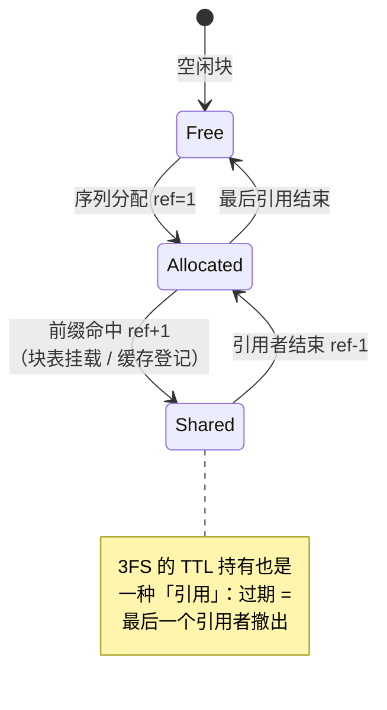

# 06 KV Cache：分页 / 3FS / 前缀缓存 / SWA 有界重放

KV Cache 是推理系统里最大的状态、最贵的资源、生命周期最复杂的对象。第 02 章论证过：三大设计目标的实现全部压在它身上；第 03 章看到 3FS 围绕它成为架构枢纽。本章把 KV Cache 自身讲透：为什么必须分页、共享为什么需要引用计数、SWA 层为什么特殊、以及「按层推进」这个不起眼却承重的语义。DeepInfer 恰好未开源「KV cache 管理」组件，本章按公开行为推断其设计——每处推断都有 miniflow 的实现验证逻辑自洽。

## 1. 为什么需要 KV：不存则贵，存则涨

自回归注意力的工作方式：生成第 $t$ 个 token 时，它的查询向量（Q）要和**全部前文**的键（K）算相似度、再对全部前文的值（V）加权求和。前文的 K/V 是由前文的 token 经各层投影算出来的——问题在于，这些 K/V **每步都要用、且永不变**。

不缓存的话，每生成一个 token 都要把前文全部重算一遍（前文 t 个 token 的 K/V 要逐层恢复），整个生成的总计算量是 $O(t^2)$ 级——4000 token 的请求要算 4000 次完整前向，完全不可接受。所以必须缓存。但缓存意味着：**每个 token、每一层，都要存它的 K/V**——随序列长度线性增长，且乘上并发请求数。量级感受一下：MLA 压缩后一个 token 全层的 KV 约几十 KB，1 万条并发请求、平均 4000 token，就是数百 GB 到 TB 级——比模型权重本身还大。

于是 KV Cache 的管理成为系统主战场：显存怎么切、怎么共享、怎么逐出、怎么跨节点流动。

## 2. 分页：借操作系统虚拟内存的思想

### 2.1 朴素方案坏在哪

直接想法：每条序列预留一段**连续**显存，大小按 `max_len` 算。两个问题，都用数字看：

**内部碎片**（预留在、用不上）：`max_len=8192`，用户实际只生成了 200 token 就说完了——预留的 8K 位置里 97% 白白占着。预留是为了「万一长」，但绝大多数请求短，平均浪费率高得离谱。

**外部碎片**（显存被洞撕碎）：长短不一的连续段反复分配、释放后，显存里剩下无数个大小不等的洞。总量明明够，却找不到一段**连续**的空闲区放下新请求——操作系统教材的经典问题。

### 2.2 分页方案

操作系统的解法直接搬过来：把物理显存切成**大小固定的块**（block），每条序列持有一张**块表**（block table），记录「逻辑位置 → 物理块号」的映射。序列增长就追加新块（物理上不需要连续），结束就整块归还池子。

```text
序列 A 的块表: [块 7, 块 3, 块 11]   → 逻辑第 0..127 token 在块 7，第 128..255 在块 3 …
序列 B 的块表: [块 9, 块 3*]          → *块 3 被两条序列共享（前缀缓存命中，见下节）
```

两个碎片同时消失：内部碎片的上限是**每条序列最多半个块**的尾部浪费（最后一块没填满）；外部碎片为零——块是等大的，物理位置放哪都行，永远有「洞」可用。

DeepInfer 生产块大小 128 token；miniflow 用 4（`CacheConfig.block_size`）。块小是为了教学：10 个块的池子里，一次调度决策能看得清清楚楚。尾浪费在 miniflow 里可观测——`PagedKVCache.stats()["tail_waste_slots"]` 输出「已分配块的未用槽位」，生产上报这个数就是为了回答「块大小选多大才合适」。

## 3. 块被共享 → 引用计数

分页还送了一个意想不到的能力：**物理块共享**。前缀缓存（[第 03 章](03-architecture.md)）命中时，新序列 B 的前缀和已有序列 A 相同——这段的 KV 计算结果完全一致（确定性前向），B 直接把 A 的块挂进自己的块表就行，一个字节都不用重算。上图里的块 3 就处于这个状态。

但这立刻引入一个新问题：**块 3 现在有两条命**。A 结束时不能回收块 3（B 还在用），B 结束也不能（可能还有 C）。答案是操作系统同款的**引用计数**：块被挂载一次计数 +1，引用者结束 -1，**归零才真正归还池子**：

```python
# miniflow/cache/paged_kv.py 的真实实现
def free_seq(self, seq_id):
    for b in self.block_tables.pop(seq_id, []):
        self.ref_counts[b] -= 1
        if self.ref_counts[b] <= 0:
            self.free_blocks.append(b)      # 归零才真正回收
```

三个会让计数 +1 的路径，miniflow 全部实现：

| 路径 | 操作 | 生产对应 |
|---|---|---|
| 序列自身分配 | `ref = 1` | 普通块 |
| 前缀命中挂载 | `acquire_blocks: ref += 1` | 块表共享 |
| 缓存条目登记 | `acquire_reference: ref += 1` | 3FS 块在 TTL 期内被持有 |

第三个路径值得多说一句：3FS 上持久化的块，在 TTL 内被「缓存条目」这个抽象所有者持有（否则没有请求引用它时就被回收了，前缀复用无从谈起）。TTL 过期 = 这个引用撤出——本质和序列结束是同一种事件。

!!! danger "miniflow 踩坑实录：引用泄漏"

    早期版本里，调度器对 waiting 序列**先挂载命中块、后检查容量**——
    检查失败 break 时已挂的引用不回滚，下轮重试再挂一遍：引用计数
    只增不减，块永远无法回收。修复：**先检查后挂载**（检查时把命中块
    算作「不需要新分配的已覆盖部分」）。见 `miniflow/scheduler.py`
    的 `need_new = blocks_needed(...) - len(hit_blocks)`。

## 4. 命中语义的一个硬约束：至少留 1 个 token

前缀命中「跳过 prefill」有一个初学者想不到的边界：**命中长度不能覆盖到最后一个 token**。规则是 `max_blocks = (num_tokens - 1) // block_size`——就算整条 prompt 都命中了，也必须把最后一个 token 留给 prefill 重算。

为什么？回到 KV Cache 和输出的关系：prefill 算完第 $n$ 个 token，得到的是**第 $n+1$ 个位置**的输出分布（采样出第一个生成 token）。如果命中覆盖了全部 $n$ 个 token、一个未算的都不剩，那么这次 forward 没有任何位置产出 logits——第一个生成 token 无从采起。所以至少要重算最后一个 token，用它的 forward 拿到第一个输出位置的分布。vLLM 同款约束，miniflow 一比一复刻。

## 5. SWA 层：不进块池的 KV

V4.1 的部分层用**滑动窗口注意力**（SWA，Sliding Window Attention）：只 attend 最近 W 个 token（比如 W=2048），窗口外的历史位置**永远不再被读**。

这从根本上改变了这些层的 KV 需求。全注意力层的 KV 是「只增不删」的档案（任何历史都可能被回看）；SWA 层的 KV 是「只留最近 W 个」的滚动窗口——窗口外存着也是纯浪费。所以 DeepInfer 让 SWA 层的 KV 不进块池，走**定长 StateBlock**（环形缓冲：新 token 覆盖最老的）。效果是块池容量只被全注意力层消耗——同样显存，能驻留的请求数显著变多，等效扩容。

**Bounded replay（有界重放）**是配套机制。SWA 的状态是定长的，但注意力核处理「连续输入」最自然——当需要重建窗口边界附近的连续性（比如推测解码回滚、断点恢复）时，做法是**只重放窗口内的有界段**：重算量以窗口大小 W 为上界，与序列全长无关。一条 100K token 的请求发生回滚，全注意力层要考虑的前缀很长，SWA 层的重算最多就是 W——这就是「有界」的含义。miniflow 对应：`ModelConfig.swa_window=16`，`layers.py` 里窗口外的 KV 根本不进入注意力计算。

## 6. 按层同步推进：最不起眼却最承重的语义

一个容易被整体忽视的细节：**KV 的「已计算进度」是按层独立记账的**。

为什么必然如此：一次 forward 里，第 $L$ 层刚算出的新 KV，第 $L+1$ 层用的是**它自己的**池（第 $L+1$ 层的 K/V 由第 $L+1$ 层的输入算出，而那个输入此刻还没被算出来）。所以进度天然是 `computed[seq_id][layer]` 这样一个**每层一个数**的表，而不是「序列已算到第几个 token」一个数。

这个语义是三个高级特性的地基：

1. **断点续算**：forward 中途故障，每层保留各自进度，恢复时从未完成处继续，不用整层重头；
2. **推测解码回滚**：draft token 被拒绝时，进度整体退回「保留长度」——注意**被拒槽位的 KV 无需物理擦除**，它们只是变成「未计算」状态，下次 forward 会覆盖写。回滚是改账本，不是擦数据；
3. **chunked prefill**：长 prompt 分多步算，每步推进「若干层 × 若干块」，层间进度天然允许不一致。

miniflow 里它是一等公民：

```python
# miniflow/cache/paged_kv.py
self.computed: Dict[seq_id, List[int]]    # 每层各自的已算 token 数
def reset_computed(self, seq_id):          # 推测解码回滚：全部层退回第 0 层的进度
    keep = self.computed[seq_id][0]
    self.computed[seq_id] = [keep] * self.mcfg.num_layers
```

!!! danger "miniflow 踩坑实录：进度语义错位"

    推测解码早期版本把 KV 进度回滚到 `num_tokens`（全部算完的位置）——
    下一步 draft 的第一次 forward 发现「没有新 token 可算」，增量契约
    直接断言失败。正确不变量：**进入每次 forward 时恰有 1 个未算 token**
    （算最后一个已定 token，才能得到下一位置的分布）。这个 bug 的
    完整推导见 [lab/05](../lab/05-speculative.md)。

## 7. 生命周期总览

一个物理块的一生，串起本章全部机制：



## miniflow 对应实验

```bash
python examples/demo_paged_kv.py                 # 分配/回收/引用计数/尾浪费
python examples/demo_prefix_cache.py             # 命中挂载 + 跳过 prefill
python -m pytest tests/test_prefix_cache.py -q   # 复用不改输出（契约测试）
```

| 上一章 | 下一章 |
|---|---|
| [05 并行策略](05-parallelism.md) | [07 调度器](07-scheduler.md) |