```mermaid
gantt
    title 静态 batch（上） vs 连续组批（下）
    dateFormat X
    axisFormat %s
    section 静态
    请求A(短)      :0, 4
    请求B(长)      :0, 10
    请求C(中)      :0, 7
    section 连续
    请求A          :0, 4
    请求C          :0, 7
    请求B          :0, 10
    请求D(新到)    :5, 12
```

# 07 调度器：Continuous Batching 与异步调度

调度器是引擎的心脏起搏器：每个 step 决定**谁进批、算多少、块给谁**。它一行矩阵乘都不算，却决定了所有子系统的效率上限——算子再快，GPU 空转就全白搭。本章讲四个问题：组批的迭代级粒度、chunked prefill 的预算、CPU/GPU 流水线（「零开销」零的是哪部分开销）、以及抢占——最后这个问题上 miniflow 踩过本项目最贵的坑（三重死锁），完整实录在 [lab/04](../lab/04-scheduler.md)。

## 1. Continuous Batching：迭代级调度

先看要被打败的旧方案。**静态 batch**（早期服务的做法）：凑齐 N 条请求 → 一起 prefill → 一起 decode → **等批里最长的生成完** → 整批释放、换下一批。致命伤用一个数字看清：批里三条请求分别要生成 4、7、10 步，整批要跑 10 步才释放——前 4 步算 A 的活，第 5~7 步里 A 已完成但它的显存和批位还占着，GPU 在为「已经没活的请求」空转。真实流量下请求长短高度不齐（有人问一句话、有人让它写论文），平均空转率能到一半以上。

**Continuous batching**（连续组批，迭代级调度）把组批粒度从「请求的一生」降到「一个 decode step」：**每一步都重新组批**——

- 完成的序列**立刻出批**：本 step 结束就释放它的 KV 块，下一步批里没有它；
- 新到的请求**立刻插队**：它的 prefill 和在跑请求的 decode 组进同一个 step（异构批：prefill 段 + 1 个新 token 的 decode 段一起 forward）；
- GPU 每一步只算「正好有活干」的请求——吞吐逼近理论上限。



上图下半段：D 在第 5 步到达时立刻加入（不用等 B/C 完成），A 第 4 步完成立刻让位。对比上半段——同样的 GPU 时间，静态批 10 步服务 3 条，连续组批 12 步服务 4 条且没有一步空转。

代价是调度的复杂度暴涨：每毫秒级的 step 都要做「谁出、谁进、块给谁」的决策，而且这个决策必须和 KV 块池的状态精确同步（第 06 章）。这就是本章剩余部分的全部内容。miniflow 的对应演示：`examples/demo_scheduler.py cb`——第 3 步后新请求插队，解码步被共享，完成即让位。

## 2. Chunked prefill：预算在保护谁

新请求的 prefill 和在跑请求的 decode 混进同一个 step 是必要的（否则新请求要等一整轮空档），但代价第 03 章算过：prefill 是计算受限的大矩阵乘，一条 8000 token 的 prompt 混进批里，这个 step 的耗时被它主导，所有 decode 请求的 TPOT 瞬间劣化——用户看到字停了一下。

**Chunked prefill** 的解法：把长 prompt 切块，每个 step 只放**预算内**的一段。比如预算 2048 token：8000 的 prompt 分 4 个 step 消化（4×2048），每个 step 里 decode 请求照常推进，只是每步都陪跑一小段 prefill。被保护的对象由此明确——**在跑请求的 TPOT**：预算越小、TPOT 越稳、这条新请求自己的 TTFT 越长。它是第 02 章「延迟-延迟权衡」的具体旋钮。

预算怎么定？miniflow 用固定 token 预算（`EngineConfig.max_tokens_per_step = 64`）演示思想；DeepInfer 生产版更进一步，用**拟合的二次成本模型** cost(q, c)：「一个 step 的实际耗时」被建模为 chunk 大小 q 和混跑 decode 并发数 c 的函数，离线拟合系数（耗时随 q 近似二次增长——prefill 的计算量里注意力部分是 q² 量级的两两打分）。在线运行时给定 TPOT 预算，**反解**出 q 的上限——用测出来的代价函数做决策，代替拍一个常数。

!!! danger "miniflow 踩坑实录：预算也能造成死锁"

    预算逻辑早期写作「`need > budget` 就不接纳」。被抢占的序列回到
    waiting 后，它的重算长度 = prompt + 已生成部分——**可能超过预算**
    → 它永远出不了队。修复：无活可干时（running 空）强制放行。
    生产框架用 chunked prefill 天然规避（长 prefill 切成多步消化，
    每步都在预算内）；miniflow 的整段放行是 liveness 兜底。
    见 `miniflow/scheduler.py`。

## 3. 零开销批调度器：CPU/GPU 流水线

朴素执行循环长这样：

```text
schedule(N) → forward(N) → sample(N) → schedule(N+1) → forward(N+1) → ...
               └── GPU 算 ──┘              └── GPU 闲等 CPU ──┘
```

schedule（组批、查块池、定优先级）和采样后处理是纯 CPU 逻辑。朴素循环里 GPU 算完 forward 就闲下来等 CPU 想下一步——每步都有一段 GPU 空窗。decode 每 step 才 10~20 ms，CPU 调度占 2~3 ms 的话，10%+ 的吞吐白扔。

DeepInfer 的流水线让两边的活重叠：

```text
CPU:   schedule(N+1) ─────┐ launch
GPU:        forward(N) ───┼→ sample(N) → forward(N+1) → sample(N+1)
            （CPU 在 GPU 跑 forward(N) 时构建 schedule(N+1)）
```

CPU 构建 N+1 批的同时，GPU 在算 N 批——**「零开销」零的是调度在 GPU 关键路径上的出场时间**，不是调度本身消失了。

这里有一个非常深的工程细节：schedule(N+1) 开始构建时，**sample(N) 的结果还没返回**——调度器是在「滞后一步的序列状态」上做决策的：哪些请求完成了、哪些该出批，它知道的是一步前的旧账。DeepInfer 的处理不是同步等结果，而是**容忍过时信息 + 执行侧自治修正**：CPU 只固定 step 的总预算，每条请求「多退少补」的长度修正在 GPU 侧执行时自行完成。把这个「用陈旧信息也要做出正确决策」的思路想通，你对流水线设计的理解就上了一层楼。

miniflow 用双线程复刻（`miniflow/engine.py` 的 `AsyncLLMEngine`）：

```text
调度线程：schedule(N+1)（基于滞后一步的名单）→ 投递队列
执行线程：forward(N) → 对「调度时活着、执行时已 finish」的序列防御性跳过
```

`examples/demo_scheduler.py async` 打印双线程的时间线：`schedule(N+1)` 完全落在 `forward(N)` 的区间内——流水线真实生效（这个统计本身踩过一个坑：两个线程各自用不同的时间基准，重叠率算出来是 0%，详见 [lab/04](../lab/04-scheduler.md)）。

## 4. 抢占：块池吃紧时的让路

连续组批要求「请求随到随入」，但显存有限：请求太多或某条序列长得超出预期，块池耗尽，decode 无法为新 token 追加块。此时调度器必须让路——**抢占**：选一条受害序列，回收它的资源，把它退回等待队列，资源宽裕时再继续。两种生产流派：

| 流派 | 做法 | 代价 |
|---|---|---|
| **swap** | 把受害序列的 KV 换出到 CPU 内存 | 换入换出的带宽 |
| **recompute** | 丢弃 KV，状态回退，稍后从头重算 | 重算的算力 |

vLLM 以 recompute 为主（换出换入的带宽在高峰期本身就是稀缺资源，重算反而便宜）；DeepInfer QA 里描述为「调度让路」。共同语义：**受害序列不失败，只是降速**——用户的请求变慢了但不会被拒。victim 的选择是**最晚进入 running 的序列**：让老请求先走完——单请求视角的公平直觉。

抢占听起来只是「回收-重试」，但它和组批顺序、容量检查的**交互**比直觉复杂得多——miniflow 在这里依次踩过三重死锁，这是本项目最贵的教训，值得全文照录：

!!! danger "miniflow 三重死锁实录（本项目最贵的教训）"

    **死锁一：容量检查的语义错误（自我抢占循环）。**
    running 序列的 decode 检查误用了「整序列所需块 ≤ 空闲块」——
    但序列自己占着的块不在空闲池里 → 检查永远通不过 →「自己挡自己」：
    序列长到需要第 N+1 块时被判定不够 → 抢占自己 → 释放全部块 →
    重新 prefill → 长到同一点 → 又抢占 → 无限循环，吞吐为零。
    **修复**：decode 的检查必须用**增量语义**——只看「还要补几块」，
    不看「总共要几块」。

    **死锁二：检查通过但分配滞后（同批双重花销）。**
    组批时对同批 N 条序列逐条做容量检查，但检查都基于**同一瞬间的
    空闲块数**——每条都「看到」同一份富余，都判定「够」，物理分配
    时才发现被前面的邻居花掉了，MemoryError。
    **修复**：检查与分配**原子化**——每条序列通过检查的瞬间就把预留
    实体化为物理块分配，下一条看到的是扣减后的真实余量。

    **死锁三：组批顺序颠倒（接纳-抢占震荡）。**
    早期顺序是「先接纳 waiting 的新 prefill，再组 decode 批」——新
    prefill 用光剩余块 → 在跑序列追加 1 块失败 → 触发抢占，victim 恰是
    「最晚进入 running 的」= 刚接纳的那条新请求 → 释放它的块 → 下一步
    又把它接纳进来 → 又抢占 → **每步零进展，永远在原地打转**。
    **修复**：**decode 优先组批，剩余容量再接纳 prefill**（vLLM 同款
    顺序）。教训：组批顺序是**正确性问题**，不是性能偏好。

    三重死锁的完整复现与逐步推演见 [lab/04](../lab/04-scheduler.md)。

## 5. 调度器的完整决策序

修复后的 miniflow 调度序（`miniflow/scheduler.py` 的 `schedule()`），可以直接当生产语义的缩影读：

```text
1. decode 优先：逐条「检查（增量语义）→ 分配（实体化）」原子推进
   └ 容量不足 → 抢占最晚 running 序列 → 本步停止扩批（保守策略）
2. waiting 接纳（用 decode 预留后的真实剩余容量）：
   ├ 前缀缓存 match（命中块只加引用，不耗空闲块）
   ├ 容量检查：blocks_needed(全序列) - 已覆盖块 ≤ 空闲块
   ├ 预算检查：need ≤ budget（无活可干时强制放行——liveness 兜底）
   └ 实体化分配到 num_tokens + 1（为下一个 token 留位）
3. liveness 防御：无可执行项却还有等待者 → 明确报错（配置错误的信号）
```

注意三重死锁的修复各就各位：第 1 步的「增量语义」治死锁一、「原子推进」治死锁二、「decode 优先」治死锁三；第 2 步的「先检查后挂载」治第 06 章的引用泄漏；预算强制放行治本章第 2 节的预算死锁。**每一个防御背后都对应一个实际发生过的故障**——这份决策序不是设计出来的，是被咬出来的。

## miniflow 对应实验

```bash
python examples/demo_scheduler.py          # cb / preempt / async 三幕全演
python examples/demo_scheduler.py preempt  # 多次抢占，全部请求最终完成
python -m pytest tests/test_scheduler.py -q
```

| 上一章 | 下一章 |
|---|---|
| [06 KV Cache](06-kvcache.md) | [08 推测解码：DSpark](08-speculative.md) |