# 07 调度器：Continuous Batching 与异步调度

!!! question "本章问题"
    - 静态 batch 为什么在真实流量下吞吐惨败？
    - chunked prefill 的「预算」到底在保护什么？DeepInfer 的
      cost(q, c) 二次成本模型是什么？
    - 「零开销批调度器」零的到底是哪部分开销？
    - 抢占为什么必须与组批顺序协同，否则会死循环？

---

调度器是引擎的「心脏起搏器」：每个 step 决定**谁进批、算多少、
块给谁**。它不碰张量，却决定了所有子系统的效率上限。

## 1. Continuous Batching：迭代级调度

**静态 batch**（早期服务的方式）：凑齐 N 条请求 → 一起 prefill →
一起 decode → **等最长的生成完** → 整批释放。致命伤：短请求陪跑，
GPU 大量时间花在「等批里的尾巴」上。

**Continuous batching（迭代级调度）**：**每个 decode step 重新组批**：

```mermaid
gantt
    title 静态 batch（上） vs 连续组批（下）
    dateFormat X
    axisFormat %s
    section 静态
    请求A(短)      :0, 4
    请求B(长)      :0, 10
    请求C(中)      :0, 7
    section 连续
    请求A          :0, 4
    请求C          :0, 7
    请求B          :0, 10
    请求D(新到)    :5, 12
```



- 完成的序列**立刻让位**（本 step 结束就出批）；
- 新到的请求**立刻插队**（prompt 的 prefill 与在跑请求的 decode
  同 step 组批）；
- GPU 时间被切给「正好有活干」的请求 —— 吞吐逼近理论上限。

miniflow 的对应演示：`examples/demo_scheduler.py cb` —— 第 3 步后
新请求插队，解码步被共享，完成即让位。

## 2. Chunked prefill：预算在保护谁

新请求的 prefill 与在跑请求的 decode **混跑在一个 step** 是必要的
（否则新请求要等一整轮），但代价明确：

- prefill 是计算受限的大活 —— 混进批里，decode 的 TPOT 瞬间劣化；
- decode 是访存受限 —— 大 prefill 挤占的激活显存可能触发换页。

**Chunked prefill**：把长 prompt 切块，每步只放**预算内**的一段。
miniflow 用固定 token 预算（`EngineConfig.max_tokens_per_step = 64`）
讲同一思想；DeepInfer 生产版更进一步 —— **拟合的二次成本模型
cost(q, c)**：以 chunk 大小 q 与混跑 decode 数 c 为自变量拟合
「一个 step 的实际耗时」（矩阵乘形状决定耗时是 q 的二次函数），
然后在 TPOT 时间预算内**反解** q —— 量化决策代替拍脑袋。

!!! danger "miniflow 踩坑实录：预算也能造成死锁"
    预算逻辑早期写作「`need > budget` 就不接纳」。被抢占的序列回
    waiting 后，其重算长度 = prompt + 已生成 —— **可能超过预算** →
    永远出不了队。修复：无活可干时（running 空）强制放行。
    生产框架用 chunked prefill 天然规避（长 prefill 被切多步消化）；
    miniflow 整段放行是 liveness 兜底。见 `miniflow/scheduler.py`。

## 3. 零开销批调度器：CPU/GPU 流水线

朴素执行循环：

```text
schedule(N) → forward(N) → sample(N) → schedule(N+1) → forward(N+1) → ...
              └── GPU 算 ──┘             └── GPU 闲等 CPU ──┘
```

schedule / post-process 是纯 CPU 逻辑 —— 朴素流水里 GPU 在此期间
**空转**。DeepInfer 的流水线：

```text
CPU:   schedule(N+1) ─────┐ launch
GPU:        forward(N) ───┼→ sample(N) → forward(N+1) → sample(N+1)
           （CPU 在 GPU 跑 forward(N) 时构建 schedule(N+1)）
```

**零的开销 = 调度不再出现在 GPU 的关键路径上**。一个 QA 里的细节
很能说明工程深度：schedule(N+1) 时 sample(N) 的结果**尚未返回** ——
调度基于滞后一步的序列状态，CPU 只固定总预算，「每请求的长度修正
在 GPU 侧自行完成」。即：**调度容忍过时信息 + 执行侧自治修正**。

miniflow 用双线程复刻（`miniflow/engine.py` 的 `AsyncLLMEngine`）：

```text
调度线程：schedule(N+1)（基于滞后一步的名单）→ 投递队列
执行线程：forward(N) → 对「调度时活着、执行时已 finish」的序列防御性跳过
```

`examples/demo_scheduler.py async` 打印双段时间线：`schedule(N+1)`
完全落在 `forward(N)` 区间内 —— 流水线生效。

## 4. 抢占：块池吃紧时的让路

块池耗尽时（请求太多 / 序列太长），调度器必须**回收**。两种生产流派：

| 流派 | 做法 | 代价 |
|---|---|---|
| **swap** | 把受害序列的 KV 换出到 CPU 内存 | 换入换出带宽 |
| **recompute** | 丢弃 KV，状态回退，稍后从头重算 | 重算算力（prefill 已摊销的部分重来） |

vLLM 用 recompute 为主；DeepInfer QA 里描述为「调度让路」。
共同语义：**受害序列不失败，只是降速** —— 稍后资源宽裕时继续。

victim 选择：**最晚到达的 running 序列**（先让老请求走完 ——
对单请求公平性的直觉保护）。

!!! danger "miniflow 踩坑实录：三重死锁（本项目最贵的教训）"
    抢占与组批的交互比直觉复杂得多。miniflow 开发中依次踩过：

    **死锁一：容量检查的语义错误（自我抢占循环）。**
    running 序列的 decode 检查误用了「整序列所需块 ≤ 空闲块」——
    序列自己占的块不在空闲池里 → 「自己挡自己」：序列长到需要第
    N+1 块时检查说不够 → 抢占自己 → 释放全部块 → 重新 prefill →
    长到同一点 → 又抢占 → 无限循环。
    **修复**：检查必须用**增量语义** —— 只看「还要补几块」。

    **死锁二：检查通过但分配滞后（同批双重花销）。**
    同批 N 条序列的容量检查共享同一瞬时空闲数 —— 每条都「看到」
    同一份富余，物理分配时炸 MemoryError。
    **修复**：检查与分配**原子化**（调度期就把预留实体化为物理块）。

    **死锁三：组批顺序颠倒（接纳-抢占震荡）。**
    先接纳 waiting 的新 prefill、再组 decode 批 → 新 prefill 恰好
    用光剩余块 → 在跑序列追加 1 块失败 → 抢占「最晚进入 running 的」
    = 刚接纳的那条 → 释放 → 下一步又接纳它 → **每步零进展**。
    **修复**：**decode 优先组批，剩余容量再接纳 prefill**（vLLM
    同款顺序 —— 顺序本身是正确性问题，不是性能偏好）。

    三重死锁的完整复现与推演见 [lab/04](../lab/04-scheduler.md)。

## 5. 调度器的完整决策序

修复后的 miniflow 调度序（`miniflow/scheduler.py` 的 `schedule()`），
可直接当生产语义的缩影读：

```text
1. decode 优先：逐条「检查（增量语义）→ 分配（实体化）」原子推进
   └ 容量不足 → 抢占最晚 running 序列 → 本步停止扩批（保守）
2. waiting 接纳（用 decode 预留后的真实剩余容量）：
   ├ 前缀缓存 match（命中块只加引用不耗空闲）
   ├ 容量检查：blocks_needed(全序列) - 已覆盖块 ≤ 空闲块
   ├ 预算检查：need ≤ budget（无活可干时强制放行）
   └ 实体化分配到 num_tokens + 1（为下一个 token 留位）
3. liveness 防御：无可执行项却还有等待者 → 明确报错（配置错误）
```

## miniflow 对应实验

```bash
python examples/demo_scheduler.py          # 三幕全演
python examples/demo_scheduler.py preempt  # 4 次抢占，3 条请求全部完成
python -m pytest tests/test_scheduler.py -q
```

| 上一章 | 下一章 |
|---|---|
| [06 KV Cache](06-kvcache.md) | [08 推测解码：DSpark](08-speculative.md) |