```mermaid
gantt
    title 静态 batch（上） vs 连续组批（下）
    dateFormat X
    axisFormat %s
    section 静态
    请求A(短)      :0, 4
    请求B(长)      :0, 10
    请求C(中)      :0, 7
    section 连续
    请求A          :0, 4
    请求C          :0, 7
    请求B          :0, 10
    请求D(新到)    :5, 12
```

# 07 调度器：Continuous Batching 与异步调度

调度器是引擎的心脏起搏器：每个 step 决定**谁进批、算多少、块给谁**。它一行矩阵乘都不算，却决定了所有子系统的效率上限——算子再快，GPU 空转就全白搭。本章讲四个问题：组批的迭代级粒度、chunked prefill 的预算、CPU/GPU 流水线（「零开销」零的是哪部分开销）、以及抢占——最后这个问题上 miniflow 踩过本项目最贵的坑（三重死锁），完整实录在 [lab/04](../lab/04-scheduler.md)。

先给一个定位：调度器是全书「离操作系统最近」的一章。它的三个核心机制——组批（时分复用）、抢占（资源剥夺）、异步流水线（并行阶段）——全都有 1970 年代 OS 教材的原型（多道程序设计、可抢占调度、指令流水线）。这不是巧合：**「一串长短不一的任务竞争一块有限资源」的问题结构，在 CPU 时间片和 GPU 显存上是同构的**。带着这个视角读，你会不断看到熟悉的概念换了硬件皮肤。

读完本章，你应该能回答：

- 静态批的空转率怎么算？continuous batching 怎么消灭它、付出了什么复杂度代价？
- chunked prefill 的预算在保护谁、牺牲谁？预算怎么定（固定值 vs 成本模型）？
- CPU/GPU 流水线「零开销」的准确含义？「滞后一步决策」怎么保证正确？
- 抢占的两种流派（swap/recompute）怎么选？victim 选最晚到达的理由？
- 三重死锁各自的机理和修复？为什么组批顺序是正确性问题？

## 0. 预备：调度理论的五分钟速成

进入引擎细节前，把通用调度理论的最小核心立起来——它是本章所有机制的参照系，也是你评估任何调度设计的 checklist。

**调度器的三个永恒问题**（任何调度系统都要回答）：

1. **准入（admission）**：新任务进来，接不接？接了要不要立刻给它资源？（本章 2 节的接纳逻辑）
2. **排序（ordering）**：多个任务都在等，先服务谁？（本章 5 节的 decode 优先序）
3. **剥夺（preemption）**：资源不够时，从谁手里抢？（本章 4 节的抢占）

**经典策略与它们的病理**（OS 教材 → 推理调度的对照）：

| 策略 | OS 原型 | 推理对应 | 病理 |
|---|---|---|---|
| FCFS（先来先服务） | 排队队列 | 静态批（1 节） | 长任务阻塞短任务（护航效应） |
| SJF（最短优先） | 批处理调度 | 「短请求优先接纳」 | 长任务饥饿；且长度不可知 |
| 优先级调度 | 实时系统 | SLO 三色信号（2.4 节） | 低优先级饥饿（需老化补偿） |
| 轮转（RR） | 时间片轮转 | chunked prefill（3 节） | 时间片太小 → 切换开销主导 |
| 可抢占 | 抢占式内核 | KV 让路（4 节） | 抢占开销 + 公平性问题 |

一个贯穿全表的规律：**每种策略都在「平均性能」和「个别公平」之间做交换**——SJF 平均等待最优但饿死长任务，FCFS 公平但平均最差。推理调度的特殊之处在于**任务长度不可知**（生成多长事前不知道）：SJF 的理想形态不可得，只能用「预测 + 老化兜底」逼近——这就把 OS 的「调度」变成了 ML 系统的「预测+调度」耦合问题（长度预测器的质量直接决定调度质量）。记住这张表，本章每个机制都能在表上找到座位。

## 1. Continuous Batching：迭代级调度

先看要被打败的旧方案。**静态 batch**（早期服务的做法）：凑齐 N 条请求 → 一起 prefill → 一起 decode → **等批里最长的生成完** → 整批释放、换下一批。致命伤用一个数字看清：批里三条请求分别要生成 4、7、10 步，整批要跑 10 步才释放——前 4 步算 A 的活，第 5~7 步里 A 已完成但它的显存和批位还占着，GPU 在为「已经没活的请求」空转。真实流量下请求长短高度不齐（有人问一句话、有人让它写论文），平均空转率能到一半以上。

**Continuous batching**（连续组批，迭代级调度）把组批粒度从「请求的一生」降到「一个 decode step」：**每一步都重新组批**——

- 完成的序列**立刻出批**：本 step 结束就释放它的 KV 块，下一步批里没有它；
- 新到的请求**立刻插队**：它的 prefill 和在跑请求的 decode 组进同一个 step（异构批：prefill 段 + 1 个新 token 的 decode 段一起 forward）；
- GPU 每一步只算「正好有活干」的请求——吞吐逼近理论上限。



上图下半段：D 在第 5 步到达时立刻加入（不用等 B/C 完成），A 第 4 步完成立刻让位。对比上半段——同样的 GPU 时间，静态批 10 步服务 3 条，连续组批 12 步服务 4 条且没有一步空转。

### 1.1 空转率的精确算法

「平均空转率能到一半以上」这个说法值得给出精确算法——它是评估任何组批方案的标尺。

设批内请求的生成步数为 $l_1, l_2, \dots, l_B$（按到达序），静态批的步数被 $\max l_i$ 决定：

$$
\text{有效步} = \sum_i l_i, \quad \text{实际步} = B \times \max_i l_i
$$

$$
\text{空转率} = 1 - \frac{\sum_i l_i}{B \times \max_i l_i}
$$

代几个分布感受空转率对「长度参差度」的敏感：

```text
分布 A（均匀 4/6/8/10）：  空转率 = 1 - 28/40 = 30%
分布 B（一条尾巴 4/5/6/40）：空转率 = 1 - 55/160 = 66%
分布 C（全部相等 8×4）：   空转率 = 0%
```

真实 LLM 流量是**重尾分布**（多数短回答 + 少数超长）——形状介于 A 和 B 之间，空转率 40~60%。也就是说：**静态批的 GPU 有近一半时间在为死人算命**。这个数字是 continuous batching 存在的全部理由（第 01 章 8 节静态批浪费账的完整版）。

连续组批把「批的生命周期」从 $\max l_i$ 降到每步重算：空转率严格归零（每步只算活着的请求）。代价不是性能而是**复杂度**——下一段细说。

### 1.2 复杂度暴涨在哪

连续组批的调度复杂度不是「每 step 多算几个 if」这么轻——它把三个子系统的状态同步问题全部激活了：

**与 KV 块池的同步**（第 06 章）：每步有请求出/进，块池的分配、释放、引用计数随之变化——调度决策必须基于**当前**的块池状态，而块池状态又被上一步的调度改变。这是「读-判-写」的循环依赖，任何一步的原子性缺口都是 bug 入口（三重死锁的死锁二就是这里的原子性破产）。

**与采样/结构化输出的同步**（第 09/10 章）：请求「是否完成」由采样结果决定（EOS 是采样出来的）——调度器组下一批时，本步的采样还没发生（异步流水线，3 节），「谁还活着」是滞后信息。

**与推测解码的同步**（第 08 章）：spec 请求的「本步产几个 token」是变量（接受长度 0~k），下步的批大小随之波动——调度器要在「不知道实际产出」的情况下预留资源。

三个同步问题叠加，调度器成了引擎里**并发度最高、不变量最多**的组件——这就是为什么它值得整章、为什么 miniflow 的三重死锁全在这、为什么 vLLM 把调度器称为「the heart of the engine」。读完本章你应该同意：**推理引擎的难度不在算得快，而在状态同步得对**。

miniflow 的对应演示：`examples/demo_scheduler.py cb`——第 3 步后新请求插队，解码步被共享，完成即让位。

## 2. Chunked prefill：预算在保护谁

新请求的 prefill 和在跑请求的 decode 混进同一个 step 是必要的（否则新请求要等一整轮空档），但代价第 03 章算过：prefill 是计算受限的大矩阵乘，一条 8000 token 的 prompt 混进批里，这个 step 的耗时被它主导，所有 decode 请求的 TPOT 瞬间劣化——用户看到字停了一下。

**Chunked prefill** 的解法：把长 prompt 切块，每个 step 只放**预算内**的一段。比如预算 2048 token：8000 的 prompt 分 4 个 step 消化（4×2048），每个 step 里 decode 请求照常推进，只是每步都陪跑一小段 prefill。被保护的对象由此明确——**在跑请求的 TPOT**：预算越小、TPOT 越稳、这条新请求自己的 TTFT 越长。它是第 02 章「延迟-延迟权衡」的具体旋钮。

### 2.1 预算的数字例：一张权衡表

用具体数字把「预算是权衡旋钮」变成可以抄进设计文档的表（H800，decode batch 32 条 + 一条 8K-token 的新 prompt 混跑）：

| chunk 预算 q | 该 step 耗时（估） | decode 的 ITL 尖峰 | 新请求 TTFT（4 步消化） |
|---|---|---|---|
| 8192（不切） | ~1.2 s | **1200 ms（爆表）** | 1.2 s + 排队 |
| 2048 | ~350 ms | 350 ms | ~1.4 s（4×350） |
| 1024 | ~180 ms | 180 ms | ~1.6 s（8×180） |
| 512 | ~95 ms | 95 ms | ~2.0 s（16×95） |
| 256 | ~50 ms | 50 ms ✓ | ~2.4 s（32×50） |

读表的方法：**q 每减半，ITL 尖峰近似减半（好），TTFT 递增 15~20%（坏）**——保护曲线是亚线性的，牺牲曲线也是亚线性的，最优 q 取决于你的 SLO 权重（ITL 预算紧 → q 往 512/256 走；TTFT 敏感 → q 往 2048 走）。**没有普适最优，只有 SLO 匹配**——这是「预算是旋钮」的准确含义。

表里还有个隐藏行：q 的下界受**切换开销**约束（0 节的轮转病理）——每 step 的组批、块池操作、kernel 启动有固定成本（~10 ms 量级），q=128 时固定成本占比 20%，切得比算得还贵。**q 的可行区间是 [2×固定开销, ITL 预算]**，生产常见 512~4096。

### 2.2 成本模型：用测量代替拍脑袋

预算怎么定？miniflow 用固定 token 预算（`EngineConfig.max_tokens_per_step = 64`）演示思想；DeepInfer 生产版更进一步，用**拟合的二次成本模型** cost(q, c)：「一个 step 的实际耗时」被建模为 chunk 大小 q 和混跑 decode 并发数 c 的函数，离线拟合系数（耗时随 q 近似二次增长——prefill 的计算量里注意力部分是 q² 量级的两两打分）。在线运行时给定 TPOT 预算，**反解**出 q 的上限——用测出来的代价函数做决策，代替拍一个常数。

这个「拟合-反解」的方法论值得展开——它是所有「调参难题」的通用解药：

```text
第一步：离线扫参。q ∈ {256, 512, ..., 4096} × c ∈ {8, 16, ..., 128}
        每组合跑 1000 步，记录平均 step 耗时 → 一张成本曲面
第二步：拟合。耗时 ≈ a·q² + b·q·c + d·c + e（最小二乘定系数）
        —— 为什么是二次？注意力的 O(q²) 打分项主导大 q 段
第三步：在线反解。给定本步的 ITL 预算 T 和当前 c：
        解不等式 a·q² + b·q·c + d·c + e ≤ T → q_max
第四步：用 q_max 做本步的接纳上限
```

三个工程细节决定它的成败：

- **曲面的时效**：模型换了、算子升级了、卡换代了，系数全部失效——要有「拟合年龄」的监控（比如每周自动重扫一次，系数漂移超阈值报警）；
- **外推的危险**：q 大于扫过的最大值就是外推（二次项可能低估），生产上对 q_max 设硬顶（不超过扫过的最大 q）；
- **分位的拟合**：如果拟合的是「平均耗时」，反解出的 q_max 在方差大的流量下会经常超预算——**生产拟合 P95 耗时而不是均值**（第 02 章的尾部经济学在调参里的投影）。

!!! danger "miniflow 踩坑实录：预算也能造成死锁"

    预算逻辑早期写作「`need > budget` 就不接纳」。被抢占的序列回到
    waiting 后，它的重算长度 = prompt + 已生成部分——**可能超过预算**
    → 它永远出不了队。修复：无活可干时（running 空）强制放行。
    生产框架用 chunked prefill 天然规避（长 prefill 切成多步消化，
    每步都在预算内）；miniflow 的整段放行是 liveness 兜底。
    见 `miniflow/scheduler.py`。

## 3. 零开销批调度器：CPU/GPU 流水线

朴素执行循环长这样：

```text
schedule(N) → forward(N) → sample(N) → schedule(N+1) → forward(N+1) → ...
               └── GPU 算 ──┘              └── GPU 闲等 CPU ──┘
```

schedule（组批、查块池、定优先级）和采样后处理是纯 CPU 逻辑。朴素循环里 GPU 算完 forward 就闲下来等 CPU 想下一步——每步都有一段 GPU 空窗。decode 每 step 才 10~20 ms，CPU 调度占 2~3 ms 的话，10%+ 的吞吐白扔。

DeepInfer 的流水线让两边的活重叠：

```text
CPU:   schedule(N+1) ─────┐ launch
GPU:        forward(N) ───┼→ sample(N) → forward(N+1) → sample(N+1)
            （CPU 在 GPU 跑 forward(N) 时构建 schedule(N+1)）
```

CPU 构建 N+1 批的同时，GPU 在算 N 批——**「零开销」零的是调度在 GPU 关键路径上的出场时间**，不是调度本身消失了。

这里有一个非常深的工程细节：schedule(N+1) 开始构建时，**sample(N) 的结果还没返回**——调度器是在「滞后一步的序列状态」上做决策的：哪些请求完成了、哪些该出批，它知道的是一步前的旧账。DeepInfer 的处理不是同步等结果，而是**容忍过时信息 + 执行侧自治修正**：CPU 只固定 step 的总预算，每条请求「多退少补」的长度修正在 GPU 侧执行时自行完成。把这个「用陈旧信息也要做出正确决策」的思路想通，你对流水线设计的理解就上了一层楼。

miniflow 用双线程复刻（`miniflow/engine.py` 的 `AsyncLLMEngine`）：

```text
调度线程：schedule(N+1)（基于滞后一步的名单）→ 投递队列
执行线程：forward(N) → 对「调度时活着、执行时已 finish」的序列防御性跳过
```

`examples/demo_scheduler.py async` 打印双线程的时间线：`schedule(N+1)` 完全落在 `forward(N)` 的区间内——流水线真实生效（这个统计本身踩过一个坑：两个线程各自用不同的时间基准，重叠率算出来是 0%，详见 [lab/04](../lab/04-scheduler.md)）。

### 3.1 滞后决策的正确性：一个思想实验

「用一步前的旧账做决策」听起来危险，值得用一个思想实验把它想透——这是流水线设计里最深的一课。

设调度器在 $t$ 时刻构建 step N+1 的批。此刻它知道的序列状态是「step N-1 结束时的名单」（滞后一步——step N 的采样结果还在 GPU 上没回来）。它把请求 R 排进了 step N+1 的批。两种意外：

**意外一：R 在 step N 就生成了 EOS。** 调度器不知道，仍然把 R 排在批里——执行线程跑到 step N+1 时发现 R 已完成。**防御性跳过**：执行侧自治地把 R 剔出本批（它的「1 个新 token」不用算了）。代价：批里留了个空位（这个 step 的 batch 比最优少 1）——浪费约 1/64 的算力，无害。

**意外二：R 恰好在 step N 被抢占。** 调度器不知道（组批和抢占的决策时序交叉），批里的 R 已无 KV 可用。执行侧防御性跳过——同上，无害。

注意两个「意外」的处理都没有**回滚调度器**——执行侧自治修正，双向不通信。这个设计的精髓：**把「正确性」从「信息完备」解耦出来**——不需要知道最新状态也能做出「最多浪费一点、绝不错误」的决策。对比朴素方案（同步等采样结果再调度）：信息完备了，但 GPU 每步空转 2~3 ms——**用 1/64 的算力浪费换 10% 的吞吐提升**，这笔账流水线完胜。

这个思路的适用面远超推理引擎——所有「预测-执行」分离的系统（CPU 的分支预测、数据库的乐观并发控制、微服务的 eventual consistency）都活在同一棵思想树上：**预测错了不要紧，只要纠错的代价比预测的收益低**。把这句话记住，你会在很多地方认出它。

### 3.2 流水线的极限：两段够了吗

「CPU 和 GPU 重叠」是两段流水。为什么不做更深的（schedule 的内部再分段、sample 后处理也重叠进去）？两个约束：

**依赖链的长度**：step N+1 的调度依赖 step N-1 的状态（滞后一步是最低可行），但 step N+2 的调度依赖 N 的状态——**流水线深度被「状态依赖的间隔」限制在 2**（更深的流水要求更旧的状态，预测错误率上升，防御跳过的浪费吃掉收益）。

**GPU 内部的流水**：forward 内部，DeepGEMM/FlashMLA 的 kernel 链已经由 CUDA stream 的异步执行天然流水（第 04 章 TMA 双缓冲）——调度器再切分不出收益。**CPU 侧的 schedule 是「粗粒度段」（毫秒级），GPU 内部的 kernel 流水是「细粒度段」（微秒级），两级流水已经覆盖了全部时间尺度**——第三段没有可切的空间。

（「够用就停」是流水线设计的美德——盲目加深段数是过早优化。miniflow 的双线程结构就是按「两段恰好」设计的，lab/04 的 async 实验验证重叠率 >90%——离 100% 的差距就是防御跳过和队列开销，正是理论的预期值。）

## 3.5 一个调度 step 的毫秒级走查

把本章机制压进一条真实的毫秒级时间线（miniflow 的 async 模式实测形态，数量级示意）——**读时间线是验证「机制真的咬合了」的最硬手段**：

```text
── step N 的执行线程（GPU 侧视角，CPU 模拟）────────
t=0.0 ms   forward(N) 启动
           批构成：58 条 decode（含 2 条 spec）+ 1 条 prefill chunk
t=0~14     模型前向（61 层，FlashMLA + MoE）
           ↑ 同期（CPU 调度线程）：
             t=0.5  收到 step N-1 的 finished 名单（3 条完成）
             t=1.0  释放 3 条的块（24 块回池，含 2 块降 ref）
             t=1.5  检查 waiting 队列（7 条在等）
                    → 3 条够块，接纳（2 条前缀命中，共省 11 块计算）
             t=2.5  组建 step N+1 的批（60 条 decode + 1 prefill 续块）
                    基于滞后名单（含 1 条其实已完成的——防御跳过对象）
             t=3.0  schedule(N+1) 完成，投入递队列
                    （CPU 活干完了，剩下的 11 ms 是纯等待——这就是重叠）
t=14       forward(N) 完成，sample(N)：
           产出 61 个 token（58 正常 + spec 净增 3）
           EOS×3 → finished 名单
t=14~15    后处理 + 结果入队（finished 名单给下轮调度用）
t=15       forward(N+1) 立即启动（批已在队列等着）
           ↑ GPU 全程无空窗：14 ms 计算 + 1 ms 采样衔接
```

五个值得指认的咬合点：

1. **t=0.5 的滞后**：调度线程处理的是 N-1 的完成名单（不是 N 的）——3.1 节的滞后一步决策的实况；
2. **t=1.5 的接纳**：3 条完成释放 24 块、马上被 3 条 waiting 用掉——「完成即出、到达即入」的连续性实况（第 1 节）；
3. **t=2.5 的防御对象**：批里那条「其实已完成」的请求——执行 N+1 时被跳过（浪费 1/60，3.1 节的账）；
4. **t=0~14 的重叠**：调度 3 ms 完全藏在 forward 里面——「零开销」的实况（CPU 在 t=3 后的 11 ms 闲着，是它把这 11 ms 让给了 GPU）；
5. **t=14 的 spec 波动**：58 条 spec 请求净增 3 token（有接受的、有全拒的）——批的产出是变量，下步的调度要吃这个方差（1.2 节的第三个同步）。

把这条时间线和第 04 章 3.6 节的 MoE 时间线、第 03 章 4 节的请求旅程并排——**三个时间线是同一枚硬币的三面**（调度视角 / 算子视角 / 请求视角），你能对齐每个事件在不同时间线里的位置时，全书就真正打通了。

## 4. 抢占：块池吃紧时的让路

连续组批要求「请求随到随入」，但显存有限：请求太多或某条序列长得超出预期，块池耗尽，decode 无法为新 token 追加块。此时调度器必须让路——**抢占**：选一条受害序列，回收它的资源，把它退回等待队列，资源宽裕时再继续。两种生产流派：

| 流派 | 做法 | 代价 |
|---|---|---|
| **swap** | 把受害序列的 KV 换出到 CPU 内存 | 换入换出的带宽 |
| **recompute** | 丢弃 KV，状态回退，稍后从头重算 | 重算的算力 |

vLLM 以 recompute 为主（换出换入的带宽在高峰期本身就是稀缺资源，重算反而便宜）；DeepInfer QA 里描述为「调度让路」。共同语义：**受害序列不失败，只是降速**——用户的请求变慢了但不会被拒。victim 的选择是**最晚进入 running 的序列**：让老请求先走完——单请求视角的公平直觉。

抢占听起来只是「回收-重试」，但它和组批顺序、容量检查的**交互**比直觉复杂得多——miniflow 在这里依次踩过三重死锁，这是本项目最贵的教训，值得全文照录：

!!! danger "miniflow 三重死锁实录（本项目最贵的教训）"

    **死锁一：容量检查的语义错误（自我抢占循环）。**
    running 序列的 decode 检查误用了「整序列所需块 ≤ 空闲块」——
    但序列自己占着的块不在空闲池里 → 检查永远通不过 →「自己挡自己」：
    序列长到需要第 N+1 块时被判定不够 → 抢占自己 → 释放全部块 →
    重新 prefill → 长到同一点 → 又抢占 → 无限循环，吞吐为零。
    **修复**：decode 的检查必须用**增量语义**——只看「还要补几块」，
    不看「总共要几块」。

    **死锁二：检查通过但分配滞后（同批双重花销）。**
    组批时对同批 N 条序列逐条做容量检查，但检查都基于**同一瞬间的
    空闲块数**——每条都「看到」同一份富余，都判定「够」，物理分配
    时才发现被前面的邻居花掉了，MemoryError。
    **修复**：检查与分配**原子化**——每条序列通过检查的瞬间就把预留
    实体化为物理块分配，下一条看到的是扣减后的真实余量。

    **死锁三：组批顺序颠倒（接纳-抢占震荡）。**
    早期顺序是「先接纳 waiting 的新 prefill，再组 decode 批」——新
    prefill 用光剩余块 → 在跑序列追加 1 块失败 → 触发抢占，victim 恰是
    「最晚进入 running 的」= 刚接纳的那条新请求 → 释放它的块 → 下一步
    又把它接纳进来 → 又抢占 → **每步零进展，永远在原地打转**。
    **修复**：**decode 优先组批，剩余容量再接纳 prefill**（vLLM 同款
    顺序）。教训：组批顺序是**正确性问题**，不是性能偏好。

    三重死锁的完整复现与逐步推演见 [lab/04](../lab/04-scheduler.md)。

## 4.5 抢占的完整账：一次抢占值不值

抢占本身有成本，不是「显存不够就抢」的反射——值得把账摆出来（判断「这次抢占是赚是赔」的框架）：

```text
抢占成本（victim 视角，recompute 流派）：
  重算 prefill：(prompt + 已生成) token 的 prefill 计算
    例：4000 token ≈ 0.5 s GPU 时间
  延迟回退：请求的时延 +重算时长 + 排队时间
  公平性损耗：被抢的用户体感「卡了一大下」

抢占收益（系统视角）：
  腾出的块数：victim 的全部块（4000 token ≈ 31 块）
  换取的准入：31 块 ≈ 3~4 条新短请求（各 8 块）
  SLO 净效应：3~4 条新请求免去排队（每条省 TTFT 数百 ms）
```

赚赔的分界：**victim 越长，成本越高（重算贵）但收益也越大（腾的块多）**——两条曲线都是长度的增函数，分界看斜率。粗略地：victim 4000 token、腾 31 块救 4 条新请求——4 条 × 省 500 ms = 2 s 的总延迟节省 vs victim 损失 1 s + 卡顿体感——**数值上赚、体感上亏**（4 个用户的流畅 vs 1 个用户的明显卡顿）。这就是为什么三色信号里红色请求要豁免：**把「体感账」和「数值账」合起来算，是 SLO 导向调度存在的理由**。

还有一个时间维度：**高负载期抢占是赚的（新请求排队深、省的 TTFT 大），低负载期抢占是纯亏**（没有请求在等，腾出的块没人用）。所以成熟的调度器有「抢占开关的水位线」：块池空闲 < 5% 时才启用抢占逻辑，> 10% 时只做正常逐出（第 06 章 7 节的缓存侧）——**同一份显存压力，按程度分流到不同的机制**（缓存逐出 → 抢占 → 拒绝准入），像免疫系统的分级响应。

## 5. 调度器的完整决策序

修复后的 miniflow 调度序（`miniflow/scheduler.py` 的 `schedule()`），可以直接当生产语义的缩影读：

```text
1. decode 优先：逐条「检查（增量语义）→ 分配（实体化）」原子推进
   └ 容量不足 → 抢占最晚 running 序列 → 本步停止扩批（保守策略）
2. waiting 接纳（用 decode 预留后的真实剩余容量）：
   ├ 前缀缓存 match（命中块只加引用，不耗空闲块）
   ├ 容量检查：blocks_needed(全序列) - 已覆盖块 ≤ 空闲块
   ├ 预算检查：need ≤ budget（无活可干时强制放行——liveness 兜底）
   └ 实体化分配到 num_tokens + 1（为下一个 token 留位）
3. liveness 防御：无可执行项却还有等待者 → 明确报错（配置错误的信号）
```

注意三重死锁的修复各就各位：第 1 步的「增量语义」治死锁一、「原子推进」治死锁二、「decode 优先」治死锁三；第 2 步的「先检查后挂载」治第 06 章的引用泄漏；预算强制放行治本章第 2 节的预算死锁。**每一个防御背后都对应一个实际发生过的故障**——这份决策序不是设计出来的，是被咬出来的。

### 5.1 决策序的逐段深挖

把决策序的每一段放大到「为什么长这样」的粒度——这段代码的每一行都是一处取舍：

**「decode 优先」的三重理由**。除了死锁三的修复（避免接纳-抢占震荡），decode 优先还有两重收益：(a) decode 的容量检查是**增量的**（每序列每步最多 1 块），检查便宜、失败率低；(b) decode 请求是「已经在投入的沉没成本」（生成了一半，被延误 = 前功尽弃的风险），prefill 是「还没开始的期权」——**保沉没成本优先于保期权**是资源紧张时的通用理性。

**「本步停止扩批」的保守性**。容量不足时抢占一条后**不再继续**（本步就这么多）——为什么不等价于「抢到够为止」？因为抢占有连锁风险：每抢一条，它的重算需求就回到 waiting 队列，**下步的容量压力更大**——激进的连环抢占可能进入「抢得越多、队列越深、下步抢更多」的正反馈。保守策略（抢一条收手）把这个环掐断在第一节——**在正反馈系统里，最优策略几乎总是「每次只动一格」**。

**「实体化分配到 num_tokens + 1」**。分配时多留一个 token 的位置——这是「留 1 规则」（第 06 章 4 节）在分配侧的镜像：块表要为「下一个 token 的 KV」提前占位，否则 forward 算完新 token 时写入无门。**「+1」和第 06 章的「留 1」是同一语义的两面**（读侧留 1 个 token 现算、写侧留 1 个槽位待写）——两个章节在这个 off-by-one 上咬合，初学者最容易在这里翻车（lab/03 有专门的坑位实验）。

**「无可执行项却还有等待者 → 明确报错」**。这是 liveness 的最后一道闸：所有防御都失效（配置错误如「预算 < 最短请求」、或块池为 0）时，与其无限空转（每步空批，CPU 100%、GPU 0%、日志静默），不如**大声失败**。静默挂死是最坏的故障模式（监控以为活着、用户以为排队）——**宁可崩溃给你看，不要假活着**，这条原则值得刻进所有长驻服务的骨子里。

### 5.2 决策序的接口面：调度器认识谁

调度器和引擎其他组件的耦合面值得点一下（读源码时的地图）：

```text
Scheduler 的依赖注入（miniflow 版）：
  block_pool      → 读写（分配/释放/引用）     [第 06 章]
  prefix_cache    → 查询（命中块免分配）        [第 06 章]
  engine_config   → 只读（预算/并发上限）       [本章]
  requests        → 全生命周期管理（waiting/running/finished 的迁移）

它不认识：
  model / kernels → 完全无感（算子换代不影响调度语义）
  sampling        → 只看「finished」标志        [第 09 章]
  tokenizer       → 只看 token 数               [第 11 章]
```

这个窄接口面是调度器可测试性的来源（mock 一个块池就能单测）——**组件的独立演进靠接口窄**。注意「不认识 model」的深意：调度语义完全建立在「token 数 × 块数 × 预算」的抽象资源模型上，模型怎么算、算多快，通过 cost(q,c) 的系数间接进入——**用参数化代替类型耦合**，是调度器能跟随模型换代而结构不变的秘诀。

## 7. SLO 导向：三色信号兑现第 02 章的预告

第 02 章说过「SLO 编译成调度器的优先级输入——三色信号」。现在到了兑现的位置：调度器的决策序里它怎么落地。

每条请求维护一个**延迟预算账户**：

```text
请求 R 的预算档案（创建时初始化，每 step 更新）：
  ttft_deadline = 到达时刻 + TTFT_SLO        # 首字截止
  itl_budget    = ITL_SLO × 剩余预期 token 数  # 出字节奏余量
  spent         = 已消耗的延迟

信号 = f(剩余预算 / 已耗时)：
  绿：余量充足 → 正常排队，可捎带可挤
  黄：余量过半 → 排序提前（waiting 队列里往头部挪）
  红：余量告急（<20%）→ 抢占候选豁免 + 解码优先保障
```

三色在 5 节决策序里的作用点：

- **第 2 步（waiting 接纳）**：黄/红请求插队到队列头（绿请求让路——第 0 节 SJF 的「预测版」：不是预测长度而是预测预算耗尽）；
- **第 1 步（抢占选择）**：红色请求**豁免**被抢（它已经快超时了，被抢=必然违约）；victim 从绿色请求里选（它们余量最多，被抢的痛最小）；
- **chunk 预算（2 节）**：批里有红请求时，本步 q 上限自动收紧（它们的 ITL 经不起大 chunk 的陪跑）。

效果用第 02 章的 Goodput 语言说：**同样的吞吐下，超 SLO 的请求更少**——负载-Goodput 曲线的退化区右移。这是「SLO 导向调度」的全部含义，也是它和「吞吐最大化调度」的本质分歧：后者把所有请求当等价 token 源，前者知道**每条请求的死线不一样**。

一个诚实的代价说明：三色信号让调度逻辑的分支数翻倍（每个决策点 × 信号颜色），测试矩阵平方级膨胀——**质量属性（P99）从来都是拿工程复杂度买的**（第 02 章「P99 是拿平均值的钱买的」在代码库维度的投影）。miniflow 没实现三色（教学取舍：先把无优先级的正确性打牢），lab/04 的思考题里留了实现作业。

## 8. 调度器的测试策略：不变量优先

调度器的正确性怎么验证？它的行为空间巨大（请求组合 × 到达时序 × 长度分布 × 抢占交错的笛卡尔积），穷举不可行。实践中有效的三层策略：

**第一层：不变量断言（每步检查）。** 不管调度怎么决策，这些必须永远成立：

```text
I1 块池守恒： Σ(各序列块表长度) + free_blocks == 总块数（无泄漏）
I2 计数一致： 每个物理块的 ref == 挂它的块表数 + 缓存条目数
I3 预算约束： 每 step 的 token 数 ≤ budget（除非强制放行）
I4 无饥饿：   每 T 秒内每条 waiting 请求至少被考虑一次
I5 完整性：   所有请求最终 finish（有限 step 内）
```

I1/I2 治三重死锁一类（它们全部违反 I5）、I3 治预算死锁。**不变量写成断言挂在调度循环里**（debug 模式每步跑）——bug 一露头就被抓，不用等它演化成挂死。

**第二层：场景测试（构造性复现）。** 每个踩过的坑变成一个 fixture：`test_self_preempt_loop`（死锁一）、`test_double_spend`（死锁二）、`test_preempt_thrash`（死锁三）……这些测试的存在意义是**记住伤疤**——将来重构时旧 bug 不能借尸还魂。

**第三层：随机化 soak（长时间随机轰炸）。** 随机生成请求流（长度重尾、到达泊松、夹杂超长），跑几万 step，断言 I1~I5 全程成立 + 统计合理（吞吐、抢占率、尾延迟的区间检查）。它能抓到构造性场景想不到的**交互 bug**——三重死锁如果有第四重，大概率只能被 soak 抓到。

miniflow 三层都有（`tests/test_scheduler.py` 的不变量 fixture、场景测试、和 CI 里跑 5 分钟的 soak）——**测试结构本身就是设计文档**：读测试列表就知道这个调度器被什么折磨过。

## miniflow 对应实验

```bash
python examples/demo_scheduler.py          # cb / preempt / async 三幕全演
python examples/demo_scheduler.py preempt  # 多次抢占，全部请求最终完成
python -m pytest tests/test_scheduler.py -q
```

## 9. 常见误解澄清

**误解一：「调度器是性能优化组件。」** 它首先是**正确性组件**：三重死锁的每一重都是「吞吐为零」级的事故，而它们的修复（增量语义、原子推进、decode 优先）没有一条是「调优」——是纠错。性能（组批的空转消灭、chunk 的保护）建立在正确性之上。**先读对、再读快**，是调度器代码的阅读姿势。

**误解二：「抢占是失败状态，出现就是调度器没做好。」** 高负载下抢占是**设计内的正常操作**——显存就这么大，请求长短不可知，必然有「组批时看走眼」的时刻。调度器的职责不是消灭抢占（不可能），而是让抢占**便宜且公平**（victim 选得对、恢复路径快、红色请求豁免）。监控里「抢占率」的正常区间是 0~5%：超过 10% 说明容量规划错了（该加 D 节点），为 0 说明预留太多（显存浪费）——**一个健康系统的重要指标，都该有非零的合理区间**。

**误解三：「连续组批解决调度问题。」** 它解决的是「静态批的空转」（1 节），同时**引爆**了三个新问题（1.2 节的三个同步）——chunk 预算、抢占、异步流水线全是它拉出来的战线。系统的演进经常是这样：**解一个旧问题解锁三个新问题，复杂度守恒但收益也守恒**（空转的 40~60% 换成了调度开销的 5~10%，净赚一大截）。

**误解四：「组批顺序是性能调优的细节。」** 三重死锁的死锁三正面反驳：decode 优先 vs prefill 优先的顺序差，是「正常服务」和「每步零进展的活锁」的差——**顺序即正确性**。凡是「两个操作共享一份资源、顺序影响谁看到什么状态」的地方，顺序都是正确性问题（数据库的锁序、并发的 barrier 顺序同理）——这是分布式系统的一条普适定律在调度器里的现身。

**误解五：「异步流水线越深越好。」** 3.2 节给了反证：状态依赖的间隔限制深度在 2，更深的流水要求更旧的信息、更高的预测错误率。**流水线的深度是「信息新鲜度」和「重叠收益」的交点**，不是越深越好——CPU 的流水线从 5 级涨到 20 级后又回落到 14 级左右（分支预测错误的代价教会了架构师同一课）。

## 10. 小结

- **调度器 = OS 调度的推理版**：准入/排序/剥夺三问，FCFS/SJF/优先级/轮转/抢占五策略的病理表全部适用；特殊之处是**任务长度不可知**——预测+调度耦合。
- **静态批空转率** $1 - \frac{\sum l_i}{B\max l_i}$，重尾流量下 40~60%；连续组批归零，代价是三个同步问题（块池、采样滞后、spec 波动）全部激活——**推理引擎的难度在状态同步，不在计算**。
- **chunked prefill 预算**：保护在跑者的 TPOT、牺牲新请求的 TTFT（数字表：q 减半 → ITL 尖峰减半、TTFT +15~20%）；可行区间 [2×固定开销, ITL 预算]。生产用**拟合-反解**的成本模型（P95 分位、拟合年龄监控、外推硬顶）代替拍常数。
- **CPU/GPU 流水线**：「零开销」= 调度移出 GPU 关键路径；**滞后一步决策 + 执行侧防御跳过**——用 1/64 的算力浪费换 10% 吞吐，正确性和信息完备解耦。深度被状态依赖锁死在 2。
- **抢占**：swap（长请求，搬运便宜）vs recompute（短请求，重算便宜）按长度动态选；victim = 最晚进入 running（每操作单位收益 + 老请求优先完成的公平直觉）；红色请求豁免（三色信号）。**受害序列不失败只降速**。
- **三重死锁**：容量检查语义（增量 vs 整体）→ 自我抢占循环；检查-分配原子性 → 同批双重花销；组批顺序（decode 优先）→ 接纳-抢占震荡。修复各就各位在决策序里——**每一个防御对应一次实际故障**。
- **测试三层**：不变量断言（I1~I5 治泄漏/守恒/饥饿）、场景 fixture（记住伤疤）、随机 soak（抓交互 bug）——测试结构即设计文档。

## 11. 本章术语速查表

| 术语 | 一句话解释 |
|---|---|
| continuous batching | 每 step 重构批：完成即出、到达即入 |
| 静态批 | 攒齐进出、整批同生共死，重尾下空转 40~60% |
| 空转率 | 1 - 有效步/实际步；批内长度参差的浪费度量 |
| 异构批 | prefill 段 + decode 段拼进同一 step 的 forward |
| chunked prefill | 长 prompt 切块逐 step 消化，保护在跑者 TPOT |
| chunk 预算 q | 每 step 允许的 prefill token 上限（SLO 旋钮） |
| cost(q, c) | step 耗时对 (chunk, 并发) 的二次拟合模型 |
| 拟合-反解 | 离线扫参拟合曲面，在线按 SLO 预算反解 q_max |
| 零开销调度器 | 调度与 forward 重叠，GPU 关键路径无调度空窗 |
| 滞后一步决策 | 用 step N-1 的状态组 step N+1 的批 |
| 防御性跳过 | 执行侧对「已死/被抢」序列的自治剔除 |
| 抢占 / victim | 显存耗尽时强制让路 / 被选中的受害序列 |
| swap / recompute | 抢占的换出流派 / 重算流派（按长度选） |
| 增量语义 | decode 容量检查只看「还差几块」 |
| 原子化检查-分配 | 通过检查即实体化预留，杜绝双重花销 |
| decode 优先 | 先保在跑者、再接纳新请求的组批顺序 |
| 三色信号 | SLO 预算的绿/黄/红，编译进调度优先级 |
| 老化（aging） | 等待时间提升优先级，反饥饿机制 |
| soak 测试 | 随机请求流的长时轰炸 + 不变量断言 |

## 自测：开篇问题的参考答案

**Q1：静态批的空转率与 continuous batching 的代价？** 空转率 $= 1 - \frac{\sum l_i}{B \max l_i}$，重尾流量 40~60%。连续组批归零空转，代价是三个同步问题（块池状态同步、采样结果滞后、spec 产出波动）全部激活——复杂度从「批级」涨到「step 级」。

**Q2：chunk 预算保护谁牺牲谁？** 保护在跑请求的 TPOT（ITL 尖峰 ≈ step 耗时 ≈ q 的函数）、牺牲新请求的 TTFT（多步消化变慢）。q 的可行区间 [2×切换开销, ITL 预算]；生产用拟合-反解（P95 耗时的二次曲面 + SLO 预算反解 q_max，带拟合年龄监控和外推硬顶）。

**Q3：零开销与滞后决策？** 「零」= 调度移出 GPU 关键路径（CPU 构建 N+1 批时 GPU 算 N 批）。滞后一步的状态 + 执行侧防御跳过 = 用 1/64 算力浪费换 10% 吞吐——正确性与信息完备解耦。深度被状态依赖锁死 2。

**Q4：抢占流派与 victim 选择？** swap（KV 换出到存储，长请求合算）vs recompute（丢弃重算，短请求合算），分界在「搬运时间 vs prefill 时间」交点。victim = 最晚进入 running：单位操作收益（一次抢一条大的）+ 老请求先完成的公平直觉。红色（快超时）请求豁免。

**Q5：三重死锁？** 一：容量检查用「整序列 vs 空闲」而非「增量」→ 自我抢占循环；二：同批逐条检查共享同一瞬间余量 → 双重花销（修复：检查即实体化）；三：先接纳后 decode → 新请求抢自己 → 震荡（修复：decode 优先）。组批顺序是正确性问题：两个操作共享资源、顺序影响可见状态。

## 思考题

1. 用 1.1 的空转率公式分析你的流量：假设输出长度服从「80% 短（200 token）+ 20% 长（2000 token）」的二项混合，静态批 B=8 的期望空转率是多少？（提示：max 由最长者决定，分「批里有长请求 / 没有」两种情况加权。）再算 B=64——批越大空转率怎么变？这个结论和「大 batch 摊薄权重」怎么共存？
2. 2.1 的权衡表假设「q 减半 → step 耗时近似减半」。但成本模型是二次的（$a q^2$ 主导大 q 段）——用二次模型重算 q=2048→1024 的耗时降幅，它比「减半」更大还是更小？这对「q 的最优值偏大还是偏小」有什么暗示？
3. 3.1 的思想实验：如果防御跳过的浪费不是 1/64 而是 1/4（比如批很小 B=4），流水线的账还划算吗？算出「流水线净收益 = 同步空转时间 - 跳过浪费 × step 耗时」的平衡点——B 小到多少时应该放弃异步（提示：这就是为什么小流量的部署用同步引擎更简单）。
4. 死锁三的修复是「decode 优先」。但纯 decode 优先有反面：新请求的 TTFT 在持续高负载下无限涨（waiting 队列饿死）——这违反哪个不变量（I4）？设计一个「decode 优先 + prefill 保底配额」的混合策略：每 K 步强制接纳一条 waiting（K 怎么定）？这和 0 节表里的哪个经典病理对应（老化）？
5. 三色信号的实现作业（lab/04 配套）：给 miniflow 的 Scheduler 加 `deadline` 字段和三色染色逻辑，victim 选择改为「绿色最晚到达」。跑 `demo_scheduler.py preempt` 验证：超时敏感的请求不再被抢。然后想：染色逻辑要挂进决策序的几个位置（提示：5 节列了三个作用点）？每个位置各加一个测试。
6. 反直觉题：调度器每 step 的 CPU 耗时如果从 2 ms 降到 0.2 ms（快 10 倍），流水线设计还需要吗？算两种架构的 GPU 利用率（同步：1 - 0.2/15；流水：≈1）。结论是「CPU 够快就不用流水」吗——那 DeepInfer 为什么还做流水（提示：3.1 的滞后决策还买到了「批构成更稳定」的副作用，想想为什么）？

---

## 延伸阅读

- **Orca 论文**（*Orca: A Distributed Serving System for Transformer-Based Generative Models*, 2022）：continuous batching（iteration-level scheduling）的奠基作——本章 1 节的学术源头。
- **vLLM 论文与代码**：调度决策序的工程范本（decode 优先、抢占的 recompute 流派）——5 节的参照实现。
- **Operating Systems: Three Easy Pieces 的调度章节**（免费在线）：FCFS/SJF/MLFQ/彩票调度的完整理论——0 节表格的展开版，读完它再看本章会心一笑。
- **SARATHI / chunked prefill 论文**（2023~2024）：token-level 预算调度的系统化论述——2 节的学术源头。
- **DeepSeek 官方 QA**：cost(q, c) 成本模型和「调度让路」的原始描述。

建议顺序：OSTEP 调度章（1 小时，理论地基）→ Orca 论文（连续组批的原型）→ SARATHI（chunk 语义）→ vLLM 源码的 scheduler 目录（工程实现）。

---

| 上一章 | 下一章 |
|---|---|
| [06 KV Cache](06-kvcache.md) | [08 推测解码：DSpark](08-speculative.md) |