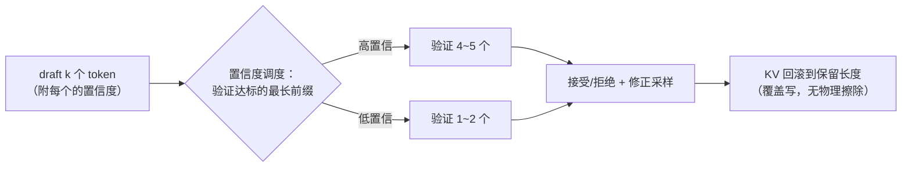

# 08 推测解码：DSpark 与置信度调度

第 01 章的账本上还挂着一笔没用完的余款：decode 时芯片的算力利用率不到 1%，**算力大量闲置，缺的只是「可以批量算的 token」**。推测解码（speculative decoding）就是把这笔闲置算力花掉的方法。本章讲它的原理（为什么「验证 k 个 token 的算力 ≈ 生成 1 个」）、DeepInfer 生产实现 DSpark 的两个巧思、以及 miniflow 教学版的取舍与踩坑。

本章的乐趣在于它是一个「合法的作弊」：**输出分布严格不变（数学证明），速度却快 2~4 倍**——性能工程里「鱼与熊掌兼得」的罕见样本。理解它的三个台阶：先懂经济账（为什么验证便宜），再懂数学账（为什么分布不变），最后懂工程账（DSpark 怎么把理论收益在真实流量里兑现——这一步最微妙，朴素实现可以亏钱）。

读完本章，你应该能回答：

- verify 一次 forward 处理 k 个 token，为什么耗时几乎不涨？
- Leviathan 的接受/残差采样规则怎么保证输出分布严格等于目标模型？
- 为什么说 draft 的质量决定一切？draft 的三个来源（独立小模型/MTP 头/温度采样）各有什么取舍？
- DSpark 的变长验证和置信度调度各自省什么？为什么朴素 spec 在混合流量下可能净亏？
- KV 回滚的正确不变量是什么（`kv_keep = base_len + len(keep_tokens) - 1` 的推导）？

## 0. 历史注脚：投机执行的思想谱系

「先猜、再验证、错了回滚」不是 LLM 的发明——它是计算机科学里一条古老而光荣的思路，speculative 这个词本身就是谱系的线索：

- **分支预测 + 投机执行**（CPU，1990s~）：流水线不等条件跳转的结果，预测一路先执行；预测对了白赚几个周期，错了丢弃流水线状态回滚。现代 CPU 每秒投机执行几十亿次，预测准确率 95%+；
- **乐观并发控制**（数据库，1981~）：事务不加锁直接提交，冲突了回滚重试——「先干，撞了再说」；
- **预取**（存储系统，无处不在）：预测接下来的访问模式，提前把数据搬进缓存；猜错了浪费一点带宽，猜对了省一次 miss；
- **推测解码**（LLM，2023~）：draft 先猜 token，主模型一次验证——猜错了回滚 KV 进度。

四个领域、四十年跨度、同一个结构：**「串行依赖的等待」用「并行的赌博」来填**。而且赌注的经济学完全一致——**赌赢的收益（跳过等待）远大于赌输的代价（丢弃重算）**时，赌博就是正期望。CPU 的分支预测把这个账做到了极致（预测器用历史 PC 模式学习），推测解码的 draft 模型是它的 LLM 翻版——**理解谱系的价值在于：下次你遇到任何「串行依赖瓶颈」，第一反应应该是「这里能不能赌」**。

## 1. 核心机制：先猜，再一起验

自回归的串行性是根本约束：第 $t+1$ 个 token 的分布依赖第 $t$ 个 token 的结果，一步只能产出一个。推测解码绕这个弯：

```text
draft（便宜）：  先猜接下来 k 个 token（用什么猜都行，见下）
verify（一次）：  把 k 个候选连同上下文拼起来，一次 forward「审」完
accept：        命中的候选直接采纳；第一个被拒的位置，重新采样一个修正 token
```

关键账在 verify 这步。一次 forward 处理 $1+k$ 个 token：权重还是要读**一整遍**（37 GB 不变），但矩阵乘的 M 维从 1 变成 $1+k$——算力需求仍然在闲置区（第 04 章说过 M=1 只能跑峰值的 ~2%，M=6 也远填不满），**时间几乎没有增加**。效果：一次权重读取摊给了 $1+k$ 个候选位置，若其中 $m$ 个被接受，这个 step 就净产出 $m$ 个 token（正常只有一个）。串行的生成被「批量审阅」替代了。

### 1.1 verify 的账为什么这么好算

把第 04 章 2.5 节的 GEMM 速算用在这里——「时间几乎不增」的精确版。decode step 的耗时构成：

```text
T(step) ≈ 权重搬运时间（W/B，不随 k 变）
        + KV 读取时间（随 k 微增：k 个 draft 的 KV 也要读）
        + 计算时间（随 k 线性，但在闲置区）
        + 固定开销（kernel 启动/调度，不随 k 变）

B=64、k=5：
  权重项：37/64 GB ≈ 0.58 GB → 0.17 ms（不变）
  KV 项：64 条 × 4 GB ÷ 64 卡…… 单卡视角 0.06 GB→0.018 ms
        + draft 的 5×64 个额外位置 ≈ 忽略
  计算项：6/64 的 M 维利用率 → 仍深在闲置区
  固定项：~2 ms（kernel 链）
  合计：verify(6) ≈ verify(1) + <5% —— 「几乎免费」的来源
```

**免费的上限在哪**：k 涨到某个值（大约 M 维开始填满算力时，batch 64 × k 40+），计算项脱离闲置区、耗时开始线性涨——verify 不再免费。所以最优 k 是「计算项脱离闲置区」的边界，**batch 越小（闲置越多）k 可以越大**——这解释了第 02 章「推测解码是算力闲时的套利，组批已经用掉一部分闲时」的边界关系：B=64 时闲算力还很多（利用率从 2% 到 6%），k=5~8 仍是免费区；B=512 时利用率已 16%，k 的空间被压缩。

### 1.2 一个完整的走查例子

用数字把一轮 draft-verify-accept 走完（greedy 版，miniflow 语义）：

```text
上下文：『法国的首都是』（4 token）
draft（k=3）：猜出 [巴黎, 是, 一]（附置信度 0.9/0.8/0.6）
verify：一次 forward 算 6 个位置（4 上下文 + 1 修正点 + 3 候选……
        实际形态：把 [法国的首都是巴黎是一] 8 个 token 一起前向，
        得到每个位置的「下一 token 分布」：
        位置 4 的目标 argmax：巴黎 ✓（接受 1）
        位置 5 的目标 argmax：， ✗（draft 给的是「是」——拒绝）
accept：采纳 [巴黎]，拒绝点用目标分布的 argmax「，」做修正 token
        本步净产出：巴黎 + ，= 2 个 token
        （若全接受则产 3+1=4 个；全拒则产 1 个修正）

KV 处理：draft 阶段 [巴黎是一] 的 KV 已写入池；
        接受 [巴黎] + 修正 [，] → 进度保留到位置 5；
        [是一] 的 KV 不擦除，进度回退标记「未算」，下轮覆盖写。
```

注意「拒绝点的修正 token 也是产出」——**最坏情况（第 1 个就被拒）也产出 1 个 token**，和正常 decode 持平（额外付出的只是 draft 的成本）。**下界有保底、上界有惊喜**——这个收益结构是「赌博」里最友好的形状。

接受率决定一切：draft 猜得准，平均接受长度就长、加速比就高；猜得差，verify 的算力打水漂（产出 1 个修正 token，等于白花一次 forward——但注意「白花」的量级是闲置算力，机会成本近零）。所以 draft 从哪来是第一设计决策。

### 1.3 draft 的三个来源

| 来源 | 机制 | 优点 | 缺点 |
|---|---|---|---|
| 独立小模型（如 1B 配 70B） | 单独训练一个小 LM | draft 快（权重小）、可独立优化 | 额外显存/部署；分布对齐要调 |
| **MTP 头**（DeepSeek 用） | 主模型训练时自带「预测后 k 个」的辅助头 | 和主模型同分布空间、共享权重加载 | 需要训练时的结构预留 |
| 主模型温度采样（miniflow 用） | 上一步的 logits 直接采样 k 个 | 零额外成本、机制保真 | 猜测质量最弱（没有额外信息） |

三者的取舍轴是「draft 成本 vs 猜测质量」。独立小模型质量好但贵（一次 draft 就是一次小前向）；温度采样零成本但基本靠运气（接受率低）；**MTP 是甜蜜点**——训练时让主模型学会「顺带预测 k 步」（一个共享底座 + k 个轻量输出头），推理时 draft 近乎免费且质量高（它见过自己的输出分布）。DeepSeek-V3 的 MTP 头就是为此设计——**模型结构和推理策略又一次互相成就**（第 01 章 5 节主旋律的第三个案例：MLA↔FlashMLA、MoE↔DeepEP、MTP↔DSpark）。

## 1.5 加速比的理论公式与它的撒谎方式

「4.00x 加速」这类数字怎么来的、能信多少——值得一段专门讨论，它是所有性能宣称的阅读课。

**理论加速比公式**（忽略 draft 成本和回滚开销的理想版）：

$$
S = \frac{E[\text{每步产出}]}{T_{verify}/T_{single}} = \frac{\sum_{i=1}^{k} r^i}{T_{ratio}}
$$

其中 $r$ 是每 token 接受率、$T_{ratio}$ 是 verify 一个 k-前缀的耗时相对单 token forward 的倍数（1.1 节说过它 ≈ 1.05~1.3）。r=0.8、k=5、T_ratio=1.15 时：$S = (0.8+0.64+0.51+0.41+0.33)/1.15 ≈ 2.3\times$。

**这个公式的四种撒谎方式**（每种都对应一类真实宣称）：

1. **忽略 draft 成本**：draft 不是零成本（MTP 头也要一次小前向）。draft 占 verify 耗时的 20% 时，真实加速比掉到约 1.9×——宣称数字要乘 $\frac{1}{1+\text{draft 占比}}$；
2. **忽略回滚税**：被拒后修正 token 的采样、KV 回滚、下步重组的开销——量级小但存在（~3%）；
3. **r 的采样偏差**：demo 里的 r 是「模型对下一个 token 很自信」的流量的 r；自由创作流量 r 可能 0.3——**加速比随流量画像变化 3 倍以上**，单一数字是营销（第 02 章「吞吐三问」的 spec 版）；
4. **与谁比**：和「无任何优化的逐 token」比是 2.3×，和「已经组批的引擎」比可能只有 1.1×（组批先吃掉了闲置）——**基线的选择决定数字的大小**。

看到「spec 带来 Nx 加速」时，四问：draft 成本算了吗、回滚算了吗、什么流量的 r、和什么基线比——四个答案齐了，数字才可信。miniflow 的 demo 输出「4.00x」也一样要过四问（它没算 draft 成本因为温度采样零成本、它和 greedy 基线比、它的流量是模型自信的续写）——**教学 demo 的数字诚实的前提是把它的口径也讲清楚**。

**一个更深的观察**：spec 的收益本质是「闲置算力的再利用」，所以它的加速比**上限被算术强度锁死**——第 01 章的 Roofline 里，decode 在横轴 2 FLOPs/B、平衡点 300：理论上算力可以支撑 150 倍的并行计算。但 KV 读取和 M 维膨胀的税把它压到 2~4×——**现实收益是理论空间的 2~3%，其余被「不免费的部分」收走了**。下次有人宣称「我的 spec 加速 10×」，先算他流量的 r 要多高（r≈0.95+，基本只有代码补全类流量）。

## 2. 分布不变性：数学上「不变味」

一个自然的疑虑：draft 模型引入的偏差会不会让输出「变味」？Leviathan et al.（2023）证明了不会，规则如下。设目标模型分布 $p(x)$、draft 分布 $q(x)$（都是验证位置上的条件分布）：

- 对 draft 给出的候选 $x$，以 $\min\left(\frac{p(x)}{q(x)},\, 1\right)$ 的概率**接受**——draft 越觉得可能（$q$ 大）而目标越不认同（$p$ 小），越容易被拒；
- 若被拒，从**残差分布** $\frac{\max(0,\, p(x)-q(x))}{Z}$ 重新采样。

这两条合起来恰好把概率补齐：每个 token 最终服从的分布严格等于 $p$——draft 擅长的部分直接通过，draft 想往偏带的部分被残差顶回来。**加速而不改变输出分布**，这是推测解码从「工程 trick」升格为「数学方法」的凭据。

### 2.1 证明的骨架：为什么「恰好补齐」

把「为什么最终分布 = $p$」的证明核心展开——它是本书最漂亮的一段初等概率，值得亲手验一遍。

对任意候选 token $x$，最终输出 $x$ 的概率 = 「接受 $x$」+「拒绝全部 draft 后残差采样出 $x$」：

$$
P(\text{输出}=x) = \underbrace{q(x) \cdot \min\left(\frac{p(x)}{q(x)}, 1\right)}_{\text{draft 选中 } x \text{ 且通过}} + \underbrace{P(\text{拒到 } x \text{ 为止或更早}) \cdot r(x)}_{\text{残差部分}}
$$

先看第一项。分两种情况：

- 若 $q(x) \le p(x)$：接受概率 $\frac{p(x)}{q(x)}$，第一项 $= q(x) \cdot \frac{p(x)}{q(x)} = p(x)$——**刚好装满 $p(x)$，残差项对 $x$ 的贡献应为零**；
- 若 $q(x) > p(x)$：接受概率 1，第一项 $= q(x)$——**超装了 $q(x) - p(x)$，残差要从别处借走这么多**。

残差分布 $\max(0, p - q)/Z$ 正是为这个收支平衡设计的：被 $q$ 低估的 token（$p > q$）在残差里有正权重、被高估的为零权重。而「拒绝」的概率总和恰好等于 $\sum_x \max(0, q(x) - p(x))$ 量级的项（拒绝发生在 $q$ 高估的地方）……分部求和下去，**每一层的收支都严格平**，最终边缘分布就是 $p$。

一个两点分布的数值验证（建议手算）：

```text
p = [0.7, 0.3]（目标），q = [0.5, 0.5]（draft 均匀猜）
draft 抽中 x₀（概率 0.5）→ 接受概率 min(0.7/0.5,1)=1 → 必接受
draft 抽中 x₁（概率 0.5）→ 接受概率 min(0.3/0.5,1)=0.6
   拒绝概率 0.4 → 残差 = max(0, p-q)/Z = [0.2, 0]/0.2 = [1, 0]
   → 残差采样必出 x₀
P(x₀) = 0.5×1 + 0.5×(0.4×1 + 0.6×0) = 0.5 + 0.2 = 0.7 ✓
P(x₁) = 0.5×0.6 = 0.3 ✓
```

数值严丝合缝——这就是「合法作弊」的全部秘密：**接受规则和残差规则是一对共轭设计**，一个负责「让 $q$ 的自信通过」，一个负责「把 $q$ 的偏差找补回来」。

### 2.2 教学版的取舍：argmax 的一致性

miniflow 的教学版故意不用这套采样规则，改用 **argmax 验证 + argmax 修正**：候选等于目标分布的 argmax 才接受，被拒位置直接取目标的 argmax。代价是分布不变性让位于一个更强的性质：**输出与纯 greedy 逐 token 严格一致**——正确性能被测试钉死（`tests/test_speculative.py` 的 `test_spec_matches_greedy`），教学项目里「可验证」优先。

这个取舍值得多说一句：argmax 版本其实是采样版的特例（温度 → 0 时 $p$、$q$ 都退化为点分布，接受规则自动变成「argmax 相等」），所以**数学谱系上没有分叉**——教学版是生产版的一个极限点。你在 `tests/` 里看到的一致性断言，守护的就是「这个极限点没有跑偏」。

## 3. DSpark 的两板斧

DeepInfer 的生产实现（QA 文档披露的数据）：变长验证把平均验证长度从 **5.00 降到 3.2~4.4**，平均接受长度几乎不变（3.29 vs 3.20），总吞吐 **+4~7%**。

### 板斧一：变长验证

朴素实现对每条请求固定「每步验证 5 个 draft」。问题：**接受率因请求、因位置而异**——代码续写类请求 draft 命中率高（语法强约束，好猜），自由创作类低；同一条请求里，确定性强的片段好猜、分叉点难猜。给低置信度的 draft 照样验 5 个，大概率第 1~2 个就被拒——后面 3~4 个的验证算力是纯浪费。

DSpark 反过来：只验证「置信度达标的最长前缀」，其余 draft 直接丢弃（KV 回滚）。验证算力集中在边际收益高的 token 上。

「前缀」这个约束来自接受的结构：接受是**链式**的（第 2 个接受的前提是第 1 个也接受——上下文串起来了），所以置信度低的 draft 挡在前面，后面再高也没用——**验证从「数目」变成「达标前缀的长度」**，这是对接受结构的正确建模（不是「挑最高的 3 个验」——它们在链上可能根本轮不到）。

### 板斧二：置信度调度

draft 侧训练一个**置信度头**（confidence head）：预测每个 draft token 会被接受的概率。调度器据此在**批内**分配验证算力——高置信度的请求多验几个、低置信度的少验。验证长度从「全局常数」变成「每请求每步的动态决策」。



值得专门回答「+4~7% 也值得写进发布？」——是的，因为它的性质：**纯软件、不改模型不改硬件的等效扩容**。按整个集群的规模折算，这是一笔巨大的成本节约；而且它是「度量驱动优化」的范本：平均验证长度 5.0 → 3.4，接受长度只掉 0.09——**省下三分之二的验证算力，几乎白赚**。没有置信度调度，推测解码在真实混合流量下的净收益可能是负的（低置信度请求拖垮全批）。

### 3.3 朴素 spec 为什么会亏：混合流量的算术

「净收益可能是负的」值得展开算一遍——它是理解板斧价值的关键：

```text
批内 64 条请求，两类流量：
  代码类 32 条：接受率 0.8/token，验 5 个 → 期望接受 4.0
  创作类 32 条：接受率 0.3/token，验 5 个 → 期望接受 1.7*
       *E[接受数] = Σ r^i (1-r) × i + r^5 × 5 ≈ 1.7

朴素固定 k=5：
  批产出 = 32×4.0 + 32×1.7 = 182 token/step
  但创作类的 3.3 个「验了白验」位置 × 32 条 = 106 个浪费位置
  ——浪费的计算（在闲置区，机会成本≈0）
  ——浪费的 KV 读取（不在闲置区！draft 的 KV 是实打实搬的）
  ——浪费的延迟（M 维 +15%，step 变慢 5~8%）

置信度调度后（创作类只验 2 个）：
  批产出 = 32×4.0 + 32×1.5 = 176 token/step（几乎没掉）
  M 维省 10% → step 快 5% → 净产出率反超
```

看到关键了吗：**计算浪费是免费的（闲置区），但 KV 搬运和 M 维膨胀的延迟不是免费的**——朴素实现的隐性成本藏在「不免费」的那部分里。置信度调度的全部价值，就是把验证长度收缩到「边际收益 > 边际延迟」的刀刃上。**「闲置资源不是完全免费」是推测解码经济学里最容易被忽略的税**——第 01 章「闲时套利」的账在这里被细化了一层。

## 4. miniflow 的教学映射

教学版不训练独立 draft 模型，用「主模型温度采样」当 draft——**机制保真、角色简化**（`miniflow/speculative.py`）：

| DSpark 生产 | miniflow 教学 |
|---|---|
| 独立 draft 小模型 / MTP 头 | 主模型 logits / draft_temperature 采样 |
| Confidence Head 预测接受率 | draft token 在分布中的概率 |
| 变长验证（置信前缀） | `_verify_len`：阈值 0.35 的最长达标前缀 |
| 残差分布采样（分布不变性） | argmax 验证 + argmax 修正（greedy 一致性） |
| KV 回滚 | `computed` 按层回退 + 覆盖写 |

加速效果可观测（`examples/demo_speculative.py` 实测输出）：

```text
[基线]     steps = 24
[推测解码] steps = 6    同样 24 个 token
输出与纯 greedy 完全一致: True
等效加速: 4.00x
```

!!! danger "miniflow 踩坑实录：KV 回滚量算错"

    早期版本把回滚进度设为 `base + accepted + 1`——验证后追加的 bonus
    修正 token 被记账为「KV 已算」，但它从未进过 forward（它是采样
    出来的，没有算过哪一层）。下一步 draft 的第一次 forward 发现
    0 个未算 token，增量契约断言失败。

    正确不变量：**进入每次 forward 时恰有 1 个未算 token**——算掉
    最后一个已确定的 token，才能得到下一位置的分布。统一公式：
    `kv_keep = base_len + len(keep_tokens) - 1`。全接受分支同样适用
    （最后 1 个 keep token 的 KV 已写，回退 1 步重算——确定性前向下
    数值一致，无害）。这个不变量在第 06 章「按层推进」的语义里是
    自然语言，但踩坑时它并不显然——完整推导见
    [lab/05](../lab/05-speculative.md)。

    另一个坑：一步提交多 token 会**越过 max_tokens**（基线 24 个
    token 上限，spec 一步可能交 5 个变 25）——提交前按剩余额度截断
    （`room = max_tokens - hist_out_len`）。

## 5. 与 KV Cache 的耦合

回看本章流程图，每一步都在「预写未来再回滚」：draft 阶段 k 个 token 的 KV **先写进池**（复用块表追加块）；验证被拒时进度回滚，**被拒槽位不物理擦除**——下次 forward 覆盖写（第 06 章的语义）；提交的 token 的 KV 变成正式历史。

所以推测解码是 KV 进度语义**最苛刻的用户**：按层记账（回滚要退回每一层）、覆盖写（回滚不擦数据）、命中收缩（第 06 章的「留 1 个 token」约束在这里天天生效）。KV 管理是推测解码的地基——这也再次解释了为什么它恰好是 DeepInfer 未开源的组件。

### 5.1 KV 与 spec 的交互：三个微妙点

KV 耦合里有三个容易想错的细节，值得逐一钉住：

**细节一：draft 的 KV 是「预写」的**。draft 阶段 k 个 token 各层都要过一遍前向（draft 模型或温度采样都要）——它们的 KV 是真实写入池的。验证拒绝后回滚，这些 KV 变成「孤儿数据」：物理上在池里、逻辑上未确认。**下次 forward 覆盖写**（同位置的新 token 直接覆写）——这依赖第 06 章「覆盖写不改账本只改进度」的语义。想清楚：为什么可以覆盖？因为被拒 token 的 KV **从未被任何注意力读过**（它在序列末尾，没人 attend 它）——覆盖一个「没人看过的数据」是无害的。

**细节二：verify 的 forward 是「读己写」**。验证前向要读「上下文 + draft 们」的全部 KV——包括刚写入的 draft KV。同一 step 内写入→读取的时序由 kernel 的执行序保证（FlashMLA 读完才能进 MoE）。这没什么特别，但**单元测试容易漏**（测试里 KV 池是 mock 的话，读写时序就测不到）——miniflow 的 spec 测试用真实 KV 池跑，就是为这个。

**细节三：接受长度影响下步的批大小**。本步接受 4 个 token 的请求，下步它的 KV 长了 4——**批的 KV 读取量随接受长度波动**（第 07 章 1.2 节的「spec 波动」）。调度器的预算要吃这个方差：接受长度期望 3、方差 2 的流量，step 耗时的波动 ±10%——**收益的波动是成本**（TPOT 方差上升，第 02 章「节奏比速度更伤体感」在此兑现）。

## 6. 常见误解澄清

**误解一：「推测解码让模型变快了。」** 模型没变快——**生成过程**变快了。每 token 的计算量其实增加了（draft + verify 的总 FLOPs > 单步 forward），但墙钟时间下降，因为增加的那部分吃的是闲置算力。「快」的来源是**调度**（把串行等待填成了并行验证），不是「计算高效」——把它理解成「用免费的算力买时间」最准确。

**误解二：「draft 越准越好。」** draft 准确率的收益是**亚线性**的：接受率从 0.5 到 0.8，平均接受长度从约 1.9 涨到约 3.9（2 倍）；从 0.8 到 0.95，从 3.9 涨到 8.7（2.2 倍）——但 draft 要达到 0.95 准确率，draft 模型的成本通常要指数上升（它得接近目标模型的能力）。**收益线性、成本指数 = 存在最优的 draft 水平**，通常在「小 draft + 中等接受率」——不是「最准的 draft」。

**误解三：「分布不变性意味着输出和不用 spec 完全一样。」** 严格说法是：**每个位置的边缘分布**不变。但「同一个 seed 下逐 token 一致」不成立（接受/拒绝的随机事件会消耗随机数流，后续采样路径分岔）——只要 RNG 按请求隔离（第 09 章），spec 和非 spec 的输出**统计上不可区分**，但不是逐位相同。生产上这是够的（A/B 统计对比成立），但要「逐 token 复现」的回归测试得固定 spec 的开关状态——**复现的粒度和机制的开关要对齐**，这是测试设计经常踩的坑。

**误解四：「推测解码和 continuous batching 抢同一笔闲置算力。」** 部分对——组批先把闲置算力用掉一批（M 维从 1 到 64），spec 再吃剩余（64 到 64+k）。两者是**串行套利**关系：先组批、后 spec。B 很小（<8）时闲置多、spec 收益大；B 很大（>512）时 spec 的空间被压缩——**「低负载用 spec、高负载靠组批」是同一个经济学在两个机制间的动态分配**。DSpark 的置信度调度本质上是在批内做这个分配的精细化。

**误解五：「KV 回滚是个独立的昂贵操作。」** 回滚的成本 ≈ 0：改 `computed` 表（几个整数写）+ 不擦数据（覆盖写语义）。**贵的错觉来自「回滚 = 丢工作」的直觉**——被拒 draft 的 KV 确实白算了，但那是 draft 阶段的事后成本，不是回滚操作本身。把「回滚动作」和「被拒的机会成本」分开记账，spec 的账才能算清（3.3 节的算术就是分开记的）。

## 7. 小结

- **思想谱系**：分支预测/乐观并发/预取/推测解码——「串行依赖用并行赌博来填」的四十年同构。赌赢收益 >> 赌输代价时，赌博是正期望。
- **经济账**：verify 处理 k 个 token 几乎免费（权重搬运不变、计算在闲置区、M 维膨胀 <5%）——但**不免费的部分（KV 读取、M 维的延迟税）决定朴素实现的盈亏**。最优 k 在「计算脱离闲置区」的边界，随 batch 大小反向变化（闲时套利的动态分配）。
- **数学账**：接受 $\min(p/q, 1)$ + 残差 $\max(0, p-q)/Z$ 的共轭设计——输出边缘分布严格等于 $p$（两点分布手算可验证）。「合法的作弊」。教学版 argmax 是它的温度→0 极限。
- **draft 三来源**：独立小模型（贵而准）、MTP 头（甜蜜点——训练时预埋、推理近免费、同分布空间）、温度采样（教学用）。**模型-引擎互相成就的第三案例（MTP↔DSpark）**。
- **DSpark 两板斧**：变长验证（只验置信达标的最长**前缀**——接受是链式的，「挑最高的验」是错误建模）+ 置信度调度（批内动态分配验证算力）。效果：验证长度 5.0→3.4、接受长度几乎不掉、吞吐 +4~7% 纯软件扩容——**度量驱动优化的范本**。
- **KV 耦合**：draft KV 预写（可覆盖因为没人读过）、verify 读己写（时序靠 kernel 执行序）、接受长度波动传导到 step 耗时（收益的方差是成本）。
- **回滚不变量**：`kv_keep = base_len + len(keep_tokens) - 1`——「进入 forward 恰有 1 个未算 token」的 spec 版；被拒槽位覆盖写不擦除。

## 8. 本章术语速查表

| 术语 | 一句话解释 |
|---|---|
| speculative decoding | 先猜 k 个、一次验证的加速方法 |
| draft / verify / accept | 猜测 / 批量前向验证 / 链式接受三阶段 |
| MTP 头 | 主模型训练时自带的 multi-token 预测辅助头 |
| 接受率 / 平均接受长度 | draft 命中频率 / 每 step 净产出 token 数的期望 |
| 分布不变性 | 输出边缘分布严格等于目标模型（Leviathan 证明） |
| 残差分布 | $\max(0, p-q)/Z$，拒绝后的修正采样源 |
| 共轭设计 | 接受规则和残差规则配对，收支严格平衡 |
| 变长验证 | 只验置信度达标的最长前缀（不是固定 k） |
| 置信度头 / 调度 | 预测每个 draft 被接受的概率 / 据此分配验证算力 |
| 链式接受 | 第 i 个接受以第 i-1 个接受为前提 |
| 闲置区税 | KV 读取和 M 维膨胀中「不免费」的隐性成本 |
| 预写-回滚 | draft KV 先写、拒绝后进度回退覆盖写 |
| 串行套利 | 组批先吃闲置、spec 吃剩余的层次关系 |
| argmax 一致性 | 教学版更强性质：输出 ≡ 纯 greedy |

## 思考题

1. 用 1.1 的框架算 k 的边界：B=16 时 M 维利用率从 1/16 到 (1+k)/16，k 多大时计算项脱离闲置区（利用率 >30%）？B=256 时呢？两个答案的比值告诉你「小流量部署和大流量集群，谁的 spec 更激进」？
2. 分布不变性的三点分布验证：p = [0.5, 0.3, 0.2]，q = [0.2, 0.5, 0.3]。逐项手算 P(输出=x₀)、P(输出=x₁)、P(输出=x₂)（提示：x₀ 被 q 低估→接受概率 1；x₁ 高估→接受概率 0.6；x₂ 高估→接受概率 2/3；残差 = [0.3, 0, 0]/0.3）。三个结果和 p 对齐吗？这道题做出来，2.1 节就是你的了。
3. 接受率期望公式：链式接受下，E[接受数] = $\sum_{i=1}^{k} r^i$（r 为每 token 接受率）。用它重算 3.3 节：r=0.8 时验 5 个的期望、r=0.3 时验 2 个的期望（对照正文里的 4.0 和 1.5，允许舍入差）。然后回答：r=0.3 的请求，最优验证长度是多少（对 $\sum r^i / (1 + i \cdot c)$ 最大化，c 为每位置的延迟系数）？
4. 误解三的落地：你要写一个「spec 开关的回归测试」——同一批请求、同 seed，分别跑 spec-on 和 spec-off。输出能逐 token 对齐吗（提示：argmax 教学版可以，生产采样版不行——为什么）？如果不行，测试的断言应该是什么（统计口径：分布对比/K-S 检验/或者干脆固定开关）？
5. DSpark 的置信度头是「预测自己的接受率」——一个模型预测「另一个模型会不会同意自己」。这个头怎么训练（提示：训练时跑 spec，把真实的接受/拒绝当标签——一个自举式的监督信号）？它预测得好不好怎么评估（AUC？校准曲线？为什么校准比 AUC 更重要——置信度调度用的是绝对阈值 0.35，不是排序）？
6. 动手题：跑 `examples/demo_speculative.py`，记录默认配置的加速比。然后改 `draft_temperature`（调高/调低）各跑一遍——观察接受率和加速比怎么联动（提示：温度高 draft 更散、接受率降；温度趋 0 draft 变 greedy——和主模型 argmax 重合度取决于模型对下一个 token 的「自信程度」）。画出「温度-加速比」曲线，找出峰值——这就是你的流量的最优 draft 温度。

---

## 延伸阅读

- **Leviathan et al. 2023**（*Fast Inference from Transformers via Speculative Decoding*）：分布不变性的原始证明（本章 2 节的学术源头）——附录的证明比 2.1 节更完整。
- **Chen et al. 2023**（*Accelerating Large Language Model Decoding with Speculative Sampling*）：DeepMind 的并行工作，同一数学的独立发现（科学界「双发」的有趣案例）。
- **DeepSeek-V3 技术报告的 MTP 节**：MTP 头的结构（一个共享底座 + 两个深度的输出头）和训练目标——1.3 节表格中「甜蜜点」的出处。
- **DeepSeek 官方 QA 的 DSpark 披露**：变长验证、置信度调度的生产数据（5.00→3.2~4.4、+4~7%）。
- **M门 Medusa / EAGLE 系列论文**（2024）：spec 的其他变体（多头并行 draft、草稿树）——接受结构的更多建模方式，对照 3.2 节的「链式」讨论。

建议顺序：Leviathan 论文的 math 节（配合本章 2.1 手算）→ V3 报告 MTP 节 → 官方 QA → Medusa/EAGLE（开拓变体视野）。

## miniflow 对应实验

```bash
python examples/demo_speculative.py        # 4.00x + 一致性验证
python -m pytest tests/test_speculative.py -q
```

demo 的观察点：输出末尾的「输出与纯 greedy 完全一致: True」行——它跑的是 2.2 节说的一致性断言（spec 的输出和关掉 spec 的 greedy 逐 token 对齐）。改 `speculative.py` 里的 `_verify_len` 阈值（0.35）再跑：阈值高 → 验证前缀短 → 加速比降、一致性不变；阈值低 → 验证长 → 接受多但 step 变慢——**亲手调一次 DSpark 的置信度阈值**，3 节的两板斧就有了体感。

## 自测：开篇问题的参考答案

**Q1：verify 为什么便宜？** 权重搬运不随 k 变（37 GB 一遍）、计算项在闲置区（M 从 1 到 6，利用率 2%→6%）、只有 KV 微增和固定开销。k 的免费上限在「计算脱离闲置区」，随 batch 反向变化。

**Q2：分布不变性怎么保证？** 接受概率 $\min(p/q,1)$ 让 $q$ 低估的部分全通过、高估的部分按超额比例拒绝；残差 $\max(0,p-q)/Z$ 把 $q$ 的偏差找补回来——共轭设计收支严格平衡，输出边缘分布 = $p$（两点分布手算可验证）。

**Q3：draft 三来源的取舍？** 独立小模型（准而贵）、MTP 头（训练预埋 + 推理近免费 + 同分布空间——甜蜜点）、温度采样（零成本、教学用）。draft 准确率收益线性、成本指数——存在最优 draft 水平而非「最准」。

**Q4：DSpark 省什么？** 变长验证省「验了白验」的算力（只验置信达标的最长前缀——链式接受的结构约束）；置信度调度省批内的算力错配（高置信多验低置信少验）。朴素 spec 亏在「不免费的税」：KV 读取和 M 维膨胀的延迟。

**Q5：回滚不变量？** `kv_keep = base_len + len(keep_tokens) - 1`——采样出来的修正 token 没算过任何层，不能记「已算」；「进入 forward 恰有 1 个未算 token」的统一公式。被拒槽位覆盖写（没人读过，覆盖无害）。

---

| 上一章 | 下一章 |
|---|---|
| [07 调度器](07-scheduler.md) | [09 采样：确定性与批次不变](09-sampling.md) |