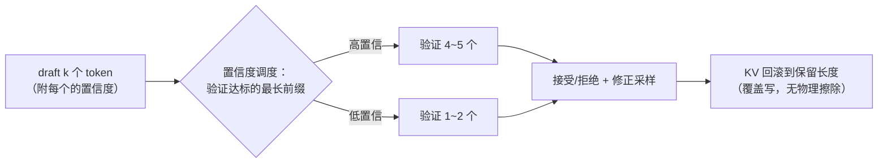

# 08 推测解码：DSpark 与置信度调度

第 01 章的账本上还挂着一笔没用完的余款：decode 时芯片的算力利用率不到 1%，**算力大量闲置，缺的只是「可以批量算的 token」**。推测解码（speculative decoding）就是把这笔闲置算力花掉的方法。本章讲它的原理（为什么「验证 k 个 token 的算力 ≈ 生成 1 个」）、DeepInfer 生产实现 DSpark 的两个巧思、以及 miniflow 教学版的取舍与踩坑。

## 1. 核心机制：先猜，再一起验

自回归的串行性是根本约束：第 $t+1$ 个 token 的分布依赖第 $t$ 个 token 的结果，一步只能产出一个。推测解码绕这个弯：

```text
draft（便宜）：  先猜接下来 k 个 token（用什么猜都行，见下）
verify（一次）：  把 k 个候选连同上下文拼起来，一次 forward「审」完
accept：        命中的候选直接采纳；第一个被拒的位置，重新采样一个修正 token
```

关键账在 verify 这步。一次 forward 处理 $1+k$ 个 token：权重还是要读**一整遍**（37 GB 不变），但矩阵乘的 M 维从 1 变成 $1+k$——算力需求仍然在闲置区（第 04 章说过 M=1 只能跑峰值的 ~2%，M=6 也远填不满），**时间几乎没有增加**。效果：一次权重读取摊给了 $1+k$ 个候选位置，若其中 $m$ 个被接受，这个 step 就净产出 $m$ 个 token（正常只有一个）。串行的生成被「批量审阅」替代了。

接受率决定一切：draft 猜得准，平均接受长度就长、加速比就高；猜得差，verify 的算力打水漂（产出 1 个修正 token，等于白花一次 forward）。所以 draft 从哪来是第一设计决策——DSpark 用的是 MTP 头（multi-token prediction，主模型自带的预测后续多个 token 的辅助头）和主模型温度采样。

## 2. 分布不变性：数学上「不变味」

一个自然的疑虑：draft 模型引入的偏差会不会让输出「变味」？Leviathan et al.（2023）证明了不会，规则如下。设目标模型分布 $p(x)$、draft 分布 $q(x)$（都是验证位置上的条件分布）：

- 对 draft 给出的候选 $x$，以 $\min\left(\frac{p(x)}{q(x)},\, 1\right)$ 的概率**接受**——draft 越觉得可能（$q$ 大）而目标越不认同（$p$ 小），越容易被拒；
- 若被拒，从**残差分布** $\frac{\max(0,\, p(x)-q(x))}{Z}$ 重新采样。

这两条合起来恰好把概率补齐：每个 token 最终服从的分布严格等于 $p$——draft 擅长的部分直接通过，draft 想往偏带的部分被残差顶回来。**加速而不改变输出分布**，这是推测解码从「工程 trick」升格为「数学方法」的凭据。

miniflow 的教学版故意不用这套采样规则，改用 **argmax 验证 + argmax 修正**：候选等于目标分布的 argmax 才接受，被拒位置直接取目标的 argmax。代价是分布不变性让位于一个更强的性质：**输出与纯 greedy 逐 token 严格一致**——正确性能被测试钉死（`tests/test_speculative.py` 的 `test_spec_matches_greedy`），教学项目里「可验证」优先。

## 3. DSpark 的两板斧

DeepInfer 的生产实现（QA 文档披露的数据）：变长验证把平均验证长度从 **5.00 降到 3.2~4.4**，平均接受长度几乎不变（3.29 vs 3.20），总吞吐 **+4~7%**。

### 板斧一：变长验证

朴素实现对每条请求固定「每步验证 5 个 draft」。问题：**接受率因请求、因位置而异**——代码续写类请求 draft 命中率高（语法强约束，好猜），自由创作类低；同一条请求里，确定性强的片段好猜、分叉点难猜。给低置信度的 draft 照样验 5 个，大概率第 1~2 个就被拒——后面 3~4 个的验证算力是纯浪费。

DSpark 反过来：只验证「置信度达标的最长前缀」，其余 draft 直接丢弃（KV 回滚）。验证算力集中在边际收益高的 token 上。

### 板斧二：置信度调度

draft 侧训练一个**置信度头**（confidence head）：预测每个 draft token 会被接受的概率。调度器据此在**批内**分配验证算力——高置信度的请求多验几个、低置信度的少验。验证长度从「全局常数」变成「每请求每步的动态决策」。



值得专门回答「+4~7% 也值得写进发布？」——是的，因为它的性质：**纯软件、不改模型不改硬件的等效扩容**。按整个集群的规模折算，这是一笔巨大的成本节约；而且它是「度量驱动优化」的范本：平均验证长度 5.0 → 3.4，接受长度只掉 0.09——**省下三分之二的验证算力，几乎白赚**。没有置信度调度，推测解码在真实混合流量下的净收益可能是负的（低置信度请求拖垮全批）。

## 4. miniflow 的教学映射

教学版不训练独立 draft 模型，用「主模型温度采样」当 draft——**机制保真、角色简化**（`miniflow/speculative.py`）：

| DSpark 生产 | miniflow 教学 |
|---|---|
| 独立 draft 小模型 / MTP 头 | 主模型 logits / draft_temperature 采样 |
| Confidence Head 预测接受率 | draft token 在分布中的概率 |
| 变长验证（置信前缀） | `_verify_len`：阈值 0.35 的最长达标前缀 |
| 残差分布采样（分布不变性） | argmax 验证 + argmax 修正（greedy 一致性） |
| KV 回滚 | `computed` 按层回退 + 覆盖写 |

加速效果可观测（`examples/demo_speculative.py` 实测输出）：

```text
[基线]     steps = 24
[推测解码] steps = 6    同样 24 个 token
输出与纯 greedy 完全一致: True
等效加速: 4.00x
```

!!! danger "miniflow 踩坑实录：KV 回滚量算错"

    早期版本把回滚进度设为 `base + accepted + 1`——验证后追加的 bonus
    修正 token 被记账为「KV 已算」，但它从未进过 forward（它是采样
    出来的，没有算过哪一层）。下一步 draft 的第一次 forward 发现
    0 个未算 token，增量契约断言失败。

    正确不变量：**进入每次 forward 时恰有 1 个未算 token**——算掉
    最后一个已确定的 token，才能得到下一位置的分布。统一公式：
    `kv_keep = base_len + len(keep_tokens) - 1`。全接受分支同样适用
    （最后 1 个 keep token 的 KV 已写，回退 1 步重算——确定性前向下
    数值一致，无害）。这个不变量在第 06 章「按层推进」的语义里是
    自然语言，但踩坑时它并不显然——完整推导见
    [lab/05](../lab/05-speculative.md)。

    另一个坑：一步提交多 token 会**越过 max_tokens**（基线 24 个
    token 上限，spec 一步可能交 5 个变 25）——提交前按剩余额度截断
    （`room = max_tokens - hist_out_len`）。

## 5. 与 KV Cache 的耦合

回看本章流程图，每一步都在「预写未来再回滚」：draft 阶段 k 个 token 的 KV **先写进池**（复用块表追加块）；验证被拒时进度回滚，**被拒槽位不物理擦除**——下次 forward 覆盖写（第 06 章的语义）；提交的 token 的 KV 变成正式历史。

所以推测解码是 KV 进度语义**最苛刻的用户**：按层记账（回滚要退回每一层）、覆盖写（回滚不擦数据）、命中收缩（第 06 章的「留 1 个 token」约束在这里天天生效）。KV 管理是推测解码的地基——这也再次解释了为什么它恰好是 DeepInfer 未开源的组件。

## miniflow 对应实验

```bash
python examples/demo_speculative.py        # 4.00x + 一致性验证
python -m pytest tests/test_speculative.py -q
```

| 上一章 | 下一章 |
|---|---|
| [07 调度器](07-scheduler.md) | [09 采样：确定性与批次不变](09-sampling.md) |