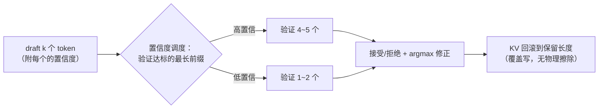

# 08 推测解码：DSpark 与置信度调度

!!! question "本章问题"
    - 「验证 k 个 token 的算力 ≈ 生成 1 个」—— 为什么这是真的？
    - DSpark 的变长验证为什么能 +4~7% 吞吐？这点提升难在哪？
    - 教学版用 argmax 验证 —— 输出与纯 greedy **严格一致**是怎么
      做到的？标准 speculative sampling 为什么不这么做？

---

## 1. 核心洞察：用闲置算力换串行等待

[第 01 章](01-overview.md) 的结论：decode 访存受限、算力闲置。推测解码
（speculative decoding）的思路：

```text
draft（便宜）：先猜接下来 k 个 token（小模型 / MTP 头 / 主模型温度采样）
verify（一次 forward）：把 k 个候选连同上下文一次前向「审」完
                      —— 矩阵乘摊开后，k 个 token 的验证 ≈ 1 个 token 的生成成本
accept：命中目标分布的候选直接采纳，被拒位置重新采样
```

**串行的 token 生成被批量化** —— 每步净产出从 1 个 token 变成
「平均接受长度」个。数学保证（Leviathan et al. 2023）：接受/拒绝规则
可以设计得使**输出分布与目标模型严格相同** —— 加速而不改变分布。

## 2. DSpark 的两板斧（DeepInfer 生产实现）

QA 里的生产数据：变长验证把平均验证长度 **5.00 → 3.2~4.4**，接受长度
几乎不变（3.29 vs 3.20），吞吐 **+4~7%**。

### 板斧一：变长验证

固定「每步验证 5 个 draft」的问题：**接受率随请求/位置差异巨大**。
低置信度的 draft 前缀验证了也是白验证（大概率前 1~2 个就被拒）——
算力浪费在低边际收益的 token 上。

DSpark 只验证「置信度达标的最长前缀」，其余 draft 直接丢弃
（KV 回滚）—— 把验证算力花在边际收益高的 token 上。

### 板斧二：置信度调度（Confidence Head）

draft 侧训练一个**置信度头**：预测每个 draft token 的接受率。
调度器据此分配验证算力 —— 高置信度的请求多验几个，低置信度的少验，
批内算力分配最优化。



!!! tip "为什么 +4~7% 也值得发"
    纯软件手段、不改模型不改硬件的等效扩容。按集群规模折算，
    这是一笔巨大的成本节约 —— 也是「度量驱动优化」的范本：
    平均验证长度从 5.0 降到 3.4，接受长度只掉 0.09 —— 省下的
    2/3 验证算力几乎白赚。

## 3. miniflow 的教学映射

教学版不训练独立 draft 模型，用「主模型温度采样」当 draft ——
**机制保真，角色简化**（`miniflow/speculative.py`）：

| DSpark 生产 | miniflow 教学 |
|---|---|
| 独立 draft 小模型 / MTP 头 | 主模型 logits / draft_temperature 采样 |
| Confidence Head 预测接受率 | draft token 在分布中的概率 |
| 变长验证（置信前缀） | `_verify_len`：阈值 0.35 的最长达标前缀 |
| 残差分布采样（分布不变性） | **argmax 验证 + argmax 修正** |
| KV 回滚 | `computed` 按层回退 + 覆盖写 |

**argmax 验证的教学红利**：输出与纯 greedy **严格一致**（token 级）——
正确性可以用测试钉死（`tests/test_speculative.py` 的
`test_spec_matches_greedy`），加速效果可观测：

```text
[基线]     steps = 24
[推测解码] steps = 6    同样 24 个 token
输出与纯 greedy 完全一致: True
等效加速: 4.00x
```

代价：分布不变性让位于可验证性（被拒位置取 argmax 而非残差采样）——
教学项目里「可测试」优先。

!!! danger "miniflow 踩坑实录：KV 回滚量算错"
    早期版本把回滚进度设为 `base + accepted + 1` —— bonus 修正 token
    被标记为「已算」但它从未进过 forward。下一步 draft 的第一次
    forward 发现 0 个未算 token，增量契约断言失败。

    正确不变量：**进入每次 forward 时恰有 1 个未算 token**（算最后
    一个 token 才能得到下一位置的分布）。统一公式：
    `kv_keep = base_len + len(keep_tokens) - 1`。全接受分支同样适用
    （最后 1 个 keep token 的 KV 已写，回退 1 步重算 —— 确定性下
    数值一致，无害）。

    另一个坑：一步提交多 token 会**越过 max_tokens** —— 提交前按
    剩余额度截断（`room = max_tokens - hist_out_len`）。

## 4. 与 KV Cache 的耦合（为什么它离不开第 06 章）

推测解码的每一步都在「预写未来再回滚」：

- draft 阶段：k 个 token 的 KV **先写进池**（复用块表）；
- 验证被拒：进度回滚，**被拒槽位不擦除** —— 下次 forward 覆盖写；
- 前缀缓存交互：draft 写过的块若被缓存条目引用……

这依赖 [第 06 章](06-kvcache.md) 的「按层同步推进 + 覆盖写」语义 ——
KV 管理是推测解码的地基，反之推测解码是 KV 进度语义最苛刻的用户。

## miniflow 对应实验

```bash
python examples/demo_speculative.py        # 4.00x + 一致性验证
python -m pytest tests/test_speculative.py -q
```

| 上一章 | 下一章 |
|---|---|
| [07 调度器](07-scheduler.md) | [09 采样：确定性与批次不变](09-sampling.md) |