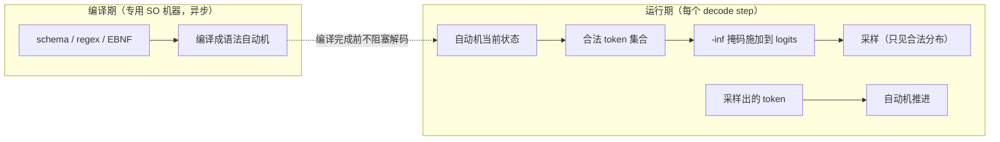

# 10 结构化输出：编译期自动机 + 运行时掩码

!!! question "本章问题"
    - 让 LLM 输出合法 JSON —— 「重试到合法」为什么不可接受？
    - 「编译-运行」两段式拆分的动机是什么？编译跑在哪？
    - 掩码如何做到**约束生效但不扭曲分布**？
    - token 与字符的粒度错位（BPE）是怎么解决的？

---

## 1. 问题：约束生成的正确姿势

Agent / 工具调用 / 数据抽取要求输出**严格匹配** schema。朴素做法的
通病：

| 做法 | 问题 |
|---|---|
| prompt 里求它输出 JSON | 概率性违规，长尾请求必然踩中 |
| 生成后校验 + 重试 | 首 token 延迟翻倍；违规模式重试也违规 |
| logit 校验（逐 token 硬规则） | 表达力弱，写不了递归/复杂 schema |

正确做法：**把 schema 编译成状态机，在采样层强制** —— 违规在
数学上不可能发生。DeepInfer 的 `structure_output` 模块就是这个思路
的生产实现。

## 2. 编译-运行两段式



**拆分的动机**（QA 里明确提到编译异步跑在专用 SO 机器上）：

1. 复杂 JSON Schema 编译耗时可观 —— 同步编译会直接打爆 TTFT；
   异步编译期间解码照常开始（未受约束的前缀）；
2. 编译是 CPU 密集纯逻辑 —— 放独立机器池，与推理集群物理解耦；
3. 同一 schema 的编译产物可**缓存复用**（生产上 schema 重复率极高）。

## 3. 掩码：约束不扭曲分布

关键性质：mask 在采样**前**施加，只做 `-inf` 屏蔽：

```python
# miniflow/engine.py 的 _so_mask
masked[:_N_SPECIAL] = -np.inf        # 特殊 token 一律屏蔽（防注入配合）
masked = automaton.mask(masked, vocab)   # 非法 token -inf
# softmax 在掩码后的 logits 上归一化
```

合法 token 的**相对概率完全保留** —— 模型对「合法空间内怎么选」的
偏好不被扭曲；被约束的只有「能不能选」。这与 prompt 工程有本质区别：
后者改变的是分布本身，前者只是裁剪分布的支撑集。

## 4. 粒度问题：token ≠ 字符

schema 是字符级的（`( ran| flew)( in| over) the`），但采样发生在
**token 级**（BPE 词表）—— 一个 token 可能对应语法路径的**任意前缀**
（如词表里有 `▁r` 而 schema 此刻走到 ` ran`：`▁r` 应该合法，它停在
中间态）。

解法（生产 xgrammar / outlines 同源）：**token 喂给字符级自动机，
允许部分消费** —— `token_feasible` = 该 token 的字符串能从当前
状态集走通且不落入死态（状态可以停在中间）。miniflow 的
`miniflow/structured_output.py` 用 Thompson NFA 实现了完整版本：

```python
def token_feasible(self, token_str: str) -> bool:
    return bool(self._step_chars(set(self.states), token_str))
    # _step_chars 逐字符推进 NFA 状态集，中途为空 = 违约
```

miniflow 的 BPE 教学词表恰好是**最难的形态**：空格是独立 token
`'▁'`，`ran` 是另一个 token —— 「 ran」要两个 token 才能拼出来。
这逼着实现走通「跨 token 的字符级约束」而非取巧的单 token 匹配。

!!! danger "miniflow 踩坑实录：初始状态硬编码"
    Thompson 构造的状态编号**从 1 开始**（`new_state()` 先自增），
    而 `_reset()` 曾硬编码初始状态为 `{0}` —— 状态 0 不存在于转移表，
    初始状态集永远「空转」，**任何 pattern 第一步就报语法死局**。
    修复：初始状态显式传入（`start_state=node.start`）。
    教训：隐式约定的编号起点是状态机的经典陷阱 —— 显式传递
    比隐式假设可靠一个数量级。

## 5. 收笔与死局

两个边界语义（生产必须处理，教学版一比一实现）：

**正常收笔**：语法完整匹配（`in_accept()`）且无合法后继
（`has_feasible_token()` 为假）→ 引擎 `FINISHED_STOPPED` ——
而不是把全 `-inf` 的 mask 喂给采样器（argmax 未定义行为）。

**死局 abort**：词表与语法无交集（如要求输出字符 `z`，而词表字符集
里根本没有 `z`）→ `FINISHED_ABORTED` 明确失败 —— 可观测、可归因，
优于静默产出垃圾。

```python
# miniflow/engine.py 的收笔判定
if automaton.in_accept() and not automaton.has_feasible_token(...):
    seq.finish(SequenceStatus.FINISHED_STOPPED)   # 语法完整，正常收笔
...
try:
    last = self._so_mask(automaton, last)
except ValueError:
    seq.finish(SequenceStatus.FINISHED_ABORTED)   # 语法死局，明确失败
```

## 6. 与防注入的联动

`_so_mask` 先屏蔽全部特殊 token 再施加语法掩码 —— 与
[第 11 章](11-recipe.md) 的 deepseek-recipe 防注入形成双保险：
约束生成期间，用户伪造的控制标记（即使逃过了分词层消毒）也拿不到
采样概率。**约束越强的地方，注入的面越小** —— 结构化输出是安全
边界的一部分。

## miniflow 对应实验

```bash
python examples/demo_structured.py
#   [自由 greedy]   output = ' sat on the the'   （finished_length_capped）
#   [SO 约束]       output = ' ran in the'        （finished_stopped）
#   输出严格匹配模式 '( ran| flew)( in| over) the': True
#   初始状态下合法 token: ['▁']   <- mask 的直接观测

python -m pytest tests/test_structured.py -q
#   模式匹配 / 干净收笔 / 约束改变行为 / 死局 abort
```

| 上一章 | 下一章 |
|---|---|
| [09 采样](09-sampling.md) | [11 deepseek-recipe 的工程哲学](11-recipe.md) |