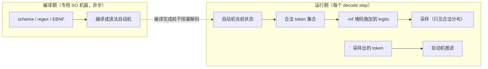

# 10 结构化输出：编译期自动机 + 运行时掩码

Agent 调用工具、数据抽取、代码生成要求模型输出**严格匹配**一个格式（JSON Schema、正则、语法）。但 LLM 本质是「按分布采样下一个 token」——它没有任何内建的机制保证格式正确。本章讲 DeepInfer 的解法：把格式**编译成自动机**，在采样层用掩码强制——让违规在数学上不可能发生，而不是概率上不太可能。

## 1. 先排除三种朴素做法

| 做法 | 问题 |
|---|---|
| prompt 里求它输出 JSON | 概率性违规：一万条请求总有一条踩中，长尾无法消除 |
| 生成完校验 + 重试 | 首 token 延迟翻倍；违规的模式重试往往还是违规（分布没变） |
| 逐 token 写 if-else 硬规则 | 表达力弱——递归 schema、嵌套结构写不动 |

正确做法的形态：**把格式约束变成一个自动机，采样时强制走合法路径**。需要先补一块基础。

## 2. 补基础：正则如何变成自动机

以本仓示例的模式 `( ran| flew)( in| over) the` 为例（匹配「 ran in the」这类短语）。它是一个**正则表达式**。计算机科学的经典结论：**任何正则表达式都能机械地转换成一个有限状态机**——Thompson 构造（Ken Thompson，Unix 的作者之一，1968 年）。

状态机的直觉：一台只有「当前状态」这个小内存的机器。它读入一个字符，按转移表跳到下一个状态；读完全部输入时停在**接受状态**，就算「匹配成功」。`( ran| flew)` 的状态机有两个分支：读到空格后，下一个字符是 `r` 走一支、是 `f` 走另一支。

正则里有「或」时，状态机会**同时处于多个可能状态**（NFA，非确定有限自动机）：读到 `▁r` 之后，它「可能」在 `ran` 分支的中途。实现上我们不真的「同时」，而是维护一个**状态集合**——`{ran分支中途, 死亡}`，每读一个字符，把集合里每个状态都推进一格，去掉走不通的。集合里只要还有活状态，输入就仍有可能匹配；走到接受状态，就匹配成功。

这套东西和 LLM 推理的连接点：**模型每采一个 token，就把它的字符喂给状态机推进；采样前，先问状态机「从当前状态出发，哪些 token 还能走通」——走不通的，掩掉。**

## 3. 编译-运行两段式



为什么拆成两段、编译放哪，各有明确动机（QA 文档披露编译异步跑在专用机器上）：

**编译是重活。** 复杂 JSON Schema 编译成自动机可能要几百毫秒——同步做会直接打爆 TTFT（第 02 章的「SO 编译是 TTFT 杀手」）。异步编译期间，解码照常开始（先产出无约束的前缀），编译完成后掩码才生效。

**编译是纯 CPU 逻辑。** 放独立的机器池，与 GPU 推理集群物理解耦——推理节点的毫秒预算里塞不下这种突发 CPU 任务。

**编译产物可缓存。** 生产上 schema 的重复率极高（一万个 agent 用同一套工具 schema），编译一次到处复用。

## 4. 掩码：约束生效但不扭曲分布

运行期的核心动作，在**采样之前**对 logits 施加掩码：

```python
# miniflow/engine.py 的 _so_mask
masked[:_N_SPECIAL] = -np.inf        # 特殊 token 一律屏蔽（防注入联动，见第 11 章）
masked = automaton.mask(masked, vocab)   # 非法 token 置 -inf
# 之后 softmax 在掩码后的 logits 上归一化
```

关键性质为什么成立：掩码只把非法 token 的 logit 设为 $-\infty$，**合法 token 之间的相对大小一个字节都没动**。softmax 归一化后，合法 token 的概率比值与无约束时完全相同——模型对「合法空间内怎么选」的偏好被完整保留，被约束的只有「能不能选」。数学上：这叫裁剪分布的**支撑集**（support），不改变条件分布的形状。

对比 prompt 工程：往 prompt 里写「必须输出 JSON」改变的是分布本身（软性引导，可以违反）；掩码是硬边界（违反不可能）。两者一个管「意愿」，一个管「能力」，生产上都需要但不可互替。

## 5. 粒度错位：token ≠ 字符

一个初想不到的坑：**schema 是字符级的，采样却是 token 级的**。

miniflow 的 BPE 词表里（GPT-2 同款），空格是独立 token `'▁'`，`ran` 是另一个 token——模式里的「 ran」需要**两个 token**（`▁` + `ran`）才能拼出来。更麻烦的形态：某些词表里有 `▁r` 这种**半个词**的 token——如果模式此刻走到「 ran」的开头，`▁r` 应该算合法（它是「 ran」的前缀，走完它语法还在半路上）。

所以掩码的判定不能问「这个 token 是否等于下一个该出现的字符」，而要问：**「这个 token 的字符串，从当前状态集出发能不能走通而不死」**——允许停在中间态。解法（生产 xgrammar / outlines 同源）：token 喂给字符级自动机，允许部分消费：

```python
# miniflow/structured_output.py
def token_feasible(self, token_str: str) -> bool:
    return bool(self._step_chars(set(self.states), token_str))
    # _step_chars 逐字符推进 NFA 状态集；推进途中状态集变空 = 必死，返回 False
```

miniflow 的教学词表恰好是**最难**的形态（空格独立成 token），逼着实现走通「跨 token 的字符级约束」，而不是单 token 字符串匹配的取巧版本。

!!! danger "miniflow 踩坑实录：初始状态硬编码"

    Thompson 构造的状态编号**从 1 开始**（`new_state()` 先自增再返回），
    而 `_reset()` 曾硬编码初始状态集合为 `{0}`——状态 0 根本不存在于
    转移表，初始状态集永远空转，**任何 pattern 第一步就报语法死局**。
    修复：初始状态显式传入（`start_state=node.start`）。
    教训：隐式的编号起点约定是状态机的经典陷阱——显式传递比
    隐式假设可靠一个数量级。详见 [lab/06](../lab/06-structured.md)。

## 6. 两个边界：收笔与死局

约束生成有两个必须显式处理的边界，生产如此，miniflow 一比一实现：

**正常收笔。** 模式完整匹配后（状态集到达接受状态），「还有没有合法后继 token」的答案是「没有」——比如 ` the` 之后模式走完了，任何 token 都走不通。这时**不能**把全 `-inf` 的 logits 喂给采样器（全零分布的 argmax 是未定义行为），而要让引擎以 `FINISHED_STOPPED` 结束请求——「语法走完了」本身就是一种合法的完成：

```python
# miniflow/engine.py 的收笔判定
if automaton.in_accept() and not automaton.has_feasible_token(...):
    seq.finish(SequenceStatus.FINISHED_STOPPED)   # 语法完整，正常收笔
```

**死局 abort。** 词表与语法可能**根本没有交集**——比如模式要求输出字符 `z`，而词表的字符集里没有 `z`。这时逐 token 掩码会一路全 `-inf`，怎么采都违规。miniflow 让 `_so_mask` 抛出 `ValueError`，引擎捕获后以 `FINISHED_ABORTED` 明确失败——可观测、可归因，优于静默产出垃圾 token。

## 7. 与防注入的联动

注意 `_so_mask` 的第一行：**先屏蔽全部特殊 token，再施加语法掩码**。这和 [第 11 章](11-recipe.md) 的 deepseek-recipe 防注入形成双保险：约束生成期间，用户伪造的控制标记（即使逃过了分词层的消毒）也拿不到任何采样概率。逻辑闭环：**约束越强的地方，注入的攻击面越小**——结构化输出本身是安全边界的一部分。

## miniflow 对应实验

```bash
python examples/demo_structured.py
#   [自由 greedy]   output = ' sat on the the'   （finished_length_capped）
#   [SO 约束]       output = ' ran in the'        （finished_stopped）
#   输出严格匹配模式 '( ran| flew)( in| over) the': True
#   初始状态下合法 token: ['▁']   <- mask 行为的直接观测

python -m pytest tests/test_structured.py -q
#   模式匹配 / 干净收笔 / 约束改变行为 / 死局 abort
```

| 上一章 | 下一章 |
|---|---|
| [09 采样](09-sampling.md) | [11 deepseek-recipe 的工程哲学](11-recipe.md) |