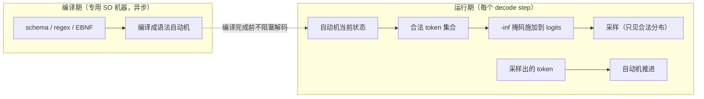

# 10 结构化输出：编译期自动机 + 运行时掩码

Agent 调用工具、数据抽取、代码生成要求模型输出**严格匹配**一个格式（JSON Schema、正则、语法）。但 LLM 本质是「按分布采样下一个 token」——它没有任何内建的机制保证格式正确。本章讲 DeepInfer 的解法：把格式**编译成自动机**，在采样层用掩码强制——让违规在数学上不可能发生，而不是概率上不太可能。

本章的魅力在于它是「编译原理 + 形式语言 + LLM」的三学科交叉： Thompson 构造（1968 年的形式语言成果）在 2020 年代的采样循环里复活。你会看到 Chomsky 层级里最低的一层（正则语言）恰好是工程上最有用的约束层——**理论的「低」和工程的「用」经常不对应**，这本身就是一课。

读完本章，你应该能回答：

- 三种朴素做法（prompt 求它/事后重试/手写规则）各死在哪？
- Thompson 构造怎么把正则变成 NFA？「同时处于多个状态」怎么用状态集合实现？
- 为什么掩码不扭曲分布（支撑集裁剪的数学）？
- token 和字符的粒度错位怎么解（部分消费）？
- 收笔和死局两个边界为什么必须显式处理？

## 1. 先排除三种朴素做法

| 做法 | 问题 |
|---|---|
| prompt 里求它输出 JSON | 概率性违规：一万条请求总有一条踩中，长尾无法消除 |
| 生成完校验 + 重试 | 首 token 延迟翻倍；违规的模式重试往往还是违规（分布没变） |
| 逐 token 写 if-else 硬规则 | 表达力弱——递归 schema、嵌套结构写不动 |

三种做法的死因值得逐一细看——每种都对应一类「看似合理实则漏风」的工程直觉：

**prompt 工程死在「概率的长尾」**。「99% 正确」在生产规模下是灾难：日流量 1000 万条请求，1% 违规 = 每天 10 万条解析失败——**每条失败都要 fallback 逻辑、告警噪声、用户工单**。「概率上不太可能」和「不可能」之间隔着一条运维成本的鸿沟。而且违规率不是常数：分布漂移（新流量模式）、对抗输入（精心构造的 prompt 挤出格式）、超长输出（格式意识随长度衰减）都会让尾部变肥——**你无法给概率性保证写 SLO**。

**重试死在「分布没变」**。违规后原样重试，模型的分布和上次一模一样——重试大概率还是违规（自相关）。真正有效的重试要改条件（把上次的错误反馈进 prompt），那就是 n 倍的延迟成本（n 次完整生成）和递增的 token 费用。更糟的是**重试本身可能陷入循环**（反馈错误 → 生成类似的错 → 再反馈）——工业实践里重试上限 2~3 次后只能降级人工，长尾依旧。

**手写规则死在「表达力天花板」**。`if 下一 token 该是 '{' then ...` 的写法，到嵌套结构就爆炸：JSON 的 `{"a": {"b": [...]}}` 要求规则理解「括号栈」——手写状态跟踪的代码量随语法复杂度指数涨，且每加一种 schema 都要重写。**表达力问题的正解是形式化**（把语法交给编译器技术处理），不是更多的人力。

正确做法的形态：**把格式约束变成一个自动机，采样时强制走合法路径**。需要先补一块基础。

## 2. 补基础：正则如何变成自动机

以本仓示例的模式 `( ran| flew)( in| over) the` 为例（匹配「 ran in the」这类短语）。它是一个**正则表达式**。计算机科学的经典结论：**任何正则表达式都能机械地转换成一个有限状态机**——Thompson 构造（Ken Thompson，Unix 的作者之一，1968 年）。

### 2.1 状态机的直觉

状态机的直觉：一台只有「当前状态」这个小内存的机器。它读入一个字符，按转移表跳到下一个状态；读完全部输入时停在**接受状态**，就算「匹配成功」。

`( ran| flew)` 的状态机有两个分支：读到空格后，下一个字符是 `r` 走一支、是 `f` 走另一支。

### 2.2 Thompson 构造：递归的三条规则

「机械地转换」怎么做——Thompson 构造的完整规则其实是三条递归（值得看全，它比想象中简单）：

```text
规则一（单字符 c）：  开始 --c--> 接受        一个字符 = 两个状态一条边

规则二（连接 AB）：   A 的接受 --ε--> B 的开始   先走 A 再走 B
                      （ε = 不读字符的"免费"跳转）

规则三（或 A|B）：    新开始 --ε--> A 的开始
                      新开始 --ε--> B 的开始
                      A 的接受 --ε--> 新接受
                      B 的接受 --ε--> 新接受    两条路都到终点
```

任何正则表达式都能拆成这三种结构的组合（字符、连接、或——加上 `*` 的第四条规则处理重复），递归下去就是一台自动机。`( ran| flew)` 的构造：空格是规则一、「 ran」和「 flew」各是「字符序列的连接」、「或」是规则三——**正则的语法树自顶向下，每个节点产一小段子图，拼起来**。

### 2.3 NFA：同时处于多个状态

正则里有「或」时，状态机会**同时处于多个可能状态**（NFA，非确定有限自动机）：读到 `▁r` 之后，它「可能」在 `ran` 分支的中途，也可能已经死在 `flew` 分支。实现上我们不真的「同时」，而是维护一个**状态集合**——`{ran分支中途, 死亡}`，每读一个字符，把集合里每个状态都推进一格，去掉走不通的。集合里只要还有活状态，输入就仍有可能匹配；走到接受状态，就匹配成功。

用我们的模式走一个具体例子（状态集合的演化，强烈建议跟着画）：

```text
模式：( ran| flew)( in| over) the

读入 "▁ran▁in▁the"（token 流，字符序列 " ran in the"）：

读 " "  → 状态集 {在两个分支的入口前}     —— 空格喂给两条分支都合法
读 "r"  → 状态集 {ran 分支第 1 格}        —— flew 分支死了，剔除
读 "a"  → 状态集 {ran 分支第 2 格}
读 "n"  → 状态集 {第一个分组完成!}        —— 到达组间边界
读 " "  → 状态集 {第二组两个分支入口前}
读 "i"  → 状态集 {in 分支中}              —— over 分支死
读 "n"  → 状态集 {第二组完成}
读 " "  → 状态集 {the 入口前}
读 "t" "h" "e" → 状态集 {接受状态!}       —— 匹配成功
```

每一步的核心操作就一个：**「状态集合 × 输入字符 → 新状态集合」的批量推进**——集合空了 = 死局，含接受态 = 匹配。没有回溯（对比带回溯的正则引擎：NFA 集合模拟天然并行，**牺牲一点状态冗余换来无回溯**——这是它能嵌进毫秒级采样循环的关键性质）。

这套东西和 LLM 推理的连接点：**模型每采一个 token，就把它的字符喂给状态机推进；采样前，先问状态机「从当前状态出发，哪些 token 还能走通」——走不通的，掩掉。**

### 2.4 Chomsky 层级的工程裁剪

一个自然的问题：为什么停在正则（Chomsky 层级的最低层）？JSON 不是有嵌套吗——嵌套算上下文无关语言（第二层）？

工程上的诚实回答：**严格的嵌套语法需要栈（CFG/PDA），但 JSON 的嵌套深度可以设上限**——「深度 ≤ N 的 JSON」是正则可表达的（N 层的括号配对可以展开成有限状态）。生产的语法约束引擎（xgrammar 等）的处理方式：把 CFG **展开/近似成超大 NFA**，超深嵌套（实际不会出现）被截断——**用「深度上限」把第二层语言压回第一层**，换来状态机的全部工程优点（无回溯、O(1) 推进、掩码快）。

这个裁剪的通用教训：**形式语言理论和工程约束系统的差距，常用「实际不会出现的信息论上限」来填平**。词表大小、嵌套深度、字符串长度——都裁到「生产可达的范围」，让数学上更弱的模型覆盖工程上足够的空间。

### 2.5 从 JSON Schema 到语法：生产的主路径

到目前为止例子都是正则——但生产的结构化输出请求里，**JSON Schema 占九成以上**（agent 的工具调用参数、数据抽取的字段模板）。这一节补上「schema → 自动机」的完整转换链，它是本章通往生产现场的最后一公里。

#### 一个最小的 JSON Schema

从一个具体 schema 开始（agent 调用「查天气」工具的参数约束）：

```json
{
  "type": "object",
  "properties": {
    "city":  {"type": "string"},
    "days":  {"type": "integer", "minimum": 1, "maximum": 7}
  },
  "required": ["city"],
  "additionalProperties": false
}
```

合法输出的样子：`{"city": "北京", "days": 3}` 或 `{"city": "上海"}`（days 可省）。

#### 转换链：schema → 语法 → 有限状态近似

生产实现（xgrammar / DeepInfer SO，思路同源）的转换是一条流水线：

```text
第 1 步：JSON Schema → 上下文无关语法（CFG）
  schema 的每个关键字对应一条语法产生式：

  根对象 → "{" 城市字段 天数字段可选 "}"
  城市字段 → '"city"' ":" 字符串
  天数字段 → ',' '"days"' ":" 整数1到7
  字符串 → '"' 字符* '"'
  整数1到7 → '1' | '2' | ... | '7'

第 2 步：CFG → 有限状态近似（处理嵌套）
  JSON 有递归嵌套（对象套数组套对象）——严格说它是 CFG 不是正则。
  但 schema 里 declared 的嵌套结构是有限的（properties 树有界），
  「无限嵌套」只出现在 additionalProperties 或递归 $ref 的场景。
  把递归深度截断到 D 层（生产常取 8~16），CFG 展开成有限的
  状态机——超大但有限。

  本例的 schema 是平的（无嵌套），直接就是正则级：
  \{"city": " [^"]* "(, "days": [1-7])?\}

第 3 步：正则 → NFA（第 2 节的 Thompson 构造）
  ——你已经会的部分
```

第 1 步的「关键字 → 产生式」对照表值得看全（每个 schema 关键字都有一条机械规则）：

| Schema 关键字 | 语法产生式 |
|---|---|
| `type: object` + properties | `{` 字段序列 `}`，字段顺序按 schema 声明 |
| `required` / 非必需 | 必需字段必出现；非必需字段带可选逗号结构 |
| `additionalProperties: false` | 声明之外的字段名**不合法**——掩码直接拒绝 |
| `type: string` | `"` 字符* `"`（maxLength/pattern 再收紧） |
| `type: integer` + min/max | 数字字面量的**枚举**——`[1-7]` 变成字符类 |
| `enum: [...]` | 值的精确枚举（含转义处理） |
| `anyOf / oneOf` | 产生式的「或」——多个自动机的并联 |
| 嵌套 object / array | 递归产生式 → 深度截断后展开 |

两个值得停留的细节：

**数字范围的语法化没有看起来简单**。`minimum: 1, maximum: 7` 变成 `[1-7]` 很直白，但 `maximum: 500` 呢？`15` 合法（≤500）、`600` 不合法（>500）、`51` 合法——**数字范围不是字符类**，正确展开是 `[1-4][0-9][0-9]|[1-9][0-9]|[1-9]|500` 这样的「位数分解」——范围越大枚举越长。生产的处理：把数值范围编译成「按位的自动机」（每一位状态记住前缀的上下界），或者干脆超宽范围时只约束类型不约束范围（`[0-9]+`）让下游校验兜底。**「约束的严格度」和「自动机的复杂度」是可调滑杆**——太严编译爆炸，太松违规漏过，生产的常见取舍是「语法管类型和枚举、语义范围交给下游」。

**字段顺序的严格与宽松**。JSON 语义上字段无序（`{"days":3,"city":"x"}` 等价于反过来），但语法上 schema 声明的顺序固定——严格按声明序约束会把语义等价但顺序不同的输出判为违规。两派做法：**严格派**（xgrammar 默认）只接受声明序——反正模型没有理由乱序，换来自动机小一个数量级；**宽松派**做全排列（k 个字段 k! 条分支）——5 个字段 120 条分支，编译时间爆炸。实践中严格派赢了：约束的目的是「可解析」，下游解析器对字段顺序本来就不敏感——**约束「过严但无害」优于「宽松但昂贵」**，这是约束设计的通用判断。

#### 掩码在 schema 场景的实况

编译出的自动机在运行期怎么工作——用「查天气」的生成走一遍（每步的合法 token 集）：

```text
生成位置            状态要点                    合法 token（示意）
第 1 步            初始                        '{'（唯一合法）
第 2 步            进对象，等字段名            '"'
第 3~5 步          字段名字符                  '"city"' 的各种前缀 token
                   （BPE 的各种切法           ——掩码保证只能拼出 "city"
                    都在合法集里）
第 6 步            字段名完，等冒号            ':'
第 7 步            等值——city 是 string        '"'
第 8~N 步          字符串内容                  几乎全部字符串 token（自由段）
第 N+1 步          字符串结尾                  '"'（或继续内容）
第 N+2 步          等可选的 days 字段          ',' 或 '}'（days 可省——两个分支都活着！）
...
最后一步           对象闭合                    '}'（唯一合法——收笔判定）
```

两个观察：**结构段的合法集极小**（语法在「掐着模型的脖子」）、**内容段的合法集极宽**（自由字符串几乎全词表）——掩码的工作量集中在结构转换的边界上，这正是 3.1 节「trie 枚举」快的原因（合法集小时枚举天然便宜）。**结构化输出对生成的影响是「脉冲式」的**：结构点强制、内容点自由——模型的表达力保留在自由段，正确性锁死在结构段。

第 N+2 步还藏着一个 NFA 细节：`','` 和 `'}'` **同时合法**（days 可选的「或」结构）——状态集合里有两条活路，掩码放行两个 token，采样自由选。选了 `','` 走 days 分支、选了 `'}'` 跳过 days——**「可选字段」的语义由 NFA 的分支天然表达**，不需要任何专门的 if-else。这就是把约束「编译成数据」的红利：schema 的每个语义（可选/枚举/嵌套）都变成自动机的结构，运行期只有一套统一的推进逻辑。

#### schema 缓存的键：语义哈希

3 节说过编译产物按 schema 哈希缓存——哈希的键有个工程细节：**语义相同的两个 schema 可能文本不同**（字段顺序、默认值、缩进差异）——直接哈希原文会让缓存错过本该命中的复用。生产做法：schema 先规范化（排序 properties、展开 $ref、去除注释性字段）再哈希——**缓存的键对「语义」不对「文本」**。agent 平台上一千个工具的 schema 各被引用千万次、且平台升级时批量改写格式——规范化哈希的命中率差距能到 20%+，直接反映在编译池的负载上（第 02 章 Zipf 头部的又一现场：头部 schema 贡献几乎全部编译复用）。

## 3. 编译-运行两段式



为什么拆成两段、编译放哪，各有明确动机（QA 文档披露编译异步跑在专用机器上）：

**编译是重活。** 复杂 JSON Schema 编译成自动机可能要几百毫秒——同步做会直接打爆 TTFT（第 02 章的「SO 编译是 TTFT 杀手」）。异步编译期间，解码照常开始（先产出无约束的前缀），编译完成后掩码才生效。

「先无约束跑着」的窗口期值得多想一步：**前几个 token 无约束，会不会产出非法内容**？看典型输出的前缀：JSON 请求的前几个 token 通常是 `{\n` 或空白——这些 token 在几乎任何 schema 下都合法（所有 JSON 都以 `{` 开头），所以「无约束窗口期的产出」大概率天然合法，编译完成后掩码接管，剩下的路径被强制。**窗口期的风险 ≈ 首字符就分叉的 schema 的比例**——工程上很小，且可以用「schema 已缓存」（第 3 节的第三点）把窗口缩到零。这是一个「乐观启动 + 惰性接管」的流水线设计——**用「大概率没事」的乐观换 TTFT 的确定收益**。

**编译是纯 CPU 逻辑。** 放独立的机器池，与 GPU 推理集群物理解耦——推理节点的毫秒预算里塞不下这种突发 CPU 任务。

**编译产物可缓存。** 生产上 schema 的重复率极高（一万个 agent 用同一套工具 schema），编译一次到处复用。缓存键是 schema 的规范哈希，命中率受益于第 02 章的 Zipf 经济学——**头部 schema（热门工具的参数格式）贡献几乎全部流量**。

### 3.1 运行期的每步开销账

掩码不是免费的——每个 decode step 都要做「状态机推进 + 合法集计算 + 掩码施加」，这笔账值得算：

```text
每步的 SO 开销（状态集合大小 s、词表 V≈13 万）：
  状态推进：s 个状态 × token 的字符数（1~5）次转移查表 —— 微秒级
  合法集：naive 做法是 V 个 token 逐个试 —— 130 万次可行性判定，
          太慢（毫秒级，不能接受）
  → 生产做法：预先建「token → 字符串」的 trie（前缀树），
     状态集合沿 trie 走一遍就能标出全部可行 token —— 亚毫秒
  掩码施加：V 维布尔 → logits 加 -inf —— 一个 kernel，微秒

合计：每 step 增加 0.1~0.5 ms（占 15 ms step 的 1~3%）
```

「trie 走一遍标合法」是掩码性能的灵魂——**不是问 13 万个 token「你可不可以」，而是沿数据结构走一次把合法的都找出来**。前者是 O(V × 检查)，后者是 O(可行 token 数 + trie 深度)。**把「逐个排除」变成「一次枚举」**——这个思路在调度（decode 优先先算增量）和 EPLB（按热度分组再分配）里反复出现，是性能工程的通用语法。

## 4. 掩码：约束生效但不扭曲分布

运行期的核心动作，在**采样之前**对 logits 施加掩码：

```python
# miniflow/engine.py 的 _so_mask
masked[:_N_SPECIAL] = -np.inf        # 特殊 token 一律屏蔽（防注入联动，见第 11 章）
masked = automaton.mask(masked, vocab)   # 非法 token 置 -inf
# 之后 softmax 在掩码后的 logits 上归一化
```

关键性质为什么成立：掩码只把非法 token 的 logit 设为 $-\infty$，**合法 token 之间的相对大小一个字节都没动**。softmax 归一化后，合法 token 的概率比值与无约束时完全相同——模型对「合法空间内怎么选」的偏好被完整保留，被约束的只有「能不能选」。数学上：这叫裁剪分布的**支撑集**（support），不改变条件分布的形状。

用两点分布写出来（数学课的一分钟）：

$$
p = [0.6, 0.3, 0.1] \xrightarrow{\text{掩码 } x_2} \tilde{p} = [0.6, 0, 0.1] \xrightarrow{\text{renorm}} [0.857, 0, 0.143]
$$

$x_1$ 和 $x_3$ 的比值 6:1 原样保留（0.857:0.143 = 6:1 ✓）——**裁剪后重归一化是「等比例缩放」**，合法集内的偏好序、相对权重、温度行为全部不变。这就是「约束管能力、不管意愿」的精确数学表述。

对比 prompt 工程：往 prompt 里写「必须输出 JSON」改变的是分布本身（软性引导，可以违反）；掩码是硬边界（违反不可能）。两者一个管「意愿」，一个管「能力」，生产上都需要但不可互替——**prompt 让模型「想」输出好的 JSON（内容质量），掩码保证「是」JSON（形式正确）**。

### 4.1 掩码与温度的交互

「支撑集裁剪不变条件分布」有个隐含前提值得点破：**温度在掩码之后施加**（或等价地，温度作用在合法 logits 上）——顺序错了会出现「约束扭曲温度」的怪象：

```text
错误顺序（先温度后掩码）：T=2 摊平的分布 → 掩码 → 合法部分的"摊平"被保留
                          但 T=0.1 尖锐的分布 → 掩码 → 峰值若被掩掉，
                          次高分的合法 token 被顶上（相对分布全变）
正确顺序（先掩码后温度）：掩码先定支撑集 → 温度在合法 logits 上锐化/平滑
                          —— 模型"在合法空间里"的意愿强度被温度正确调制
```

第 09 章的工序序（确定变换在前、随机在后）在这里的具体化：**掩码是最前的一道确定变换**（它定义「游戏规则」），温度等调制在其后（「在规则内多敢冒险」）。miniflow 的 `_so_mask` 在采样管线最前、`constraint.mask` 在 temperature 之前——协议顺序和第 09 章 6 节的表格一致。

## 5. 粒度错位：token ≠ 字符

一个初想不到的坑：**schema 是字符级的，采样却是 token 级的**。

miniflow 的 BPE 词表里（GPT-2 同款），空格是独立 token `'▁'`，`ran` 是另一个 token——模式里的「 ran」需要**两个 token**（`▁` + `ran`）才能拼出来。更麻烦的形态：某些词表里有 `▁r` 这种**半个词**的 token——如果模式此刻走到「 ran」的开头，`▁r` 应该算合法（它是「 ran」的前缀，走完它语法还在半路上）。

所以掩码的判定不能问「这个 token 是否等于下一个该出现的字符」，而要问：**「这个 token 的字符串，从当前状态集出发能不能走通而不死」**——允许停在中间态。解法（生产 xgrammar / outlines 同源）：token 喂给字符级自动机，允许部分消费：

```python
# miniflow/structured_output.py
def token_feasible(self, token_str: str) -> bool:
    return bool(self._step_chars(set(self.states), token_str))
    # _step_chars 逐字符推进 NFA 状态集；推进途中状态集变空 = 必死，返回 False
```

「部分消费」的语义值得用例子钉死：

```text
当前状态集：走到「▁ran」的「▁」已消费、期待 'r'
候选 token 三个：
  '▁ran'（整词）→ 喂进自动机 "ran"：r✓ a✓ n✓ → 走到组间状态 —— 可行
  '▁r'（半词）  → 喂 "r"：r✓ → 停在 ran 分支中途（未到接受，但活着）—— 可行！
  '▁f'（半词）  → 喂 "f"：r 分支死、f... 当前期待 r，f 走不通 —— 不可行
  'the'（整词） → 喂 "the"：t 不是 r —— 不可行
```

「可行 = 走完 token 的字符后状态集非空」——**不管停在不在中间态**。下一步采样出 `▁r`，状态集合推进到「ran 分支中途」；再下一步的合法集从那里继续算（`an`、`and`… 各种续）。**约束跟随实际采样路径逐 token 重算**——这就是「运行期」三个字的含义（不是一次性算死整条路径）。

miniflow 的教学词表恰好是**最难**的形态（空格独立成 token），逼着实现走通「跨 token 的字符级约束」，而不是单 token 字符串匹配的取巧版本。

!!! danger "miniflow 踩坑实录：初始状态硬编码"

    Thompson 构造的状态编号**从 1 开始**（`new_state()` 先自增再返回），
    而 `_reset()` 曾硬编码初始状态集合为 `{0}`——状态 0 根本不存在于
    转移表，初始状态集永远空转，**任何 pattern 第一步就报语法死局**。
    修复：初始状态显式传入（`start_state=node.start`）。
    教训：隐式的编号起点约定是状态机的经典陷阱——显式传递比
    隐式假设可靠一个数量级。详见 [lab/06](../lab/06-structured.md)。

## 6. 两个边界：收笔与死局

约束生成有两个必须显式处理的边界，生产如此，miniflow 一比一实现：

**正常收笔。** 模式完整匹配后（状态集到达接受状态），「还有没有合法后继 token」的答案是「没有」——比如 ` the` 之后模式走完了，任何 token 都走不通。这时**不能**把全 `-inf` 的 logits 喂给采样器（全零分布的 argmax 是未定义行为），而要让引擎以 `FINISHED_STOPPED` 结束请求——「语法走完了」本身就是一种合法的完成：

```python
# miniflow/engine.py 的收笔判定
if automaton.in_accept() and not automaton.has_feasible_token(...):
    seq.finish(SequenceStatus.FINISHED_STOPPED)   # 语法完整，正常收笔
```

**死局 abort。** 词表与语法可能**根本没有交集**——比如模式要求输出字符 `z`，而词表的字符集里没有 `z`。这时逐 token 掩码会一路全 `-inf`，怎么采都违规。miniflow 让 `_so_mask` 抛出 `ValueError`，引擎捕获后以 `FINISHED_ABORTED` 明确失败——可观测、可归因，优于静默产出垃圾 token。

两个边界对照着读：**收笔是「语法走完了」（正常生命的终点），死局是「语法没法走」（怀孕就死了）**——前者要在引擎层转成正常完成事件（用户拿到合法的短输出），后者要转成明确失败（用户知道是约束配置错，不是模型抽风）。**边界情形的语义清晰度是 API 质量的试纸**——「全 -inf 时 argmax 返回 0」这种未定义行为溜进生产，就是「偶尔吐出 index 0 的 token」这种查不出来的灵异 bug。

## 7. 与防注入的联动

注意 `_so_mask` 的第一行：**先屏蔽全部特殊 token，再施加语法掩码**。这和 [第 11 章](11-recipe.md) 的 deepseek-recipe 防注入形成双保险：约束生成期间，用户伪造的控制标记（即使逃过了分词层的消毒）也拿不到任何采样概率。逻辑闭环：**约束越强的地方，注入的攻击面越小**——结构化输出本身是安全边界的一部分。

## 8. 业界对比：三家的路线差

结构化输出是近年热门方向，三个代表实现值得对比（帮你定位 DeepInfer 的路线）：

| | **outlines**（2023） | **xgrammar**（2024） | **DeepInfer SO**（据公开信息） |
|---|---|---|---|
| 核心思路 | 正则/CFG → 索引化的 logits 处理 | CFG → 下推自动机近似 + trie 加速掩码 | 编译外置专用机 + 运行期掩码 |
| 编译位置 | 引擎进程内 | 引擎进程内（缓存） | **独立机器池（异步）** |
| 掩码粒度 | token 级（预计算索引） | token×上下文（自适应 trie） | 同源思路 |
| 特色 | 开创性、生态广 | 性能强（成为 vLLM/SGLang 默认） | **编译的物理隔离**（TTFT 不受编译拖累） |

三家的共同底座是本章 2~5 节的内容（自动机 + 掩码 + 粒度处理）——**差别在工程包装**：编译放哪、掩码多快、缓存怎么做。DeepInfer 的差异点「编译独立成机器池」服务于它的 TTFT SLO（大集群的专用组件化路线，第 03 章的 E/P/D 思想在第 10 章的复现——**「重 CPU 活从 GPU 集群剥出去」**的第三次出现：E 节点、编译池、还有谁？想——第 11 章的 tokenizer）。

## 9.5 接口层：SO 能力怎么暴露成 API

引擎内部讲完了，还差一层：**用户怎么触发结构化输出**——接口的语义设计决定了引擎能力能不能被正确使用。业界的 API 形态收敛出一个谱系：

**形态一：自由格式开关。** `response_format: {"type": "json_object"}`——只保证「输出是合法 JSON」，不约束具体结构（字段、类型都不管）。实现最轻（语法只要 JSON 的通用地基：`{`、`"`、配对、转义……一个中等规模的通用自动机，**全局缓存一次**），但对调用方的价值也最薄（解析不炸而已，字段对不对还是靠模型自觉）。**「合法 JSON」和「符合我的 schema」是两个承诺等级**——前者是语法、后者是语义，接口的设计要先想清楚承诺到哪级。

**形态二：带 schema 的严格模式。** `response_format: {"type": "json_schema", "schema": {...}, "strict: true}}`——引擎编译你的 schema、掩码保证逐字段匹配。这是本章全部机制的接口化：**strict 模式的承诺是「违规在数学上不可能」**（掩码是硬边界），用户可以删掉下游的重试和 fallback 逻辑。代价：schema 必须先过「可编译检查」（2.5 节的深度、$ref 展开、字段数限制——接口层要返回明确的「schema 不受支持」错误而不是静默降级）。

**形态三：混合（结构 + 自由段）。** 输出的**一部分**受约束、其余自由——比如「`{"analysis": <自由文本>, "result": <受 schema 约束>}`」：analysis 字段是模型的自由发挥区（长文本推理），result 是严格区。实现上是 schema 里的 `type: string` 不再限制字符集（自由段自动机 = 全词表 - 结构字符）。**生产上这是最高频的形态**——纯 schema 输出把模型框得太死（没有「思考空间」），纯 JSON 开关又太松。**约束的粒度要能下放到字段级**，schema 的 `type: string` 天然提供了这个「自由洞」。

三个形态对应三层承诺（语法合法 / 语义匹配 / 部分语义匹配），**接口的每一级「方便」都是引擎复杂度换的**：形态一全局一份自动机（零边际成本）、形态二每 schema 一份（缓存 + 编译池的全部基建）、形态三在二之上加自由段语义（自动机的混合粒度）。

还有两个接口细节值得留意（它们是「承诺语义」的边界条款）：

**「strict 模式下 token 预算的交互」**：受约束的输出**可能更快撞到 max_tokens**——结构 token（`{`、`"`、`:`、字段名）不产出语义但消耗额度，一个 20 字段的 schema 光结构就吃掉上百 token。接口的诚实做法是在文档里标注「strict 模式建议上调 max_tokens」，或者引擎在结构开销大时自动放宽——**约束的代价（token 预算）要在接口层可见**。

**「strict 模式与采样参数的交互」**：temperature 在掩码后的合法集上起作用（4.1 节）——结构段合法集极小时温度几乎无感（2 个候选谈不上分布形状），内容段照常。**「structured output 会钝化你的 temperature」**是用户最常惊讶的行为——接口文档该写明，或者干脆在结构段自动提温（补偿约束的保守化倾向——有引擎这么做了，效果是内容段的多样性部分恢复）。

## 11. 常见误解澄清

**误解一：「结构化输出限制了模型的创造力。」** 只裁剪支撑集、不变条件分布（4 节的数学）——**合法空间内模型仍是自由采样**。实际效果经常相反：约束消除了「格式焦虑」（模型不用分心维持格式，注意力集中在内容），JSON 内的字段质量经常**好于**无约束版本。「戴着镣铐反而跳得更好」是有实证支持的观察。

**误解二：「掩码每步都算 13 万 token 的可行性，太贵。」** 3.1 节算了：trie 沿状态集合走一次是亚毫秒——**「逐个排除」和「一次枚举」的复杂度差**是常见的性能错觉。任何时候你觉得某个操作「按元素数算太贵」，先问有没有「按结构走一次」的算法。

**误解三：「正则不够表达 JSON（嵌套），所以这套方法不适用。」** 2.4 节：深度上限内的 JSON 是正则可表达的——「理论上的语言层级」和「工程上需要的约束」差一个「实际可达范围」。**拒绝一个方法的正确理由是「工程上用不到那个表达力」，不是「理论上不够强」**。

**误解四：「先无约束跑着再接管，会产生非法输出。」** 窗口期通常只有几个 token，且 JSON 类输出的首 token（`{`）天然合法——**乐观启动的风险是「首字符分叉的 schema 占比」，工程上极小**。且 schema 缓存命中时窗口为零。这是个「风险极小的乐观换确定的 TTFT 收益」——和第 07 章「防御性跳过」同族：**小概率的浪费换大概率加速**。

**误解五：「死局是 bug，不该发生。」** 死局是**词表和语法不交**的数学事实（模式要求 `z` 而词表没有 `z`）——它不是实现缺陷，是输入配置错误。工程的责任是**可观测地失败**（FINISHED_ABORTED + 明确原因），不是假装它不存在。**「不可能满足的约束」和「还没满足的约束」是两种状态，API 必须区分**。

## 12. 小结

- **朴素三做法各死一处**：prompt 死在概率长尾（无法写 SLO）、重试死在分布自相关（重试还是错）、手写规则死在表达力（嵌套爆炸）——正解是形式化：语法交给编译技术。
- **Thompson 构造**：正则 → NFA 的三条递归规则（字符/连接/或）；NFA 用**状态集合模拟**（无回溯——嵌进毫秒级循环的关键性质）。Chomsky 层级的工程裁剪：深度上限把 CFG 压回正则可表达。
- **JSON Schema 的转换链**（生产主路径）：schema → CFG（关键字→产生式的机械规则）→ 深度截断的有限状态近似 → NFA。数字范围要位数分解（不是字符类）；字段顺序选严格派（过严但无害优于宽松但昂贵）；**掩码的影响是脉冲式**——结构段合法集极小、内容段极宽，「可选字段」由 NFA 分支天然表达。缓存键用**语义哈希**（规范化后再哈希）。
- **编译-运行两段式**：编译（重活，几百 ms）异步跑专用机池、产物按 schema 语义哈希缓存；运行期每步 0.1~0.5 ms（trie 枚举而非逐个排除）。**乐观启动 + 惰性接管**保 TTFT。
- **掩码的数学**：裁剪支撑集不变条件分布——合法集内偏好、温度行为全部保留。「管能力不管意愿」；掩码在温度**之前**（工序序：规则先于调制）。
- **粒度错位**：token 字符串喂字符级 NFA、允许部分消费（`▁r` 是「▁ran」的合法半步）——判定「走完不死」而非「等于下一个字符」。
- **两个边界**：收笔（语法走完 → FINISHED_STOPPED，正常的短输出）vs 死局（词表语法无交集 → FINISHED_ABORTED，可观测的配置错误）——**边界语义的清晰度是 API 质量的试纸**。
- **防注入联动**：特殊 token 先屏蔽再语法掩码——约束越强攻击面越小，结构化输出是安全边界的一部分。
- 三家路线（outlines/xgrammar/DeepInfer）共同底座 + 不同的工程包装——DeepInfer 的编译外置是「重 CPU 活剥出 GPU 集群」思想的第三次出现。

## 13. 本章术语速查表

| 术语 | 一句话解释 |
|---|---|
| 结构化输出 / SO | 输出严格匹配 schema/正则/语法的约束生成 |
| Thompson 构造 | 正则 → NFA 的机械转换（1968，三条递归规则） |
| NFA / 状态集合 | 非确定自动机 /「同时多状态」的集合实现（无回溯） |
| ε-转移 | 不读字符的免费跳转（连接/或结构的粘合剂） |
| 接受状态 | 输入读完停在这里 = 匹配成功 |
| 支撑集裁剪 | 掩码只删非法 token、合法集内分布形状不变 |
| token 粒度错位 | schema 字符级 vs 采样 token 级的核心坑 |
| 部分消费 | token 字符串推进 NFA 允许停在中间态 |
| trie 枚举 | 沿前缀树走一次标出全部合法 token（性能灵魂） |
| 乐观启动 | 编译未完先无约束解码（首 token 天然合法的赌注） |
| 收笔 / FINISHED_STOPPED | 语法走完的正常完成（无合法后继） |
| 死局 / FINISHED_ABORTED | 词表与语法无交集的明确失败 |
| 深度上限裁剪 | 嵌套深度 ≤ N 把 CFG 压回正则可表达 |
| schema 指纹 / 语义哈希 | 编译缓存键：schema 规范化后再哈希（对语义不对文本） |
| 位数分解 | 数值范围 → 按位枚举的语法（范围约束的编译代价来源） |
| 严格序 / 全排列 | schema 字段按声明序 / k! 分支的宽松派——实践中严格派胜出 |
| 脉冲式掩码 | 结构段合法集极小、内容段极宽的掩码形态 |
| schema 哈希缓存 | 编译产物按 schema 规范哈希复用 |

## 思考题

1. 手工做一遍 Thompson 构造：模式 `(a|b)c*`。画出完整 NFA（标出 ε-转移），写出读入 `bcc` 的状态集合演化序列。它接受 `bc` 吗？`cb` 呢？（答案：接受前者、拒绝后者——用状态集合的死亡说明后者。）
2. 3.1 节说「trie 走一次」是掩码性能的灵魂。估算它的复杂度：trie 节点数 ≈ 词表全部 token 的共享前缀树规模（GPT-2 词表 5 万 token、平均长 4 字符，trie 约 10 万节点）；状态集合 s=5、沿每个 trie 节点做一次状态推进——总操作数多少？对比「逐个排除」的 13 万 token × 平均 3 字符 × 5 状态——快几倍？
3. 4.1 节的温度交互：写出一个具体反例——先温度后掩码导致「约束扭曲温度」的数值场景（提示：p=[0.5, 0.49, 0.01]，T=0.1 尖锐化后峰在 x₀；掩码掉 x₀，次峰 x₁ 顶上——合法分布的形状和无约束时（x₁ vs x₂ 的比值）还成比例吗？）。这个反例说明掩码必须「最早」的工序序约束。
4. 死局的工程处理设计：FINISHED_ABORTED 的响应体应该带什么信息（错误码、无交集的具体证据——哪个字符/哪个 token 范围）？客户端拿到后最常见的修复动作是什么（改 schema、换词表、还是改请求参数）？设计这个错误协议时「可行动性」（actionable）比「完整性」重要——为什么？
5. 乐观启动（3 节）的赌注量化：假设「首 token 就分叉」的 schema 占 5%、窗口平均 3 个 token、分叉的代价是这 3 个 token 的重生成（约 100 ms TTFT 增量）——期望损失多少？对比「同步编译」的确定损失（全部请求 +300 ms TTFT）——乐观启动好多少倍？什么流量画像会翻转这个优劣（提示：首 token 分叉率多高时）？
6. 动手题：跑 `examples/demo_structured.py`，然后改 `examples` 里的模式为 `( sat| ran)( on| under) the`——预测初始合法 token 集（提示：`▁`）、跑出来验证。再改一个「死局」模式（用一个词表里没有的字符，比如模式含全角`（`）——观察 FINISHED_ABORTED 的报错信息长什么样，评价它的可行动性（对照思考题 4 的标准）。
7. Schema 编译题：把 2.5 节「查天气」的 schema 改复杂——给 city 加 `maxLength: 20`、加一个可选的 `unit: {enum: ["C", "F"]}` 字段。写出新语法（产生式形式），手推「city 值填完后的合法 token 集」（应该含 `,`、`}`、和 `"` 相关的 token——三个分支同时活着）。然后估算：新 schema 的 NFA 比 2.5 节的版本多多少状态？编译时间会涨到「值得担心」的量级吗（对照 3 节的几百 ms 基准）？
8. 语义哈希设计题：两个 schema 文本不同但语义相同（字段声明顺序不同），规范化哈希让它们命中同一份编译产物。但反过来——两个**语义不同**的 schema 可能规范化后相同吗（提示：`required` 缺省值在不同 JSON Schema 版本的语义差异——draft-04 的 required 是字段存在性、draft-07 是数组形式；规范化如果抹掉这个差异，约束就错了）。**「规范化」的安全边界：只能抹掉确定无语义的字段**——列出哪些字段能抹（缩进/注释/字段排序）、哪些不能（required 的形式/$ref 的目标）。
9. 用 2.5 节的「脉冲式掩码」观察做实验设计：怎么从日志数据验证「结构段合法集极小、内容段极宽」？给 `demo_structured.py` 加一行统计（每步的合法 token 数），画出「合法集大小 vs 生成位置」的曲线——它应该呈现什么形态（脉冲：结构点深谷、内容段高原）？这条曲线对「3.1 节的 trie 开销」意味着什么（平均开销被内容段摊薄——掩码的贵只在结构点）？

---

## 延伸阅读

- **Thompson 的原始论文**（*Regular Expression Search Algorithm*, 1968）：NFA 模拟的出处——也是 grep 的诞生地（一篇论文一个时代）。
- **outlines 论文**（2023）：LLM 结构化输出的开创工作（2 节的工程先声）。
- **xgrammar 论文/博客**（2024）：自适应 trie 掩码的细节（3.1 节的性能方案）、CFG 近似的深度裁剪。
- **《编译原理》（龙书）第 3 章**：正则→NFA→DFA 的完整理论（2 节的教科书版）——只想补本章所需的话，读 Thompson 构造一小节就够。
- **JSON Schema 规范 + 生产 SO 库的 README**：schema → 语法的映射细节（哪些关键字支持、哪些忽略——工程裁剪的现场）。

建议顺序：本章 2 节配合龙书那一小节 → outlines 论文 → xgrammar 的技术博客 → 其余按兴趣。

## miniflow 对应实验

```bash
python examples/demo_structured.py
#   [自由 greedy]   output = ' sat on the the'   （finished_length_capped）
#   [SO 约束]       output = ' ran in the'        （finished_stopped）
#   输出严格匹配模式 '( ran| flew)( in| over) the': True
#   初始状态下合法 token: ['▁']   <- mask 行为的直接观测

python -m pytest tests/test_structured.py -q
#   模式匹配 / 干净收笔 / 约束改变行为 / 死局 abort
```

这个 demo 的观察价值在于它把本章三个抽象概念变成了可执行对照：

- **「自由 greedy vs SO 约束」两行输出**：同一个模型、同一个上下文，无约束时它想输出 `sat on the the`（过拟合小模型的胡言乱语）——掩码接管后只能输出 ` ran in the`。**分布没变（模型还是那个模型），支撑集变了**——4 节的数学在眼前上演；
- **「初始状态下合法 token: ['▁']」**：掩码行为的直接观测——模式以空格开头，所以第一个 token 只能是空格。想验证 5 节的粒度处理？在 `demo` 里加打印「第二个 token 的合法集」（应该是 `r`/`f` 开头的各种 token——包括 `▁r` 这种半词）；
- **「finished_stopped vs finished_length_capped」**：6 节两个边界的现场——约束版以语法收笔（FINISHED_STOPPED）正常结束，自由版跑满长度上限才停（LENGTH_CAPPED）。**结束原因也是输出的一部分语义**。

---

| 上一章 | 下一章 |
|---|---|
| [09 采样](09-sampling.md) | [11 deepseek-recipe 的工程哲学](11-recipe.md) |