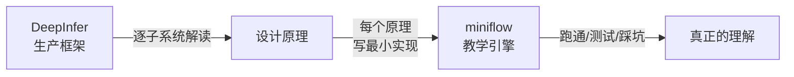

# deepinfer-lab

> **读懂 DeepInfer，最好的方式是把它的每个决策亲手做一遍。**

2026-10-20，DeepSeek 开源了生产级推理框架 **DeepInfer** —— 支撑 R 系列
模型线上服务的同一套引擎。它不是论文里的概念系统，而是「每天扛真实流量」
的工程产物：E/P/D 分离部署、FlashMLA/DeepGEMM/DeepEP 手写算子、
3FS 分布式 KV、DSpark 推测解码……

**本仓库做两件事：**

1. **解读**（[走进 DeepInfer](guide/01-overview.md)）——逐个子系统拆开
   DeepInfer 的设计决策：它面对什么约束、放弃了什么、为什么这样取舍；
2. **复刻**（[动手实验室](lab/01-tensor.md)）——用 Python + NumPy 从零
   写一个 CPU 可跑的教学推理引擎 **miniflow**，把 Paged KV、前缀缓存、
   Continuous Batching、抢占、推测解码、结构化输出、批次不变采样
   全部实现一遍 —— 每个模块标注对应的 DeepInfer 生产组件。



## 快速开始

```bash
pip install -r requirements.txt        # numpy / mkdocs-material / pytest

# 训练一个 15 万参数的 tiny 模型（约 2 分钟，手写反向传播）
python tools/train.py --out checkpoints/tiny --steps 400

# 端到端推理
python -m miniflow.entrypoints.cli \
    --checkpoint checkpoints/tiny.npz \
    --tokenizer checkpoints/tiny.tok.json \
    --prompt "the cat" --max-tokens 32

# 六个教学演示（分页 KV / 前缀缓存 / 调度器 / 推测解码 / 结构化输出）
python examples/demo_paged_kv.py
python examples/demo_prefix_cache.py
python examples/demo_scheduler.py        # cb / preempt / async 三幕
python examples/demo_speculative.py
python examples/demo_structured.py

# 测试（17 个用例：正确性契约全量回归）
python -m pytest tests/ -q
```

## 仓库结构

| 目录 | 内容 |
|---|---|
| `miniflow/` | 教学引擎：模型 / 分页 KV / 前缀缓存 / 调度器 / 采样 / 推测解码 / 结构化输出 / 异步引擎 |
| `tools/` | `train.py`（手写反向传播 + Adam）、`gradcheck.py`（数值梯度校验） |
| `examples/` | 六个子系统的可运行演示 |
| `tests/` | 正确性契约：batch-invariance、spec==greedy、SO 模式匹配…… |
| `csrc/` | 可选 C++ 算子后端（pybind11，对应 DeepInfer 的手写算子库） |
| `docs/` | 本文档站（12 篇解读 + 6 篇实验手册） |

## 阅读路线

- **想懂原理**：[01 总览](guide/01-overview.md) →
  [02 三大设计目标](guide/02-goals.md) →
  [03 总体架构](guide/03-architecture.md) → 按兴趣深入各子系统；
- **想写代码**：直接进 [实验室](lab/01-tensor.md)，每章先讲原理再讲
  miniflow 的实现与踩坑，最后给可运行的验证脚本；
- **只想看结论**：[12 设计哲学总结](guide/12-philosophy.md) ——
  从整个项目提炼出的十条原则。

## 素材来源

DeepInfer 的解读素材主要来自其官方仓库的
[inference_deployment_qa.md](https://raw.githubusercontent.com/deepseek-ai/DeepInfer/main/doc/inference_deployment_qa.md)
（部署问答实录）。miniflow 的实现细节与踩坑记录全部来自真实开发过程
—— 包括调度器的三重死锁、推测解码的 KV 回滚错位、语法自动机的初始
状态 bug（详见各 lab 章节「踩坑实录」）。

!!! note "关于「生产未开源」"
    DeepInfer 开源的是引擎主体；KV cache 管理与负载均衡组件未随仓发布。
    本文对其行为的推断均标注「推测」，与官方陈述严格区分。